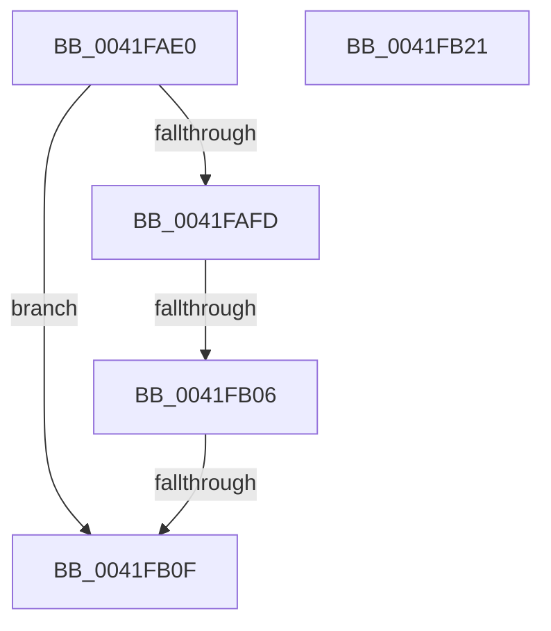

# FsRtlLookupPerFileContext

- RVA: `0x0041FAE0`–`0x0041FB22` (길이 `66` bytes)
- VA: `0x000000014041FAE0`
- 실행 섹션: `.text`
- PDB 이름 있음: `예`; PDB Function 태그: `예`
- unwind 정보 RVA: `0x0009FEF0`
- 디코드: `22`개 명령, `66/66` bytes 표시
- 미해석 바이트: `0` (있으면 어셈블리에 `.byte`로 보존)

> 이 문서는 커널 이미지의 기계어와 PDB 기호를 분석해 생성했습니다. 4번과 5번은 함수 원형과 자료형을 바이너리 사용 방식에서 추정한 C 해석이며 원본 소스 복구 결과는 아닙니다.

## 1. Dependencies

- 직접 호출 지점: **0**; 고유 호출 대상: **0**
- 직접 호출자로 확인된 함수: **1**
- RIP 상대 이미지 참조: **0**

### Outgoing calls
- 직접 디코드된 call 명령이 없습니다.

### Direct callers
- [FsRtlRemovePerFileContextWithReserve](../58/FsRtlRemovePerFileContextWithReserve_function_00581740.md) at `0x00581758`

### Static image references
- 디코드된 RIP-relative 메모리 참조가 없습니다.

## 2. Other-region calls and transfers

- 다른 실행 섹션으로 향하는 call: **0**
- call이 아닌 외부 분기/꼬리 이동: **2**
  - `0x0041FB04` → [sub_0041FB6D](Unknown_function_0041FB6D.md) (`tail-transfer`)
  - `0x0041FB0D` → [sub_0041FB22](Unknown_function_0041FB22.md) (`tail-transfer`)

## 3. Assembly (complete function range)

```asm
0041FAE0  48 89 5C 24 10                  mov qword ptr [rsp + 0x10], rbx
0041FAE5  48 89 74 24 18                  mov qword ptr [rsp + 0x18], rsi
0041FAEA  57                              push rdi
0041FAEB  48 83 EC 20                     sub rsp, 0x20
0041FAEF  48 8B 09                        mov rcx, qword ptr [rcx]
0041FAF2  49 8B D8                        mov rbx, r8
0041FAF5  48 8B FA                        mov rdi, rdx
0041FAF8  48 85 C9                        test rcx, rcx
0041FAFB  74 12                           je 0x14041fb0f
0041FAFD  48 8B 41 20                     mov rax, qword ptr [rcx + 0x20]
0041FB01  48 85 C0                        test rax, rax
0041FB04  75 67                           jne 0x14041fb6d
0041FB06  48 8D 71 10                     lea rsi, [rcx + 0x10]
0041FB0A  48 39 36                        cmp qword ptr [rsi], rsi
0041FB0D  75 13                           jne 0x14041fb22
0041FB0F  33 C0                           xor eax, eax
0041FB11  48 8B 5C 24 38                  mov rbx, qword ptr [rsp + 0x38]
0041FB16  48 8B 74 24 40                  mov rsi, qword ptr [rsp + 0x40]
0041FB1B  48 83 C4 20                     add rsp, 0x20
0041FB1F  5F                              pop rdi
0041FB20  C3                              ret
0041FB21  CC                              int3
```

## 4. C-style interpretation (structured pseudocode)

```c
__int64 __fastcall FsRtlLookupPerFileContext(__int64 a1, __int64 a2, __int64 a3)
{
    __int64 result;
    __int64 v_rsp;
    unsigned __int64 v_stack_p10;
    unsigned __int64 v_stack_p18;

    v_stack_p10 = v_rbx;
    v_stack_p18 = v_rsi;
    v_rsp = (v_rsp) - (32);
    if (*(unsigned __int64 *)(a1) == 0) goto loc_0041FB0F;
loc_0041FB0F:
    result = 0;
    v_rsp = (v_rsp) + (32);
    return result;
}
```

## 5. (Beta) C Style

```c
int64_t FsRtlLookupPerFileContext(void *Arg1, int64_t Arg2, int64_t Arg3)
{
    uint8_t *arg1 = (uint8_t *)Arg1;

    int64_t result;
    int64_t local_rsp;
    uint64_t v_stack_p10;
    uint64_t v_stack_p18;

    v_stack_p10 = local_rbx;
    v_stack_p18 = local_rsi;
    local_rsp = (local_rsp) - (32);
    if (*(uint64_t *)(arg1) == 0) goto loc_0041FB0F;
loc_0041FB0F:
    result = 0;
    local_rsp = (local_rsp) + (32);
    return result;
}
```

### 관측된 메모리 오프셋

구조체 형식이 확인되지 않은 접근은 인자 기준의 오프셋으로만 기록했습니다.

| 기준 인자 | 오프셋 표현 | 폭 (bit) | 접근 |
|---|---:|---:|---|
| `Arg1` | `+ 0x0` | `64` | `R` |

## 6. Execution-region graph

[열기: 2D/3D 그래프와 함수 탐색 컨트롤 패널](../../../control-panel.html?section=text&rva=0x0041FAE0&view=graph)

- 2D 그래프는 위에서 아래로 흐르고, 3D 그래프는 빈 공간을 드래그해 회전합니다. Shift+드래그는 이동, 휠은 확대·축소, 함수 노드 선택은 대상 보고서 이동입니다.

### Static fallback


