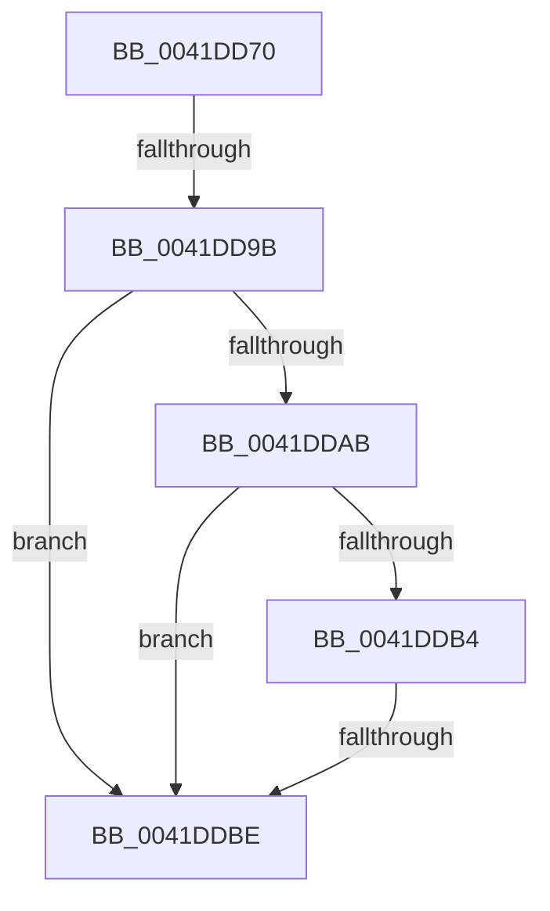

# FsRtlpAttachOplockKey

- RVA: `0x0041DD70`–`0x0041DDC3` (길이 `83` bytes)
- VA: `0x000000014041DD70`
- 실행 섹션: `.text`
- PDB 이름 있음: `예`; PDB Function 태그: `아니요`
- unwind 정보 RVA: `0x0009F988`
- 디코드: `20`개 명령, `83/83` bytes 표시
- 미해석 바이트: `0` (있으면 어셈블리에 `.byte`로 보존)

> 이 문서는 커널 이미지의 기계어와 PDB 기호를 분석해 생성했습니다. 4번과 5번은 함수 원형과 자료형을 바이너리 사용 방식에서 추정한 C 해석이며 원본 소스 복구 결과는 아닙니다.

## 1. Dependencies

- 직접 호출 지점: **0**; 고유 호출 대상: **0**
- 직접 호출자로 확인된 함수: **4**
- RIP 상대 이미지 참조: **1**

### Outgoing calls
- 직접 디코드된 call 명령이 없습니다.

### Direct callers
- [FsRtlCheckOplockEx2](../3F/FsRtlCheckOplockEx2_function_003F2BC0.md) at `0x003F2E71`
- [FsRtlpOplockFsctrlInternal](../../page/9F/FsRtlpOplockFsctrlInternal_function_009F1640.md) at `0x009F1804`
- [FsRtlOplockBreakH2](../../page/A4/FsRtlOplockBreakH2_function_00A44550.md) at `0x00A445AD`
- [sub_00B3115E](../../page/B3/Unknown_function_00B3115E.md) at `0x00B3117E`

### Static image references
- `0x0041DD7A` → RVA `0x00E0A740` (`.data`; read)

## 2. Other-region calls and transfers

- 다른 실행 섹션으로 향하는 call: **0**
- call이 아닌 외부 분기/꼬리 이동: **2**
  - `0x0041DD95` → [sub_0041DE32 + 0x19](Unknown_function_0041DE32.md) (`tail-transfer`)
  - `0x0041DDB8` → [sub_0041DE32 + 0x19](Unknown_function_0041DE32.md) (`tail-transfer`)

## 3. Assembly (complete function range)

```asm
0041DD70  48 89 74 24 18                  mov qword ptr [rsp + 0x18], rsi
0041DD75  57                              push rdi
0041DD76  48 83 EC 40                     sub rsp, 0x40
0041DD7A  48 8B 05 BF C9 9E 00            mov rax, qword ptr [rip + 0x9ec9bf]
0041DD81  48 33 C4                        xor rax, rsp
0041DD84  48 89 44 24 38                  mov qword ptr [rsp + 0x38], rax
0041DD89  48 8B B9 B8 00 00 00            mov rdi, qword ptr [rcx + 0xb8]
0041DD90  33 F6                           xor esi, esi
0041DD92  40 38 37                        cmp byte ptr [rdi], sil
0041DD95  0F 85 B0 00 00 00               jne 0x14041de4b
0041DD9B  48 8B 57 30                     mov rdx, qword ptr [rdi + 0x30]
0041DD9F  4C 8B 82 D0 00 00 00            mov r8, qword ptr [rdx + 0xd0]
0041DDA6  4D 85 C0                        test r8, r8
0041DDA9  74 13                           je 0x14041ddbe
0041DDAB  49 8B 50 38                     mov rdx, qword ptr [r8 + 0x38]
0041DDAF  48 85 D2                        test rdx, rdx
0041DDB2  74 0A                           je 0x14041ddbe
0041DDB4  F6 42 02 03                     test byte ptr [rdx + 2], 3
0041DDB8  0F 85 8D 00 00 00               jne 0x14041de4b
0041DDBE  48 8D 54 24 28                  lea rdx, [rsp + 0x28]
```

## 4. C-style interpretation (structured pseudocode)

```c
__int64 __fastcall FsRtlpAttachOplockKey(__int64 a1)
{
    __int64 result;
    __int64 v_rsi;
    __int64 v_rsp;
    unsigned __int64 v_stack_m10;
    unsigned __int64 v_stack_m20;
    unsigned __int64 v_stack_p18;

    v_stack_p18 = v_rsi;
    v_rsp = (v_rsp) - (64);
    result = (*(unsigned __int64 *)(v_rip + 10406335)) ^ (v_rsp);
    v_stack_m10 = result;
    v_rsi = 0;
    if (*(unsigned __int64 *)(*(unsigned __int64 *)(*(unsigned __int64 *)(a1 + 184) + 48) + 208) == 0) goto loc_0041DDBE;
    if (*(unsigned __int64 *)(*(unsigned __int64 *)(*(unsigned __int64 *)(*(unsigned __int64 *)(a1 + 184) + 48) + 208) + 56) == 0) goto loc_0041DDBE;
loc_0041DDBE:
    return result;
}
```

## 5. (Beta) C Style

```c
int64_t FsRtlpAttachOplockKey(void *Arg1)
{
    uint8_t *arg1 = (uint8_t *)Arg1;

    int64_t result;
    int64_t local_rsi;
    int64_t local_rsp;
    uint64_t v_stack_m10;
    uint64_t v_stack_m20;
    uint64_t v_stack_p18;

    v_stack_p18 = local_rsi;
    local_rsp = (local_rsp) - (64);
    result = (*(uint64_t *)(v_rip + 0x9EC9BF)) ^ (local_rsp);
    v_stack_m10 = result;
    local_rsi = 0;
    if (*(uint64_t *)(*(uint64_t *)(*(uint64_t *)(arg1 + 0xB8) + 0x30) + 0xD0) == 0) goto loc_0041DDBE;
    if (*(uint64_t *)(*(uint64_t *)(*(uint64_t *)(*(uint64_t *)(arg1 + 0xB8) + 0x30) + 0xD0) + 0x38) == 0) goto loc_0041DDBE;
loc_0041DDBE:
    return result;
}
```

### 관측된 메모리 오프셋

구조체 형식이 확인되지 않은 접근은 인자 기준의 오프셋으로만 기록했습니다.

| 기준 인자 | 오프셋 표현 | 폭 (bit) | 접근 |
|---|---:|---:|---|
| `Arg1` | `+ 0xB8` | `64` | `R` |

## 6. Execution-region graph

[열기: 2D/3D 그래프와 함수 탐색 컨트롤 패널](../../../control-panel.html?section=text&rva=0x0041DD70&view=graph)

- 2D 그래프는 위에서 아래로 흐르고, 3D 그래프는 빈 공간을 드래그해 회전합니다. Shift+드래그는 이동, 휠은 확대·축소, 함수 노드 선택은 대상 보고서 이동입니다.

### Static fallback


