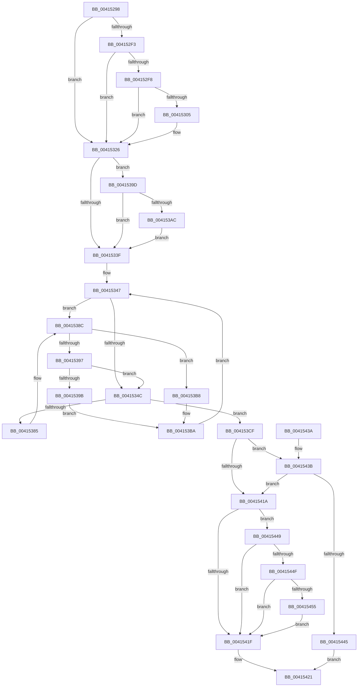

# FsRtlpWaitForIoAtEof

- RVA: `0x00415298`–`0x0041546B` (길이 `467` bytes)
- VA: `0x0000000140415298`
- 실행 섹션: `.text`
- PDB 이름 있음: `예`; PDB Function 태그: `아니요`
- unwind 정보 RVA: `0x0009C27C`
- 디코드: `144`개 명령, `467/467` bytes 표시
- 미해석 바이트: `0` (있으면 어셈블리에 `.byte`로 보존)

> 이 문서는 커널 이미지의 기계어와 PDB 기호를 분석해 생성했습니다. 4번과 5번은 함수 원형과 자료형을 바이너리 사용 방식에서 추정한 C 해석이며 원본 소스 복구 결과는 아닙니다.

## 1. Dependencies

- 직접 호출 지점: **11**; 고유 호출 대상: **8**
- 직접 호출자로 확인된 함수: **2**
- RIP 상대 이미지 참조: **0**

### Outgoing calls
- `0x004152D9` → [PsGetIoPriorityThread](../34/PsGetIoPriorityThread_function_00343930.md) (function, `0x00343930`)
- `0x004152FB` → [PsGetIoPriorityThread](../34/PsGetIoPriorityThread_function_00343930.md) (function, `0x00343930`)
- `0x00415310` → [PsBoostThreadIoEx](../39/PsBoostThreadIoEx_function_00392C00.md) (function, `0x00392C00`)
- `0x0041531D` → [IoBoostThreadIoPriority](../21/IoBoostThreadIoPriority_function_00216110.md) (function, `0x00216110`)
- `0x00415329` → [KeQueryPriorityThread](../38/KeQueryPriorityThread_function_0038F4F0.md) (function, `0x0038F4F0`)
- `0x004153A3` → [KeQueryPriorityThread](../38/KeQueryPriorityThread_function_0038F4F0.md) (function, `0x0038F4F0`)
- `0x004153B1` → [KeSetPriorityBoost](../39/KeSetPriorityBoost_function_00398860.md) (function, `0x00398860`)
- `0x004153ED` → [FsRtlReleaseHeaderMutex](../25/FsRtlReleaseHeaderMutex_function_002516C0.md) (function, `0x002516C0`)
- `0x00415404` → [KeWaitForSingleObject](../20/KeWaitForSingleObject_function_0020E6B0.md) (function, `0x0020E6B0`)
- `0x00415410` → [FsRtlAcquireHeaderMutex](../20/FsRtlAcquireHeaderMutex_function_0020DE90.md) (function, `0x0020DE90`)
- `0x00415460` → [PsBoostThreadIoEx](../39/PsBoostThreadIoEx_function_00392C00.md) (function, `0x00392C00`)

### Direct callers
- [FsRtlGetIoAtEof](FsRtlGetIoAtEof_function_00415040.md) at `0x004150A7`
- [sub_00415276](Unknown_function_00415276.md) at `0x0041528B`

### Static image references
- 디코드된 RIP-relative 메모리 참조가 없습니다.

## 2. Other-region calls and transfers

- 다른 실행 섹션으로 향하는 call: **0**
- 별도 외부 분기/꼬리 이동을 확인하지 못했습니다.

## 3. Assembly (complete function range)

```asm
00415298  48 89 5C 24 08                  mov qword ptr [rsp + 8], rbx
0041529D  48 89 74 24 18                  mov qword ptr [rsp + 0x18], rsi
004152A2  48 89 54 24 10                  mov qword ptr [rsp + 0x10], rdx
004152A7  55                              push rbp
004152A8  57                              push rdi
004152A9  41 54                           push r12
004152AB  41 56                           push r14
004152AD  41 57                           push r15
004152AF  48 8B EC                        mov rbp, rsp
004152B2  48 83 EC 70                     sub rsp, 0x70
004152B6  48 83 65 C0 00                  and qword ptr [rbp - 0x40], 0
004152BB  48 8B D9                        mov rbx, rcx
004152BE  48 83 65 C8 00                  and qword ptr [rbp - 0x38], 0
004152C3  4D 8B E0                        mov r12, r8
004152C6  C6 45 D3 00                     mov byte ptr [rbp - 0x2d], 0
004152CA  65 4C 8B 3C 25 88 01 00 00      mov r15, qword ptr gs:[0x188]
004152D3  4C 8B 31                        mov r14, qword ptr [rcx]
004152D6  49 8B CF                        mov rcx, r15
004152D9  E8 52 E6 F2 FF                  call 0x140343930
004152DE  41 B9 02 00 00 00               mov r9d, 2
004152E4  8B F0                           mov esi, eax
004152E6  41 3B C1                        cmp eax, r9d
004152E9  41 0F 4D F1                     cmovge esi, r9d
004152ED  80 7B 24 00                     cmp byte ptr [rbx + 0x24], 0
004152F1  75 33                           jne 0x140415326
004152F3  83 FE 01                        cmp esi, 1
004152F6  7E 2E                           jle 0x140415326
004152F8  49 8B CE                        mov rcx, r14
004152FB  E8 30 E6 F2 FF                  call 0x140343930
00415300  41 3B C1                        cmp eax, r9d
00415303  7D 21                           jge 0x140415326
00415305  45 33 C9                        xor r9d, r9d
00415308  45 33 C0                        xor r8d, r8d
0041530B  33 D2                           xor edx, edx
0041530D  49 8B CE                        mov rcx, r14
00415310  E8 EB D8 F7 FF                  call 0x140392c00
00415315  45 33 C0                        xor r8d, r8d
00415318  8B D6                           mov edx, esi
0041531A  49 8B CE                        mov rcx, r14
0041531D  E8 EE 0D E0 FF                  call 0x140216110
00415322  C6 43 24 01                     mov byte ptr [rbx + 0x24], 1
00415326  49 8B CF                        mov rcx, r15
00415329  E8 C2 A1 F7 FF                  call 0x14038f4f0
0041532E  8B F8                           mov edi, eax
00415330  B8 0F 00 00 00                  mov eax, 0xf
00415335  3B F8                           cmp edi, eax
00415337  0F 4D F8                        cmovge edi, eax
0041533A  3B 7B 20                        cmp edi, dword ptr [rbx + 0x20]
0041533D  7F 5E                           jg 0x14041539d
0041533F  48 8B 4B 10                     mov rcx, qword ptr [rbx + 0x10]
00415343  4C 8D 43 08                     lea r8, [rbx + 8]
00415347  49 3B C8                        cmp rcx, r8
0041534A  75 40                           jne 0x14041538c
0041534C  83 65 D4 00                     and dword ptr [rbp - 0x2c], 0
00415350  48 8D 45 D8                     lea rax, [rbp - 0x28]
00415354  48 89 45 E0                     mov qword ptr [rbp - 0x20], rax
00415358  48 8D 45 D8                     lea rax, [rbp - 0x28]
0041535C  48 89 45 D8                     mov qword ptr [rbp - 0x28], rax
00415360  48 8D 43 08                     lea rax, [rbx + 8]
00415364  48 8B 48 08                     mov rcx, qword ptr [rax + 8]
00415368  66 C7 45 D0 01 00               mov word ptr [rbp - 0x30], 1
0041536E  C6 45 D2 06                     mov byte ptr [rbp - 0x2e], 6
00415372  4C 89 7D F0                     mov qword ptr [rbp - 0x10], r15
00415376  89 7D F8                        mov dword ptr [rbp - 8], edi
00415379  89 75 FC                        mov dword ptr [rbp - 4], esi
0041537C  4C 89 65 E8                     mov qword ptr [rbp - 0x18], r12
00415380  48 39 01                        cmp qword ptr [rcx], rax
00415383  74 4A                           je 0x1404153cf
00415385  B9 03 00 00 00                  mov ecx, 3
0041538A  CD 29                           int 0x29
0041538C  8B 41 38                        mov eax, dword ptr [rcx + 0x38]
0041538F  48 8D 51 3C                     lea rdx, [rcx + 0x3c]
00415393  3B C7                           cmp eax, edi
00415395  7C 21                           jl 0x1404153b8
00415397  39 32                           cmp dword ptr [rdx], esi
00415399  7D B1                           jge 0x14041534c
0041539B  EB 1D                           jmp 0x1404153ba
0041539D  49 8B CE                        mov rcx, r14
004153A0  89 7B 20                        mov dword ptr [rbx + 0x20], edi
004153A3  E8 48 A1 F7 FF                  call 0x14038f4f0
004153A8  3B F8                           cmp edi, eax
004153AA  7E 93                           jle 0x14041533f
004153AC  8B D7                           mov edx, edi
004153AE  49 8B CE                        mov rcx, r14
004153B1  E8 AA 34 F8 FF                  call 0x140398860
004153B6  EB 87                           jmp 0x14041533f
004153B8  8B C7                           mov eax, edi
004153BA  89 41 38                        mov dword ptr [rcx + 0x38], eax
004153BD  8B 02                           mov eax, dword ptr [rdx]
004153BF  3B F0                           cmp esi, eax
004153C1  48 8B 49 08                     mov rcx, qword ptr [rcx + 8]
004153C5  0F 4F C6                        cmovg eax, esi
004153C8  89 02                           mov dword ptr [rdx], eax
004153CA  E9 78 FF FF FF                  jmp 0x140415347
004153CF  48 89 4D C8                     mov qword ptr [rbp - 0x38], rcx
004153D3  48 8D 55 C0                     lea rdx, [rbp - 0x40]
004153D7  48 89 45 C0                     mov qword ptr [rbp - 0x40], rax
004153DB  48 89 11                        mov qword ptr [rcx], rdx
004153DE  48 8D 4D C0                     lea rcx, [rbp - 0x40]
004153E2  48 8B 55 38                     mov rdx, qword ptr [rbp + 0x38]
004153E6  48 89 48 08                     mov qword ptr [rax + 8], rcx
004153EA  48 8B CB                        mov rcx, rbx
004153ED  E8 CE C2 E3 FF                  call 0x1402516c0
004153F2  48 83 64 24 20 00               and qword ptr [rsp + 0x20], 0
004153F8  48 8D 4D D0                     lea rcx, [rbp - 0x30]
004153FC  45 33 C9                        xor r9d, r9d
004153FF  45 33 C0                        xor r8d, r8d
00415402  33 D2                           xor edx, edx
00415404  E8 A7 92 DF FF                  call 0x14020e6b0
00415409  48 8B 55 38                     mov rdx, qword ptr [rbp + 0x38]
0041540D  48 8B CB                        mov rcx, rbx
00415410  E8 7B 8A DF FF                  call 0x14020de90
00415415  4D 85 E4                        test r12, r12
00415418  79 21                           jns 0x14041543b
0041541A  83 FE 02                        cmp esi, 2
0041541D  7C 2A                           jl 0x140415449
0041541F  B0 01                           mov al, 1
00415421  4C 8D 5C 24 70                  lea r11, [rsp + 0x70]
00415426  49 8B 5B 30                     mov rbx, qword ptr [r11 + 0x30]
0041542A  49 8B 73 40                     mov rsi, qword ptr [r11 + 0x40]
0041542E  49 8B E3                        mov rsp, r11
00415431  41 5F                           pop r15
00415433  41 5E                           pop r14
00415435  41 5C                           pop r12
00415437  5F                              pop rdi
00415438  5D                              pop rbp
00415439  C3                              ret
0041543A  CC                              int3
0041543B  48 8B 43 18                     mov rax, qword ptr [rbx + 0x18]
0041543F  4C 3B 60 28                     cmp r12, qword ptr [rax + 0x28]
00415443  7F D5                           jg 0x14041541a
00415445  32 C0                           xor al, al
00415447  EB D8                           jmp 0x140415421
00415449  80 7B 24 00                     cmp byte ptr [rbx + 0x24], 0
0041544D  75 D0                           jne 0x14041541f
0041544F  83 7D FC 02                     cmp dword ptr [rbp - 4], 2
00415453  7C CA                           jl 0x14041541f
00415455  45 33 C9                        xor r9d, r9d
00415458  45 33 C0                        xor r8d, r8d
0041545B  33 D2                           xor edx, edx
0041545D  49 8B CF                        mov rcx, r15
00415460  E8 9B D7 F7 FF                  call 0x140392c00
00415465  C6 43 24 01                     mov byte ptr [rbx + 0x24], 1
00415469  EB B4                           jmp 0x14041541f
```

## 4. C-style interpretation (structured pseudocode)

```c
__int64 __fastcall FsRtlpWaitForIoAtEof(__int64 a1, __int64 a2, __int64 a3)
{
    __int64 result;
    __int64 v_rdi;
    __int64 v_rsi;
    __int64 v_rsp;
    unsigned __int64 v_stack_m28;
    unsigned int v_stack_m2C;
    unsigned int v_stack_m30;
    unsigned __int64 v_stack_m38;
    unsigned __int64 v_stack_m40;
    unsigned __int64 v_stack_m48;
    unsigned __int64 v_stack_m50;
    unsigned int v_stack_m54;
    unsigned __int8 v_stack_m55;
    unsigned __int8 v_stack_m56;
    unsigned __int16 v_stack_m58;
    unsigned __int64 v_stack_m60;
    unsigned __int64 v_stack_m68;
    unsigned __int64 v_stack_m78;
    unsigned __int64 v_stack_p10;
    unsigned __int64 v_stack_p18;
    unsigned __int64 v_stack_p8;

    v_stack_p8 = v_rbx;
    v_stack_p18 = v_rsi;
    v_stack_p10 = a2;
    v_rsp = (v_rsp) - (112);
    v_stack_m55 = 0;
    result = PsGetIoPriorityThread(*(unsigned __int64 *)(gs_base + (0 + 392)), a2, a3, a4);
    v_rsi = (unsigned int)((unsigned int)(result));
    if (((unsigned int)(result)) >= 2) { v_rsi = 2; }
    if ((*(unsigned __int8 *)(a1 + 36)) != 0) goto loc_00415326;
    if (((unsigned int)(v_rsi)) <= 1) goto loc_00415326;
    result = PsGetIoPriorityThread(*(unsigned __int64 *)(a1), a2, a3, 2);
    if (((unsigned int)(result)) < 2) {
        a4 = 0;
        a3 = 0;
        a2 = 0;
        a1 = *(unsigned __int64 *)(a1);
        result = PsBoostThreadIoEx(a1, a2, a3, a4);
        a3 = 0;
        a2 = (unsigned int)(v_rsi);
        a1 = *(unsigned __int64 *)(a1);
        result = IoBoostThreadIoPriority(a1, a2, a3, a4);
        *(unsigned __int8 *)(a1 + 36) = 1;
    }
    result = KeQueryPriorityThread(*(unsigned __int64 *)(gs_base + (0 + 392)), a2, a3, a4);
    v_rdi = (unsigned int)((unsigned int)(result));
    if (((unsigned int)((unsigned int)((unsigned int)(result)))) >= 15) { v_rdi = 15; }
    if (((unsigned int)(v_rdi)) > (*(unsigned int *)(a1 + 32))) goto loc_0041539D;
loc_0041533F:
loc_00415347:
    if ((*(unsigned __int64 *)(a1 + 16)) != (a1 + 8)) goto loc_0041538C;
loc_0041534C:
    v_stack_m48 = v_stack_m50;
    v_stack_m50 = v_stack_m50;
    v_stack_m58 = 1;
    v_stack_m56 = 6;
    v_stack_m38 = *(unsigned __int64 *)(gs_base + (0 + 392));
    v_stack_m30 = (unsigned int)(v_rdi);
    v_stack_m2C = (unsigned int)(v_rsi);
    v_stack_m40 = 0;
    if ((*(unsigned __int64 *)(*(unsigned __int64 *)(a1 + 8 + 8))) == (a1 + 8)) goto loc_004153CF;
loc_0041538C:
    if (((unsigned int)((unsigned int)(*(unsigned int *)(3 + 56)))) < ((unsigned int)(v_rdi))) goto loc_004153B8;
    if ((*(unsigned int *)(3 + 60)) >= ((unsigned int)(v_rsi))) goto loc_0041534C;
    goto loc_004153BA;
loc_0041539D:
    *(unsigned int *)(a1 + 32) = (unsigned int)(v_rdi);
    result = KeQueryPriorityThread(*(unsigned __int64 *)(a1), 3 + 60, a1 + 8, a4);
    if (((unsigned int)(v_rdi)) <= ((unsigned int)(result))) goto loc_0041533F;
    result = KeSetPriorityBoost(*(unsigned __int64 *)(a1), (unsigned int)((unsigned int)(v_rdi)), a1 + 8, a4);
    goto loc_0041533F;
loc_004153B8:
loc_004153BA:
    *(unsigned int *)(*(unsigned __int64 *)(a1) + 56) = (unsigned int)((unsigned int)((unsigned int)(v_rdi)));
    result = (unsigned int)(*(unsigned int *)((unsigned int)((unsigned int)(v_rdi))));
    if (((unsigned int)(v_rsi)) > ((unsigned int)((unsigned int)(*(unsigned int *)((unsigned int)((unsigned int)(v_rdi))))))) { result = (unsigned int)(v_rsi); }
    *(unsigned int *)((unsigned int)((unsigned int)(v_rdi))) = (unsigned int)(result);
    goto loc_00415347;
loc_004153CF:
    v_stack_m60 = *(unsigned __int64 *)(*(unsigned __int64 *)(a1) + 8);
    v_stack_m68 = result;
    *(unsigned __int64 *)(*(unsigned __int64 *)(*(unsigned __int64 *)(a1) + 8)) = v_stack_m68;
    *(unsigned __int64 *)(result + 8) = v_stack_m68;
    result = FsRtlReleaseHeaderMutex(a1, v_stack_p10, a1 + 8, a4);
    a4 = 0;
    a3 = 0;
    a2 = 0;
    result = KeWaitForSingleObject(v_stack_m58, a2, a3, a4);
    result = FsRtlAcquireHeaderMutex(a1, v_stack_p10, a3, a4);
    if (!sign_flag) goto loc_0041543B;
loc_0041541A:
    if (((unsigned int)(v_rsi)) < 2) goto loc_00415449;
loc_0041541F:
loc_00415421:
    return 1;
loc_0041543B:
    if (0 > (*(unsigned __int64 *)(*(unsigned __int64 *)(*(unsigned __int64 *)(v_stack_m28 + 48) + 24) + 40))) goto loc_0041541A;
    result = 0;
    goto loc_00415421;
loc_00415449:
    if ((*(unsigned __int8 *)(*(unsigned __int64 *)(v_stack_m28 + 48) + 36)) != 0) goto loc_0041541F;
    if (v_stack_m2C < 2) goto loc_0041541F;
    a4 = 0;
    a3 = 0;
    a2 = 0;
    result = PsBoostThreadIoEx(*(unsigned __int64 *)(gs_base + (0 + 392)), a2, a3, a4);
    *(unsigned __int8 *)(*(unsigned __int64 *)(v_stack_m28 + 48) + 36) = 1;
    goto loc_0041541F;
}
```

## 5. (Beta) C Style

```c
int64_t FsRtlpWaitForIoAtEof(void *Arg1, int64_t Arg2, int64_t Arg3)
{
    uint8_t *arg1 = (uint8_t *)Arg1;

    int64_t result;
    int64_t local_rdi;
    int64_t local_rsi;
    int64_t local_rsp;
    uint64_t v_stack_m28;
    uint32_t v_stack_m2C;
    uint32_t v_stack_m30;
    uint64_t v_stack_m38;
    uint64_t v_stack_m40;
    uint64_t v_stack_m48;
    uint64_t v_stack_m50;
    uint32_t v_stack_m54;
    uint8_t v_stack_m55;
    uint8_t v_stack_m56;
    uint16_t v_stack_m58;
    uint64_t v_stack_m60;
    uint64_t v_stack_m68;
    uint64_t v_stack_m78;
    uint64_t v_stack_p10;
    uint64_t v_stack_p18;
    uint64_t v_stack_p8;

    v_stack_p8 = local_rbx;
    v_stack_p18 = local_rsi;
    v_stack_p10 = Arg2;
    local_rsp = (local_rsp) - (112);
    v_stack_m55 = 0;
    result = PsGetIoPriorityThread(*(uint64_t *)(gs_base + (0 + 0x188)), Arg2, Arg3, a4);
    local_rsi = (uint32_t)((uint32_t)(result));
    if (((uint32_t)(result)) >= 2) { local_rsi = 2; }
    if ((*(uint8_t *)(arg1 + 0x24)) != 0) goto loc_00415326;
    if (((uint32_t)(local_rsi)) <= 1) goto loc_00415326;
    result = PsGetIoPriorityThread(*(uint64_t *)(arg1), Arg2, Arg3, 2);
    if (((uint32_t)(result)) < 2) {
        a4 = 0;
        Arg3 = 0;
        Arg2 = 0;
        Arg1 = *(uint64_t *)(arg1);
        result = PsBoostThreadIoEx(Arg1, Arg2, Arg3, a4);
        Arg3 = 0;
        Arg2 = (uint32_t)(local_rsi);
        Arg1 = *(uint64_t *)(arg1);
        result = IoBoostThreadIoPriority(Arg1, Arg2, Arg3, a4);
        *(uint8_t *)(arg1 + 0x24) = 1;
    }
    result = KeQueryPriorityThread(*(uint64_t *)(gs_base + (0 + 0x188)), Arg2, Arg3, a4);
    local_rdi = (uint32_t)((uint32_t)(result));
    if (((uint32_t)((uint32_t)((uint32_t)(result)))) >= 15) { local_rdi = 15; }
    if (((uint32_t)(local_rdi)) > (*(uint32_t *)(arg1 + 0x20))) goto loc_0041539D;
loc_0041533F:
loc_00415347:
    if ((*(uint64_t *)(arg1 + 0x10)) != (Arg1 + 8)) goto loc_0041538C;
loc_0041534C:
    v_stack_m48 = v_stack_m50;
    v_stack_m50 = v_stack_m50;
    v_stack_m58 = 1;
    v_stack_m56 = 6;
    v_stack_m38 = *(uint64_t *)(gs_base + (0 + 0x188));
    v_stack_m30 = (uint32_t)(local_rdi);
    v_stack_m2C = (uint32_t)(local_rsi);
    v_stack_m40 = 0;
    if ((*(uint64_t *)(*(uint64_t *)(arg1 + 0x8 + 0x8))) == (Arg1 + 8)) goto loc_004153CF;
loc_0041538C:
    if (((uint32_t)((uint32_t)(*(uint32_t *)(3 + 0x38)))) < ((uint32_t)(local_rdi))) goto loc_004153B8;
    if ((*(uint32_t *)(3 + 0x3C)) >= ((uint32_t)(local_rsi))) goto loc_0041534C;
    goto loc_004153BA;
loc_0041539D:
    *(uint32_t *)(arg1 + 0x20) = (uint32_t)(local_rdi);
    result = KeQueryPriorityThread(*(uint64_t *)(arg1), 3 + 60, Arg1 + 8, a4);
    if (((uint32_t)(local_rdi)) <= ((uint32_t)(result))) goto loc_0041533F;
    result = KeSetPriorityBoost(*(uint64_t *)(arg1), (uint32_t)((uint32_t)(local_rdi)), Arg1 + 8, a4);
    goto loc_0041533F;
loc_004153B8:
loc_004153BA:
    *(uint32_t *)(*(uint64_t *)(arg1) + 0x38) = (uint32_t)((uint32_t)((uint32_t)(local_rdi)));
    result = (uint32_t)(*(uint32_t *)((uint32_t)((uint32_t)(local_rdi))));
    if (((uint32_t)(local_rsi)) > ((uint32_t)((uint32_t)(*(uint32_t *)((uint32_t)((uint32_t)(local_rdi))))))) { result = (uint32_t)(local_rsi); }
    *(uint32_t *)((uint32_t)((uint32_t)(local_rdi))) = (uint32_t)(result);
    goto loc_00415347;
loc_004153CF:
    v_stack_m60 = *(uint64_t *)(*(uint64_t *)(arg1) + 0x8);
    v_stack_m68 = result;
    *(uint64_t *)(*(uint64_t *)(*(uint64_t *)(arg1) + 0x8)) = v_stack_m68;
    *(uint64_t *)(result + 0x8) = v_stack_m68;
    result = FsRtlReleaseHeaderMutex(Arg1, v_stack_p10, Arg1 + 8, a4);
    a4 = 0;
    Arg3 = 0;
    Arg2 = 0;
    result = KeWaitForSingleObject(v_stack_m58, Arg2, Arg3, a4);
    result = FsRtlAcquireHeaderMutex(Arg1, v_stack_p10, Arg3, a4);
    if (!sign_flag) goto loc_0041543B;
loc_0041541A:
    if (((uint32_t)(local_rsi)) < 2) goto loc_00415449;
loc_0041541F:
loc_00415421:
    return 1;
loc_0041543B:
    if (0 > (*(uint64_t *)(*(uint64_t *)(*(uint64_t *)(v_stack_m28 + 0x30) + 0x18) + 0x28))) goto loc_0041541A;
    result = 0;
    goto loc_00415421;
loc_00415449:
    if ((*(uint8_t *)(*(uint64_t *)(v_stack_m28 + 0x30) + 0x24)) != 0) goto loc_0041541F;
    if (v_stack_m2C < 2) goto loc_0041541F;
    a4 = 0;
    Arg3 = 0;
    Arg2 = 0;
    result = PsBoostThreadIoEx(*(uint64_t *)(gs_base + (0 + 0x188)), Arg2, Arg3, a4);
    *(uint8_t *)(*(uint64_t *)(v_stack_m28 + 0x30) + 0x24) = 1;
    goto loc_0041541F;
}
```

### 관측된 메모리 오프셋

구조체 형식이 확인되지 않은 접근은 인자 기준의 오프셋으로만 기록했습니다.

| 기준 인자 | 오프셋 표현 | 폭 (bit) | 접근 |
|---|---:|---:|---|
| `Arg1` | `+ 0x0` | `64` | `R` |
| `Arg1` | `+ 0x8` | `64` | `R` |
| `Arg1` | `+ 0x8` | `64` | `W` |
| `Arg1` | `+ 0x10` | `64` | `R` |
| `Arg1` | `+ 0x18` | `64` | `R` |
| `Arg1` | `+ 0x20` | `32` | `R` |
| `Arg1` | `+ 0x20` | `32` | `W` |
| `Arg1` | `+ 0x24` | `8` | `R` |
| `Arg1` | `+ 0x24` | `8` | `W` |

## 6. Execution-region graph

[열기: 2D/3D 그래프와 함수 탐색 컨트롤 패널](../../../control-panel.html?section=text&rva=0x00415298&view=graph)

- 2D 그래프는 위에서 아래로 흐르고, 3D 그래프는 빈 공간을 드래그해 회전합니다. Shift+드래그는 이동, 휠은 확대·축소, 함수 노드 선택은 대상 보고서 이동입니다.

### Static fallback


