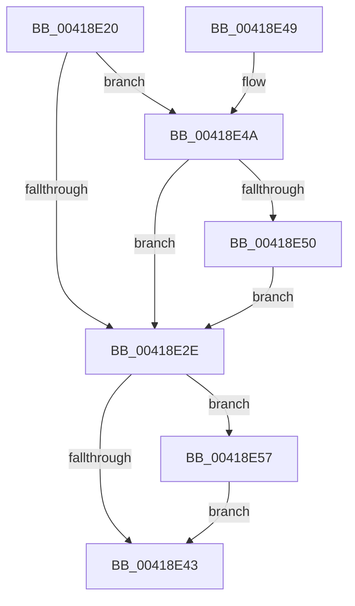

# HalPerformEndOfInterrupt

- RVA: `0x00418E20`–`0x00418E61` (길이 `65` bytes)
- VA: `0x0000000140418E20`
- 실행 섹션: `.text`
- PDB 이름 있음: `예`; PDB Function 태그: `아니요`
- unwind 정보 RVA: `0x0009D0AC`
- 디코드: `20`개 명령, `65/65` bytes 표시
- 미해석 바이트: `0` (있으면 어셈블리에 `.byte`로 보존)

> 이 문서는 커널 이미지의 기계어와 PDB 기호를 분석해 생성했습니다. 4번과 5번은 함수 원형과 자료형을 바이너리 사용 방식에서 추정한 C 해석이며 원본 소스 복구 결과는 아닙니다.

## 1. Dependencies

- 직접 호출 지점: **3**; 고유 호출 대상: **3**
- 직접 호출자로 확인된 함수: **10**
- RIP 상대 이미지 참조: **2**

### Outgoing calls
- `0x00418E35` → [guard_dispatch_icall](../6B/guard_dispatch_icall_function_006BAAD0.md) (function, `0x006BAAD0`)
- `0x00418E50` → [HalpInterruptServiceActiveBoth](../54/HalpInterruptServiceActiveBoth_function_00545CFC.md) (function, `0x00545CFC`)
- `0x00418E5A` → [HalpInterruptPerformDirectedEndOfInterrupt](../54/HalpInterruptPerformDirectedEndOfInterrupt_function_00545C88.md) (function, `0x00545C88`)

### Direct callers
- [KiChainedDispatch](../6B/KiChainedDispatch_function_006B3480.md) at `0x006B34C4`
- [KiInterruptDispatch](../6B/KiInterruptDispatch_function_006B3B30.md) at `0x006B3B74`
- [KiInterruptDispatchNoLock](../6B/KiInterruptDispatchNoLock_function_006B3F10.md) at `0x006B3F54`
- [KiInterruptDispatchNoLockNoEtw](../6B/KiInterruptDispatchNoLockNoEtw_function_006B42F0.md) at `0x006B4334`
- [KxIsrLinkage](../6B/KxIsrLinkage_function_006B5680.md) at `0x006B5A7F`
- [KiApcInterrupt](../6B/KiApcInterrupt_function_006B5E20.md) at `0x006B61AA`
- [KiHvInterruptDispatch](../6B/KiHvInterruptDispatch_function_006B7750.md) at `0x006B77A0`
- [KiSwInterrupt](../6B/KiSwInterrupt_function_006B8070.md) at `0x006B8418`
- [KiDpcInterrupt](../6B/KiDpcInterrupt_function_006B87C0.md) at `0x006B8B41`
- [KiIpiInterrupt](../6B/KiIpiInterrupt_function_006B8F20.md) at `0x006B92C2`

### Static image references
- `0x00418E2E` → RVA `0x00E002D0` (`.data`; read)
- `0x00418E3A` → RVA `0x00F906D4` (`.data`; read)

## 2. Other-region calls and transfers

- 다른 실행 섹션으로 향하는 call: **0**
- 별도 외부 분기/꼬리 이동을 확인하지 못했습니다.

## 3. Assembly (complete function range)

```asm
00418E20  40 53                           push rbx
00418E22  48 83 EC 20                     sub rsp, 0x20
00418E26  48 8B D9                        mov rbx, rcx
00418E29  48 85 C9                        test rcx, rcx
00418E2C  75 1C                           jne 0x140418e4a
00418E2E  48 8B 05 9B 74 9E 00            mov rax, qword ptr [rip + 0x9e749b]
00418E35  E8 96 1C 2A 00                  call 0x1406baad0
00418E3A  80 3D 93 78 B7 00 00            cmp byte ptr [rip + 0xb77893], 0
00418E41  75 14                           jne 0x140418e57
00418E43  48 83 C4 20                     add rsp, 0x20
00418E47  5B                              pop rbx
00418E48  C3                              ret
00418E49  CC                              int3
00418E4A  80 79 65 00                     cmp byte ptr [rcx + 0x65], 0
00418E4E  74 DE                           je 0x140418e2e
00418E50  E8 A7 CE 12 00                  call 0x140545cfc
00418E55  EB D7                           jmp 0x140418e2e
00418E57  48 8B CB                        mov rcx, rbx
00418E5A  E8 29 CE 12 00                  call 0x140545c88
00418E5F  EB E2                           jmp 0x140418e43
```

## 4. C-style interpretation (structured pseudocode)

```c
__int64 __fastcall HalPerformEndOfInterrupt(__int64 a1)
{
    __int64 result;
    __int64 v_rsp;

    v_rsp = (v_rsp) - (32);
    if (a1 != 0) goto loc_00418E4A;
loc_00418E2E:
    result = guard_dispatch_icall(a1, a2, a3, a4);
    if ((*(unsigned __int8 *)(v_rip + 12023955)) != 0) goto loc_00418E57;
loc_00418E43:
    v_rsp = (v_rsp) + (32);
    return result;
loc_00418E4A:
    if ((*(unsigned __int8 *)(a1 + 101)) == 0) goto loc_00418E2E;
    result = HalpInterruptServiceActiveBoth(a1, a2, a3, a4);
    goto loc_00418E2E;
loc_00418E57:
    result = HalpInterruptPerformDirectedEndOfInterrupt(a1, a2, a3, a4);
    goto loc_00418E43;
}
```

## 5. (Beta) C Style

```c
int64_t HalPerformEndOfInterrupt(int64_t Arg1)
{
    int64_t result;
    int64_t local_rsp;

    local_rsp = (local_rsp) - (32);
    if (Arg1 != 0) goto loc_00418E4A;
loc_00418E2E:
    result = guard_dispatch_icall(Arg1, a2, a3, a4);
    if ((*(uint8_t *)(v_rip + 0xB77893)) != 0) goto loc_00418E57;
loc_00418E43:
    local_rsp = (local_rsp) + (32);
    return result;
loc_00418E4A:
    if ((*(uint8_t *)(Arg1 + 0x65)) == 0) goto loc_00418E2E;
    result = HalpInterruptServiceActiveBoth(Arg1, a2, a3, a4);
    goto loc_00418E2E;
loc_00418E57:
    result = HalpInterruptPerformDirectedEndOfInterrupt(Arg1, a2, a3, a4);
    goto loc_00418E43;
}
```

## 6. Execution-region graph

[열기: 2D/3D 그래프와 함수 탐색 컨트롤 패널](../../../control-panel.html?section=text&rva=0x00418E20&view=graph)

- 2D 그래프는 위에서 아래로 흐르고, 3D 그래프는 빈 공간을 드래그해 회전합니다. Shift+드래그는 이동, 휠은 확대·축소, 함수 노드 선택은 대상 보고서 이동입니다.

### Static fallback


