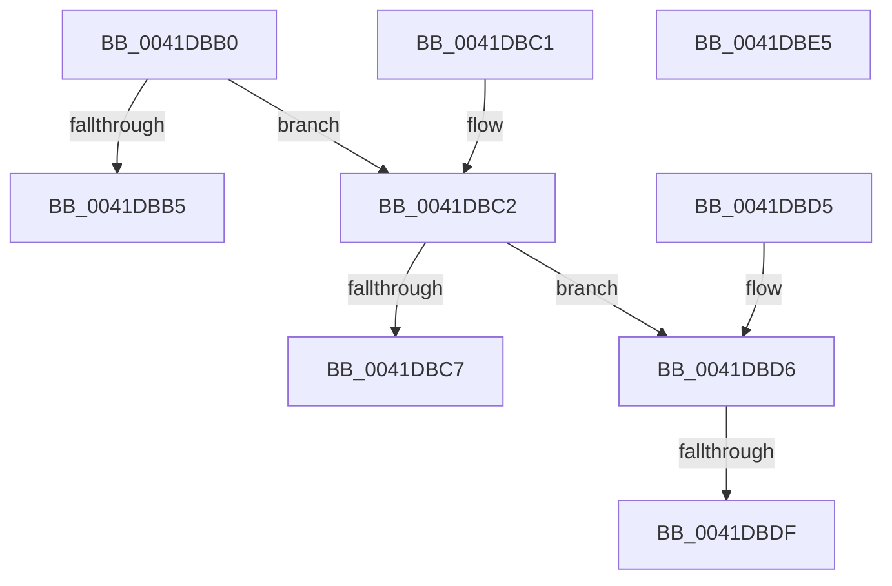

# HalpAcpiPmRegisterReadPort

- RVA: `0x0041DBB0`–`0x0041DBE6` (길이 `54` bytes)
- VA: `0x000000014041DBB0`
- 실행 섹션: `.text`
- PDB 이름 있음: `예`; PDB Function 태그: `예`
- unwind 정보 RVA: `0x000DB714`
- 디코드: `25`개 명령, `54/54` bytes 표시
- 미해석 바이트: `0` (있으면 어셈블리에 `.byte`로 보존)

> 이 문서는 커널 이미지의 기계어와 PDB 기호를 분석해 생성했습니다. 4번과 5번은 함수 원형과 자료형을 바이너리 사용 방식에서 추정한 C 해석이며 원본 소스 복구 결과는 아닙니다.

## 1. Dependencies

- 직접 호출 지점: **0**; 고유 호출 대상: **0**
- 직접 호출자로 확인된 함수: **1**
- RIP 상대 이미지 참조: **0**

### Outgoing calls
- 직접 디코드된 call 명령이 없습니다.

### Direct callers
- [HalpAcpiPmRegisterRead](HalpAcpiPmRegisterRead_function_0041DB30.md) at `0x0041DB71`

### Static image references
- 디코드된 RIP-relative 메모리 참조가 없습니다.

## 2. Other-region calls and transfers

- 다른 실행 섹션으로 향하는 call: **0**
- call이 아닌 외부 분기/꼬리 이동: **1**
  - `0x0041DBD9` → `0x006ED79E` (`tail-transfer`)

## 3. Assembly (complete function range)

```asm
0041DBB0  83 FA 01                        cmp edx, 1
0041DBB3  75 0D                           jne 0x14041dbc2
0041DBB5  90                              nop
0041DBB6  0F B7 D1                        movzx edx, cx
0041DBB9  EC                              in al, dx
0041DBBA  90                              nop
0041DBBB  41 88 00                        mov byte ptr [r8], al
0041DBBE  33 C0                           xor eax, eax
0041DBC0  C3                              ret
0041DBC1  CC                              int3
0041DBC2  83 FA 02                        cmp edx, 2
0041DBC5  75 0F                           jne 0x14041dbd6
0041DBC7  90                              nop
0041DBC8  0F B7 D1                        movzx edx, cx
0041DBCB  66 ED                           in ax, dx
0041DBCD  90                              nop
0041DBCE  66 41 89 00                     mov word ptr [r8], ax
0041DBD2  33 C0                           xor eax, eax
0041DBD4  C3                              ret
0041DBD5  CC                              int3
0041DBD6  83 FA 04                        cmp edx, 4
0041DBD9  0F 84 BF FB 2C 00               je 0x1406ed79e
0041DBDF  B8 01 00 00 C0                  mov eax, 0xc0000001
0041DBE4  C3                              ret
0041DBE5  CC                              int3
```

## 4. C-style interpretation (structured pseudocode)

```c
__int64 __fastcall HalpAcpiPmRegisterReadPort(unsigned __int16 a1, int a2, __int64 a3)
{
    __int64 result;

    if (a2 != 1) goto loc_0041DBC2;
    *(unsigned __int8 *)(a3) = (unsigned __int8)(result);
    result = 0;
    return result;
loc_0041DBC2:
    if (a1 != 2) goto loc_0041DBD6;
    *(unsigned __int16 *)(a3) = 0;
    result = 0;
    return result;
loc_0041DBD6:
    return (unsigned int)(0xC0000001ULL);
}
```

## 5. (Beta) C Style

```c
int64_t HalpAcpiPmRegisterReadPort(uint16_t Arg1, int32_t Arg2, void *Arg3)
{
    uint8_t *arg3 = (uint8_t *)Arg3;

    int64_t result;

    if (Arg2 != 1) goto loc_0041DBC2;
    *(uint8_t *)(arg3) = (uint8_t)(result);
    result = 0;
    return result;
loc_0041DBC2:
    if (Arg1 != 2) goto loc_0041DBD6;
    *(uint16_t *)(arg3) = 0;
    result = 0;
    return result;
loc_0041DBD6:
    return (uint32_t)(0xC0000001ULL);
}
```

### 관측된 메모리 오프셋

구조체 형식이 확인되지 않은 접근은 인자 기준의 오프셋으로만 기록했습니다.

| 기준 인자 | 오프셋 표현 | 폭 (bit) | 접근 |
|---|---:|---:|---|
| `Arg3` | `+ 0x0` | `8` | `W` |
| `Arg3` | `+ 0x0` | `16` | `W` |

## 6. Execution-region graph

[열기: 2D/3D 그래프와 함수 탐색 컨트롤 패널](../../../control-panel.html?section=text&rva=0x0041DBB0&view=graph)

- 2D 그래프는 위에서 아래로 흐르고, 3D 그래프는 빈 공간을 드래그해 회전합니다. Shift+드래그는 이동, 휠은 확대·축소, 함수 노드 선택은 대상 보고서 이동입니다.

### Static fallback


