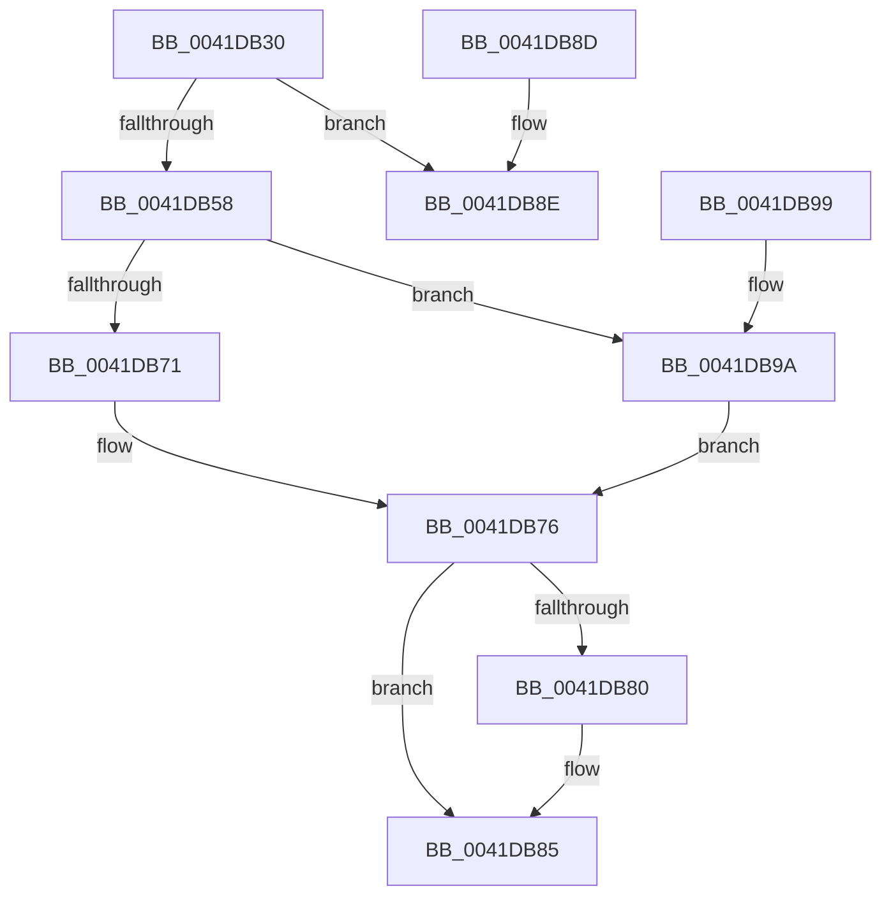

# HalpAcpiPmRegisterRead

- RVA: `0x0041DB30`–`0x0041DBA1` (길이 `113` bytes)
- VA: `0x000000014041DB30`
- 실행 섹션: `.text`
- PDB 이름 있음: `예`; PDB Function 태그: `아니요`
- unwind 정보 RVA: `0x0009F8CC`
- 디코드: `35`개 명령, `113/113` bytes 표시
- 미해석 바이트: `0` (있으면 어셈블리에 `.byte`로 보존)

> 이 문서는 커널 이미지의 기계어와 PDB 기호를 분석해 생성했습니다. 4번과 5번은 함수 원형과 자료형을 바이너리 사용 방식에서 추정한 C 해석이며 원본 소스 복구 결과는 아닙니다.

## 1. Dependencies

- 직접 호출 지점: **2**; 고유 호출 대상: **2**
- 직접 호출자로 확인된 함수: **9**
- RIP 상대 이미지 참조: **2**

### Outgoing calls
- `0x0041DB71` → [HalpAcpiPmRegisterReadPort](HalpAcpiPmRegisterReadPort_function_0041DBB0.md) (function, `0x0041DBB0`)
- `0x0041DB9A` → [guard_dispatch_icall](../6B/guard_dispatch_icall_function_006BAAD0.md) (function, `0x006BAAD0`)

### Direct callers
- [HaliHaltSystem](../54/HaliHaltSystem_function_005465C0.md) at `0x00546607`
- [HaliHaltSystem](../54/HaliHaltSystem_function_005465C0.md) at `0x0054662F`
- [HalpCheckPowerButton](../54/HalpCheckPowerButton_function_00546660.md) at `0x005466A7`
- [HalpCheckPowerButton](../54/HalpCheckPowerButton_function_00546660.md) at `0x005466CF`
- [HalpShutdown](../54/HalpShutdown_function_005469AC.md) at `0x00546A2D`
- [HalpShutdown](../54/HalpShutdown_function_005469AC.md) at `0x00546A54`
- [HalpShutdown](../54/HalpShutdown_function_005469AC.md) at `0x00546AD2`
- [HalpShutdown](../54/HalpShutdown_function_005469AC.md) at `0x00546B2F`
- [HaliAcpiSleep](../56/HaliAcpiSleep_function_0056AD60.md) at `0x0056AE74`
- [HaliAcpiSleep](../56/HaliAcpiSleep_function_0056AD60.md) at `0x0056AE96`
- [HaliAcpiSleep](../56/HaliAcpiSleep_function_0056AD60.md) at `0x0056B0C5`
- [HaliAcpiSleep](../56/HaliAcpiSleep_function_0056AD60.md) at `0x0056B118`
- [HaliAcpiSleep](../56/HaliAcpiSleep_function_0056AD60.md) at `0x0056B184`
- [HaliAcpiSleep](../56/HaliAcpiSleep_function_0056AD60.md) at `0x0056B1C3`
- [HalpDpPostReplace](../../pagelk/B5/HalpDpPostReplace_function_00B5FCD0.md) at `0x00B5FD39`
- [HalpDpPostReplace](../../pagelk/B5/HalpDpPostReplace_function_00B5FCD0.md) at `0x00B5FD73`
- [HalpDpPreReplace](../../pagelk/B5/HalpDpPreReplace_function_00B5FF8C.md) at `0x00B5FFE6`
- [HalpDpPreReplace](../../pagelk/B5/HalpDpPreReplace_function_00B5FF8C.md) at `0x00B6001B`
- [HalpAcpiPostSleep](../../pagelk/B7/HalpAcpiPostSleep_function_00B79990.md) at `0x00B79A09`
- [HalpAcpiPostSleep](../../pagelk/B7/HalpAcpiPostSleep_function_00B79990.md) at `0x00B79A3B`
- [HalpCheckFixedWakeSources](../../pagelk/B7/HalpCheckFixedWakeSources_function_00B7A594.md) at `0x00B7A5E0`
- [HalpCheckFixedWakeSources](../../pagelk/B7/HalpCheckFixedWakeSources_function_00B7A594.md) at `0x00B7A60A`
- [sub_00B8109C](../../pagelk/B8/Unknown_function_00B8109C.md) at `0x00B810B3`
- [sub_00B8109C](../../pagelk/B8/Unknown_function_00B8109C.md) at `0x00B810EA`
- [sub_00B8109C](../../pagelk/B8/Unknown_function_00B8109C.md) at `0x00B81179`
- [sub_00B8109C](../../pagelk/B8/Unknown_function_00B8109C.md) at `0x00B811A3`

### Static image references
- `0x0041DB39` → RVA `0x00F8FE60` (`.data`; read)
- `0x0041DB5B` → RVA `0x0041DBB0` (`HalpAcpiPmRegisterReadPort`; read)

## 2. Other-region calls and transfers

- 다른 실행 섹션으로 향하는 call: **0**
- 별도 외부 분기/꼬리 이동을 확인하지 못했습니다.

## 3. Assembly (complete function range)

```asm
0041DB30  40 53                           push rbx
0041DB32  48 83 EC 20                     sub rsp, 0x20
0041DB36  48 63 C1                        movsxd rax, ecx
0041DB39  4C 8D 1D 20 23 B7 00            lea r11, [rip + 0xb72320]
0041DB40  44 8B D2                        mov r10d, edx
0041DB43  48 8D 04 40                     lea rax, [rax + rax*2]
0041DB47  48 03 C0                        add rax, rax
0041DB4A  41 8B 54 C3 18                  mov edx, dword ptr [r11 + rax*8 + 0x18]
0041DB4F  49 8D 1C C3                     lea rbx, [r11 + rax*8]
0041DB53  41 3B D1                        cmp edx, r9d
0041DB56  77 36                           ja 0x14041db8e
0041DB58  41 8B CA                        mov ecx, r10d
0041DB5B  4C 8D 0D 4E 00 00 00            lea r9, [rip + 0x4e]
0041DB62  49 03 4C C3 08                  add rcx, qword ptr [r11 + rax*8 + 8]
0041DB67  49 8B 44 C3 20                  mov rax, qword ptr [r11 + rax*8 + 0x20]
0041DB6C  49 3B C1                        cmp rax, r9
0041DB6F  75 29                           jne 0x14041db9a
0041DB71  E8 3A 00 00 00                  call 0x14041dbb0
0041DB76  48 8B 4C 24 50                  mov rcx, qword ptr [rsp + 0x50]
0041DB7B  48 85 C9                        test rcx, rcx
0041DB7E  74 05                           je 0x14041db85
0041DB80  8B 43 18                        mov eax, dword ptr [rbx + 0x18]
0041DB83  89 01                           mov dword ptr [rcx], eax
0041DB85  33 C0                           xor eax, eax
0041DB87  48 83 C4 20                     add rsp, 0x20
0041DB8B  5B                              pop rbx
0041DB8C  C3                              ret
0041DB8D  CC                              int3
0041DB8E  B8 23 00 00 C0                  mov eax, 0xc0000023
0041DB93  48 83 C4 20                     add rsp, 0x20
0041DB97  5B                              pop rbx
0041DB98  C3                              ret
0041DB99  CC                              int3
0041DB9A  E8 31 CF 29 00                  call 0x1406baad0
0041DB9F  EB D5                           jmp 0x14041db76
```

## 4. C-style interpretation (structured pseudocode)

```c
__int64 __fastcall HalpAcpiPmRegisterRead(int a1, int a2, __int64 a3, int a4, __int64 a5)
{
    __int64 result;
    __int64 v_rsp;

    v_rsp = (v_rsp) - (32);
    result = ((int)(a1) + (int)(a1) * 2) + ((int)(a1) + (int)(a1) * 2);
    if (((unsigned int)((unsigned int)(*(unsigned int *)(v_rip + 12002080 + result * 8 + 24)))) > a4) goto loc_0041DB8E;
    a1 = ((unsigned int)((unsigned int)((unsigned int)(a2)))) + (*(unsigned __int64 *)(v_rip + 12002080 + result * 8 + 8));
    if ((*(unsigned __int64 *)(v_rip + 12002080 + result * 8 + 32)) != (v_rip + 78)) goto loc_0041DB9A;
    result = HalpAcpiPmRegisterReadPort(a1, (unsigned int)(*(unsigned int *)(v_rip + 12002080 + result * 8 + 24)), a3, v_rip + 78);
loc_0041DB76:
    if (a5 != 0) {
        result = *(unsigned int *)(v_rip + 12002080 + result * 8 + 24);
        *(unsigned int *)(a5) = (unsigned int)(result);
    }
    result = 0;
    v_rsp = (v_rsp) + (32);
    return result;
loc_0041DB8E:
    v_rsp = (v_rsp) + (32);
    return (unsigned int)(0xC0000023ULL);
loc_0041DB9A:
    result = guard_dispatch_icall(a5, (unsigned int)(*(unsigned int *)(v_rip + 12002080 + result * 8 + 24)), a3, v_rip + 78);
    goto loc_0041DB76;
}
```

## 5. (Beta) C Style

```c
int64_t HalpAcpiPmRegisterRead(void *Arg1, int32_t Arg2, int64_t Arg3, int32_t Arg4, int64_t Arg5)
{
    uint8_t *arg1 = (uint8_t *)Arg1;

    int64_t result;
    int64_t local_rsp;

    local_rsp = (local_rsp) - (32);
    result = ((int32_t)(Arg1) + (int32_t)(Arg1) * 2) + ((int32_t)(Arg1) + (int32_t)(Arg1) * 2);
    if (((uint32_t)((uint32_t)(*(uint32_t *)(v_rip + 0xB72320 + result * 8 + 0x18)))) > Arg4) goto loc_0041DB8E;
    Arg1 = ((uint32_t)((uint32_t)((uint32_t)(Arg2)))) + (*(uint64_t *)(v_rip + 0xB72320 + result * 8 + 0x8));
    if ((*(uint64_t *)(v_rip + 0xB72320 + result * 8 + 0x20)) != (v_rip + 78)) goto loc_0041DB9A;
    result = HalpAcpiPmRegisterReadPort(Arg1, (uint32_t)(*(uint32_t *)(v_rip + 0xB72320 + result * 8 + 0x18)), Arg3, v_rip + 78);
loc_0041DB76:
    if (Arg5 != 0) {
        result = *(uint32_t *)(v_rip + 0xB72320 + result * 8 + 0x18);
        *(uint32_t *)(Arg5) = (uint32_t)(result);
    }
    result = 0;
    local_rsp = (local_rsp) + (32);
    return result;
loc_0041DB8E:
    local_rsp = (local_rsp) + (32);
    return (uint32_t)(0xC0000023ULL);
loc_0041DB9A:
    result = guard_dispatch_icall(Arg5, (uint32_t)(*(uint32_t *)(v_rip + 0xB72320 + result * 8 + 0x18)), Arg3, v_rip + 78);
    goto loc_0041DB76;
}
```

### 관측된 메모리 오프셋

구조체 형식이 확인되지 않은 접근은 인자 기준의 오프셋으로만 기록했습니다.

| 기준 인자 | 오프셋 표현 | 폭 (bit) | 접근 |
|---|---:|---:|---|
| `Arg1` | `+ 0x0 + rax*2` | `64` | `R` |

## 6. Execution-region graph

[열기: 2D/3D 그래프와 함수 탐색 컨트롤 패널](../../../control-panel.html?section=text&rva=0x0041DB30&view=graph)

- 2D 그래프는 위에서 아래로 흐르고, 3D 그래프는 빈 공간을 드래그해 회전합니다. Shift+드래그는 이동, 휠은 확대·축소, 함수 노드 선택은 대상 보고서 이동입니다.

### Static fallback


