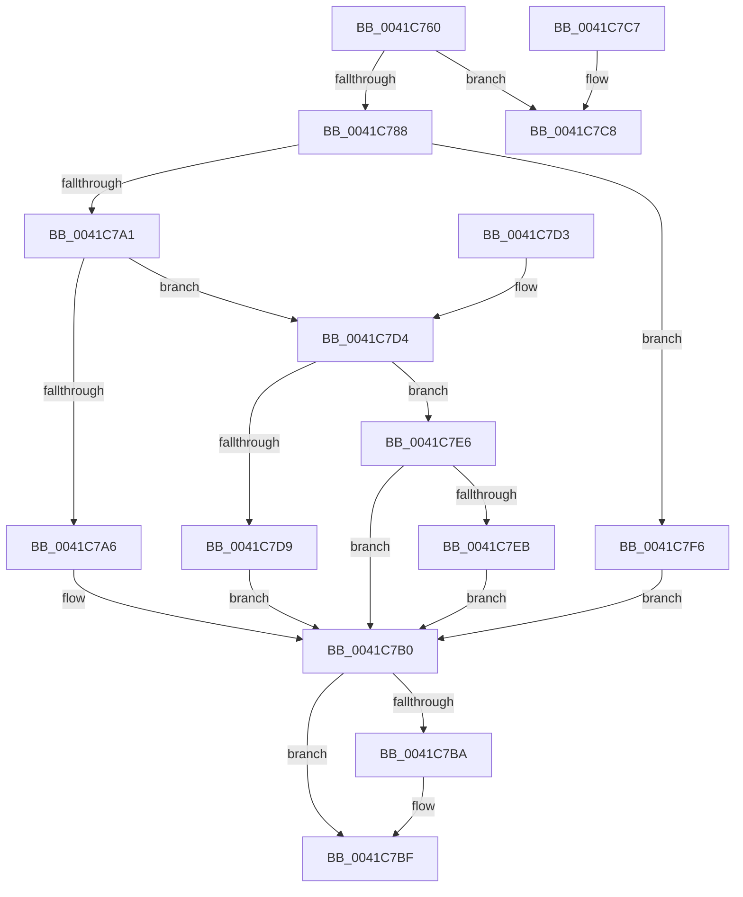

# HalpAcpiPmRegisterWrite

- RVA: `0x0041C760`–`0x0041C7FD` (길이 `157` bytes)
- VA: `0x000000014041C760`
- 실행 섹션: `.text`
- PDB 이름 있음: `예`; PDB Function 태그: `아니요`
- unwind 정보 RVA: `0x0009EB74`
- 디코드: `57`개 명령, `157/157` bytes 표시
- 미해석 바이트: `0` (있으면 어셈블리에 `.byte`로 보존)

> 이 문서는 커널 이미지의 기계어와 PDB 기호를 분석해 생성했습니다. 4번과 5번은 함수 원형과 자료형을 바이너리 사용 방식에서 추정한 C 해석이며 원본 소스 복구 결과는 아닙니다.

## 1. Dependencies

- 직접 호출 지점: **1**; 고유 호출 대상: **1**
- 직접 호출자로 확인된 함수: **8**
- RIP 상대 이미지 참조: **2**

### Outgoing calls
- `0x0041C7F6` → [guard_dispatch_icall](../6B/guard_dispatch_icall_function_006BAAD0.md) (function, `0x006BAAD0`)

### Direct callers
- [HalpPowerWriteResetCommand](../54/HalpPowerWriteResetCommand_function_00546744.md) at `0x00546818`
- [HalpShutdown](../54/HalpShutdown_function_005469AC.md) at `0x00546A71`
- [HalpShutdown](../54/HalpShutdown_function_005469AC.md) at `0x00546A90`
- [HalpShutdown](../54/HalpShutdown_function_005469AC.md) at `0x00546B10`
- [HalpShutdown](../54/HalpShutdown_function_005469AC.md) at `0x00546B69`
- [HalpCheckWakeupTimeAndAdjust](../55/HalpCheckWakeupTimeAndAdjust_function_0055BB14.md) at `0x0055BBD3`
- [HalpCheckWakeupTimeAndAdjust](../55/HalpCheckWakeupTimeAndAdjust_function_0055BB14.md) at `0x0055BBF6`
- [HaliAcpiSleep](../56/HaliAcpiSleep_function_0056AD60.md) at `0x0056AFCD`
- [HaliAcpiSleep](../56/HaliAcpiSleep_function_0056AD60.md) at `0x0056AFEC`
- [HaliAcpiSleep](../56/HaliAcpiSleep_function_0056AD60.md) at `0x0056B0F9`
- [HaliAcpiSleep](../56/HaliAcpiSleep_function_0056AD60.md) at `0x0056B14E`
- [HaliAcpiSleep](../56/HaliAcpiSleep_function_0056AD60.md) at `0x0056B1F0`
- [HaliAcpiSleep](../56/HaliAcpiSleep_function_0056AD60.md) at `0x0056B212`
- [HalpDpPostReplace](../../pagelk/B5/HalpDpPostReplace_function_00B5FCD0.md) at `0x00B5FDA6`
- [HalpDpPostReplace](../../pagelk/B5/HalpDpPostReplace_function_00B5FCD0.md) at `0x00B5FDD6`
- [HalpDpPreReplace](../../pagelk/B5/HalpDpPreReplace_function_00B5FF8C.md) at `0x00B6004E`
- [HalpDpPreReplace](../../pagelk/B5/HalpDpPreReplace_function_00B5FF8C.md) at `0x00B6007E`
- [HalpAcpiPostSleep](../../pagelk/B7/HalpAcpiPostSleep_function_00B79990.md) at `0x00B79A6E`
- [HalpAcpiPostSleep](../../pagelk/B7/HalpAcpiPostSleep_function_00B79990.md) at `0x00B79A9A`
- [sub_00B8109C](../../pagelk/B8/Unknown_function_00B8109C.md) at `0x00B8113B`
- [sub_00B8109C](../../pagelk/B8/Unknown_function_00B8109C.md) at `0x00B81164`
- [sub_00B8109C](../../pagelk/B8/Unknown_function_00B8109C.md) at `0x00B811C0`
- [sub_00B8109C](../../pagelk/B8/Unknown_function_00B8109C.md) at `0x00B811E6`

### Static image references
- `0x0041C769` → RVA `0x00F8FE60` (`.data`; read)
- `0x0041C78B` → RVA `0x003FE630` (`HalpAcpiPmRegisterWritePort`; read)

## 2. Other-region calls and transfers

- 다른 실행 섹션으로 향하는 call: **0**
- 별도 외부 분기/꼬리 이동을 확인하지 못했습니다.

## 3. Assembly (complete function range)

```asm
0041C760  40 53                           push rbx
0041C762  48 83 EC 20                     sub rsp, 0x20
0041C766  48 63 C1                        movsxd rax, ecx
0041C769  4C 8D 1D F0 36 B7 00            lea r11, [rip + 0xb736f0]
0041C770  44 8B D2                        mov r10d, edx
0041C773  48 8D 04 40                     lea rax, [rax + rax*2]
0041C777  48 03 C0                        add rax, rax
0041C77A  41 8B 54 C3 18                  mov edx, dword ptr [r11 + rax*8 + 0x18]
0041C77F  49 8D 1C C3                     lea rbx, [r11 + rax*8]
0041C783  41 3B D1                        cmp edx, r9d
0041C786  77 40                           ja 0x14041c7c8
0041C788  41 8B CA                        mov ecx, r10d
0041C78B  4C 8D 0D 9E 1E FE FF            lea r9, [rip - 0x1e162]
0041C792  49 03 4C C3 08                  add rcx, qword ptr [r11 + rax*8 + 8]
0041C797  49 8B 44 C3 28                  mov rax, qword ptr [r11 + rax*8 + 0x28]
0041C79C  49 3B C1                        cmp rax, r9
0041C79F  75 55                           jne 0x14041c7f6
0041C7A1  83 FA 01                        cmp edx, 1
0041C7A4  75 2E                           jne 0x14041c7d4
0041C7A6  41 0F B6 00                     movzx eax, byte ptr [r8]
0041C7AA  0F B7 D1                        movzx edx, cx
0041C7AD  90                              nop
0041C7AE  EE                              out dx, al
0041C7AF  90                              nop
0041C7B0  48 8B 4C 24 50                  mov rcx, qword ptr [rsp + 0x50]
0041C7B5  48 85 C9                        test rcx, rcx
0041C7B8  74 05                           je 0x14041c7bf
0041C7BA  8B 43 18                        mov eax, dword ptr [rbx + 0x18]
0041C7BD  89 01                           mov dword ptr [rcx], eax
0041C7BF  33 C0                           xor eax, eax
0041C7C1  48 83 C4 20                     add rsp, 0x20
0041C7C5  5B                              pop rbx
0041C7C6  C3                              ret
0041C7C7  CC                              int3
0041C7C8  B8 23 00 00 C0                  mov eax, 0xc0000023
0041C7CD  48 83 C4 20                     add rsp, 0x20
0041C7D1  5B                              pop rbx
0041C7D2  C3                              ret
0041C7D3  CC                              int3
0041C7D4  83 FA 02                        cmp edx, 2
0041C7D7  75 0D                           jne 0x14041c7e6
0041C7D9  41 0F B7 00                     movzx eax, word ptr [r8]
0041C7DD  0F B7 D1                        movzx edx, cx
0041C7E0  90                              nop
0041C7E1  66 EF                           out dx, ax
0041C7E3  90                              nop
0041C7E4  EB CA                           jmp 0x14041c7b0
0041C7E6  83 FA 04                        cmp edx, 4
0041C7E9  75 C5                           jne 0x14041c7b0
0041C7EB  41 8B 00                        mov eax, dword ptr [r8]
0041C7EE  0F B7 D1                        movzx edx, cx
0041C7F1  90                              nop
0041C7F2  EF                              out dx, eax
0041C7F3  90                              nop
0041C7F4  EB BA                           jmp 0x14041c7b0
0041C7F6  E8 D5 E2 29 00                  call 0x1406baad0
0041C7FB  EB B3                           jmp 0x14041c7b0
```

## 4. C-style interpretation (structured pseudocode)

```c
__int64 __fastcall HalpAcpiPmRegisterWrite(int a1, int a2, __int64 a3, int a4, __int64 a5)
{
    __int64 result;
    __int64 v_rsp;

    v_rsp = (v_rsp) - (32);
    result = ((int)(a1) + (int)(a1) * 2) + ((int)(a1) + (int)(a1) * 2);
    if (((unsigned int)((unsigned int)(*(unsigned int *)(v_rip + 12007152 + result * 8 + 24)))) > a4) goto loc_0041C7C8;
    a1 = ((unsigned int)((unsigned int)((unsigned int)(a2)))) + (*(unsigned __int64 *)(v_rip + 12007152 + result * 8 + 8));
    if ((*(unsigned __int64 *)(v_rip + 12007152 + result * 8 + 40)) != (v_rip - 123234)) goto loc_0041C7F6;
    if (((unsigned int)((unsigned int)(*(unsigned int *)(v_rip + 12007152 + result * 8 + 24)))) != 1) goto loc_0041C7D4;
loc_0041C7B0:
    result = *(unsigned __int8 *)(a3);
    if (a5 != 0) {
        result = *(unsigned int *)(v_rip + 12007152 + result * 8 + 24);
        *(unsigned int *)(a5) = (unsigned int)(result);
    }
    result = 0;
    v_rsp = (v_rsp) + (32);
    return result;
loc_0041C7C8:
    v_rsp = (v_rsp) + (32);
    return (unsigned int)(0xC0000023ULL);
loc_0041C7D4:
    if (((unsigned int)((unsigned __int16)(a1))) != 2) goto loc_0041C7E6;
    goto loc_0041C7B0;
loc_0041C7E6:
    if (((unsigned int)((unsigned __int16)(a5))) != 4) goto loc_0041C7B0;
    goto loc_0041C7B0;
loc_0041C7F6:
    result = guard_dispatch_icall(a5, (unsigned __int16)(a5), a3, v_rip - 123234);
    goto loc_0041C7B0;
}
```

## 5. (Beta) C Style

```c
int64_t HalpAcpiPmRegisterWrite(void *Arg1, int32_t Arg2, void *Arg3, int32_t Arg4, int64_t Arg5)
{
    uint8_t *arg1 = (uint8_t *)Arg1;
    uint8_t *arg3 = (uint8_t *)Arg3;

    int64_t result;
    int64_t local_rsp;

    local_rsp = (local_rsp) - (32);
    result = ((int32_t)(Arg1) + (int32_t)(Arg1) * 2) + ((int32_t)(Arg1) + (int32_t)(Arg1) * 2);
    if (((uint32_t)((uint32_t)(*(uint32_t *)(v_rip + 0xB736F0 + result * 8 + 0x18)))) > Arg4) goto loc_0041C7C8;
    Arg1 = ((uint32_t)((uint32_t)((uint32_t)(Arg2)))) + (*(uint64_t *)(v_rip + 0xB736F0 + result * 8 + 0x8));
    if ((*(uint64_t *)(v_rip + 0xB736F0 + result * 8 + 0x28)) != (v_rip - 123234)) goto loc_0041C7F6;
    if (((uint32_t)((uint32_t)(*(uint32_t *)(v_rip + 0xB736F0 + result * 8 + 0x18)))) != 1) goto loc_0041C7D4;
loc_0041C7B0:
    result = *(uint8_t *)(arg3);
    if (Arg5 != 0) {
        result = *(uint32_t *)(v_rip + 0xB736F0 + result * 8 + 0x18);
        *(uint32_t *)(Arg5) = (uint32_t)(result);
    }
    result = 0;
    local_rsp = (local_rsp) + (32);
    return result;
loc_0041C7C8:
    local_rsp = (local_rsp) + (32);
    return (uint32_t)(0xC0000023ULL);
loc_0041C7D4:
    if (((uint32_t)((uint16_t)(Arg1))) != 2) goto loc_0041C7E6;
    goto loc_0041C7B0;
loc_0041C7E6:
    if (((uint32_t)((uint16_t)(Arg5))) != 4) goto loc_0041C7B0;
    goto loc_0041C7B0;
loc_0041C7F6:
    result = guard_dispatch_icall(Arg5, (uint16_t)(Arg5), Arg3, v_rip - 123234);
    goto loc_0041C7B0;
}
```

### 관측된 메모리 오프셋

구조체 형식이 확인되지 않은 접근은 인자 기준의 오프셋으로만 기록했습니다.

| 기준 인자 | 오프셋 표현 | 폭 (bit) | 접근 |
|---|---:|---:|---|
| `Arg1` | `+ 0x0 + rax*2` | `64` | `R` |
| `Arg3` | `+ 0x0` | `8` | `R` |
| `Arg3` | `+ 0x0` | `16` | `R` |
| `Arg3` | `+ 0x0` | `32` | `R` |

## 6. Execution-region graph

[열기: 2D/3D 그래프와 함수 탐색 컨트롤 패널](../../../control-panel.html?section=text&rva=0x0041C760&view=graph)

- 2D 그래프는 위에서 아래로 흐르고, 3D 그래프는 빈 공간을 드래그해 회전합니다. Shift+드래그는 이동, 휠은 확대·축소, 함수 노드 선택은 대상 보고서 이동입니다.

### Static fallback


