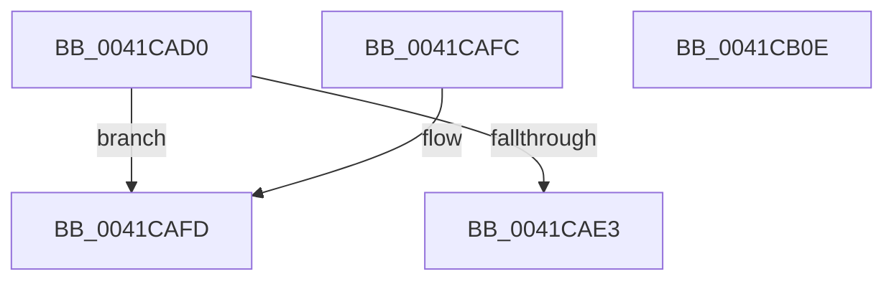

# HalpApicX2WriteCommand

- RVA: `0x0041CAD0`–`0x0041CB0F` (길이 `63` bytes)
- VA: `0x000000014041CAD0`
- 실행 섹션: `.text`
- PDB 이름 있음: `예`; PDB Function 태그: `아니요`
- unwind 정보 RVA: `0x000DB714`
- 디코드: `21`개 명령, `63/63` bytes 표시
- 미해석 바이트: `0` (있으면 어셈블리에 `.byte`로 보존)

> 이 문서는 커널 이미지의 기계어와 PDB 기호를 분석해 생성했습니다. 4번과 5번은 함수 원형과 자료형을 바이너리 사용 방식에서 추정한 C 해석이며 원본 소스 복구 결과는 아닙니다.

## 1. Dependencies

- 직접 호출 지점: **0**; 고유 호출 대상: **0**
- 직접 호출자로 확인된 함수: **0**
- RIP 상대 이미지 참조: **0**

### Outgoing calls
- 직접 디코드된 call 명령이 없습니다.

### Direct callers
- 이 함수 시작 RVA로 연결되는 직접 call은 확인되지 않았습니다. 간접 호출은 완전히 역산할 수 없습니다.

### Static image references
- 디코드된 RIP-relative 메모리 참조가 없습니다.

## 2. Other-region calls and transfers

- 다른 실행 섹션으로 향하는 call: **0**
- 별도 외부 분기/꼬리 이동을 확인하지 못했습니다.

## 3. Assembly (complete function range)

```asm
0041CAD0  8B C2                           mov eax, edx
0041CAD2  81 E2 00 00 0C 00               and edx, 0xc0000
0041CAD8  44 8B C1                        mov r8d, ecx
0041CADB  81 FA 00 00 04 00               cmp edx, 0x40000
0041CAE1  74 1A                           je 0x14041cafd
0041CAE3  41 8B D0                        mov edx, r8d
0041CAE6  B9 30 08 00 00                  mov ecx, 0x830
0041CAEB  48 C1 E2 20                     shl rdx, 0x20
0041CAEF  48 0B D0                        or rdx, rax
0041CAF2  48 8B C2                        mov rax, rdx
0041CAF5  48 C1 EA 20                     shr rdx, 0x20
0041CAF9  0F 30                           wrmsr
0041CAFB  C3                              ret
0041CAFC  CC                              int3
0041CAFD  0F B6 D0                        movzx edx, al
0041CB00  B9 3F 08 00 00                  mov ecx, 0x83f
0041CB05  8B C2                           mov eax, edx
0041CB07  48 C1 EA 20                     shr rdx, 0x20
0041CB0B  0F 30                           wrmsr
0041CB0D  C3                              ret
0041CB0E  CC                              int3
```

## 4. C-style interpretation (structured pseudocode)

```c
__int64 __fastcall HalpApicX2WriteCommand(int a1, int a2)
{
    a2 = (unsigned int)((a2) & (0xC0000ULL));
    if (a2 == 0x40000ULL) goto loc_0041CAFD;
    a2 = ((unsigned int)((unsigned int)((unsigned int)(a1)))) << (32);
    a2 = (a2) | ((unsigned int)(a2));
    a2 = (a2) >> (32);
    return a2;
loc_0041CAFD:
    a2 = ((unsigned __int8)(a2)) >> (32);
    return (unsigned int)((unsigned int)((unsigned __int8)(a2)));
}
```

## 5. (Beta) C Style

```c
int64_t HalpApicX2WriteCommand(int32_t Arg1, int32_t Arg2)
{
    Arg2 = (uint32_t)((Arg2) & (0xC0000ULL));
    if (Arg2 == 0x40000ULL) goto loc_0041CAFD;
    Arg2 = ((uint32_t)((uint32_t)((uint32_t)(Arg1)))) << (32);
    Arg2 = (Arg2) | ((uint32_t)(Arg2));
    Arg2 = (Arg2) >> (32);
    return Arg2;
loc_0041CAFD:
    Arg2 = ((uint8_t)(Arg2)) >> (32);
    return (uint32_t)((uint32_t)((uint8_t)(Arg2)));
}
```

## 6. Execution-region graph

[열기: 2D/3D 그래프와 함수 탐색 컨트롤 패널](../../../control-panel.html?section=text&rva=0x0041CAD0&view=graph)

- 2D 그래프는 위에서 아래로 흐르고, 3D 그래프는 빈 공간을 드래그해 회전합니다. Shift+드래그는 이동, 휠은 확대·축소, 함수 노드 선택은 대상 보고서 이동입니다.

### Static fallback


