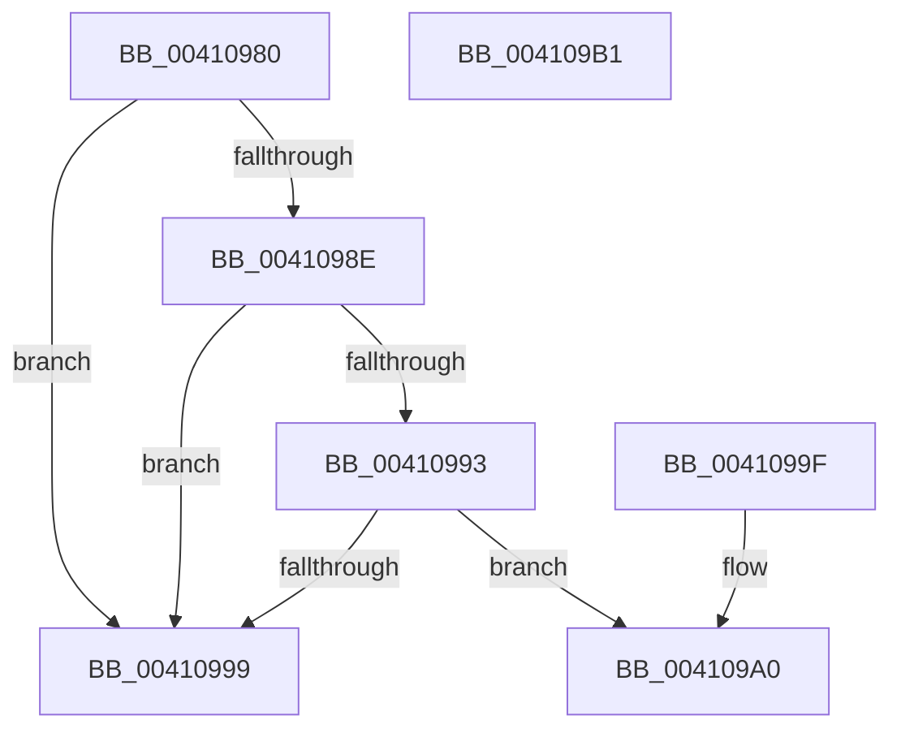

# IoGetActivityIdIrp

- RVA: `0x00410980`–`0x004109B2` (길이 `50` bytes)
- VA: `0x0000000140410980`
- 실행 섹션: `.text`
- PDB 이름 있음: `예`; PDB Function 태그: `아니요`
- unwind 정보 RVA: `0x000DB714`
- 디코드: `17`개 명령, `50/50` bytes 표시
- 미해석 바이트: `0` (있으면 어셈블리에 `.byte`로 보존)

> 이 문서는 커널 이미지의 기계어와 PDB 기호를 분석해 생성했습니다. 4번과 5번은 함수 원형과 자료형을 바이너리 사용 방식에서 추정한 C 해석이며 원본 소스 복구 결과는 아닙니다.

## 1. Dependencies

- 직접 호출 지점: **0**; 고유 호출 대상: **0**
- 직접 호출자로 확인된 함수: **1**
- RIP 상대 이미지 참조: **0**

### Outgoing calls
- 직접 디코드된 call 명령이 없습니다.

### Direct callers
- [IoPropagateActivityIdToThread](IoPropagateActivityIdToThread_function_00410910.md) at `0x0041094A`

### Static image references
- 디코드된 RIP-relative 메모리 참조가 없습니다.

## 2. Other-region calls and transfers

- 다른 실행 섹션으로 향하는 call: **0**
- 별도 외부 분기/꼬리 이동을 확인하지 못했습니다.

## 3. Assembly (complete function range)

```asm
00410980  48 8B 81 C8 00 00 00            mov rax, qword ptr [rcx + 0xc8]
00410987  90                              nop
00410988  80 79 47 00                     cmp byte ptr [rcx + 0x47], 0
0041098C  7C 0B                           jl 0x140410999
0041098E  48 85 C0                        test rax, rax
00410991  74 06                           je 0x140410999
00410993  F6 40 02 01                     test byte ptr [rax + 2], 1
00410997  75 07                           jne 0x1404109a0
00410999  B8 25 02 00 C0                  mov eax, 0xc0000225
0041099E  C3                              ret
0041099F  CC                              int3
004109A0  48 8B 81 C8 00 00 00            mov rax, qword ptr [rcx + 0xc8]
004109A7  0F 10 40 18                     movups xmm0, xmmword ptr [rax + 0x18]
004109AB  33 C0                           xor eax, eax
004109AD  0F 11 02                        movups xmmword ptr [rdx], xmm0
004109B0  C3                              ret
004109B1  CC                              int3
```

## 4. C-style interpretation (structured pseudocode)

```c
__int64 __fastcall IoGetActivityIdIrp(__int64 a1, __int64 a2)
{
    __int64 result;

    if ((*(unsigned __int8 *)(a1 + 71)) < 0) goto loc_00410999;
    if (*(unsigned __int64 *)(a1 + 200) == 0) goto loc_00410999;
    if (((*(unsigned __int8 *)(*(unsigned __int64 *)(a1 + 200) + 2)) & (1)) != 0) goto loc_004109A0;
loc_00410999:
    return (unsigned int)(0xC0000225ULL);
loc_004109A0:
    result = 0;
    *(unsigned __int64 *)(a2) = v_xmm0;
    return result;
}
```

## 5. (Beta) C Style

```c
int64_t IoGetActivityIdIrp(void *Arg1, void *Arg2)
{
    uint8_t *arg1 = (uint8_t *)Arg1;
    uint8_t *arg2 = (uint8_t *)Arg2;

    int64_t result;

    if ((*(uint8_t *)(arg1 + 0x47)) < 0) goto loc_00410999;
    if (*(uint64_t *)(arg1 + 0xC8) == 0) goto loc_00410999;
    if (((*(uint8_t *)(*(uint64_t *)(arg1 + 0xC8) + 0x2)) & (1)) != 0) goto loc_004109A0;
loc_00410999:
    return (uint32_t)(0xC0000225ULL);
loc_004109A0:
    result = 0;
    *(uint64_t *)(arg2) = v_xmm0;
    return result;
}
```

### 관측된 메모리 오프셋

구조체 형식이 확인되지 않은 접근은 인자 기준의 오프셋으로만 기록했습니다.

| 기준 인자 | 오프셋 표현 | 폭 (bit) | 접근 |
|---|---:|---:|---|
| `Arg1` | `+ 0x47` | `8` | `R` |
| `Arg1` | `+ 0xC8` | `64` | `R` |
| `Arg2` | `+ 0x0` | `128` | `R` |

## 6. Execution-region graph

[열기: 2D/3D 그래프와 함수 탐색 컨트롤 패널](../../../control-panel.html?section=text&rva=0x00410980&view=graph)

- 2D 그래프는 위에서 아래로 흐르고, 3D 그래프는 빈 공간을 드래그해 회전합니다. Shift+드래그는 이동, 휠은 확대·축소, 함수 노드 선택은 대상 보고서 이동입니다.

### Static fallback


