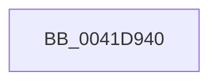

# IoGetAttachedDeviceReference

- RVA: `0x0041D940`–`0x0041D94A` (길이 `10` bytes)
- VA: `0x000000014041D940`
- 실행 섹션: `.text`
- PDB 이름 있음: `예`; PDB Function 태그: `아니요`
- unwind 정보 RVA: `0x0009F094`
- 디코드: `3`개 명령, `10/10` bytes 표시
- 미해석 바이트: `0` (있으면 어셈블리에 `.byte`로 보존)

> 이 문서는 커널 이미지의 기계어와 PDB 기호를 분석해 생성했습니다. 4번과 5번은 함수 원형과 자료형을 바이너리 사용 방식에서 추정한 C 해석이며 원본 소스 복구 결과는 아닙니다.

## 1. Dependencies

- 직접 호출 지점: **0**; 고유 호출 대상: **0**
- 직접 호출자로 확인된 함수: **11**
- RIP 상대 이미지 참조: **0**

### Outgoing calls
- 직접 디코드된 call 명령이 없습니다.

### Direct callers
- [HalpQueryPccInterface](../../page/70/HalpQueryPccInterface_function_0070D79C.md) at `0x0070D805`
- [ExpQueryPrmInterface](../../page/7C/ExpQueryPrmInterface_function_007CF018.md) at `0x007CF075`
- [CmpGetVolumeClusterSize](../../page/87/CmpGetVolumeClusterSize_function_0087B3D4.md) at `0x0087B480`
- [CmpVolumeManagerGetContextForFile](../../page/95/CmpVolumeManagerGetContextForFile_function_009525A8.md) at `0x00952619`
- [WmipForwardWmiIrp](../../page/9E/WmipForwardWmiIrp_function_009E0DB4.md) at `0x009E0EE2`
- [WmipRegisterDevice](../../page/9E/WmipRegisterDevice_function_009E2808.md) at `0x009E2880`
- [IopFilterResourceRequirementsCall](../../page/A9/IopFilterResourceRequirementsCall_function_00A92388.md) at `0x00A923B6`
- [WmipGetFilePDO](../../page/AA/WmipGetFilePDO_function_00AAF454.md) at `0x00AAF4A3`
- [IoShutdownSystem](../../pagelk/B6/IoShutdownSystem_function_00B63B8C.md) at `0x00B63C2D`
- [IoShutdownSystem](../../pagelk/B6/IoShutdownSystem_function_00B63B8C.md) at `0x00B63D58`
- [IoBuildPoDeviceNotifyList](../../pagelk/B7/IoBuildPoDeviceNotifyList_function_00B78B0C.md) at `0x00B78C05`
- [VfIrpSendSynchronousIrp](../../pagevrfy/B9/VfIrpSendSynchronousIrp_function_00B9DEF0.md) at `0x00B9DF3B`

### Static image references
- 디코드된 RIP-relative 메모리 참조가 없습니다.

## 2. Other-region calls and transfers

- 다른 실행 섹션으로 향하는 call: **0**
- 별도 외부 분기/꼬리 이동을 확인하지 못했습니다.

## 3. Assembly (complete function range)

```asm
0041D940  48 89 5C 24 18                  mov qword ptr [rsp + 0x18], rbx
0041D945  56                              push rsi
0041D946  48 83 EC 20                     sub rsp, 0x20
```

## 4. C-style interpretation (structured pseudocode)

```c
void __fastcall IoGetAttachedDeviceReference(void)
{
    __int64 v_rsp;
    unsigned __int64 v_stack_p18;

    v_stack_p18 = v_rbx;
    v_rsp = (v_rsp) - (32);
    return;
}
```

## 5. (Beta) C Style

```c
void IoGetAttachedDeviceReference(void)
{
    int64_t local_rsp;
    uint64_t v_stack_p18;

    v_stack_p18 = local_rbx;
    local_rsp = (local_rsp) - (32);
    return;
}
```

## 6. Execution-region graph

[열기: 2D/3D 그래프와 함수 탐색 컨트롤 패널](../../../control-panel.html?section=text&rva=0x0041D940&view=graph)

- 2D 그래프는 위에서 아래로 흐르고, 3D 그래프는 빈 공간을 드래그해 회전합니다. Shift+드래그는 이동, 휠은 확대·축소, 함수 노드 선택은 대상 보고서 이동입니다.

### Static fallback


