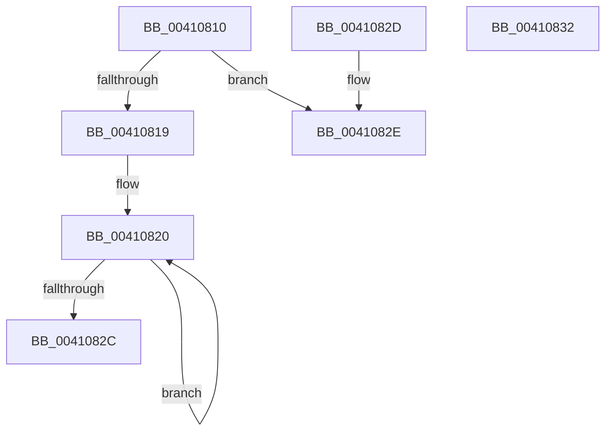

# IoGetAttachedDevice

- RVA: `0x00410810`–`0x00410833` (길이 `35` bytes)
- VA: `0x0000000140410810`
- 실행 섹션: `.text`
- PDB 이름 있음: `예`; PDB Function 태그: `아니요`
- unwind 정보 RVA: `0x000DB714`
- 디코드: `13`개 명령, `35/35` bytes 표시
- 미해석 바이트: `0` (있으면 어셈블리에 `.byte`로 보존)

> 이 문서는 커널 이미지의 기계어와 PDB 기호를 분석해 생성했습니다. 4번과 5번은 함수 원형과 자료형을 바이너리 사용 방식에서 추정한 C 해석이며 원본 소스 복구 결과는 아닙니다.

## 1. Dependencies

- 직접 호출 지점: **0**; 고유 호출 대상: **0**
- 직접 호출자로 확인된 함수: **14**
- RIP 상대 이미지 참조: **0**

### Outgoing calls
- 직접 디코드된 call 명령이 없습니다.

### Direct callers
- [NtSetInformationFile](../29/NtSetInformationFile_function_0029C5E0.md) at `0x0029D2A5`
- [IopAttachDeviceToDeviceStackSafe](IopAttachDeviceToDeviceStackSafe_function_00410574.md) at `0x004105E3`
- [IoAdjustStackSizeForRedirection](../4B/IoAdjustStackSizeForRedirection_function_004BB3B0.md) at `0x004BB424`
- [PipSendGuestAssignedNotification](../../page/74/PipSendGuestAssignedNotification_function_007404B4.md) at `0x007404D8`
- [sub_0086405D](../../page/86/Unknown_function_0086405D.md) at `0x0086405D`
- [IopCloseFile](../../page/86/IopCloseFile_function_008640C0.md) at `0x0086427B`
- [IopParseDevice](../../page/89/IopParseDevice_function_0089E510.md) at `0x0089E93C`
- [NtQueryInformationFile](../../page/8A/NtQueryInformationFile_function_008AD630.md) at `0x008AE087`
- [IopXxxControlFile](../../page/8E/IopXxxControlFile_function_008E9AD0.md) at `0x008EA782`
- [IopXxxControlFile](../../page/8E/IopXxxControlFile_function_008E9AD0.md) at `0x008EA822`
- [FsRtlQueryOpen](../../page/9D/FsRtlQueryOpen_function_009D85A4.md) at `0x009D85F6`
- [NtUnlockFile](../../page/9E/NtUnlockFile_function_009E5DA0.md) at `0x009E6250`
- [sub_00B174A6](../../page/B1/Unknown_function_00B174A6.md) at `0x00B174AA`
- [IopShutdownBaseFileSystems](../../pagelk/B6/IopShutdownBaseFileSystems_function_00B63E10.md) at `0x00B63E96`
- [VfFilterAttach](../../pagevrfy/BA/VfFilterAttach_function_00BACD80.md) at `0x00BACDFE`

### Static image references
- 디코드된 RIP-relative 메모리 참조가 없습니다.

## 2. Other-region calls and transfers

- 다른 실행 섹션으로 향하는 call: **0**
- 별도 외부 분기/꼬리 이동을 확인하지 못했습니다.

## 3. Assembly (complete function range)

```asm
00410810  48 8B 51 18                     mov rdx, qword ptr [rcx + 0x18]
00410814  48 85 D2                        test rdx, rdx
00410817  74 15                           je 0x14041082e
00410819  0F 1F 80 00 00 00 00            nop dword ptr [rax]
00410820  48 8B C2                        mov rax, rdx
00410823  48 8B 52 18                     mov rdx, qword ptr [rdx + 0x18]
00410827  48 85 D2                        test rdx, rdx
0041082A  75 F4                           jne 0x140410820
0041082C  C3                              ret
0041082D  CC                              int3
0041082E  48 8B C1                        mov rax, rcx
00410831  C3                              ret
00410832  CC                              int3
```

## 4. C-style interpretation (structured pseudocode)

```c
__int64 __fastcall IoGetAttachedDevice(__int64 a1)
{
    if (*(unsigned __int64 *)(a1 + 24) == 0) goto loc_0041082E;
loc_00410820:
    if (*(unsigned __int64 *)(*(unsigned __int64 *)(a1 + 24) + 24) != 0) goto loc_00410820;
    return *(unsigned __int64 *)(a1 + 24);
loc_0041082E:
    return a1;
}
```

## 5. (Beta) C Style

```c
void *IoGetAttachedDevice(void *Arg1)
{
    uint8_t *arg1 = (uint8_t *)Arg1;

    if (*(uint64_t *)(arg1 + 0x18) == 0) goto loc_0041082E;
loc_00410820:
    if (*(uint64_t *)(*(uint64_t *)(arg1 + 0x18) + 0x18) != 0) goto loc_00410820;
    return *(uint64_t *)(arg1 + 0x18);
loc_0041082E:
    return Arg1;
}
```

### 관측된 메모리 오프셋

구조체 형식이 확인되지 않은 접근은 인자 기준의 오프셋으로만 기록했습니다.

| 기준 인자 | 오프셋 표현 | 폭 (bit) | 접근 |
|---|---:|---:|---|
| `Arg1` | `+ 0x18` | `64` | `R` |

## 6. Execution-region graph

[열기: 2D/3D 그래프와 함수 탐색 컨트롤 패널](../../../control-panel.html?section=text&rva=0x00410810&view=graph)

- 2D 그래프는 위에서 아래로 흐르고, 3D 그래프는 빈 공간을 드래그해 회전합니다. Shift+드래그는 이동, 휠은 확대·축소, 함수 노드 선택은 대상 보고서 이동입니다.

### Static fallback


