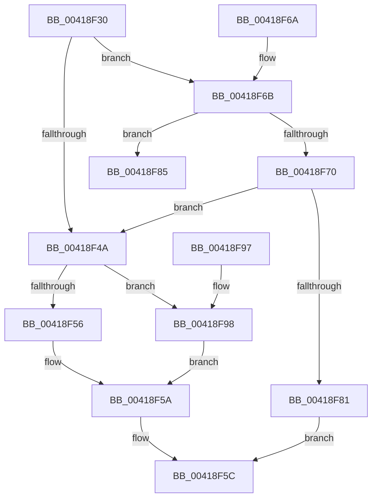

# IoGetFileObjectFilterContext

- RVA: `0x00418F30`–`0x00418F9C` (길이 `108` bytes)
- VA: `0x0000000140418F30`
- 실행 섹션: `.text`
- PDB 이름 있음: `예`; PDB Function 태그: `아니요`
- unwind 정보 RVA: `0x0009D0CC`
- 디코드: `37`개 명령, `108/108` bytes 표시
- 미해석 바이트: `0` (있으면 어셈블리에 `.byte`로 보존)

> 이 문서는 커널 이미지의 기계어와 PDB 기호를 분석해 생성했습니다. 4번과 5번은 함수 원형과 자료형을 바이너리 사용 방식에서 추정한 C 해석이며 원본 소스 복구 결과는 아닙니다.

## 1. Dependencies

- 직접 호출 지점: **1**; 고유 호출 대상: **1**
- 직접 호출자로 확인된 함수: **2**
- RIP 상대 이미지 참조: **0**

### Outgoing calls
- `0x00418F78` → [IopAllocateFileObjectExtension](IopAllocateFileObjectExtension_function_00418FB0.md) (function, `0x00418FB0`)

### Direct callers
- [sub_0026525D](../26/Unknown_function_0026525D.md) at `0x00265274`
- [sub_00863F57](../../page/86/Unknown_function_00863F57.md) at `0x00863FCF`

### Static image references
- 디코드된 RIP-relative 메모리 참조가 없습니다.

## 2. Other-region calls and transfers

- 다른 실행 섹션으로 향하는 call: **0**
- 별도 외부 분기/꼬리 이동을 확인하지 못했습니다.

## 3. Assembly (complete function range)

```asm
00418F30  48 89 5C 24 10                  mov qword ptr [rsp + 0x10], rbx
00418F35  57                              push rdi
00418F36  48 83 EC 20                     sub rsp, 0x20
00418F3A  48 83 B9 D0 00 00 00 00         cmp qword ptr [rcx + 0xd0], 0
00418F42  48 8B FA                        mov rdi, rdx
00418F45  48 8B D9                        mov rbx, rcx
00418F48  74 21                           je 0x140418f6b
00418F4A  48 8B 83 D0 00 00 00            mov rax, qword ptr [rbx + 0xd0]
00418F51  48 85 C0                        test rax, rax
00418F54  74 42                           je 0x140418f98
00418F56  48 8B 48 20                     mov rcx, qword ptr [rax + 0x20]
00418F5A  33 C0                           xor eax, eax
00418F5C  48 89 0F                        mov qword ptr [rdi], rcx
00418F5F  48 8B 5C 24 38                  mov rbx, qword ptr [rsp + 0x38]
00418F64  48 83 C4 20                     add rsp, 0x20
00418F68  5F                              pop rdi
00418F69  C3                              ret
00418F6A  CC                              int3
00418F6B  45 84 C0                        test r8b, r8b
00418F6E  74 15                           je 0x140418f85
00418F70  45 33 C0                        xor r8d, r8d
00418F73  48 8D 54 24 30                  lea rdx, [rsp + 0x30]
00418F78  E8 33 00 00 00                  call 0x140418fb0
00418F7D  85 C0                           test eax, eax
00418F7F  79 C9                           jns 0x140418f4a
00418F81  33 C9                           xor ecx, ecx
00418F83  EB D7                           jmp 0x140418f5c
00418F85  48 8B 5C 24 38                  mov rbx, qword ptr [rsp + 0x38]
00418F8A  33 C9                           xor ecx, ecx
00418F8C  48 89 0A                        mov qword ptr [rdx], rcx
00418F8F  33 C0                           xor eax, eax
00418F91  48 83 C4 20                     add rsp, 0x20
00418F95  5F                              pop rdi
00418F96  C3                              ret
00418F97  CC                              int3
00418F98  33 C9                           xor ecx, ecx
00418F9A  EB BE                           jmp 0x140418f5a
```

## 4. C-style interpretation (structured pseudocode)

```c
__int64 __fastcall IoGetFileObjectFilterContext(__int64 a1, __int64 a2, int a3)
{
    __int64 result;
    __int64 v_rsp;
    unsigned __int64 v_stack_p10;
    unsigned __int64 v_stack_p30;
    unsigned __int64 v_stack_p38;

    v_stack_p10 = v_rbx;
    v_rsp = (v_rsp) - (32);
    if ((*(unsigned __int64 *)(a1 + 208)) == 0) goto loc_00418F6B;
loc_00418F4A:
    if (*(unsigned __int64 *)(a1 + 208) == 0) goto loc_00418F98;
loc_00418F5A:
    result = 0;
loc_00418F5C:
    *(unsigned __int64 *)(a2) = *(unsigned __int64 *)(*(unsigned __int64 *)(a1 + 208) + 32);
    v_rsp = (v_rsp) + (32);
    return result;
loc_00418F6B:
    if ((unsigned __int8)(a3) == 0) goto loc_00418F85;
    a3 = 0;
    result = IopAllocateFileObjectExtension(*(unsigned __int64 *)(*(unsigned __int64 *)(a1 + 208) + 32), v_stack_p30, a3, a4);
    if (!sign_flag) goto loc_00418F4A;
    a1 = 0;
    goto loc_00418F5C;
loc_00418F85:
    a1 = 0;
    *(unsigned __int64 *)(v_stack_p30) = 0;
    result = 0;
    v_rsp = (v_rsp) + (32);
    return result;
loc_00418F98:
    a1 = 0;
    goto loc_00418F5A;
}
```

## 5. (Beta) C Style

```c
int64_t IoGetFileObjectFilterContext(void *Arg1, void *Arg2, int32_t Arg3)
{
    uint8_t *arg1 = (uint8_t *)Arg1;
    uint8_t *arg2 = (uint8_t *)Arg2;

    int64_t result;
    int64_t local_rsp;
    uint64_t v_stack_p10;
    uint64_t v_stack_p30;
    uint64_t v_stack_p38;

    v_stack_p10 = local_rbx;
    local_rsp = (local_rsp) - (32);
    if ((*(uint64_t *)(arg1 + 0xD0)) == 0) goto loc_00418F6B;
loc_00418F4A:
    if (*(uint64_t *)(arg1 + 0xD0) == 0) goto loc_00418F98;
loc_00418F5A:
    result = 0;
loc_00418F5C:
    *(uint64_t *)(arg2) = *(uint64_t *)(*(uint64_t *)(arg1 + 0xD0) + 0x20);
    local_rsp = (local_rsp) + (32);
    return result;
loc_00418F6B:
    if ((uint8_t)(Arg3) == 0) goto loc_00418F85;
    Arg3 = 0;
    result = IopAllocateFileObjectExtension(*(uint64_t *)(*(uint64_t *)(arg1 + 0xD0) + 0x20), v_stack_p30, Arg3, a4);
    if (!sign_flag) goto loc_00418F4A;
    Arg1 = 0;
    goto loc_00418F5C;
loc_00418F85:
    Arg1 = 0;
    *(uint64_t *)(v_stack_p30) = 0;
    result = 0;
    local_rsp = (local_rsp) + (32);
    return result;
loc_00418F98:
    Arg1 = 0;
    goto loc_00418F5A;
}
```

### 관측된 메모리 오프셋

구조체 형식이 확인되지 않은 접근은 인자 기준의 오프셋으로만 기록했습니다.

| 기준 인자 | 오프셋 표현 | 폭 (bit) | 접근 |
|---|---:|---:|---|
| `Arg1` | `+ 0xD0` | `64` | `R` |
| `Arg2` | `+ 0x0` | `64` | `W` |

## 6. Execution-region graph

[열기: 2D/3D 그래프와 함수 탐색 컨트롤 패널](../../../control-panel.html?section=text&rva=0x00418F30&view=graph)

- 2D 그래프는 위에서 아래로 흐르고, 3D 그래프는 빈 공간을 드래그해 회전합니다. Shift+드래그는 이동, 휠은 확대·축소, 함수 노드 선택은 대상 보고서 이동입니다.

### Static fallback


