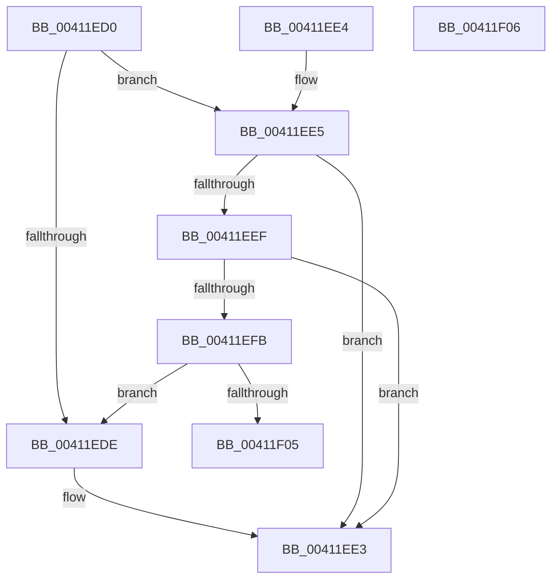

# IoGetIoPriorityHint

- RVA: `0x00411ED0`–`0x00411F07` (길이 `55` bytes)
- VA: `0x0000000140411ED0`
- 실행 섹션: `.text`
- PDB 이름 있음: `예`; PDB Function 태그: `아니요`
- unwind 정보 RVA: `0x000DB714`
- 디코드: `19`개 명령, `55/55` bytes 표시
- 미해석 바이트: `0` (있으면 어셈블리에 `.byte`로 보존)

> 이 문서는 커널 이미지의 기계어와 PDB 기호를 분석해 생성했습니다. 4번과 5번은 함수 원형과 자료형을 바이너리 사용 방식에서 추정한 C 해석이며 원본 소스 복구 결과는 아닙니다.

## 1. Dependencies

- 직접 호출 지점: **0**; 고유 호출 대상: **0**
- 직접 호출자로 확인된 함수: **2**
- RIP 상대 이미지 참조: **0**

### Outgoing calls
- 직접 디코드된 call 명령이 없습니다.

### Direct callers
- [NtQueryInformationFile](../../page/8A/NtQueryInformationFile_function_008AD630.md) at `0x008ADAF2`
- [IopSynchronousServiceTail](../../page/8E/IopSynchronousServiceTail_function_008EB440.md) at `0x008EB6CD`

### Static image references
- 디코드된 RIP-relative 메모리 참조가 없습니다.

## 2. Other-region calls and transfers

- 다른 실행 섹션으로 향하는 call: **0**
- 별도 외부 분기/꼬리 이동을 확인하지 못했습니다.

## 3. Assembly (complete function range)

```asm
00411ED0  8B 41 10                        mov eax, dword ptr [rcx + 0x10]
00411ED3  48 8B D1                        mov rdx, rcx
00411ED6  C1 E8 11                        shr eax, 0x11
00411ED9  83 E0 07                        and eax, 7
00411EDC  75 07                           jne 0x140411ee5
00411EDE  B8 02 00 00 00                  mov eax, 2
00411EE3  C3                              ret
00411EE4  CC                              int3
00411EE5  8D 48 FF                        lea ecx, [rax - 1]
00411EE8  8B C1                           mov eax, ecx
00411EEA  83 F9 02                        cmp ecx, 2
00411EED  7D F4                           jge 0x140411ee3
00411EEF  4C 8B 82 98 00 00 00            mov r8, qword ptr [rdx + 0x98]
00411EF6  4D 85 C0                        test r8, r8
00411EF9  74 E8                           je 0x140411ee3
00411EFB  41 83 B8 E0 05 00 00 00         cmp dword ptr [r8 + 0x5e0], 0
00411F03  75 D9                           jne 0x140411ede
00411F05  C3                              ret
00411F06  CC                              int3
```

## 4. C-style interpretation (structured pseudocode)

```c
__int64 __fastcall IoGetIoPriorityHint(__int64 a1)
{
    __int64 result;

    result = (unsigned int)(((unsigned int)(*(unsigned int *)(a1 + 16))) >> (17));
    result = (unsigned int)((result) & (7));
    if (condition_is_not_equal) goto loc_00411EE5;
loc_00411EDE:
loc_00411EE3:
    return 2;
loc_00411EE5:
    if (((unsigned int)(2 - 1)) >= 2) goto loc_00411EE3;
    if (*(unsigned __int64 *)(a1 + 152) == 0) goto loc_00411EE3;
    if ((*(unsigned int *)(*(unsigned __int64 *)(a1 + 152) + 1504)) != 0) goto loc_00411EDE;
    return (unsigned int)((unsigned int)(2 - 1));
}
```

## 5. (Beta) C Style

```c
int64_t IoGetIoPriorityHint(void *Arg1)
{
    uint8_t *arg1 = (uint8_t *)Arg1;

    int64_t result;

    result = (uint32_t)(((uint32_t)(*(uint32_t *)(arg1 + 0x10))) >> (17));
    result = (uint32_t)((result) & (7));
    if (condition_is_not_equal) goto loc_00411EE5;
loc_00411EDE:
loc_00411EE3:
    return 2;
loc_00411EE5:
    if (((uint32_t)(2 - 1)) >= 2) goto loc_00411EE3;
    if (*(uint64_t *)(arg1 + 0x98) == 0) goto loc_00411EE3;
    if ((*(uint32_t *)(*(uint64_t *)(arg1 + 0x98) + 0x5E0)) != 0) goto loc_00411EDE;
    return (uint32_t)((uint32_t)(2 - 1));
}
```

### 관측된 메모리 오프셋

구조체 형식이 확인되지 않은 접근은 인자 기준의 오프셋으로만 기록했습니다.

| 기준 인자 | 오프셋 표현 | 폭 (bit) | 접근 |
|---|---:|---:|---|
| `Arg1` | `+ 0x10` | `32` | `R` |
| `Arg1` | `+ 0x98` | `64` | `R` |

## 6. Execution-region graph

[열기: 2D/3D 그래프와 함수 탐색 컨트롤 패널](../../../control-panel.html?section=text&rva=0x00411ED0&view=graph)

- 2D 그래프는 위에서 아래로 흐르고, 3D 그래프는 빈 공간을 드래그해 회전합니다. Shift+드래그는 이동, 휠은 확대·축소, 함수 노드 선택은 대상 보고서 이동입니다.

### Static fallback


