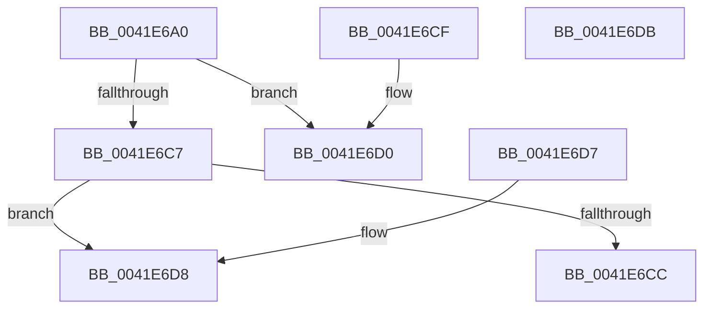

# IoIsOperationSynchronous

- RVA: `0x0041E6A0`–`0x0041E6DC` (길이 `60` bytes)
- VA: `0x000000014041E6A0`
- 실행 섹션: `.text`
- PDB 이름 있음: `예`; PDB Function 태그: `아니요`
- unwind 정보 RVA: `0x000DB714`
- 디코드: `23`개 명령, `60/60` bytes 표시
- 미해석 바이트: `0` (있으면 어셈블리에 `.byte`로 보존)

> 이 문서는 커널 이미지의 기계어와 PDB 기호를 분석해 생성했습니다. 4번과 5번은 함수 원형과 자료형을 바이너리 사용 방식에서 추정한 C 해석이며 원본 소스 복구 결과는 아닙니다.

## 1. Dependencies

- 직접 호출 지점: **0**; 고유 호출 대상: **0**
- 직접 호출자로 확인된 함수: **2**
- RIP 상대 이미지 참조: **0**

### Outgoing calls
- 직접 디코드된 call 명령이 없습니다.

### Direct callers
- [FsRtlpOplockFsctrlInternal](../../page/9F/FsRtlpOplockFsctrlInternal_function_009F1640.md) at `0x009F1712`
- [FsRtlpOplockFsctrlInternal](../../page/9F/FsRtlpOplockFsctrlInternal_function_009F1640.md) at `0x009F1903`
- [FsRtlpOplockFsctrlInternal](../../page/9F/FsRtlpOplockFsctrlInternal_function_009F1640.md) at `0x009F19FA`
- [FsRtlpOplockFsctrlInternal](../../page/9F/FsRtlpOplockFsctrlInternal_function_009F1640.md) at `0x009F1AC2`
- [sub_00B3115E](../../page/B3/Unknown_function_00B3115E.md) at `0x00B311D2`

### Static image references
- 디코드된 RIP-relative 메모리 참조가 없습니다.

## 2. Other-region calls and transfers

- 다른 실행 섹션으로 향하는 call: **0**
- 별도 외부 분기/꼬리 이동을 확인하지 못했습니다.

## 3. Assembly (complete function range)

```asm
0041E6A0  44 8B 41 10                     mov r8d, dword ptr [rcx + 0x10]
0041E6A4  41 8B C0                        mov eax, r8d
0041E6A7  48 8B 89 B8 00 00 00            mov rcx, qword ptr [rcx + 0xb8]
0041E6AE  83 E0 42                        and eax, 0x42
0041E6B1  48 8B 51 30                     mov rdx, qword ptr [rcx + 0x30]
0041E6B5  F6 42 50 02                     test byte ptr [rdx + 0x50], 2
0041E6B9  0F 94 C2                        sete dl
0041E6BC  41 F6 C0 04                     test r8b, 4
0041E6C0  0F 94 C1                        sete cl
0041E6C3  84 D1                           test cl, dl
0041E6C5  74 09                           je 0x14041e6d0
0041E6C7  83 F8 42                        cmp eax, 0x42
0041E6CA  75 0C                           jne 0x14041e6d8
0041E6CC  B0 01                           mov al, 1
0041E6CE  C3                              ret
0041E6CF  CC                              int3
0041E6D0  83 F8 02                        cmp eax, 2
0041E6D3  0F 95 C0                        setne al
0041E6D6  C3                              ret
0041E6D7  CC                              int3
0041E6D8  32 C0                           xor al, al
0041E6DA  C3                              ret
0041E6DB  CC                              int3
```

## 4. C-style interpretation (structured pseudocode)

```c
__int64 __fastcall IoIsOperationSynchronous(__int64 a1)
{
    __int64 result;

    result = (unsigned int)(((unsigned int)((unsigned int)((unsigned int)(*(unsigned int *)(a1 + 16))))) & (66));
    a2 = (((*(unsigned __int8 *)(*(unsigned __int64 *)(*(unsigned __int64 *)(a1 + 184) + 48) + 80)) & (2)) == 0) ? 1 : 0;
    a1 = ((((unsigned __int8)((unsigned int)(*(unsigned int *)(a1 + 16)))) & (4)) == 0) ? 1 : 0;
    if ((((unsigned __int8)(a1)) & ((unsigned __int8)(a2))) == 0) goto loc_0041E6D0;
    if (((unsigned int)(result)) != 66) goto loc_0041E6D8;
    return 1;
loc_0041E6D0:
    result = (1 != 2) ? 1 : 0;
    return result;
loc_0041E6D8:
    result = 0;
    return result;
}
```

## 5. (Beta) C Style

```c
int64_t IoIsOperationSynchronous(void *Arg1)
{
    uint8_t *arg1 = (uint8_t *)Arg1;

    int64_t result;

    result = (uint32_t)(((uint32_t)((uint32_t)((uint32_t)(*(uint32_t *)(arg1 + 0x10))))) & (66));
    a2 = (((*(uint8_t *)(*(uint64_t *)(*(uint64_t *)(arg1 + 0xB8) + 0x30) + 0x50)) & (2)) == 0) ? 1 : 0;
    Arg1 = ((((uint8_t)((uint32_t)(*(uint32_t *)(arg1 + 0x10)))) & (4)) == 0) ? 1 : 0;
    if ((((uint8_t)(Arg1)) & ((uint8_t)(a2))) == 0) goto loc_0041E6D0;
    if (((uint32_t)(result)) != 66) goto loc_0041E6D8;
    return 1;
loc_0041E6D0:
    result = (1 != 2) ? 1 : 0;
    return result;
loc_0041E6D8:
    result = 0;
    return result;
}
```

### 관측된 메모리 오프셋

구조체 형식이 확인되지 않은 접근은 인자 기준의 오프셋으로만 기록했습니다.

| 기준 인자 | 오프셋 표현 | 폭 (bit) | 접근 |
|---|---:|---:|---|
| `Arg1` | `+ 0x10` | `32` | `R` |
| `Arg1` | `+ 0xB8` | `64` | `R` |

## 6. Execution-region graph

[열기: 2D/3D 그래프와 함수 탐색 컨트롤 패널](../../../control-panel.html?section=text&rva=0x0041E6A0&view=graph)

- 2D 그래프는 위에서 아래로 흐르고, 3D 그래프는 빈 공간을 드래그해 회전합니다. Shift+드래그는 이동, 휠은 확대·축소, 함수 노드 선택은 대상 보고서 이동입니다.

### Static fallback


