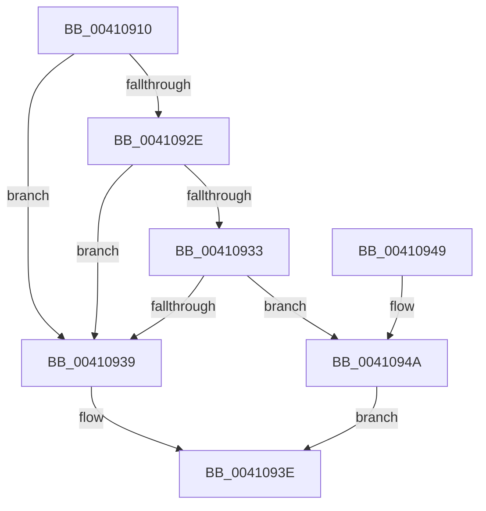

# IoPropagateActivityIdToThread

- RVA: `0x00410910`–`0x0041096D` (길이 `93` bytes)
- VA: `0x0000000140410910`
- 실행 섹션: `.text`
- PDB 이름 있음: `예`; PDB Function 태그: `아니요`
- unwind 정보 RVA: `0x000985CC`
- 디코드: `26`개 명령, `93/93` bytes 표시
- 미해석 바이트: `0` (있으면 어셈블리에 `.byte`로 보존)

> 이 문서는 커널 이미지의 기계어와 PDB 기호를 분석해 생성했습니다. 4번과 5번은 함수 원형과 자료형을 바이너리 사용 방식에서 추정한 C 해석이며 원본 소스 복구 결과는 아닙니다.

## 1. Dependencies

- 직접 호출 지점: **1**; 고유 호출 대상: **1**
- 직접 호출자로 확인된 함수: **0**
- RIP 상대 이미지 참조: **0**

### Outgoing calls
- `0x0041094A` → [IoGetActivityIdIrp](IoGetActivityIdIrp_function_00410980.md) (function, `0x00410980`)

### Direct callers
- 이 함수 시작 RVA로 연결되는 직접 call은 확인되지 않았습니다. 간접 호출은 완전히 역산할 수 없습니다.

### Static image references
- 디코드된 RIP-relative 메모리 참조가 없습니다.

## 2. Other-region calls and transfers

- 다른 실행 섹션으로 향하는 call: **0**
- 별도 외부 분기/꼬리 이동을 확인하지 못했습니다.

## 3. Assembly (complete function range)

```asm
00410910  48 89 5C 24 08                  mov qword ptr [rsp + 8], rbx
00410915  57                              push rdi
00410916  48 83 EC 20                     sub rsp, 0x20
0041091A  48 8B 81 C8 00 00 00            mov rax, qword ptr [rcx + 0xc8]
00410921  49 8B F8                        mov rdi, r8
00410924  90                              nop
00410925  48 8B DA                        mov rbx, rdx
00410928  80 79 47 00                     cmp byte ptr [rcx + 0x47], 0
0041092C  7C 0B                           jl 0x140410939
0041092E  48 85 C0                        test rax, rax
00410931  74 06                           je 0x140410939
00410933  F6 40 02 01                     test byte ptr [rax + 2], 1
00410937  75 11                           jne 0x14041094a
00410939  B8 25 02 00 C0                  mov eax, 0xc0000225
0041093E  48 8B 5C 24 30                  mov rbx, qword ptr [rsp + 0x30]
00410943  48 83 C4 20                     add rsp, 0x20
00410947  5F                              pop rdi
00410948  C3                              ret
00410949  CC                              int3
0041094A  E8 31 00 00 00                  call 0x140410980
0041094F  65 48 8B 0C 25 88 01 00 00      mov rcx, qword ptr gs:[0x188]
00410958  48 8B 81 30 06 00 00            mov rax, qword ptr [rcx + 0x630]
0041095F  48 89 99 30 06 00 00            mov qword ptr [rcx + 0x630], rbx
00410966  48 89 07                        mov qword ptr [rdi], rax
00410969  33 C0                           xor eax, eax
0041096B  EB D1                           jmp 0x14041093e
```

## 4. C-style interpretation (structured pseudocode)

```c
__int64 __fastcall IoPropagateActivityIdToThread(__int64 a1, __int64 a2, __int64 a3)
{
    __int64 result;
    __int64 v_rsp;
    unsigned __int64 v_stack_p8;

    v_stack_p8 = v_rbx;
    v_rsp = (v_rsp) - (32);
    if ((*(unsigned __int8 *)(a1 + 71)) < 0) goto loc_00410939;
    if (*(unsigned __int64 *)(a1 + 200) == 0) goto loc_00410939;
    if (((*(unsigned __int8 *)(*(unsigned __int64 *)(a1 + 200) + 2)) & (1)) != 0) goto loc_0041094A;
loc_00410939:
loc_0041093E:
    v_rsp = (v_rsp) + (32);
    return (unsigned int)(0xC0000225ULL);
loc_0041094A:
    result = IoGetActivityIdIrp(a1, a2, a3, a4);
    *(unsigned __int64 *)(*(unsigned __int64 *)(gs_base + (0 + 392)) + 1584) = v_stack_p8;
    *(unsigned __int64 *)(a3) = *(unsigned __int64 *)(*(unsigned __int64 *)(gs_base + (0 + 392)) + 1584);
    result = 0;
    goto loc_0041093E;
}
```

## 5. (Beta) C Style

```c
int64_t IoPropagateActivityIdToThread(void *Arg1, int64_t Arg2, void *Arg3)
{
    uint8_t *arg1 = (uint8_t *)Arg1;
    uint8_t *arg3 = (uint8_t *)Arg3;

    int64_t result;
    int64_t local_rsp;
    uint64_t v_stack_p8;

    v_stack_p8 = local_rbx;
    local_rsp = (local_rsp) - (32);
    if ((*(uint8_t *)(arg1 + 0x47)) < 0) goto loc_00410939;
    if (*(uint64_t *)(arg1 + 0xC8) == 0) goto loc_00410939;
    if (((*(uint8_t *)(*(uint64_t *)(arg1 + 0xC8) + 0x2)) & (1)) != 0) goto loc_0041094A;
loc_00410939:
loc_0041093E:
    local_rsp = (local_rsp) + (32);
    return (uint32_t)(0xC0000225ULL);
loc_0041094A:
    result = IoGetActivityIdIrp(Arg1, Arg2, Arg3, a4);
    *(uint64_t *)(*(uint64_t *)(gs_base + (0 + 0x188)) + 0x630) = v_stack_p8;
    *(uint64_t *)(arg3) = *(uint64_t *)(*(uint64_t *)(gs_base + (0 + 0x188)) + 0x630);
    result = 0;
    goto loc_0041093E;
}
```

### 관측된 메모리 오프셋

구조체 형식이 확인되지 않은 접근은 인자 기준의 오프셋으로만 기록했습니다.

| 기준 인자 | 오프셋 표현 | 폭 (bit) | 접근 |
|---|---:|---:|---|
| `Arg1` | `+ 0x47` | `8` | `R` |
| `Arg1` | `+ 0xC8` | `64` | `R` |
| `Arg3` | `+ 0x0` | `64` | `W` |

## 6. Execution-region graph

[열기: 2D/3D 그래프와 함수 탐색 컨트롤 패널](../../../control-panel.html?section=text&rva=0x00410910&view=graph)

- 2D 그래프는 위에서 아래로 흐르고, 3D 그래프는 빈 공간을 드래그해 회전합니다. Shift+드래그는 이동, 휠은 확대·축소, 함수 노드 선택은 대상 보고서 이동입니다.

### Static fallback


