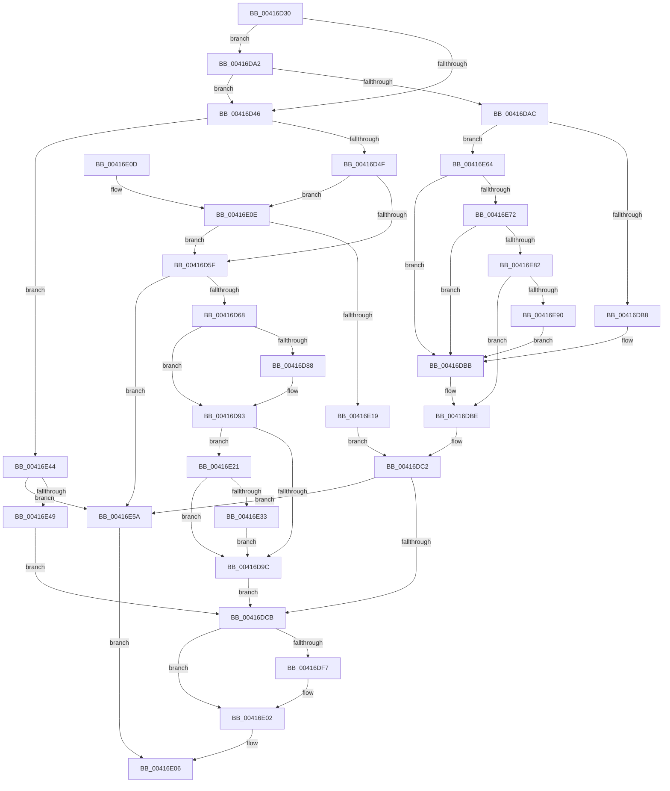

# IoRetrievePriorityInfo

- RVA: `0x00416D30`–`0x00416E95` (길이 `357` bytes)
- VA: `0x0000000140416D30`
- 실행 섹션: `.text`
- PDB 이름 있음: `예`; PDB Function 태그: `아니요`
- unwind 정보 RVA: `0x0009CC5C`
- 디코드: `85`개 명령, `357/357` bytes 표시
- 미해석 바이트: `0` (있으면 어셈블리에 `.byte`로 보존)

> 이 문서는 커널 이미지의 기계어와 PDB 기호를 분석해 생성했습니다. 4번과 5번은 함수 원형과 자료형을 바이너리 사용 방식에서 추정한 C 해석이며 원본 소스 복구 결과는 아닙니다.

## 1. Dependencies

- 직접 호출 지점: **1**; 고유 호출 대상: **1**
- 직접 호출자로 확인된 함수: **0**
- RIP 상대 이미지 참조: **0**

### Outgoing calls
- `0x00416E4C` → [PsGetIoPriorityThread](../34/PsGetIoPriorityThread_function_00343930.md) (function, `0x00343930`)

### Direct callers
- 이 함수 시작 RVA로 연결되는 직접 call은 확인되지 않았습니다. 간접 호출은 완전히 역산할 수 없습니다.

### Static image references
- 디코드된 RIP-relative 메모리 참조가 없습니다.

## 2. Other-region calls and transfers

- 다른 실행 섹션으로 향하는 call: **0**
- 별도 외부 분기/꼬리 이동을 확인하지 못했습니다.

## 3. Assembly (complete function range)

```asm
00416D30  48 83 EC 28                     sub rsp, 0x28
00416D34  41 BA 02 00 00 00               mov r10d, 2
00416D3A  4D 8B D8                        mov r11, r8
00416D3D  45 89 51 0C                     mov dword ptr [r9 + 0xc], r10d
00416D41  48 85 C9                        test rcx, rcx
00416D44  75 5C                           jne 0x140416da2
00416D46  48 85 D2                        test rdx, rdx
00416D49  0F 84 F5 00 00 00               je 0x140416e44
00416D4F  48 8B 82 D0 00 00 00            mov rax, qword ptr [rdx + 0xd0]
00416D56  48 85 C0                        test rax, rax
00416D59  0F 85 AF 00 00 00               jne 0x140416e0e
00416D5F  4D 85 DB                        test r11, r11
00416D62  0F 84 F2 00 00 00               je 0x140416e5a
00416D68  49 8B 80 20 02 00 00            mov rax, qword ptr [r8 + 0x220]
00416D6F  41 8B 88 A0 05 00 00            mov ecx, dword ptr [r8 + 0x5a0]
00416D76  C1 E9 09                        shr ecx, 9
00416D79  83 E1 07                        and ecx, 7
00416D7C  48 8B 80 A0 02 00 00            mov rax, qword ptr [rax + 0x2a0]
00416D83  48 85 C0                        test rax, rax
00416D86  74 0B                           je 0x140416d93
00416D88  8B 80 3C 04 00 00               mov eax, dword ptr [rax + 0x43c]
00416D8E  3B C8                           cmp ecx, eax
00416D90  0F 4D C8                        cmovge ecx, eax
00416D93  41 3B CA                        cmp ecx, r10d
00416D96  0F 8C 85 00 00 00               jl 0x140416e21
00416D9C  41 89 49 0C                     mov dword ptr [r9 + 0xc], ecx
00416DA0  EB 29                           jmp 0x140416dcb
00416DA2  8B 41 10                        mov eax, dword ptr [rcx + 0x10]
00416DA5  A9 00 00 0E 00                  test eax, 0xe0000
00416DAA  74 9A                           je 0x140416d46
00416DAC  C1 E8 11                        shr eax, 0x11
00416DAF  83 E0 07                        and eax, 7
00416DB2  0F 85 AC 00 00 00               jne 0x140416e64
00416DB8  41 8B C2                        mov eax, r10d
00416DBB  44 8B D0                        mov r10d, eax
00416DBE  45 89 51 0C                     mov dword ptr [r9 + 0xc], r10d
00416DC2  4D 85 DB                        test r11, r11
00416DC5  0F 84 8F 00 00 00               je 0x140416e5a
00416DCB  41 0F BE 83 33 02 00 00         movsx eax, byte ptr [r11 + 0x233]
00416DD3  41 89 41 04                     mov dword ptr [r9 + 4], eax
00416DD7  49 8B 8B 20 02 00 00            mov rcx, qword ptr [r11 + 0x220]
00416DDE  41 8B 83 A0 05 00 00            mov eax, dword ptr [r11 + 0x5a0]
00416DE5  C1 E8 0C                        shr eax, 0xc
00416DE8  83 E0 07                        and eax, 7
00416DEB  48 8B 89 A0 02 00 00            mov rcx, qword ptr [rcx + 0x2a0]
00416DF2  48 85 C9                        test rcx, rcx
00416DF5  74 0B                           je 0x140416e02
00416DF7  8B 89 44 04 00 00               mov ecx, dword ptr [rcx + 0x444]
00416DFD  3B C1                           cmp eax, ecx
00416DFF  0F 43 C1                        cmovae eax, ecx
00416E02  41 89 41 08                     mov dword ptr [r9 + 8], eax
00416E06  33 C0                           xor eax, eax
00416E08  48 83 C4 28                     add rsp, 0x28
00416E0C  C3                              ret
00416E0D  CC                              int3
00416E0E  8B 40 58                        mov eax, dword ptr [rax + 0x58]
00416E11  85 C0                           test eax, eax
00416E13  0F 84 46 FF FF FF               je 0x140416d5f
00416E19  FF C8                           dec eax
00416E1B  41 89 41 0C                     mov dword ptr [r9 + 0xc], eax
00416E1F  EB A1                           jmp 0x140416dc2
00416E21  65 48 8B 04 25 88 01 00 00      mov rax, qword ptr gs:[0x188]
00416E2A  4C 3B D8                        cmp r11, rax
00416E2D  0F 85 69 FF FF FF               jne 0x140416d9c
00416E33  41 83 B8 E0 05 00 00 00         cmp dword ptr [r8 + 0x5e0], 0
00416E3B  41 0F 45 CA                     cmovne ecx, r10d
00416E3F  E9 58 FF FF FF                  jmp 0x140416d9c
00416E44  4D 85 DB                        test r11, r11
00416E47  74 11                           je 0x140416e5a
00416E49  49 8B CB                        mov rcx, r11
00416E4C  E8 DF CA F2 FF                  call 0x140343930
00416E51  41 89 41 0C                     mov dword ptr [r9 + 0xc], eax
00416E55  E9 71 FF FF FF                  jmp 0x140416dcb
00416E5A  49 C7 41 04 FF FF FF FF         mov qword ptr [r9 + 4], 0xffffffffffffffff
00416E62  EB A2                           jmp 0x140416e06
00416E64  8D 50 FF                        lea edx, [rax - 1]
00416E67  8B C2                           mov eax, edx
00416E69  41 3B D2                        cmp edx, r10d
00416E6C  0F 8D 49 FF FF FF               jge 0x140416dbb
00416E72  4C 8B 81 98 00 00 00            mov r8, qword ptr [rcx + 0x98]
00416E79  4D 85 C0                        test r8, r8
00416E7C  0F 84 39 FF FF FF               je 0x140416dbb
00416E82  41 83 B8 E0 05 00 00 00         cmp dword ptr [r8 + 0x5e0], 0
00416E8A  0F 85 2E FF FF FF               jne 0x140416dbe
00416E90  E9 26 FF FF FF                  jmp 0x140416dbb
```

## 4. C-style interpretation (structured pseudocode)

```c
__int64 __fastcall IoRetrievePriorityInfo(__int64 a1, __int64 a2, __int64 a3, __int64 a4)
{
    __int64 result;
    __int64 v_rsp;

    v_rsp = (v_rsp) - (40);
    *(unsigned int *)(a4 + 12) = 2;
    if (a1 != 0) goto loc_00416DA2;
loc_00416D46:
    if (a2 == 0) goto loc_00416E44;
    if (*(unsigned __int64 *)(a2 + 208) != 0) goto loc_00416E0E;
loc_00416D5F:
    if (a3 == 0) goto loc_00416E5A;
    a1 = (unsigned int)(((unsigned int)(*(unsigned int *)(a3 + 1440))) >> (9));
    a1 = (unsigned int)((a1) & (7));
    result = *(unsigned __int64 *)(*(unsigned __int64 *)(a3 + 544) + 672);
    if (*(unsigned __int64 *)(*(unsigned __int64 *)(a3 + 544) + 672) != 0) {
        result = *(unsigned int *)(*(unsigned __int64 *)(*(unsigned __int64 *)(a3 + 544) + 672) + 1084);
        if (((unsigned int)(a1)) >= ((unsigned int)(result))) { a1 = (unsigned int)(result); }
    }
    if (((unsigned int)(a1)) < 2) goto loc_00416E21;
loc_00416D9C:
    *(unsigned int *)(a4 + 12) = (unsigned int)(a1);
    goto loc_00416DCB;
loc_00416DA2:
    if ((((unsigned int)((unsigned int)(*(unsigned int *)(a1 + 16)))) & (0xE0000ULL)) == 0) goto loc_00416D46;
    result = (unsigned int)(((unsigned int)(*(unsigned int *)(a1 + 16))) >> (17));
    result = (unsigned int)((result) & (7));
    if (condition_is_not_equal) goto loc_00416E64;
loc_00416DBB:
loc_00416DBE:
    *(unsigned int *)(a4 + 12) = 2;
loc_00416DC2:
    if (a3 == 0) goto loc_00416E5A;
loc_00416DCB:
    *(unsigned int *)(a4 + 4) = (unsigned int)((__int8)(*(unsigned __int8 *)(a3 + 563)));
    result = (unsigned int)(((unsigned int)(*(unsigned int *)(a3 + 1440))) >> (12));
    result = (unsigned int)((result) & (7));
    if (*(unsigned __int64 *)(*(unsigned __int64 *)(a3 + 544) + 672) != 0) {
        a1 = *(unsigned int *)(*(unsigned __int64 *)(*(unsigned __int64 *)(a3 + 544) + 672) + 1092);
        if (((unsigned int)(result)) >= ((unsigned int)(a1))) { result = (unsigned int)(a1); }
    }
    *(unsigned int *)(a4 + 8) = (unsigned int)(result);
loc_00416E06:
    result = 0;
    v_rsp = (v_rsp) + (40);
    return result;
loc_00416E0E:
    if ((unsigned int)((unsigned int)(*(unsigned int *)(result + 88))) == 0) goto loc_00416D5F;
    result = (unsigned int)(((unsigned int)(*(unsigned int *)(result + 88))) - 1);
    *(unsigned int *)(a4 + 12) = (unsigned int)(result);
    goto loc_00416DC2;
loc_00416E21:
    if (a3 != (*(unsigned __int64 *)(gs_base + (0 + 392)))) goto loc_00416D9C;
    if ((*(unsigned int *)(a3 + 1504)) != 0) { a1 = 2; }
    goto loc_00416D9C;
loc_00416E44:
    if (a3 == 0) goto loc_00416E5A;
    result = PsGetIoPriorityThread(a3, a2, a3, a4);
    *(unsigned int *)(a4 + 12) = (unsigned int)(result);
    goto loc_00416DCB;
loc_00416E5A:
    *(unsigned __int64 *)(a4 + 4) = -1;
    goto loc_00416E06;
loc_00416E64:
    if (((unsigned int)(result - 1)) >= 2) goto loc_00416DBB;
    if (*(unsigned __int64 *)(a3 + 152) == 0) goto loc_00416DBB;
    if ((*(unsigned int *)(*(unsigned __int64 *)(a3 + 152) + 1504)) != 0) goto loc_00416DBE;
    goto loc_00416DBB;
}
```

## 5. (Beta) C Style

```c
int64_t IoRetrievePriorityInfo(int64_t Arg1, int64_t Arg2, void *Arg3, void *Arg4)
{
    uint8_t *arg3 = (uint8_t *)Arg3;
    uint8_t *arg4 = (uint8_t *)Arg4;

    int64_t result;
    int64_t local_rsp;

    local_rsp = (local_rsp) - (40);
    *(uint32_t *)(arg4 + 0xC) = 2;
    if (Arg1 != 0) goto loc_00416DA2;
loc_00416D46:
    if (Arg2 == 0) goto loc_00416E44;
    if (*(uint64_t *)(Arg2 + 0xD0) != 0) goto loc_00416E0E;
loc_00416D5F:
    if (Arg3 == NULL) goto loc_00416E5A;
    Arg1 = (uint32_t)(((uint32_t)(*(uint32_t *)(arg3 + 0x5A0))) >> (9));
    Arg1 = (uint32_t)((Arg1) & (7));
    result = *(uint64_t *)(*(uint64_t *)(arg3 + 0x220) + 0x2A0);
    if (*(uint64_t *)(*(uint64_t *)(arg3 + 0x220) + 0x2A0) != 0) {
        result = *(uint32_t *)(*(uint64_t *)(*(uint64_t *)(arg3 + 0x220) + 0x2A0) + 0x43C);
        if (((uint32_t)(Arg1)) >= ((uint32_t)(result))) { Arg1 = (uint32_t)(result); }
    }
    if (((uint32_t)(Arg1)) < 2) goto loc_00416E21;
loc_00416D9C:
    *(uint32_t *)(arg4 + 0xC) = (uint32_t)(Arg1);
    goto loc_00416DCB;
loc_00416DA2:
    if ((((uint32_t)((uint32_t)(*(uint32_t *)(Arg1 + 0x10)))) & (0xE0000ULL)) == 0) goto loc_00416D46;
    result = (uint32_t)(((uint32_t)(*(uint32_t *)(Arg1 + 0x10))) >> (17));
    result = (uint32_t)((result) & (7));
    if (condition_is_not_equal) goto loc_00416E64;
loc_00416DBB:
loc_00416DBE:
    *(uint32_t *)(arg4 + 0xC) = 2;
loc_00416DC2:
    if (Arg3 == NULL) goto loc_00416E5A;
loc_00416DCB:
    *(uint32_t *)(arg4 + 0x4) = (uint32_t)((int8_t)(*(uint8_t *)(arg3 + 0x233)));
    result = (uint32_t)(((uint32_t)(*(uint32_t *)(arg3 + 0x5A0))) >> (12));
    result = (uint32_t)((result) & (7));
    if (*(uint64_t *)(*(uint64_t *)(arg3 + 0x220) + 0x2A0) != 0) {
        Arg1 = *(uint32_t *)(*(uint64_t *)(*(uint64_t *)(arg3 + 0x220) + 0x2A0) + 0x444);
        if (((uint32_t)(result)) >= ((uint32_t)(Arg1))) { result = (uint32_t)(Arg1); }
    }
    *(uint32_t *)(arg4 + 0x8) = (uint32_t)(result);
loc_00416E06:
    result = 0;
    local_rsp = (local_rsp) + (40);
    return result;
loc_00416E0E:
    if ((uint32_t)((uint32_t)(*(uint32_t *)(result + 0x58))) == 0) goto loc_00416D5F;
    result = (uint32_t)(((uint32_t)(*(uint32_t *)(result + 0x58))) - 1);
    *(uint32_t *)(arg4 + 0xC) = (uint32_t)(result);
    goto loc_00416DC2;
loc_00416E21:
    if (Arg3 != (*(uint64_t *)(gs_base + (0 + 0x188)))) goto loc_00416D9C;
    if ((*(uint32_t *)(arg3 + 0x5E0)) != 0) { Arg1 = 2; }
    goto loc_00416D9C;
loc_00416E44:
    if (Arg3 == NULL) goto loc_00416E5A;
    result = PsGetIoPriorityThread(Arg3, Arg2, Arg3, Arg4);
    *(uint32_t *)(arg4 + 0xC) = (uint32_t)(result);
    goto loc_00416DCB;
loc_00416E5A:
    *(uint64_t *)(arg4 + 0x4) = -1;
    goto loc_00416E06;
loc_00416E64:
    if (((uint32_t)(result - 1)) >= 2) goto loc_00416DBB;
    if (*(uint64_t *)(arg3 + 0x98) == 0) goto loc_00416DBB;
    if ((*(uint32_t *)(*(uint64_t *)(arg3 + 0x98) + 0x5E0)) != 0) goto loc_00416DBE;
    goto loc_00416DBB;
}
```

### 관측된 메모리 오프셋

구조체 형식이 확인되지 않은 접근은 인자 기준의 오프셋으로만 기록했습니다.

| 기준 인자 | 오프셋 표현 | 폭 (bit) | 접근 |
|---|---:|---:|---|
| `Arg3` | `+ 0x220` | `64` | `R` |
| `Arg3` | `+ 0x5A0` | `32` | `R` |
| `Arg3` | `+ 0x5E0` | `32` | `R` |
| `Arg4` | `+ 0x4` | `64` | `W` |
| `Arg4` | `+ 0xC` | `32` | `W` |

## 6. Execution-region graph

[열기: 2D/3D 그래프와 함수 탐색 컨트롤 패널](../../../control-panel.html?section=text&rva=0x00416D30&view=graph)

- 2D 그래프는 위에서 아래로 흐르고, 3D 그래프는 빈 공간을 드래그해 회전합니다. Shift+드래그는 이동, 휠은 확대·축소, 함수 노드 선택은 대상 보고서 이동입니다.

### Static fallback


