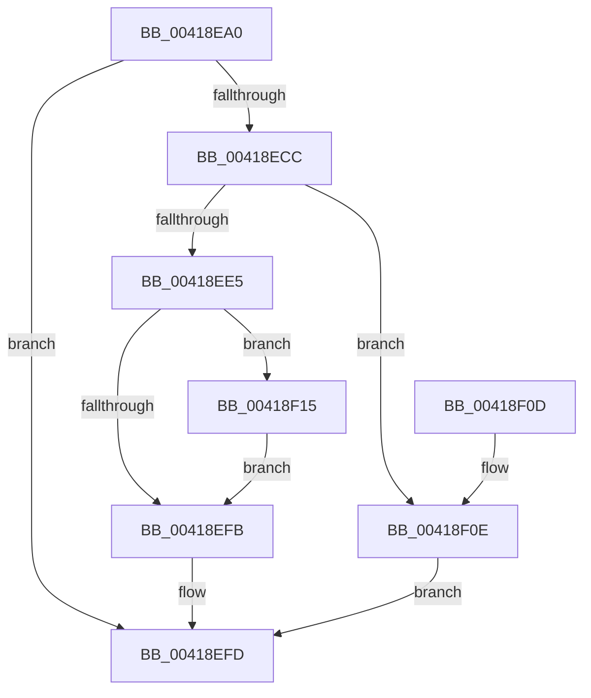

# IoSetShadowFileInformation

- RVA: `0x00418EA0`–`0x00418F26` (길이 `134` bytes)
- VA: `0x0000000140418EA0`
- 실행 섹션: `.text`
- PDB 이름 있음: `예`; PDB Function 태그: `아니요`
- unwind 정보 RVA: `0x0009D0B8`
- 디코드: `41`개 명령, `134/134` bytes 표시
- 미해석 바이트: `0` (있으면 어셈블리에 `.byte`로 보존)

> 이 문서는 커널 이미지의 기계어와 PDB 기호를 분석해 생성했습니다. 4번과 5번은 함수 원형과 자료형을 바이너리 사용 방식에서 추정한 C 해석이며 원본 소스 복구 결과는 아닙니다.

## 1. Dependencies

- 직접 호출 지점: **3**; 고유 호출 대상: **3**
- 직접 호출자로 확인된 함수: **0**
- RIP 상대 이미지 참조: **0**

### Outgoing calls
- `0x00418EC3` → [IopAllocateFileObjectExtension](IopAllocateFileObjectExtension_function_00418FB0.md) (function, `0x00418FB0`)
- `0x00418ED8` → [ExAllocatePool2](../../poolcode/B8/ExAllocatePool2_function_00B820F0.md) (function, `0x00B820F0`)
- `0x00418F1F` → [ExFreePoolWithTag](../../poolcode/B8/ExFreePoolWithTag_function_00B82870.md) (function, `0x00B82870`)

### Direct callers
- 이 함수 시작 RVA로 연결되는 직접 call은 확인되지 않았습니다. 간접 호출은 완전히 역산할 수 없습니다.

### Static image references
- 디코드된 RIP-relative 메모리 참조가 없습니다.

## 2. Other-region calls and transfers

- 다른 실행 섹션으로 향하는 call: **2**
  - `0x00418ED8` → [ExAllocatePool2](../../poolcode/B8/ExAllocatePool2_function_00B820F0.md) (`.text` → `POOLCODE`)
  - `0x00418F1F` → [ExFreePoolWithTag](../../poolcode/B8/ExFreePoolWithTag_function_00B82870.md) (`.text` → `POOLCODE`)
- 별도 외부 분기/꼬리 이동을 확인하지 못했습니다.

## 3. Assembly (complete function range)

```asm
00418EA0  48 8B C4                        mov rax, rsp
00418EA3  48 89 58 08                     mov qword ptr [rax + 8], rbx
00418EA7  48 89 70 10                     mov qword ptr [rax + 0x10], rsi
00418EAB  57                              push rdi
00418EAC  48 83 EC 20                     sub rsp, 0x20
00418EB0  49 8B F8                        mov rdi, r8
00418EB3  48 8B F2                        mov rsi, rdx
00418EB6  33 DB                           xor ebx, ebx
00418EB8  48 8D 50 20                     lea rdx, [rax + 0x20]
00418EBC  45 33 C0                        xor r8d, r8d
00418EBF  48 89 58 20                     mov qword ptr [rax + 0x20], rbx
00418EC3  E8 E8 00 00 00                  call 0x140418fb0
00418EC8  85 C0                           test eax, eax
00418ECA  78 31                           js 0x140418efd
00418ECC  8D 53 10                        lea edx, [rbx + 0x10]
00418ECF  41 B8 49 6F 53 66               mov r8d, 0x66536f49
00418ED5  8D 4B 40                        lea ecx, [rbx + 0x40]
00418ED8  E8 13 92 76 00                  call 0x140b820f0
00418EDD  4C 8B C0                        mov r8, rax
00418EE0  48 85 C0                        test rax, rax
00418EE3  74 29                           je 0x140418f0e
00418EE5  48 8B 4C 24 48                  mov rcx, qword ptr [rsp + 0x48]
00418EEA  48 89 30                        mov qword ptr [rax], rsi
00418EED  48 89 78 08                     mov qword ptr [rax + 8], rdi
00418EF1  33 C0                           xor eax, eax
00418EF3  F0 4C 0F B1 41 50               lock cmpxchg qword ptr [rcx + 0x50], r8
00418EF9  75 1A                           jne 0x140418f15
00418EFB  8B C3                           mov eax, ebx
00418EFD  48 8B 5C 24 30                  mov rbx, qword ptr [rsp + 0x30]
00418F02  48 8B 74 24 38                  mov rsi, qword ptr [rsp + 0x38]
00418F07  48 83 C4 20                     add rsp, 0x20
00418F0B  5F                              pop rdi
00418F0C  C3                              ret
00418F0D  CC                              int3
00418F0E  B8 9A 00 00 C0                  mov eax, 0xc000009a
00418F13  EB E8                           jmp 0x140418efd
00418F15  33 D2                           xor edx, edx
00418F17  49 8B C8                        mov rcx, r8
00418F1A  BB 21 00 00 C0                  mov ebx, 0xc0000021
00418F1F  E8 4C 99 76 00                  call 0x140b82870
00418F24  EB D5                           jmp 0x140418efb
```

## 4. C-style interpretation (structured pseudocode)

```c
__int64 __fastcall IoSetShadowFileInformation(__int64 a1, __int64 a2, __int64 a3)
{
    __int64 result;
    __int64 v_rbx;
    __int64 v_rsp;
    unsigned __int64 v_stack_p10;
    unsigned __int64 v_stack_p20;
    unsigned __int64 v_stack_p8;

    *(unsigned __int64 *)(v_rsp + 8) = v_rbx;
    *(unsigned __int64 *)(v_rsp + 16) = v_rsi;
    v_rsp = (v_rsp) - (32);
    v_rbx = 0;
    a3 = 0;
    *(unsigned __int64 *)(v_rsp + 32) = 0;
    result = IopAllocateFileObjectExtension(a1, v_rsp + 32, a3, a4);
    if (sign_flag) goto loc_00418EFD;
    result = ExAllocatePool2(v_rbx + 64, v_rbx + 16, (unsigned int)(0x66536F49ULL), a4);
    if (result == 0) goto loc_00418F0E;
    *(unsigned __int64 *)(result) = a2;
    *(unsigned __int64 *)(result + 8) = 0;
    result = 0;
    if (condition_is_not_equal) goto loc_00418F15;
loc_00418EFB:
loc_00418EFD:
    v_rsp = (v_rsp) + (32);
    return 0;
loc_00418F0E:
    goto loc_00418EFD;
loc_00418F15:
    a2 = 0;
    result = ExFreePoolWithTag(0, a2, result, a4);
    goto loc_00418EFB;
}
```

## 5. (Beta) C Style

```c
int64_t IoSetShadowFileInformation(int64_t Arg1, int64_t Arg2, int64_t Arg3)
{
    int64_t result;
    int64_t local_rbx;
    int64_t local_rsp;
    uint64_t v_stack_p10;
    uint64_t v_stack_p20;
    uint64_t v_stack_p8;

    *(uint64_t *)(local_rsp + 0x8) = local_rbx;
    *(uint64_t *)(local_rsp + 0x10) = local_rsi;
    local_rsp = (local_rsp) - (32);
    local_rbx = 0;
    Arg3 = 0;
    *(uint64_t *)(local_rsp + 0x20) = 0;
    result = IopAllocateFileObjectExtension(Arg1, local_rsp + 32, Arg3, a4);
    if (sign_flag) goto loc_00418EFD;
    result = ExAllocatePool2(local_rbx + 64, local_rbx + 16, (uint32_t)(0x66536F49ULL), a4);
    if (result == 0) goto loc_00418F0E;
    *(uint64_t *)(result) = Arg2;
    *(uint64_t *)(result + 0x8) = 0;
    result = 0;
    if (condition_is_not_equal) goto loc_00418F15;
loc_00418EFB:
loc_00418EFD:
    local_rsp = (local_rsp) + (32);
    return 0;
loc_00418F0E:
    goto loc_00418EFD;
loc_00418F15:
    Arg2 = 0;
    result = ExFreePoolWithTag(0, Arg2, result, a4);
    goto loc_00418EFB;
}
```

## 6. Execution-region graph

[열기: 2D/3D 그래프와 함수 탐색 컨트롤 패널](../../../control-panel.html?section=text&rva=0x00418EA0&view=graph)

- 2D 그래프는 위에서 아래로 흐르고, 3D 그래프는 빈 공간을 드래그해 회전합니다. Shift+드래그는 이동, 휠은 확대·축소, 함수 노드 선택은 대상 보고서 이동입니다.

### Static fallback


