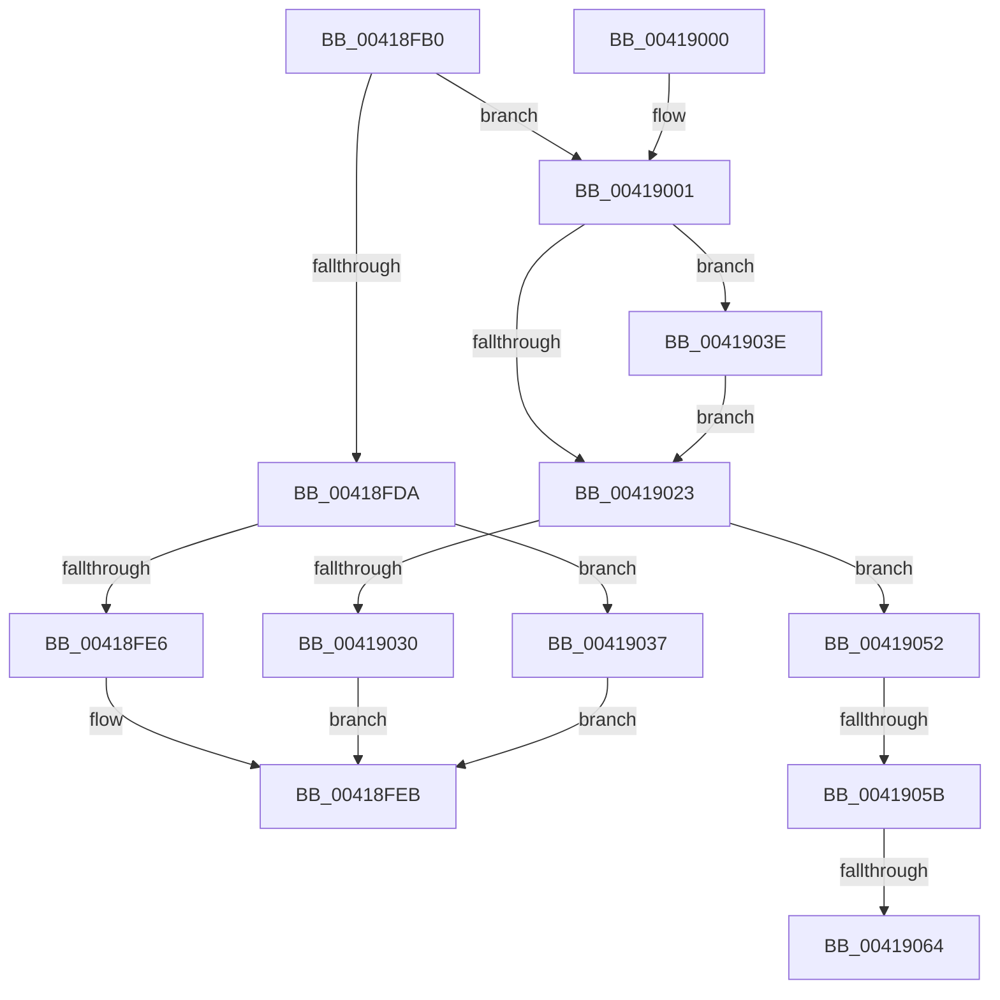

# IopAllocateFileObjectExtension

- RVA: `0x00418FB0`–`0x00419071` (길이 `193` bytes)
- VA: `0x0000000140418FB0`
- 실행 섹션: `.text`
- PDB 이름 있음: `예`; PDB Function 태그: `예`
- unwind 정보 RVA: `0x000601DC`
- 디코드: `54`개 명령, `193/193` bytes 표시
- 미해석 바이트: `0` (있으면 어셈블리에 `.byte`로 보존)

> 이 문서는 커널 이미지의 기계어와 PDB 기호를 분석해 생성했습니다. 4번과 5번은 함수 원형과 자료형을 바이너리 사용 방식에서 추정한 C 해석이며 원본 소스 복구 결과는 아닙니다.

## 1. Dependencies

- 직접 호출 지점: **2**; 고유 호출 대상: **2**
- 직접 호출자로 확인된 함수: **8**
- RIP 상대 이미지 참조: **1**

### Outgoing calls
- `0x0041900F` → [ExAllocatePool2](../../poolcode/B8/ExAllocatePool2_function_00B820F0.md) (function, `0x00B820F0`)
- `0x00419066` → [ExFreePoolWithTag](../../poolcode/B8/ExFreePoolWithTag_function_00B82870.md) (function, `0x00B82870`)

### Direct callers
- [sub_00265216](../26/Unknown_function_00265216.md) at `0x0026522A`
- [NtSetInformationFile](../29/NtSetInformationFile_function_0029C5E0.md) at `0x0029D3E0`
- [IoSetShadowFileInformation](IoSetShadowFileInformation_function_00418EA0.md) at `0x00418EC3`
- [IoGetFileObjectFilterContext](IoGetFileObjectFilterContext_function_00418F30.md) at `0x00418F78`
- [IoSetIoPriorityHintIntoFileObject](../4C/IoSetIoPriorityHintIntoFileObject_function_004CFEF0.md) at `0x004CFF12`
- [IopSetFileObjectIosbRange](../../page/71/IopSetFileObjectIosbRange_function_0071C1C8.md) at `0x0071C4EF`
- [IopSetFileMemoryPartitionInformation](../../page/71/IopSetFileMemoryPartitionInformation_function_0071E414.md) at `0x0071E4F1`
- [IopSymlinkPropagateToExtensionIfNeeded](../../page/8A/IopSymlinkPropagateToExtensionIfNeeded_function_008A1580.md) at `0x008A165A`

### Static image references
- `0x00418FDA` → RVA `0x00014730` (`.rdata`; read)

## 2. Other-region calls and transfers

- 다른 실행 섹션으로 향하는 call: **2**
  - `0x0041900F` → [ExAllocatePool2](../../poolcode/B8/ExAllocatePool2_function_00B820F0.md) (`.text` → `POOLCODE`)
  - `0x00419066` → [ExFreePoolWithTag](../../poolcode/B8/ExFreePoolWithTag_function_00B82870.md) (`.text` → `POOLCODE`)
- call이 아닌 외부 분기/꼬리 이동: **3**
  - `0x00419055` → [sub_006ED518](../6E/Unknown_function_006ED518.md) (`tail-transfer`)
  - `0x0041905E` → [sub_006ED518](../6E/Unknown_function_006ED518.md) (`tail-transfer`)
  - `0x0041906C` → [sub_006ED518](../6E/Unknown_function_006ED518.md) (`tail-transfer`)

## 3. Assembly (complete function range)

```asm
00418FB0  48 89 5C 24 08                  mov qword ptr [rsp + 8], rbx
00418FB5  48 89 6C 24 10                  mov qword ptr [rsp + 0x10], rbp
00418FBA  48 89 74 24 18                  mov qword ptr [rsp + 0x18], rsi
00418FBF  57                              push rdi
00418FC0  48 83 EC 20                     sub rsp, 0x20
00418FC4  48 8B 81 D0 00 00 00            mov rax, qword ptr [rcx + 0xd0]
00418FCB  41 0F B6 F0                     movzx esi, r8b
00418FCF  48 8B FA                        mov rdi, rdx
00418FD2  48 8B D9                        mov rbx, rcx
00418FD5  48 85 C0                        test rax, rax
00418FD8  74 27                           je 0x140419001
00418FDA  48 8D 15 4F B7 BF FF            lea rdx, [rip - 0x4048b1]
00418FE1  48 3B C2                        cmp rax, rdx
00418FE4  74 51                           je 0x140419037
00418FE6  48 89 07                        mov qword ptr [rdi], rax
00418FE9  33 C0                           xor eax, eax
00418FEB  48 8B 5C 24 30                  mov rbx, qword ptr [rsp + 0x30]
00418FF0  48 8B 6C 24 38                  mov rbp, qword ptr [rsp + 0x38]
00418FF5  48 8B 74 24 40                  mov rsi, qword ptr [rsp + 0x40]
00418FFA  48 83 C4 20                     add rsp, 0x20
00418FFE  5F                              pop rdi
00418FFF  C3                              ret
00419000  CC                              int3
00419001  33 ED                           xor ebp, ebp
00419003  41 B8 49 6F 46 45               mov r8d, 0x45466f49
00419009  8D 55 60                        lea edx, [rbp + 0x60]
0041900C  8D 4D 40                        lea ecx, [rbp + 0x40]
0041900F  E8 DC 90 76 00                  call 0x140b820f0
00419014  48 8D 15 15 B7 BF FF            lea rdx, [rip - 0x4048eb]
0041901B  48 8B C8                        mov rcx, rax
0041901E  48 85 C0                        test rax, rax
00419021  74 1B                           je 0x14041903e
00419023  33 C0                           xor eax, eax
00419025  F0 48 0F B1 8B D0 00 00 00      lock cmpxchg qword ptr [rbx + 0xd0], rcx
0041902E  75 22                           jne 0x140419052
00419030  48 89 0F                        mov qword ptr [rdi], rcx
00419033  8B C5                           mov eax, ebp
00419035  EB B4                           jmp 0x140418feb
00419037  B8 9A 00 00 C0                  mov eax, 0xc000009a
0041903C  EB AD                           jmp 0x140418feb
0041903E  40 84 F6                        test sil, sil
00419041  48 8B C2                        mov rax, rdx
00419044  BD 9A 00 00 C0                  mov ebp, 0xc000009a
00419049  48 0F 44 C1                     cmove rax, rcx
0041904D  48 8B C8                        mov rcx, rax
00419050  EB D1                           jmp 0x140419023
00419052  48 85 C9                        test rcx, rcx
00419055  0F 84 BD 44 2D 00               je 0x1406ed518
0041905B  48 3B CA                        cmp rcx, rdx
0041905E  0F 84 B4 44 2D 00               je 0x1406ed518
00419064  33 D2                           xor edx, edx
00419066  E8 05 98 76 00                  call 0x140b82870
0041906B  90                              nop
0041906C  E9 A7 44 2D 00                  jmp 0x1406ed518
```

## 4. C-style interpretation (structured pseudocode)

```c
__int64 __fastcall IopAllocateFileObjectExtension(__int64 a1, __int64 a2, unsigned __int8 a3)
{
    __int64 result;
    __int64 v_rbp;
    __int64 v_rsp;
    unsigned __int64 v_stack_p10;
    unsigned __int64 v_stack_p18;
    unsigned __int64 v_stack_p8;

    v_stack_p8 = v_rbx;
    v_stack_p10 = v_rbp;
    v_stack_p18 = v_rsi;
    v_rsp = (v_rsp) - (32);
    if (*(unsigned __int64 *)(a1 + 208) == 0) goto loc_00419001;
    if ((*(unsigned __int64 *)(a1 + 208)) == (v_rip - 4212913)) goto loc_00419037;
    *(unsigned __int64 *)(a2) = *(unsigned __int64 *)(a1 + 208);
    result = 0;
loc_00418FEB:
    v_rsp = (v_rsp) + (32);
    return result;
loc_00419001:
    v_rbp = 0;
    result = ExAllocatePool2(v_rbp + 64, v_rbp + 96, (unsigned int)(0x45466F49ULL), a4);
    if (result == 0) goto loc_0041903E;
loc_00419023:
    result = 0;
    if (condition_is_not_equal) goto loc_00419052;
    *(unsigned __int64 *)(a2) = 0;
    goto loc_00418FEB;
loc_00419037:
    goto loc_00418FEB;
loc_0041903E:
    result = v_rip - 4212971;
    if ((unsigned __int8)(v_stack_p18) == 0) { result = 0; }
    goto loc_00419023;
loc_00419052:
    a2 = 0;
    result = ExFreePoolWithTag(result, a2, (unsigned int)(0x45466F49ULL), a4);
}
```

## 5. (Beta) C Style

```c
int64_t IopAllocateFileObjectExtension(void *Arg1, void *Arg2, uint8_t Arg3)
{
    uint8_t *arg1 = (uint8_t *)Arg1;
    uint8_t *arg2 = (uint8_t *)Arg2;

    int64_t result;
    int64_t local_rbp;
    int64_t local_rsp;
    uint64_t v_stack_p10;
    uint64_t v_stack_p18;
    uint64_t v_stack_p8;

    v_stack_p8 = local_rbx;
    v_stack_p10 = local_rbp;
    v_stack_p18 = local_rsi;
    local_rsp = (local_rsp) - (32);
    if (*(uint64_t *)(arg1 + 0xD0) == 0) goto loc_00419001;
    if ((*(uint64_t *)(arg1 + 0xD0)) == (v_rip - 4212913)) goto loc_00419037;
    *(uint64_t *)(arg2) = *(uint64_t *)(arg1 + 0xD0);
    result = 0;
loc_00418FEB:
    local_rsp = (local_rsp) + (32);
    return result;
loc_00419001:
    local_rbp = 0;
    result = ExAllocatePool2(local_rbp + 64, local_rbp + 96, (uint32_t)(0x45466F49ULL), a4);
    if (result == 0) goto loc_0041903E;
loc_00419023:
    result = 0;
    if (condition_is_not_equal) goto loc_00419052;
    *(uint64_t *)(arg2) = 0;
    goto loc_00418FEB;
loc_00419037:
    goto loc_00418FEB;
loc_0041903E:
    result = v_rip - 4212971;
    if ((uint8_t)(v_stack_p18) == 0) { result = 0; }
    goto loc_00419023;
loc_00419052:
    Arg2 = 0;
    result = ExFreePoolWithTag(result, Arg2, (uint32_t)(0x45466F49ULL), a4);
}
```

### 관측된 메모리 오프셋

구조체 형식이 확인되지 않은 접근은 인자 기준의 오프셋으로만 기록했습니다.

| 기준 인자 | 오프셋 표현 | 폭 (bit) | 접근 |
|---|---:|---:|---|
| `Arg1` | `+ 0xD0` | `64` | `R` |
| `Arg2` | `+ 0x0` | `64` | `W` |

## 6. Execution-region graph

[열기: 2D/3D 그래프와 함수 탐색 컨트롤 패널](../../../control-panel.html?section=text&rva=0x00418FB0&view=graph)

- 2D 그래프는 위에서 아래로 흐르고, 3D 그래프는 빈 공간을 드래그해 회전합니다. Shift+드래그는 이동, 휠은 확대·축소, 함수 노드 선택은 대상 보고서 이동입니다.

### Static fallback


