# IopAttachDeviceToDeviceStackSafe

- RVA: `0x00410574`–`0x0041080A` (길이 `662` bytes)
- VA: `0x0000000140410574`
- 실행 섹션: `.text`
- PDB 이름 있음: `예`; PDB Function 태그: `예`
- unwind 정보 RVA: `0x0009BC9C`
- 디코드: `164`개 명령, `662/662` bytes 표시
- 미해석 바이트: `0` (있으면 어셈블리에 `.byte`로 보존)

> 이 문서는 커널 이미지의 기계어와 PDB 기호를 분석해 생성했습니다. 4번과 5번은 함수 원형과 자료형을 바이너리 사용 방식에서 추정한 C 해석이며 원본 소스 복구 결과는 아닙니다.

## 1. Dependencies

- 직접 호출 지점: **11**; 고유 호출 대상: **11**
- 직접 호출자로 확인된 함수: **3**
- RIP 상대 이미지 참조: **5**

### Outgoing calls
- `0x004105C8` → [KeAcquireQueuedSpinLock](../27/KeAcquireQueuedSpinLock_function_00273D80.md) (function, `0x00273D80`)
- `0x004105E3` → [IoGetAttachedDevice](IoGetAttachedDevice_function_00410810.md) (function, `0x00410810`)
- `0x004105EE` → [IopGetDeviceAttachmentBase](../27/IopGetDeviceAttachmentBase_function_002726E0.md) (function, `0x002726E0`)
- `0x004106F7` → [PnpCheckForWaitingReportedDevice](PnpCheckForWaitingReportedDevice_function_0041083C.md) (function, `0x0041083C`)
- `0x00410712` → [KeReleaseQueuedSpinLock](../27/KeReleaseQueuedSpinLock_function_00272540.md) (function, `0x00272540`)
- `0x0041074C` → [guard_dispatch_icall](../6B/guard_dispatch_icall_function_006BAAD0.md) (function, `0x006BAAD0`)
- `0x0041075F` → [_security_check_cookie](../6A/_security_check_cookie_function_006AC640.md) (function, `0x006AC640`)
- `0x00410783` → [IopIsKnownGoodLegacyFsFilter](IopIsKnownGoodLegacyFsFilter_function_004108A0.md) (function, `0x004108A0`)
- `0x00410794` → [ObfReferenceObjectWithTag](../21/ObfReferenceObjectWithTag_function_00210710.md) (function, `0x00210710`)
- `0x004107AB` → [IovAttachDeviceToDeviceStack](../../pagevrfy/B9/IovAttachDeviceToDeviceStack_function_00B92508.md) (function, `0x00B92508`)
- `0x004107FF` → [McTemplateK0hzr0_EtwWriteTransfer](../59/McTemplateK0hzr0_EtwWriteTransfer_function_00598024.md) (function, `0x00598024`)

### Direct callers
- [IoAttachDeviceToDeviceStack](IoAttachDeviceToDeviceStack_function_00410530.md) at `0x00410537`
- [IoAttachDeviceToDeviceStackSafe](IoAttachDeviceToDeviceStackSafe_function_00410550.md) at `0x00410554`
- [IoAttachDeviceByPointer](../59/IoAttachDeviceByPointer_function_00597980.md) at `0x00597987`

### Static image references
- `0x00410587` → RVA `0x00E0A740` (`.data`; read)
- `0x004105CD` → RVA `0x00F04A20` (`.data`; read)
- `0x0041063D` → RVA `0x00E6612C` (`.data`; read)
- `0x00410739` → RVA `0x00E65BF0` (`.data`; read)
- `0x004107DA` → RVA `0x00F8D8D4` (`.data`; reference)

## 2. Other-region calls and transfers

- 다른 실행 섹션으로 향하는 call: **1**
  - `0x004107AB` → [IovAttachDeviceToDeviceStack](../../pagevrfy/B9/IovAttachDeviceToDeviceStack_function_00B92508.md) (`.text` → `PAGEVRFY`)
- call이 아닌 외부 분기/꼬리 이동: **3**
  - `0x004107D4` → [sub_006ECEEA](../6E/Unknown_function_006ECEEA.md) (`tail-transfer`)
  - `0x004107E0` → [sub_006ECEEA + 0x199](../6E/Unknown_function_006ECEEA.md) (`tail-transfer`)
  - `0x00410805` → [sub_006ECEEA + 0x199](../6E/Unknown_function_006ECEEA.md) (`tail-transfer`)

## 3. Assembly (complete function range)

```asm
00410574  40 53                           push rbx
00410576  56                              push rsi
00410577  57                              push rdi
00410578  41 54                           push r12
0041057A  41 55                           push r13
0041057C  41 56                           push r14
0041057E  41 57                           push r15
00410580  48 81 EC C0 00 00 00            sub rsp, 0xc0
00410587  48 8B 05 B2 A1 9F 00            mov rax, qword ptr [rip + 0x9fa1b2]
0041058E  48 33 C4                        xor rax, rsp
00410591  48 89 84 24 B0 00 00 00         mov qword ptr [rsp + 0xb0], rax
00410599  48 8B 81 38 01 00 00            mov rax, qword ptr [rcx + 0x138]
004105A0  4C 8B F1                        mov r14, rcx
004105A3  45 32 FF                        xor r15b, r15b
004105A6  48 89 44 24 48                  mov qword ptr [rsp + 0x48], rax
004105AB  40 32 F6                        xor sil, sil
004105AE  44 88 7C 24 40                  mov byte ptr [rsp + 0x40], r15b
004105B3  B9 0A 00 00 00                  mov ecx, 0xa
004105B8  40 88 74 24 41                  mov byte ptr [rsp + 0x41], sil
004105BD  49 8B D8                        mov rbx, r8
004105C0  48 89 54 24 68                  mov qword ptr [rsp + 0x68], rdx
004105C5  4C 8B EA                        mov r13, rdx
004105C8  E8 B3 37 E6 FF                  call 0x140273d80
004105CD  8B 0D 4D 44 AF 00               mov ecx, dword ptr [rip + 0xaf444d]
004105D3  88 44 24 42                     mov byte ptr [rsp + 0x42], al
004105D7  F6 C1 10                        test cl, 0x10
004105DA  0F 85 C8 01 00 00               jne 0x1404107a8
004105E0  49 8B CD                        mov rcx, r13
004105E3  E8 28 02 00 00                  call 0x140410810
004105E8  49 8B CD                        mov rcx, r13
004105EB  48 8B F8                        mov rdi, rax
004105EE  E8 ED 20 E6 FF                  call 0x1402726e0
004105F3  45 32 E4                        xor r12b, r12b
004105F6  48 89 44 24 60                  mov qword ptr [rsp + 0x60], rax
004105FB  4C 8B E8                        mov r13, rax
004105FE  8B 48 48                        mov ecx, dword ptr [rax + 0x48]
00410601  83 F9 35                        cmp ecx, 0x35
00410604  77 59                           ja 0x14041065f
00410606  48 B8 08 01 10 00 01 00 20 00   movabs rax, 0x20000100100108
00410610  48 0F A3 C8                     bt rax, rcx
00410614  73 49                           jae 0x14041065f
00410616  49 8B 85 38 01 00 00            mov rax, qword ptr [r13 + 0x138]
0041061D  41 8B 4D 30                     mov ecx, dword ptr [r13 + 0x30]
00410621  81 E1 00 00 00 10               and ecx, 0x10000000
00410627  8B 50 20                        mov edx, dword ptr [rax + 0x20]
0041062A  41 0F 95 C7                     setne r15b
0041062E  81 E2 00 20 00 00               and edx, 0x2000
00410634  44 88 7C 24 40                  mov byte ptr [rsp + 0x40], r15b
00410639  40 0F 95 C6                     setne sil
0041063D  83 3D E8 5A A5 00 00            cmp dword ptr [rip + 0xa55ae8], 0
00410644  40 88 74 24 41                  mov byte ptr [rsp + 0x41], sil
00410649  0F 85 29 01 00 00               jne 0x140410778
0041064F  85 C9                           test ecx, ecx
00410651  0F 85 21 01 00 00               jne 0x140410778
00410657  85 D2                           test edx, edx
00410659  0F 85 19 01 00 00               jne 0x140410778
0041065F  8B 47 30                        mov eax, dword ptr [rdi + 0x30]
00410662  84 C0                           test al, al
00410664  0F 88 94 00 00 00               js 0x1404106fe
0041066A  48 8B 87 38 01 00 00            mov rax, qword ptr [rdi + 0x138]
00410671  8B 48 20                        mov ecx, dword ptr [rax + 0x20]
00410674  F6 C1 0F                        test cl, 0xf
00410677  0F 85 81 00 00 00               jne 0x1404106fe
0041067D  80 7F 4C 7D                     cmp byte ptr [rdi + 0x4c], 0x7d
00410681  73 7B                           jae 0x1404106fe
00410683  45 84 E4                        test r12b, r12b
00410686  75 76                           jne 0x1404106fe
00410688  48 85 DB                        test rbx, rbx
0041068B  74 03                           je 0x140410690
0041068D  48 89 3B                        mov qword ptr [rbx], rdi
00410690  8A 47 4C                        mov al, byte ptr [rdi + 0x4c]
00410693  FE C0                           inc al
00410695  41 88 46 4C                     mov byte ptr [r14 + 0x4c], al
00410699  8B 87 98 00 00 00               mov eax, dword ptr [rdi + 0x98]
0041069F  41 89 86 98 00 00 00            mov dword ptr [r14 + 0x98], eax
004106A6  0F B7 87 30 01 00 00            movzx eax, word ptr [rdi + 0x130]
004106AD  66 41 89 86 30 01 00 00         mov word ptr [r14 + 0x130], ax
004106B5  48 8B 87 38 01 00 00            mov rax, qword ptr [rdi + 0x138]
004106BC  8B 48 20                        mov ecx, dword ptr [rax + 0x20]
004106BF  F6 C1 10                        test cl, 0x10
004106C2  74 0B                           je 0x1404106cf
004106C4  49 8B 86 38 01 00 00            mov rax, qword ptr [r14 + 0x138]
004106CB  83 48 20 10                     or dword ptr [rax + 0x20], 0x10
004106CF  B9 00 00 00 08                  mov ecx, 0x8000000
004106D4  85 4F 30                        test dword ptr [rdi + 0x30], ecx
004106D7  0F 85 DD 00 00 00               jne 0x1404107ba
004106DD  49 8B C6                        mov rax, r14
004106E0  49 8B CD                        mov rcx, r13
004106E3  48 87 47 18                     xchg qword ptr [rdi + 0x18], rax
004106E7  48 8B 44 24 48                  mov rax, qword ptr [rsp + 0x48]
004106EC  66 FF 87 32 01 00 00            inc word ptr [rdi + 0x132]
004106F3  48 89 78 30                     mov qword ptr [rax + 0x30], rdi
004106F7  E8 40 01 00 00                  call 0x14041083c
004106FC  EB 0B                           jmp 0x140410709
004106FE  33 FF                           xor edi, edi
00410700  48 85 DB                        test rbx, rbx
00410703  0F 85 BA 00 00 00               jne 0x1404107c3
00410709  8A 54 24 42                     mov dl, byte ptr [rsp + 0x42]
0041070D  B9 0A 00 00 00                  mov ecx, 0xa
00410712  E8 29 1E E6 FF                  call 0x140272540
00410717  45 84 E4                        test r12b, r12b
0041071A  0F 85 AB 00 00 00               jne 0x1404107cb
00410720  48 8B 54 24 68                  mov rdx, qword ptr [rsp + 0x68]
00410725  8B 42 48                        mov eax, dword ptr [rdx + 0x48]
00410728  83 F8 14                        cmp eax, 0x14
0041072B  77 24                           ja 0x140410751
0041072D  41 B8 08 01 10 00               mov r8d, 0x100108
00410733  41 0F A3 C0                     bt r8d, eax
00410737  73 18                           jae 0x140410751
00410739  48 8B 05 B0 54 A5 00            mov rax, qword ptr [rip + 0xa554b0]
00410740  48 85 C0                        test rax, rax
00410743  74 0C                           je 0x140410751
00410745  48 8B 40 28                     mov rax, qword ptr [rax + 0x28]
00410749  49 8B CE                        mov rcx, r14
0041074C  E8 7F A3 2A 00                  call 0x1406baad0
00410751  48 8B C7                        mov rax, rdi
00410754  48 8B 8C 24 B0 00 00 00         mov rcx, qword ptr [rsp + 0xb0]
0041075C  48 33 CC                        xor rcx, rsp
0041075F  E8 DC BE 29 00                  call 0x1406ac640
00410764  48 81 C4 C0 00 00 00            add rsp, 0xc0
0041076B  41 5F                           pop r15
0041076D  41 5E                           pop r14
0041076F  41 5D                           pop r13
00410771  41 5C                           pop r12
00410773  5F                              pop rdi
00410774  5E                              pop rsi
00410775  5B                              pop rbx
00410776  C3                              ret
00410777  CC                              int3
00410778  49 8B 4E 08                     mov rcx, qword ptr [r14 + 8]
0041077C  41 B4 01                        mov r12b, 1
0041077F  48 83 C1 38                     add rcx, 0x38
00410783  E8 18 01 00 00                  call 0x1404108a0
00410788  84 C0                           test al, al
0041078A  75 29                           jne 0x1404107b5
0041078C  BA 44 66 6C 74                  mov edx, 0x746c6644
00410791  49 8B CD                        mov rcx, r13
00410794  E8 77 FF DF FF                  call 0x140210710
00410799  40 88 74 24 41                  mov byte ptr [rsp + 0x41], sil
0041079E  44 88 7C 24 40                  mov byte ptr [rsp + 0x40], r15b
004107A3  E9 B7 FE FF FF                  jmp 0x14041065f
004107A8  49 8B D5                        mov rdx, r13
004107AB  E8 58 1D 78 00                  call 0x140b92508
004107B0  E9 2B FE FF FF                  jmp 0x1404105e0
004107B5  45 32 E4                        xor r12b, r12b
004107B8  EB DF                           jmp 0x140410799
004107BA  41 09 4E 30                     or dword ptr [r14 + 0x30], ecx
004107BE  E9 1A FF FF FF                  jmp 0x1404106dd
004107C3  48 21 3B                        and qword ptr [rbx], rdi
004107C6  E9 3E FF FF FF                  jmp 0x140410709
004107CB  83 3D 5A 59 A5 00 00            cmp dword ptr [rip + 0xa5595a], 0
004107D2  B3 04                           mov bl, 4
004107D4  0F 84 10 C7 2D 00               je 0x1406eceea
004107DA  84 1D F4 D0 B7 00               test byte ptr [rip + 0xb7d0f4], bl
004107E0  0F 84 9D C8 2D 00               je 0x1406ed083
004107E6  49 8B 46 08                     mov rax, qword ptr [r14 + 8]
004107EA  45 33 C0                        xor r8d, r8d
004107ED  44 0F B7 48 38                  movzx r9d, word ptr [rax + 0x38]
004107F2  48 8B 40 40                     mov rax, qword ptr [rax + 0x40]
004107F6  66 41 D1 E9                     shr r9w, 1
004107FA  48 89 44 24 20                  mov qword ptr [rsp + 0x20], rax
004107FF  E8 20 78 18 00                  call 0x140598024
00410804  90                              nop
00410805  E9 79 C8 2D 00                  jmp 0x1406ed083
```

## 4. C-style interpretation (structured pseudocode)

```c
__int64 __fastcall IopAttachDeviceToDeviceStackSafe(__int64 a1, __int64 a2, __int64 a3)
{
    __int64 result;
    __int64 v_r12;
    __int64 v_r15;
    __int64 v_rdi;
    __int64 v_rsi;
    __int64 v_rsp;
    unsigned __int64 v_stack_m48;
    unsigned __int64 v_stack_m90;
    unsigned __int64 v_stack_m98;
    unsigned __int64 v_stack_mB0;
    unsigned __int8 v_stack_mB6;
    unsigned __int8 v_stack_mB7;
    unsigned __int8 v_stack_mB8;
    unsigned __int64 v_stack_p20;
    unsigned __int8 v_stack_p40;
    unsigned __int8 v_stack_p41;

    v_rsp = (v_rsp) - (192);
    result = (*(unsigned __int64 *)(v_rip + 10461618)) ^ (v_rsp);
    v_stack_m48 = result;
    v_r15 = 0;
    v_stack_mB0 = *(unsigned __int64 *)(a1 + 312);
    v_rsi = 0;
    v_stack_mB8 = 0;
    v_stack_mB7 = 0;
    v_stack_m90 = a2;
    result = KeAcquireQueuedSpinLock(10, a2, a3, a4);
    v_stack_mB6 = (unsigned __int8)(result);
    if ((((unsigned __int8)((unsigned int)(*(unsigned int *)(v_rip + 11486285)))) & (16)) != 0) goto loc_004107A8;
loc_004105E0:
    result = IoGetAttachedDevice(a2, a2, a3, a4);
    result = IopGetDeviceAttachmentBase(a2, a2, a3, a4);
    v_r12 = 0;
    v_stack_m98 = result;
    if (((unsigned int)((unsigned int)(*(unsigned int *)(result + 72)))) > 53) goto loc_0041065F;
    if (((unsigned int)((unsigned int)(*(unsigned int *)(result + 72)))) >= 53) goto loc_0041065F;
    a1 = (unsigned int)(((unsigned int)(*(unsigned int *)(result + 48))) & (0x10000000ULL));
    v_r15 = (condition_is_not_equal) ? 1 : 0;
    a2 = (unsigned int)(((unsigned int)(*(unsigned int *)(*(unsigned __int64 *)(result + 312) + 32))) & (0x2000ULL));
    v_stack_mB8 = (unsigned __int8)(v_r15);
    v_rsi = (condition_is_not_equal) ? 1 : 0;
    v_stack_mB7 = (unsigned __int8)(v_rsi);
    if ((*(unsigned int *)(v_rip + 10836712)) != 0) goto loc_00410778;
    if ((unsigned int)(a1) != 0) goto loc_00410778;
    if ((unsigned int)(a2) != 0) goto loc_00410778;
loc_0041065F:
    if (sign_flag) goto loc_004106FE;
    if ((((unsigned __int8)((unsigned int)(*(unsigned int *)(*(unsigned __int64 *)(result + 312) + 32)))) & (15)) != 0) goto loc_004106FE;
    if ((*(unsigned __int8 *)(result + 76)) >= 125) goto loc_004106FE;
    if (0 != 0) goto loc_004106FE;
    if (a3 != 0) {
        *(unsigned __int64 *)(a3) = result;
    }
    result = (unsigned __int8)((*(unsigned __int8 *)(result + 76)) + 1);
    *(unsigned __int8 *)(a1 + 76) = (unsigned __int8)(result);
    *(unsigned int *)(a1 + 152) = (unsigned int)((unsigned int)(*(unsigned int *)(result + 152)));
    *(unsigned __int16 *)(a1 + 304) = (unsigned __int16)(*(unsigned __int16 *)(result + 304));
    result = *(unsigned __int64 *)(result + 312);
    if ((((unsigned __int8)((unsigned int)(*(unsigned int *)(*(unsigned __int64 *)(result + 312) + 32)))) & (16)) != 0) {
        result = *(unsigned __int64 *)(a1 + 312);
    }
    if (((*(unsigned int *)(result + 48)) & ((unsigned int)((unsigned int)(0x8000000ULL)))) != 0) goto loc_004107BA;
loc_004106DD:
    *(unsigned __int64 *)(v_stack_mB0 + 48) = result;
    result = PnpCheckForWaitingReportedDevice(result, a2, a3, a4);
    goto loc_00410709;
loc_004106FE:
    v_rdi = 0;
    if (a3 != 0) goto loc_004107C3;
loc_00410709:
    result = KeReleaseQueuedSpinLock(10, v_stack_mB6, a3, a4);
    if (0 != 0) goto loc_004107CB;
    if (((unsigned int)((unsigned int)(*(unsigned int *)(v_stack_m90 + 72)))) > 20) goto loc_00410751;
    if (((unsigned int)((unsigned int)(*(unsigned int *)(v_stack_m90 + 72)))) >= 20) goto loc_00410751;
    result = *(unsigned __int64 *)(v_rip + 10835120);
    if (*(unsigned __int64 *)(v_rip + 10835120) != 0) {
        result = *(unsigned __int64 *)(*(unsigned __int64 *)(v_rip + 10835120) + 40);
        a1 = a1;
        result = guard_dispatch_icall(a1, v_stack_m90, (unsigned int)(0x100108ULL), a4);
    }
    a1 = (v_stack_m48) ^ (v_rsp);
    result = _security_check_cookie(a1, v_stack_m90, (unsigned int)(0x100108ULL), a4);
    v_rsp = (v_rsp) + (192);
    return result;
loc_00410778:
    a1 = (*(unsigned __int64 *)(a1 + 8)) + (56);
    result = IopIsKnownGoodLegacyFsFilter(a1, v_stack_m90, (unsigned int)(0x100108ULL), a4);
    if ((unsigned __int8)(result) != 0) goto loc_004107B5;
    result = ObfReferenceObjectWithTag(result, (unsigned int)(0x746C6644ULL), (unsigned int)(0x100108ULL), a4);
loc_00410799:
    v_stack_p41 = (unsigned __int8)(v_rsi);
    v_stack_p40 = (unsigned __int8)(v_r15);
    goto loc_0041065F;
loc_004107A8:
    result = IovAttachDeviceToDeviceStack(result, result, (unsigned int)(0x100108ULL), a4);
    goto loc_004105E0;
loc_004107B5:
    v_r12 = 0;
    goto loc_00410799;
loc_004107BA:
    goto loc_004106DD;
loc_004107C3:
    goto loc_00410709;
loc_004107CB:
    a3 = 0;
    a4 = (unsigned __int16)((*(unsigned __int16 *)(*(unsigned __int64 *)(a1 + 8) + 56)) >> (1));
    v_stack_p20 = *(unsigned __int64 *)(*(unsigned __int64 *)(a1 + 8) + 64);
    result = McTemplateK0hzr0_EtwWriteTransfer(result, result, a3, a4);
}
```

## 5. (Beta) C Style

```c
int64_t IopAttachDeviceToDeviceStackSafe(void *Arg1, int64_t Arg2, int64_t Arg3)
{
    uint8_t *arg1 = (uint8_t *)Arg1;

    int64_t result;
    int64_t local_r12;
    int64_t local_r15;
    int64_t local_rdi;
    int64_t local_rsi;
    int64_t local_rsp;
    uint64_t v_stack_m48;
    uint64_t v_stack_m90;
    uint64_t v_stack_m98;
    uint64_t v_stack_mB0;
    uint8_t v_stack_mB6;
    uint8_t v_stack_mB7;
    uint8_t v_stack_mB8;
    uint64_t v_stack_p20;
    uint8_t v_stack_p40;
    uint8_t v_stack_p41;

    local_rsp = (local_rsp) - (192);
    result = (*(uint64_t *)(v_rip + 0x9FA1B2)) ^ (local_rsp);
    v_stack_m48 = result;
    local_r15 = 0;
    v_stack_mB0 = *(uint64_t *)(arg1 + 0x138);
    local_rsi = 0;
    v_stack_mB8 = 0;
    v_stack_mB7 = 0;
    v_stack_m90 = Arg2;
    result = KeAcquireQueuedSpinLock(10, Arg2, Arg3, a4);
    v_stack_mB6 = (uint8_t)(result);
    if ((((uint8_t)((uint32_t)(*(uint32_t *)(v_rip + 0xAF444D)))) & (16)) != 0) goto loc_004107A8;
loc_004105E0:
    result = IoGetAttachedDevice(Arg2, Arg2, Arg3, a4);
    result = IopGetDeviceAttachmentBase(Arg2, Arg2, Arg3, a4);
    local_r12 = 0;
    v_stack_m98 = result;
    if (((uint32_t)((uint32_t)(*(uint32_t *)(result + 0x48)))) > 53) goto loc_0041065F;
    if (((uint32_t)((uint32_t)(*(uint32_t *)(result + 0x48)))) >= 53) goto loc_0041065F;
    Arg1 = (uint32_t)(((uint32_t)(*(uint32_t *)(result + 0x30))) & (0x10000000ULL));
    local_r15 = (condition_is_not_equal) ? 1 : 0;
    Arg2 = (uint32_t)(((uint32_t)(*(uint32_t *)(*(uint64_t *)(result + 0x138) + 0x20))) & (0x2000ULL));
    v_stack_mB8 = (uint8_t)(local_r15);
    local_rsi = (condition_is_not_equal) ? 1 : 0;
    v_stack_mB7 = (uint8_t)(local_rsi);
    if ((*(uint32_t *)(v_rip + 0xA55AE8)) != 0) goto loc_00410778;
    if ((uint32_t)(Arg1) != 0) goto loc_00410778;
    if ((uint32_t)(Arg2) != 0) goto loc_00410778;
loc_0041065F:
    if (sign_flag) goto loc_004106FE;
    if ((((uint8_t)((uint32_t)(*(uint32_t *)(*(uint64_t *)(result + 0x138) + 0x20)))) & (15)) != 0) goto loc_004106FE;
    if ((*(uint8_t *)(result + 0x4C)) >= 125) goto loc_004106FE;
    if (0 != 0) goto loc_004106FE;
    if (Arg3 != 0) {
        *(uint64_t *)(Arg3) = result;
    }
    result = (uint8_t)((*(uint8_t *)(result + 0x4C)) + 1);
    *(uint8_t *)(arg1 + 0x4C) = (uint8_t)(result);
    *(uint32_t *)(arg1 + 0x98) = (uint32_t)((uint32_t)(*(uint32_t *)(result + 0x98)));
    *(uint16_t *)(arg1 + 0x130) = (uint16_t)(*(uint16_t *)(result + 0x130));
    result = *(uint64_t *)(result + 0x138);
    if ((((uint8_t)((uint32_t)(*(uint32_t *)(*(uint64_t *)(result + 0x138) + 0x20)))) & (16)) != 0) {
        result = *(uint64_t *)(arg1 + 0x138);
    }
    if (((*(uint32_t *)(result + 0x30)) & ((uint32_t)((uint32_t)(0x8000000ULL)))) != 0) goto loc_004107BA;
loc_004106DD:
    *(uint64_t *)(v_stack_mB0 + 0x30) = result;
    result = PnpCheckForWaitingReportedDevice(result, Arg2, Arg3, a4);
    goto loc_00410709;
loc_004106FE:
    local_rdi = 0;
    if (Arg3 != 0) goto loc_004107C3;
loc_00410709:
    result = KeReleaseQueuedSpinLock(10, v_stack_mB6, Arg3, a4);
    if (0 != 0) goto loc_004107CB;
    if (((uint32_t)((uint32_t)(*(uint32_t *)(v_stack_m90 + 0x48)))) > 20) goto loc_00410751;
    if (((uint32_t)((uint32_t)(*(uint32_t *)(v_stack_m90 + 0x48)))) >= 20) goto loc_00410751;
    result = *(uint64_t *)(v_rip + 0xA554B0);
    if (*(uint64_t *)(v_rip + 0xA554B0) != 0) {
        result = *(uint64_t *)(*(uint64_t *)(v_rip + 0xA554B0) + 0x28);
        Arg1 = Arg1;
        result = guard_dispatch_icall(Arg1, v_stack_m90, (uint32_t)(0x100108ULL), a4);
    }
    Arg1 = (v_stack_m48) ^ (local_rsp);
    result = _security_check_cookie(Arg1, v_stack_m90, (uint32_t)(0x100108ULL), a4);
    local_rsp = (local_rsp) + (192);
    return result;
loc_00410778:
    Arg1 = (*(uint64_t *)(arg1 + 0x8)) + (56);
    result = IopIsKnownGoodLegacyFsFilter(Arg1, v_stack_m90, (uint32_t)(0x100108ULL), a4);
    if ((uint8_t)(result) != 0) goto loc_004107B5;
    result = ObfReferenceObjectWithTag(result, (uint32_t)(0x746C6644ULL), (uint32_t)(0x100108ULL), a4);
loc_00410799:
    v_stack_p41 = (uint8_t)(local_rsi);
    v_stack_p40 = (uint8_t)(local_r15);
    goto loc_0041065F;
loc_004107A8:
    result = IovAttachDeviceToDeviceStack(result, result, (uint32_t)(0x100108ULL), a4);
    goto loc_004105E0;
loc_004107B5:
    local_r12 = 0;
    goto loc_00410799;
loc_004107BA:
    goto loc_004106DD;
loc_004107C3:
    goto loc_00410709;
loc_004107CB:
    Arg3 = 0;
    a4 = (uint16_t)((*(uint16_t *)(*(uint64_t *)(arg1 + 0x8) + 0x38)) >> (1));
    v_stack_p20 = *(uint64_t *)(*(uint64_t *)(arg1 + 0x8) + 0x40);
    result = McTemplateK0hzr0_EtwWriteTransfer(result, result, Arg3, a4);
}
```

### 관측된 메모리 오프셋

구조체 형식이 확인되지 않은 접근은 인자 기준의 오프셋으로만 기록했습니다.

| 기준 인자 | 오프셋 표현 | 폭 (bit) | 접근 |
|---|---:|---:|---|
| `Arg1` | `+ 0x8` | `64` | `R` |
| `Arg1` | `+ 0x30` | `32` | `R/W` |
| `Arg1` | `+ 0x4C` | `8` | `W` |
| `Arg1` | `+ 0x98` | `32` | `W` |
| `Arg1` | `+ 0x130` | `16` | `W` |
| `Arg1` | `+ 0x138` | `64` | `R` |

## 6. Execution-region graph

[열기: 2D/3D 그래프와 함수 탐색 컨트롤 패널](../../../control-panel.html?section=text&rva=0x00410574&view=graph)

- 2D 그래프는 위에서 아래로 흐르고, 3D 그래프는 빈 공간을 드래그해 회전합니다. Shift+드래그는 이동, 휠은 확대·축소, 함수 노드 선택은 대상 보고서 이동입니다.

### Static fallback

```mermaid
flowchart TD
  bb_00410574[BB_00410574]
  bb_004105E0[BB_004105E0]
  bb_00410606[BB_00410606]
  bb_00410616[BB_00410616]
  bb_0041064F[BB_0041064F]
  bb_00410657[BB_00410657]
  bb_0041065F[BB_0041065F]
  bb_0041066A[BB_0041066A]
  bb_0041067D[BB_0041067D]
  bb_00410683[BB_00410683]
  bb_00410688[BB_00410688]
  bb_0041068D[BB_0041068D]
  bb_00410690[BB_00410690]
  bb_004106C4[BB_004106C4]
  bb_004106CF[BB_004106CF]
  bb_004106DD[BB_004106DD]
  bb_004106FE[BB_004106FE]
  bb_00410709[BB_00410709]
  bb_00410720[BB_00410720]
  bb_0041072D[BB_0041072D]
  bb_00410739[BB_00410739]
  bb_00410745[BB_00410745]
  bb_00410751[BB_00410751]
  bb_00410777[BB_00410777]
  bb_00410778[BB_00410778]
  bb_0041078C[BB_0041078C]
  bb_00410799[BB_00410799]
  bb_004107A8[BB_004107A8]
  bb_004107B5[BB_004107B5]
  bb_004107BA[BB_004107BA]
  bb_004107C3[BB_004107C3]
  bb_004107CB[BB_004107CB]
  bb_004107DA[BB_004107DA]
  bb_004107E6[BB_004107E6]
  bb_00410574 -->|branch| bb_004107A8
  bb_00410574 -->|fallthrough| bb_004105E0
  bb_004105E0 -->|branch| bb_0041065F
  bb_004105E0 -->|fallthrough| bb_00410606
  bb_00410606 -->|branch| bb_0041065F
  bb_00410606 -->|fallthrough| bb_00410616
  bb_00410616 -->|branch| bb_00410778
  bb_00410616 -->|fallthrough| bb_0041064F
  bb_0041064F -->|branch| bb_00410778
  bb_0041064F -->|fallthrough| bb_00410657
  bb_00410657 -->|branch| bb_00410778
  bb_00410657 -->|fallthrough| bb_0041065F
  bb_0041065F -->|branch| bb_004106FE
  bb_0041065F -->|fallthrough| bb_0041066A
  bb_0041066A -->|branch| bb_004106FE
  bb_0041066A -->|fallthrough| bb_0041067D
  bb_0041067D -->|branch| bb_004106FE
  bb_0041067D -->|fallthrough| bb_00410683
  bb_00410683 -->|branch| bb_004106FE
  bb_00410683 -->|fallthrough| bb_00410688
  bb_00410688 -->|branch| bb_00410690
  bb_00410688 -->|fallthrough| bb_0041068D
  bb_0041068D -->|flow| bb_00410690
  bb_00410690 -->|branch| bb_004106CF
  bb_00410690 -->|fallthrough| bb_004106C4
  bb_004106C4 -->|flow| bb_004106CF
  bb_004106CF -->|branch| bb_004107BA
  bb_004106CF -->|fallthrough| bb_004106DD
  bb_004106DD -->|branch| bb_00410709
  bb_004106FE -->|branch| bb_004107C3
  bb_004106FE -->|fallthrough| bb_00410709
  bb_00410709 -->|branch| bb_004107CB
  bb_00410709 -->|fallthrough| bb_00410720
  bb_00410720 -->|branch| bb_00410751
  bb_00410720 -->|fallthrough| bb_0041072D
  bb_0041072D -->|branch| bb_00410751
  bb_0041072D -->|fallthrough| bb_00410739
  bb_00410739 -->|branch| bb_00410751
  bb_00410739 -->|fallthrough| bb_00410745
  bb_00410745 -->|flow| bb_00410751
  bb_00410777 -->|flow| bb_00410778
  bb_00410778 -->|branch| bb_004107B5
  bb_00410778 -->|fallthrough| bb_0041078C
  bb_0041078C -->|flow| bb_00410799
  bb_00410799 -->|branch| bb_0041065F
  bb_004107A8 -->|branch| bb_004105E0
  bb_004107B5 -->|branch| bb_00410799
  bb_004107BA -->|branch| bb_004106DD
  bb_004107C3 -->|branch| bb_00410709
  bb_004107CB -->|fallthrough| bb_004107DA
  bb_004107DA -->|fallthrough| bb_004107E6
```


