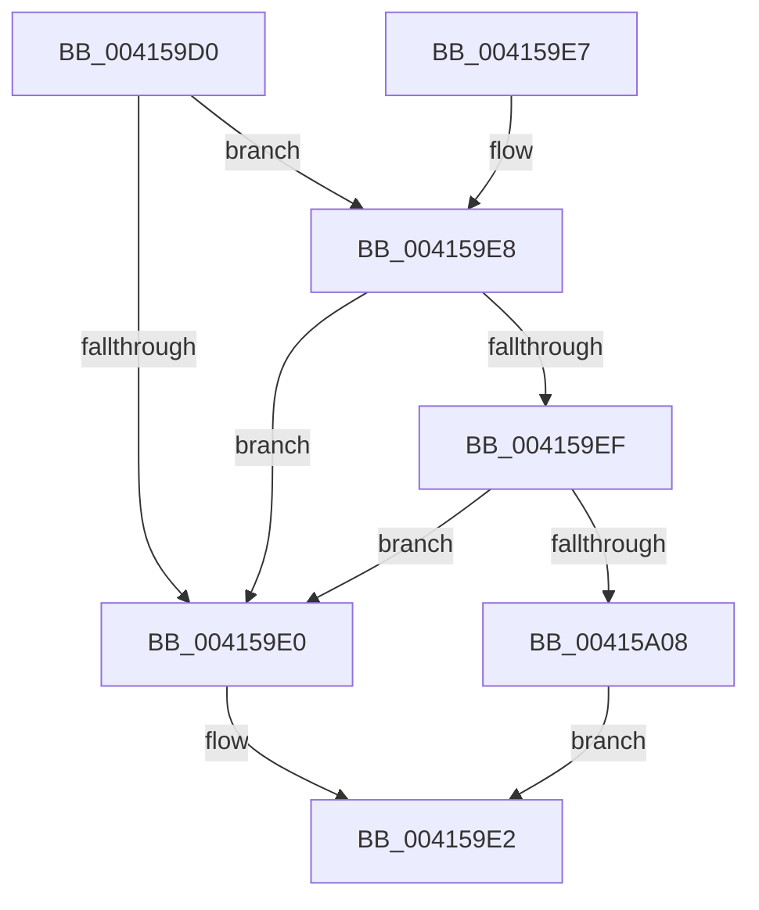

# IopFileObjectRevoked

- RVA: `0x004159D0`–`0x00415A0C` (길이 `60` bytes)
- VA: `0x00000001404159D0`
- 실행 섹션: `.text`
- PDB 이름 있음: `예`; PDB Function 태그: `아니요`
- unwind 정보 RVA: `0x00076838`
- 디코드: `18`개 명령, `60/60` bytes 표시
- 미해석 바이트: `0` (있으면 어셈블리에 `.byte`로 보존)

> 이 문서는 커널 이미지의 기계어와 PDB 기호를 분석해 생성했습니다. 4번과 5번은 함수 원형과 자료형을 바이너리 사용 방식에서 추정한 C 해석이며 원본 소스 복구 결과는 아닙니다.

## 1. Dependencies

- 직접 호출 지점: **1**; 고유 호출 대상: **1**
- 직접 호출자로 확인된 함수: **2**
- RIP 상대 이미지 참조: **0**

### Outgoing calls
- `0x004159FF` → [PsIsProcessAppContainer](../../page/A3/PsIsProcessAppContainer_function_00A38C44.md) (function, `0x00A38C44`)

### Direct callers
- [IopIoRingDispatchWrite](../../page/72/IopIoRingDispatchWrite_function_00720248.md) at `0x00720321`
- [NtCopyFileChunk](../../page/94/NtCopyFileChunk_function_0094B600.md) at `0x0094B871`
- [NtCopyFileChunk](../../page/94/NtCopyFileChunk_function_0094B600.md) at `0x0094BA07`

### Static image references
- 디코드된 RIP-relative 메모리 참조가 없습니다.

## 2. Other-region calls and transfers

- 다른 실행 섹션으로 향하는 call: **1**
  - `0x004159FF` → [PsIsProcessAppContainer](../../page/A3/PsIsProcessAppContainer_function_00A38C44.md) (`.text` → `PAGE`)
- 별도 외부 분기/꼬리 이동을 확인하지 못했습니다.

## 3. Assembly (complete function range)

```asm
004159D0  48 83 EC 28                     sub rsp, 0x28
004159D4  48 8B 81 D0 00 00 00            mov rax, qword ptr [rcx + 0xd0]
004159DB  48 85 C0                        test rax, rax
004159DE  75 08                           jne 0x1404159e8
004159E0  32 C0                           xor al, al
004159E2  48 83 C4 28                     add rsp, 0x28
004159E6  C3                              ret
004159E7  CC                              int3
004159E8  8B 08                           mov ecx, dword ptr [rax]
004159EA  F6 C1 04                        test cl, 4
004159ED  74 F1                           je 0x1404159e0
004159EF  65 48 8B 04 25 88 01 00 00      mov rax, qword ptr gs:[0x188]
004159F8  48 8B 88 B8 00 00 00            mov rcx, qword ptr [rax + 0xb8]
004159FF  E8 40 32 62 00                  call 0x140a38c44
00415A04  84 C0                           test al, al
00415A06  74 D8                           je 0x1404159e0
00415A08  B0 01                           mov al, 1
00415A0A  EB D6                           jmp 0x1404159e2
```

## 4. C-style interpretation (structured pseudocode)

```c
__int64 __fastcall IopFileObjectRevoked(__int64 a1)
{
    __int64 result;
    __int64 v_rsp;

    v_rsp = (v_rsp) - (40);
    if (*(unsigned __int64 *)(a1 + 208) != 0) goto loc_004159E8;
loc_004159E0:
    result = 0;
loc_004159E2:
    v_rsp = (v_rsp) + (40);
    return result;
loc_004159E8:
    if ((((unsigned __int8)((unsigned int)(*(unsigned int *)(result)))) & (4)) == 0) goto loc_004159E0;
    result = PsIsProcessAppContainer(*(unsigned __int64 *)(*(unsigned __int64 *)(gs_base + (0 + 392)) + 184), a2, a3, a4);
    if ((unsigned __int8)(result) == 0) goto loc_004159E0;
    goto loc_004159E2;
}
```

## 5. (Beta) C Style

```c
int64_t IopFileObjectRevoked(void *Arg1)
{
    uint8_t *arg1 = (uint8_t *)Arg1;

    int64_t result;
    int64_t local_rsp;

    local_rsp = (local_rsp) - (40);
    if (*(uint64_t *)(arg1 + 0xD0) != 0) goto loc_004159E8;
loc_004159E0:
    result = 0;
loc_004159E2:
    local_rsp = (local_rsp) + (40);
    return result;
loc_004159E8:
    if ((((uint8_t)((uint32_t)(*(uint32_t *)(result)))) & (4)) == 0) goto loc_004159E0;
    result = PsIsProcessAppContainer(*(uint64_t *)(*(uint64_t *)(gs_base + (0 + 0x188)) + 0xB8), a2, a3, a4);
    if ((uint8_t)(result) == 0) goto loc_004159E0;
    goto loc_004159E2;
}
```

### 관측된 메모리 오프셋

구조체 형식이 확인되지 않은 접근은 인자 기준의 오프셋으로만 기록했습니다.

| 기준 인자 | 오프셋 표현 | 폭 (bit) | 접근 |
|---|---:|---:|---|
| `Arg1` | `+ 0xD0` | `64` | `R` |

## 6. Execution-region graph

[열기: 2D/3D 그래프와 함수 탐색 컨트롤 패널](../../../control-panel.html?section=text&rva=0x004159D0&view=graph)

- 2D 그래프는 위에서 아래로 흐르고, 3D 그래프는 빈 공간을 드래그해 회전합니다. Shift+드래그는 이동, 휠은 확대·축소, 함수 노드 선택은 대상 보고서 이동입니다.

### Static fallback


