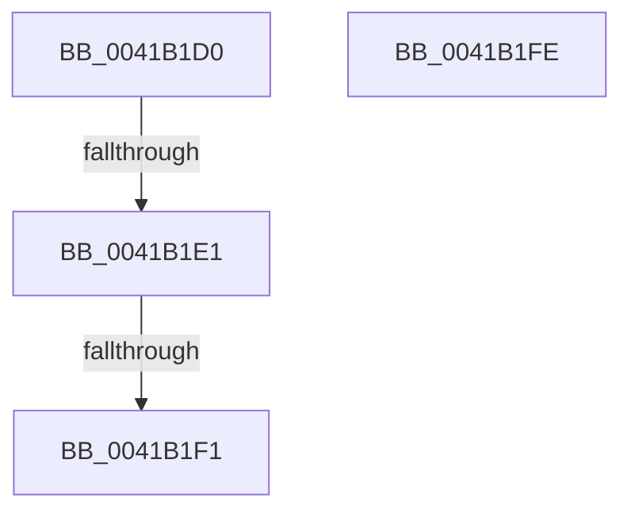

# IopIncrementDeviceObjectRefCount

- RVA: `0x0041B1D0`–`0x0041B1FF` (길이 `47` bytes)
- VA: `0x000000014041B1D0`
- 실행 섹션: `.text`
- PDB 이름 있음: `예`; PDB Function 태그: `예`
- unwind 정보 RVA: `0x0009D43C`
- 디코드: `17`개 명령, `47/47` bytes 표시
- 미해석 바이트: `0` (있으면 어셈블리에 `.byte`로 보존)

> 이 문서는 커널 이미지의 기계어와 PDB 기호를 분석해 생성했습니다. 4번과 5번은 함수 원형과 자료형을 바이너리 사용 방식에서 추정한 C 해석이며 원본 소스 복구 결과는 아닙니다.

## 1. Dependencies

- 직접 호출 지점: **0**; 고유 호출 대상: **0**
- 직접 호출자로 확인된 함수: **7**
- RIP 상대 이미지 참조: **0**

### Outgoing calls
- 직접 디코드된 call 명령이 없습니다.

### Direct callers
- [IopCompleteUnloadOrDelete](../27/IopCompleteUnloadOrDelete_function_00270BC8.md) at `0x00270CA3`
- [PnpMarkDeviceForRemove](../4C/PnpMarkDeviceForRemove_function_004C9DA8.md) at `0x004C9E2C`
- [IoRegisterFileSystem](../../page/71/IoRegisterFileSystem_function_0071D6C0.md) at `0x0071D852`
- [sub_00863E45](../../page/86/Unknown_function_00863E45.md) at `0x00863F24`
- [sub_009A5974](../../page/9A/Unknown_function_009A5974.md) at `0x009A597F`
- [IopMountVolume](../../page/A3/IopMountVolume_function_00A329D0.md) at `0x00A32C5D`
- [IopMountVolume](../../page/A3/IopMountVolume_function_00A329D0.md) at `0x00A33035`
- [IopShutdownBaseFileSystems](../../pagelk/B6/IopShutdownBaseFileSystems_function_00B63E10.md) at `0x00B63E84`

### Static image references
- 디코드된 RIP-relative 메모리 참조가 없습니다.

## 2. Other-region calls and transfers

- 다른 실행 섹션으로 향하는 call: **0**
- call이 아닌 외부 분기/꼬리 이동: **2**
  - `0x0041B1DF` → [sub_0041B1FF](Unknown_function_0041B1FF.md) (`tail-transfer`)
  - `0x0041B1EB` → [sub_0041B341](Unknown_function_0041B341.md) (`tail-transfer`)

## 3. Assembly (complete function range)

```asm
0041B1D0  48 89 5C 24 20                  mov qword ptr [rsp + 0x20], rbx
0041B1D5  57                              push rdi
0041B1D6  48 83 EC 30                     sub rsp, 0x30
0041B1DA  48 8B F9                        mov rdi, rcx
0041B1DD  84 D2                           test dl, dl
0041B1DF  75 1E                           jne 0x14041b1ff
0041B1E1  8B 59 04                        mov ebx, dword ptr [rcx + 4]
0041B1E4  FF C3                           inc ebx
0041B1E6  89 59 04                        mov dword ptr [rcx + 4], ebx
0041B1E9  85 DB                           test ebx, ebx
0041B1EB  0F 8E 50 01 00 00               jle 0x14041b341
0041B1F1  8B C3                           mov eax, ebx
0041B1F3  48 8B 5C 24 58                  mov rbx, qword ptr [rsp + 0x58]
0041B1F8  48 83 C4 30                     add rsp, 0x30
0041B1FC  5F                              pop rdi
0041B1FD  C3                              ret
0041B1FE  CC                              int3
```

## 4. C-style interpretation (structured pseudocode)

```c
__int64 __fastcall IopIncrementDeviceObjectRefCount(__int64 a1, unsigned __int8 a2)
{
    __int64 v_rbx;
    __int64 v_rsp;
    unsigned __int64 v_stack_p20;

    v_stack_p20 = v_rbx;
    v_rsp = (v_rsp) - (48);
    v_rbx = (unsigned int)(((unsigned int)(*(unsigned int *)(a1 + 4))) + 1);
    *(unsigned int *)(a1 + 4) = (unsigned int)(v_rbx);
    v_rsp = (v_rsp) + (48);
    return (unsigned int)((unsigned int)(v_rbx));
}
```

## 5. (Beta) C Style

```c
int64_t IopIncrementDeviceObjectRefCount(void *Arg1, uint8_t Arg2)
{
    uint8_t *arg1 = (uint8_t *)Arg1;

    int64_t local_rbx;
    int64_t local_rsp;
    uint64_t v_stack_p20;

    v_stack_p20 = local_rbx;
    local_rsp = (local_rsp) - (48);
    local_rbx = (uint32_t)(((uint32_t)(*(uint32_t *)(arg1 + 0x4))) + 1);
    *(uint32_t *)(arg1 + 0x4) = (uint32_t)(local_rbx);
    local_rsp = (local_rsp) + (48);
    return (uint32_t)((uint32_t)(local_rbx));
}
```

### 관측된 메모리 오프셋

구조체 형식이 확인되지 않은 접근은 인자 기준의 오프셋으로만 기록했습니다.

| 기준 인자 | 오프셋 표현 | 폭 (bit) | 접근 |
|---|---:|---:|---|
| `Arg1` | `+ 0x4` | `32` | `R` |
| `Arg1` | `+ 0x4` | `32` | `W` |

## 6. Execution-region graph

[열기: 2D/3D 그래프와 함수 탐색 컨트롤 패널](../../../control-panel.html?section=text&rva=0x0041B1D0&view=graph)

- 2D 그래프는 위에서 아래로 흐르고, 3D 그래프는 빈 공간을 드래그해 회전합니다. Shift+드래그는 이동, 휠은 확대·축소, 함수 노드 선택은 대상 보고서 이동입니다.

### Static fallback


