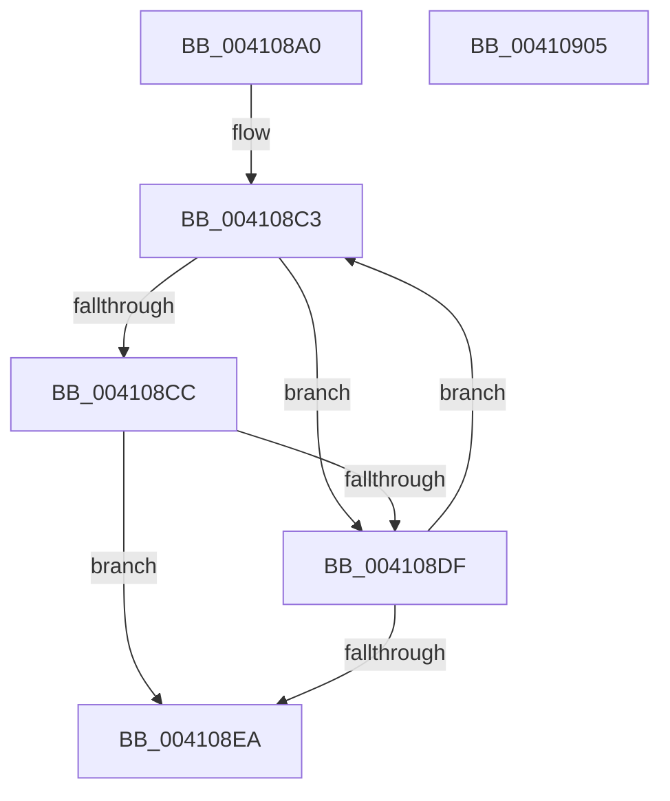

# IopIsKnownGoodLegacyFsFilter

- RVA: `0x004108A0`–`0x00410906` (길이 `102` bytes)
- VA: `0x00000001404108A0`
- 실행 섹션: `.text`
- PDB 이름 있음: `예`; PDB Function 태그: `아니요`
- unwind 정보 RVA: `0x0005C954`
- 디코드: `31`개 명령, `102/102` bytes 표시
- 미해석 바이트: `0` (있으면 어셈블리에 `.byte`로 보존)

> 이 문서는 커널 이미지의 기계어와 PDB 기호를 분석해 생성했습니다. 4번과 5번은 함수 원형과 자료형을 바이너리 사용 방식에서 추정한 C 해석이며 원본 소스 복구 결과는 아닙니다.

## 1. Dependencies

- 직접 호출 지점: **1**; 고유 호출 대상: **1**
- 직접 호출자로 확인된 함수: **2**
- RIP 상대 이미지 참조: **1**

### Outgoing calls
- `0x004108D6` → [memcmp](../6C/memcmp_function_006C6B10.md) (function, `0x006C6B10`)

### Direct callers
- [IopAttachDeviceToDeviceStackSafe](IopAttachDeviceToDeviceStackSafe_function_00410574.md) at `0x00410783`
- [IoRegisterFsRegistrationChangeMountAware](../../page/71/IoRegisterFsRegistrationChangeMountAware_function_0071D890.md) at `0x0071D8BF`

### Static image references
- `0x004108B7` → RVA `0x00002A18` (`.rdata`; read)

## 2. Other-region calls and transfers

- 다른 실행 섹션으로 향하는 call: **0**
- 별도 외부 분기/꼬리 이동을 확인하지 못했습니다.

## 3. Assembly (complete function range)

```asm
004108A0  48 89 5C 24 08                  mov qword ptr [rsp + 8], rbx
004108A5  48 89 6C 24 10                  mov qword ptr [rsp + 0x10], rbp
004108AA  48 89 74 24 18                  mov qword ptr [rsp + 0x18], rsi
004108AF  57                              push rdi
004108B0  48 83 EC 20                     sub rsp, 0x20
004108B4  0F B7 29                        movzx ebp, word ptr [rcx]
004108B7  48 8D 3D 5A 21 BF FF            lea rdi, [rip - 0x40dea6]
004108BE  48 8B F1                        mov rsi, rcx
004108C1  33 DB                           xor ebx, ebx
004108C3  0F B7 47 F8                     movzx eax, word ptr [rdi - 8]
004108C7  66 3B C5                        cmp ax, bp
004108CA  75 13                           jne 0x1404108df
004108CC  48 8B 56 08                     mov rdx, qword ptr [rsi + 8]
004108D0  44 8B C0                        mov r8d, eax
004108D3  48 8B 0F                        mov rcx, qword ptr [rdi]
004108D6  E8 35 62 2B 00                  call 0x1406c6b10
004108DB  85 C0                           test eax, eax
004108DD  74 0B                           je 0x1404108ea
004108DF  FF C3                           inc ebx
004108E1  48 83 C7 10                     add rdi, 0x10
004108E5  83 FB 03                        cmp ebx, 3
004108E8  72 D9                           jb 0x1404108c3
004108EA  48 8B 6C 24 38                  mov rbp, qword ptr [rsp + 0x38]
004108EF  83 FB 03                        cmp ebx, 3
004108F2  48 8B 5C 24 30                  mov rbx, qword ptr [rsp + 0x30]
004108F7  48 8B 74 24 40                  mov rsi, qword ptr [rsp + 0x40]
004108FC  0F 92 C0                        setb al
004108FF  48 83 C4 20                     add rsp, 0x20
00410903  5F                              pop rdi
00410904  C3                              ret
00410905  CC                              int3
```

## 4. C-style interpretation (structured pseudocode)

```c
__int64 __fastcall IopIsKnownGoodLegacyFsFilter(__int64 a1)
{
    __int64 result;
    __int64 v_rbx;
    __int64 v_rdi;
    __int64 v_rsp;
    unsigned __int64 v_stack_p10;
    unsigned __int64 v_stack_p18;
    unsigned __int64 v_stack_p8;

    v_stack_p8 = v_rbx;
    v_stack_p10 = v_rbp;
    v_stack_p18 = v_rsi;
    v_rsp = (v_rsp) - (32);
    v_rbx = 0;
loc_004108C3:
    if (((unsigned __int16)(*(unsigned __int16 *)(v_rip - 4251302 - 8))) != ((unsigned __int16)(*(unsigned __int16 *)(a1)))) goto loc_004108DF;
    result = memcmp(*(unsigned __int64 *)(v_rip - 4251302), *(unsigned __int64 *)(a1 + 8), (unsigned int)((unsigned int)(*(unsigned __int16 *)(v_rip - 4251302 - 8))), a4);
    if ((unsigned int)(result) == 0) goto loc_004108EA;
loc_004108DF:
    v_rbx = (unsigned int)((v_rbx) + 1);
    v_rdi = (v_rip - 4251302) + (16);
    if (((unsigned int)(v_rbx)) < 3) goto loc_004108C3;
loc_004108EA:
    result = (((unsigned int)(v_rbx)) < 3) ? 1 : 0;
    v_rsp = (v_rsp) + (32);
    return result;
}
```

## 5. (Beta) C Style

```c
int64_t IopIsKnownGoodLegacyFsFilter(void *Arg1)
{
    uint8_t *arg1 = (uint8_t *)Arg1;

    int64_t result;
    int64_t local_rbx;
    int64_t local_rdi;
    int64_t local_rsp;
    uint64_t v_stack_p10;
    uint64_t v_stack_p18;
    uint64_t v_stack_p8;

    v_stack_p8 = local_rbx;
    v_stack_p10 = local_rbp;
    v_stack_p18 = local_rsi;
    local_rsp = (local_rsp) - (32);
    local_rbx = 0;
loc_004108C3:
    if (((uint16_t)(*(uint16_t *)(v_rip - 0x40DEA6 - 0x8))) != ((uint16_t)(*(uint16_t *)(arg1)))) goto loc_004108DF;
    result = memcmp(*(uint64_t *)(v_rip - 0x40DEA6), *(uint64_t *)(arg1 + 0x8), (uint32_t)((uint32_t)(*(uint16_t *)(v_rip - 0x40DEA6 - 0x8))), a4);
    if ((uint32_t)(result) == 0) goto loc_004108EA;
loc_004108DF:
    local_rbx = (uint32_t)((local_rbx) + 1);
    local_rdi = (v_rip - 4251302) + (16);
    if (((uint32_t)(local_rbx)) < 3) goto loc_004108C3;
loc_004108EA:
    result = (((uint32_t)(local_rbx)) < 3) ? 1 : 0;
    local_rsp = (local_rsp) + (32);
    return result;
}
```

### 관측된 메모리 오프셋

구조체 형식이 확인되지 않은 접근은 인자 기준의 오프셋으로만 기록했습니다.

| 기준 인자 | 오프셋 표현 | 폭 (bit) | 접근 |
|---|---:|---:|---|
| `Arg1` | `+ 0x0` | `16` | `R` |
| `Arg1` | `+ 0x8` | `64` | `R` |

## 6. Execution-region graph

[열기: 2D/3D 그래프와 함수 탐색 컨트롤 패널](../../../control-panel.html?section=text&rva=0x004108A0&view=graph)

- 2D 그래프는 위에서 아래로 흐르고, 3D 그래프는 빈 공간을 드래그해 회전합니다. Shift+드래그는 이동, 휠은 확대·축소, 함수 노드 선택은 대상 보고서 이동입니다.

### Static fallback


