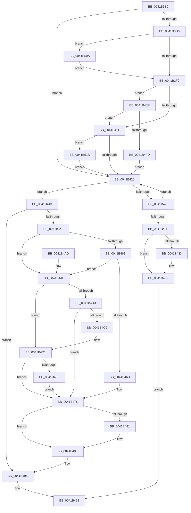

# IopVerifyDeviceObjectOnStack

- RVA: `0x0041B3B0`–`0x0041B525` (길이 `373` bytes)
- VA: `0x000000014041B3B0`
- 실행 섹션: `.text`
- PDB 이름 있음: `예`; PDB Function 태그: `아니요`
- unwind 정보 RVA: `0x0009D4E0`
- 디코드: `97`개 명령, `373/373` bytes 표시
- 미해석 바이트: `0` (있으면 어셈블리에 `.byte`로 보존)

> 이 문서는 커널 이미지의 기계어와 PDB 기호를 분석해 생성했습니다. 4번과 5번은 함수 원형과 자료형을 바이너리 사용 방식에서 추정한 C 해석이며 원본 소스 복구 결과는 아닙니다.

## 1. Dependencies

- 직접 호출 지점: **8**; 고유 호출 대상: **8**
- 직접 호출자로 확인된 함수: **1**
- RIP 상대 이미지 참조: **3**

### Outgoing calls
- `0x0041B43A` → [KeReleaseQueuedSpinLock](../27/KeReleaseQueuedSpinLock_function_00272540.md) (function, `0x00272540`)
- `0x0041B473` → [KiReleaseQueuedSpinLockInstrumented](../21/KiReleaseQueuedSpinLockInstrumented_function_002179F0.md) (function, `0x002179F0`)
- `0x0041B489` → [KiLowerIrqlProcessIrqlFlags](../4F/KiLowerIrqlProcessIrqlFlags_function_004F5698.md) (function, `0x004F5698`)
- `0x0041B4CC` → [KxWaitForLockChainValid](../21/KxWaitForLockChainValid_function_00217AA0.md) (function, `0x00217AA0`)
- `0x0041B4E8` → [KeWakeAddressAll](../21/KeWakeAddressAll_function_00217C20.md) (function, `0x00217C20`)
- `0x0041B500` → [KiAcquireQueuedSpinLockInstrumented](../27/KiAcquireQueuedSpinLockInstrumented_function_00275850.md) (function, `0x00275850`)
- `0x0041B511` → [KiRaiseIrqlProcessIrqlFlags](../4F/KiRaiseIrqlProcessIrqlFlags_function_004F56FC.md) (function, `0x004F56FC`)
- `0x0041B51B` → [KxWaitForLockOwnerShip](../25/KxWaitForLockOwnerShip_function_00257EB0.md) (function, `0x00257EB0`)

### Direct callers
- [IopCheckTopDeviceHint](../../page/9E/IopCheckTopDeviceHint_function_009EB5F0.md) at `0x009EB63B`

### Static image references
- `0x0041B3E3` → RVA `0x00FC6D20` (`ALMOSTRO`; read)
- `0x0041B404` → RVA `0x00FC6B06` (`ALMOSTRO`; read)
- `0x0041B461` → RVA `0x00F0DE58` (`.data`; read)

## 2. Other-region calls and transfers

- 다른 실행 섹션으로 향하는 call: **0**
- 별도 외부 분기/꼬리 이동을 확인하지 못했습니다.

## 3. Assembly (complete function range)

```asm
0041B3B0  48 89 5C 24 08                  mov qword ptr [rsp + 8], rbx
0041B3B5  48 89 6C 24 10                  mov qword ptr [rsp + 0x10], rbp
0041B3BA  48 89 74 24 18                  mov qword ptr [rsp + 0x18], rsi
0041B3BF  57                              push rdi
0041B3C0  48 83 EC 20                     sub rsp, 0x20
0041B3C4  40 32 F6                        xor sil, sil
0041B3C7  41 0F B6 E8                     movzx ebp, r8b
0041B3CB  48 8B FA                        mov rdi, rdx
0041B3CE  48 8B D9                        mov rbx, rcx
0041B3D1  45 84 C0                        test r8b, r8b
0041B3D4  74 4A                           je 0x14041b420
0041B3D6  44 0F 20 C6                     mov rsi, cr8
0041B3DA  B8 02 00 00 00                  mov eax, 2
0041B3DF  44 0F 22 C0                     mov cr8, rax
0041B3E3  83 3D 36 B9 BA 00 00            cmp dword ptr [rip + 0xbab936], 0
0041B3EA  0F 85 1A 01 00 00               jne 0x14041b50a
0041B3F0  65 48 8B 0C 25 28 00 00 00      mov rcx, qword ptr gs:[0x28]
0041B3F9  48 81 C1 A0 00 00 00            add rcx, 0xa0
0041B400  4C 8B 41 08                     mov r8, qword ptr [rcx + 8]
0041B404  F6 05 FB B6 BA 00 21            test byte ptr [rip + 0xbab6fb], 0x21
0041B40B  0F 85 DE 00 00 00               jne 0x14041b4ef
0041B411  48 8B D1                        mov rdx, rcx
0041B414  49 87 10                        xchg qword ptr [r8], rdx
0041B417  48 85 D2                        test rdx, rdx
0041B41A  0F 85 FB 00 00 00               jne 0x14041b51b
0041B420  48 3B DF                        cmp rbx, rdi
0041B423  74 1E                           je 0x14041b443
0041B425  48 8B 5B 18                     mov rbx, qword ptr [rbx + 0x18]
0041B429  48 85 DB                        test rbx, rbx
0041B42C  75 F2                           jne 0x14041b420
0041B42E  40 84 ED                        test bpl, bpl
0041B431  74 0C                           je 0x14041b43f
0041B433  40 0F B6 D6                     movzx edx, sil
0041B437  8D 4B 0A                        lea ecx, [rbx + 0xa]
0041B43A  E8 01 71 E5 FF                  call 0x140272540
0041B43F  32 C0                           xor al, al
0041B441  EB 55                           jmp 0x14041b498
0041B443  40 84 ED                        test bpl, bpl
0041B446  74 4E                           je 0x14041b496
0041B448  65 48 8B 1C 25 28 00 00 00      mov rbx, qword ptr gs:[0x28]
0041B451  48 81 C3 A0 00 00 00            add rbx, 0xa0
0041B458  F6 05 A7 B6 BA 00 01            test byte ptr [rip + 0xbab6a7], 1
0041B45F  74 4D                           je 0x14041b4ae
0041B461  8B 05 F1 29 AF 00               mov eax, dword ptr [rip + 0xaf29f1]
0041B467  85 C0                           test eax, eax
0041B469  75 43                           jne 0x14041b4ae
0041B46B  48 8B 54 24 28                  mov rdx, qword ptr [rsp + 0x28]
0041B470  48 8B CB                        mov rcx, rbx
0041B473  E8 78 C5 DF FF                  call 0x1402179f0
0041B478  83 3D A1 B8 BA 00 00            cmp dword ptr [rip + 0xbab8a1], 0
0041B47F  74 0D                           je 0x14041b48e
0041B481  44 0F 20 C1                     mov rcx, cr8
0041B485  40 0F B6 D6                     movzx edx, sil
0041B489  E8 0A A2 0D 00                  call 0x1404f5698
0041B48E  40 0F B6 C6                     movzx eax, sil
0041B492  44 0F 22 C0                     mov cr8, rax
0041B496  B0 01                           mov al, 1
0041B498  48 8B 5C 24 30                  mov rbx, qword ptr [rsp + 0x30]
0041B49D  48 8B 6C 24 38                  mov rbp, qword ptr [rsp + 0x38]
0041B4A2  48 8B 74 24 40                  mov rsi, qword ptr [rsp + 0x40]
0041B4A7  48 83 C4 20                     add rsp, 0x20
0041B4AB  5F                              pop rdi
0041B4AC  C3                              ret
0041B4AD  CC                              int3
0041B4AE  0F 0D 0B                        prefetchw byte ptr [rbx]
0041B4B1  48 8B 03                        mov rax, qword ptr [rbx]
0041B4B4  33 FF                           xor edi, edi
0041B4B6  48 85 C0                        test rax, rax
0041B4B9  75 16                           jne 0x14041b4d1
0041B4BB  48 8B 4B 08                     mov rcx, qword ptr [rbx + 8]
0041B4BF  48 8B C3                        mov rax, rbx
0041B4C2  F0 48 0F B1 39                  lock cmpxchg qword ptr [rcx], rdi
0041B4C7  74 AF                           je 0x14041b478
0041B4C9  48 8B CB                        mov rcx, rbx
0041B4CC  E8 CF C5 DF FF                  call 0x140217aa0
0041B4D1  48 8D 48 08                     lea rcx, [rax + 8]
0041B4D5  48 89 3B                        mov qword ptr [rbx], rdi
0041B4D8  48 8B 53 08                     mov rdx, qword ptr [rbx + 8]
0041B4DC  48 8B C2                        mov rax, rdx
0041B4DF  48 87 01                        xchg qword ptr [rcx], rax
0041B4E2  32 C2                           xor al, dl
0041B4E4  A8 04                           test al, 4
0041B4E6  74 90                           je 0x14041b478
0041B4E8  E8 33 C7 DF FF                  call 0x140217c20
0041B4ED  EB 89                           jmp 0x14041b478
0041B4EF  8B 05 63 29 AF 00               mov eax, dword ptr [rip + 0xaf2963]
0041B4F5  85 C0                           test eax, eax
0041B4F7  0F 85 14 FF FF FF               jne 0x14041b411
0041B4FD  49 8B D0                        mov rdx, r8
0041B500  E8 4B A3 E5 FF                  call 0x140275850
0041B505  E9 16 FF FF FF                  jmp 0x14041b420
0041B50A  0F B6 D0                        movzx edx, al
0041B50D  40 0F B6 CE                     movzx ecx, sil
0041B511  E8 E6 A1 0D 00                  call 0x1404f56fc
0041B516  E9 D5 FE FF FF                  jmp 0x14041b3f0
0041B51B  E8 90 C9 E3 FF                  call 0x140257eb0
0041B520  E9 FB FE FF FF                  jmp 0x14041b420
```

## 4. C-style interpretation (structured pseudocode)

```c
__int64 __fastcall IopVerifyDeviceObjectOnStack(__int64 a1, __int64 a2, unsigned __int8 a3)
{
    __int64 result;
    __int64 v_rbx;
    __int64 v_rdi;
    __int64 v_rsi;
    __int64 v_rsp;
    unsigned __int64 v_stack_p0;
    unsigned __int64 v_stack_p10;
    unsigned __int64 v_stack_p18;
    unsigned __int64 v_stack_p8;

    v_stack_p8 = v_rbx;
    v_stack_p10 = v_rbp;
    v_stack_p18 = v_rsi;
    v_rsp = (v_rsp) - (32);
    v_rsi = 0;
    if (a3 == 0) goto loc_0041B420;
    if ((*(unsigned int *)(v_rip + 12237110)) != 0) goto loc_0041B50A;
loc_0041B3F0:
    a1 = (*(unsigned __int64 *)(gs_base + (0 + 40))) + (160);
    if (((*(unsigned __int8 *)(v_rip + 12236539)) & (33)) != 0) goto loc_0041B4EF;
loc_0041B411:
    if (a1 != 0) goto loc_0041B51B;
loc_0041B420:
    if (a1 == a2) goto loc_0041B443;
    if (*(unsigned __int64 *)(a1 + 24) != 0) goto loc_0041B420;
    result = 2;
    if (a3 != 0) {
        a2 = (unsigned __int8)(v_cr8);
        a1 = *(unsigned __int64 *)(a1 + 24) + 10;
        result = KeReleaseQueuedSpinLock(a1, a2, *(unsigned __int64 *)(a1 + 8), a4);
    }
    result = 0;
    goto loc_0041B498;
loc_0041B443:
    if (a3 == 0) goto loc_0041B496;
    v_rbx = (*(unsigned __int64 *)(gs_base + (0 + 40))) + (160);
    if (((*(unsigned __int8 *)(v_rip + 12236455)) & (1)) == 0) goto loc_0041B4AE;
    if ((unsigned int)((unsigned int)(*(unsigned int *)(v_rip + 11479537))) != 0) goto loc_0041B4AE;
    result = KiReleaseQueuedSpinLockInstrumented(v_rbx, v_stack_p0, *(unsigned __int64 *)(a1 + 8), a4);
loc_0041B478:
    if ((*(unsigned int *)(v_rip + 12236961)) != 0) {
        a1 = 2;
        a2 = (unsigned __int8)(v_cr8);
        result = KiLowerIrqlProcessIrqlFlags(a1, a2, *(unsigned __int64 *)(a1 + 8), a4);
    }
loc_0041B496:
loc_0041B498:
    v_rsp = (v_rsp) + (32);
    return 1;
loc_0041B4AE:
    v_rdi = 0;
    if (*(unsigned __int64 *)(v_stack_p8) != 0) goto loc_0041B4D1;
    if (*(unsigned __int64 *)(v_stack_p8) == 0) goto loc_0041B478;
    result = KxWaitForLockChainValid(v_stack_p8, a2, *(unsigned __int64 *)(a1 + 8), a4);
loc_0041B4D1:
    *(unsigned __int64 *)(v_stack_p8) = 0;
    result = (unsigned __int8)((*(unsigned __int64 *)(v_stack_p8 + 8)) ^ ((unsigned __int8)(*(unsigned __int64 *)(v_stack_p8 + 8))));
    if ((((unsigned __int8)(result)) & (4)) == 0) goto loc_0041B478;
    result = KeWakeAddressAll(result + 8, *(unsigned __int64 *)(v_stack_p8 + 8), *(unsigned __int64 *)(a1 + 8), a4);
    goto loc_0041B478;
loc_0041B4EF:
    if ((unsigned int)((unsigned int)(*(unsigned int *)(v_rip + 11479395))) != 0) goto loc_0041B411;
    result = KiAcquireQueuedSpinLockInstrumented(result + 8, *(unsigned __int64 *)(a1 + 8), *(unsigned __int64 *)(a1 + 8), a4);
    goto loc_0041B420;
loc_0041B50A:
    result = KiRaiseIrqlProcessIrqlFlags((unsigned __int8)(v_stack_p18), (unsigned __int8)(result), *(unsigned __int64 *)(a1 + 8), a4);
    goto loc_0041B3F0;
loc_0041B51B:
    result = KxWaitForLockOwnerShip((unsigned __int8)(v_stack_p18), (unsigned __int8)(result), *(unsigned __int64 *)(a1 + 8), a4);
    goto loc_0041B420;
}
```

## 5. (Beta) C Style

```c
int64_t IopVerifyDeviceObjectOnStack(int64_t Arg1, int64_t Arg2, uint8_t Arg3)
{
    int64_t result;
    int64_t local_rbx;
    int64_t local_rdi;
    int64_t local_rsi;
    int64_t local_rsp;
    uint64_t v_stack_p0;
    uint64_t v_stack_p10;
    uint64_t v_stack_p18;
    uint64_t v_stack_p8;

    v_stack_p8 = local_rbx;
    v_stack_p10 = local_rbp;
    v_stack_p18 = local_rsi;
    local_rsp = (local_rsp) - (32);
    local_rsi = 0;
    if (Arg3 == 0) goto loc_0041B420;
    if ((*(uint32_t *)(v_rip + 0xBAB936)) != 0) goto loc_0041B50A;
loc_0041B3F0:
    Arg1 = (*(uint64_t *)(gs_base + (0 + 0x28))) + (160);
    if (((*(uint8_t *)(v_rip + 0xBAB6FB)) & (33)) != 0) goto loc_0041B4EF;
loc_0041B411:
    if (Arg1 != 0) goto loc_0041B51B;
loc_0041B420:
    if (Arg1 == Arg2) goto loc_0041B443;
    if (*(uint64_t *)(Arg1 + 0x18) != 0) goto loc_0041B420;
    result = 2;
    if (Arg3 != 0) {
        Arg2 = (uint8_t)(v_cr8);
        Arg1 = *(uint64_t *)(Arg1 + 0x18) + 10;
        result = KeReleaseQueuedSpinLock(Arg1, Arg2, *(uint64_t *)(Arg1 + 0x8), a4);
    }
    result = 0;
    goto loc_0041B498;
loc_0041B443:
    if (Arg3 == 0) goto loc_0041B496;
    local_rbx = (*(uint64_t *)(gs_base + (0 + 0x28))) + (160);
    if (((*(uint8_t *)(v_rip + 0xBAB6A7)) & (1)) == 0) goto loc_0041B4AE;
    if ((uint32_t)((uint32_t)(*(uint32_t *)(v_rip + 0xAF29F1))) != 0) goto loc_0041B4AE;
    result = KiReleaseQueuedSpinLockInstrumented(local_rbx, v_stack_p0, *(uint64_t *)(Arg1 + 0x8), a4);
loc_0041B478:
    if ((*(uint32_t *)(v_rip + 0xBAB8A1)) != 0) {
        Arg1 = 2;
        Arg2 = (uint8_t)(v_cr8);
        result = KiLowerIrqlProcessIrqlFlags(Arg1, Arg2, *(uint64_t *)(Arg1 + 0x8), a4);
    }
loc_0041B496:
loc_0041B498:
    local_rsp = (local_rsp) + (32);
    return 1;
loc_0041B4AE:
    local_rdi = 0;
    if (*(uint64_t *)(v_stack_p8) != 0) goto loc_0041B4D1;
    if (*(uint64_t *)(v_stack_p8) == 0) goto loc_0041B478;
    result = KxWaitForLockChainValid(v_stack_p8, Arg2, *(uint64_t *)(Arg1 + 0x8), a4);
loc_0041B4D1:
    *(uint64_t *)(v_stack_p8) = 0;
    result = (uint8_t)((*(uint64_t *)(v_stack_p8 + 0x8)) ^ ((uint8_t)(*(uint64_t *)(v_stack_p8 + 0x8))));
    if ((((uint8_t)(result)) & (4)) == 0) goto loc_0041B478;
    result = KeWakeAddressAll(result + 8, *(uint64_t *)(v_stack_p8 + 0x8), *(uint64_t *)(Arg1 + 0x8), a4);
    goto loc_0041B478;
loc_0041B4EF:
    if ((uint32_t)((uint32_t)(*(uint32_t *)(v_rip + 0xAF2963))) != 0) goto loc_0041B411;
    result = KiAcquireQueuedSpinLockInstrumented(result + 8, *(uint64_t *)(Arg1 + 0x8), *(uint64_t *)(Arg1 + 0x8), a4);
    goto loc_0041B420;
loc_0041B50A:
    result = KiRaiseIrqlProcessIrqlFlags((uint8_t)(v_stack_p18), (uint8_t)(result), *(uint64_t *)(Arg1 + 0x8), a4);
    goto loc_0041B3F0;
loc_0041B51B:
    result = KxWaitForLockOwnerShip((uint8_t)(v_stack_p18), (uint8_t)(result), *(uint64_t *)(Arg1 + 0x8), a4);
    goto loc_0041B420;
}
```

## 6. Execution-region graph

[열기: 2D/3D 그래프와 함수 탐색 컨트롤 패널](../../../control-panel.html?section=text&rva=0x0041B3B0&view=graph)

- 2D 그래프는 위에서 아래로 흐르고, 3D 그래프는 빈 공간을 드래그해 회전합니다. Shift+드래그는 이동, 휠은 확대·축소, 함수 노드 선택은 대상 보고서 이동입니다.

### Static fallback


