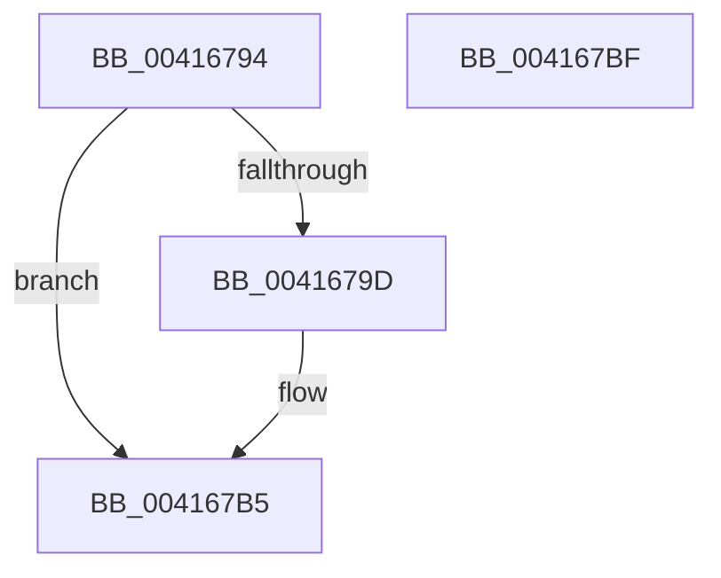

# KeAbCrossThreadRelease

- RVA: `0x00416794`–`0x004167C0` (길이 `44` bytes)
- VA: `0x0000000140416794`
- 실행 섹션: `.text`
- PDB 이름 있음: `예`; PDB Function 태그: `아니요`
- unwind 정보 RVA: `0x0005C788`
- 디코드: `13`개 명령, `44/44` bytes 표시
- 미해석 바이트: `0` (있으면 어셈블리에 `.byte`로 보존)

> 이 문서는 커널 이미지의 기계어와 PDB 기호를 분석해 생성했습니다. 4번과 5번은 함수 원형과 자료형을 바이너리 사용 방식에서 추정한 C 해석이며 원본 소스 복구 결과는 아닙니다.

## 1. Dependencies

- 직접 호출 지점: **1**; 고유 호출 대상: **1**
- 직접 호출자로 확인된 함수: **2**
- RIP 상대 이미지 참조: **0**

### Outgoing calls
- `0x004167B5` → [KiAbCrossThreadRelease](KiAbCrossThreadRelease_function_004167C8.md) (function, `0x004167C8`)

### Direct callers
- [ExpReleaseDisownedFastResourceShared](ExpReleaseDisownedFastResourceShared_function_00416338.md) at `0x00416425`
- [ExpReleaseDisownedFastResourceExclusive](ExpReleaseDisownedFastResourceExclusive_function_00416470.md) at `0x00416575`

### Static image references
- 디코드된 RIP-relative 메모리 참조가 없습니다.

## 2. Other-region calls and transfers

- 다른 실행 섹션으로 향하는 call: **0**
- 별도 외부 분기/꼬리 이동을 확인하지 못했습니다.

## 3. Assembly (complete function range)

```asm
00416794  48 83 EC 28                     sub rsp, 0x28
00416798  F6 C2 01                        test dl, 1
0041679B  74 18                           je 0x1404167b5
0041679D  48 D1 EA                        shr rdx, 1
004167A0  0F B6 C2                        movzx eax, dl
004167A3  48 6B D0 58                     imul rdx, rax, 0x58
004167A7  49 8B 80 70 04 00 00            mov rax, qword ptr [r8 + 0x470]
004167AE  48 83 C0 10                     add rax, 0x10
004167B2  48 03 D0                        add rdx, rax
004167B5  E8 0E 00 00 00                  call 0x1404167c8
004167BA  48 83 C4 28                     add rsp, 0x28
004167BE  C3                              ret
004167BF  CC                              int3
```

## 4. C-style interpretation (structured pseudocode)

```c
__int64 __fastcall KeAbCrossThreadRelease(__int64 a1, __int64 a2, __int64 a3)
{
    __int64 result;
    __int64 v_rsp;

    v_rsp = (v_rsp) - (40);
    if ((((unsigned __int8)(a2)) & (1)) != 0) {
        a2 = (a2) >> (1);
        result = (unsigned __int8)(a2);
        a2 = (a2) * (result);
        result = *(unsigned __int64 *)(a3 + 1136);
        result = (result) + (16);
        a2 = (a2) + (result);
    }
    result = KiAbCrossThreadRelease(a1, a2, a3, a4);
    v_rsp = (v_rsp) + (40);
    return result;
}
```

## 5. (Beta) C Style

```c
int64_t KeAbCrossThreadRelease(int64_t Arg1, int64_t Arg2, void *Arg3)
{
    uint8_t *arg3 = (uint8_t *)Arg3;

    int64_t result;
    int64_t local_rsp;

    local_rsp = (local_rsp) - (40);
    if ((((uint8_t)(Arg2)) & (1)) != 0) {
        Arg2 = (Arg2) >> (1);
        result = (uint8_t)(Arg2);
        Arg2 = (Arg2) * (result);
        result = *(uint64_t *)(arg3 + 0x470);
        result = (result) + (16);
        Arg2 = (Arg2) + (result);
    }
    result = KiAbCrossThreadRelease(Arg1, Arg2, Arg3, a4);
    local_rsp = (local_rsp) + (40);
    return result;
}
```

### 관측된 메모리 오프셋

구조체 형식이 확인되지 않은 접근은 인자 기준의 오프셋으로만 기록했습니다.

| 기준 인자 | 오프셋 표현 | 폭 (bit) | 접근 |
|---|---:|---:|---|
| `Arg3` | `+ 0x470` | `64` | `R` |

## 6. Execution-region graph

[열기: 2D/3D 그래프와 함수 탐색 컨트롤 패널](../../../control-panel.html?section=text&rva=0x00416794&view=graph)

- 2D 그래프는 위에서 아래로 흐르고, 3D 그래프는 빈 공간을 드래그해 회전합니다. Shift+드래그는 이동, 휠은 확대·축소, 함수 노드 선택은 대상 보고서 이동입니다.

### Static fallback


