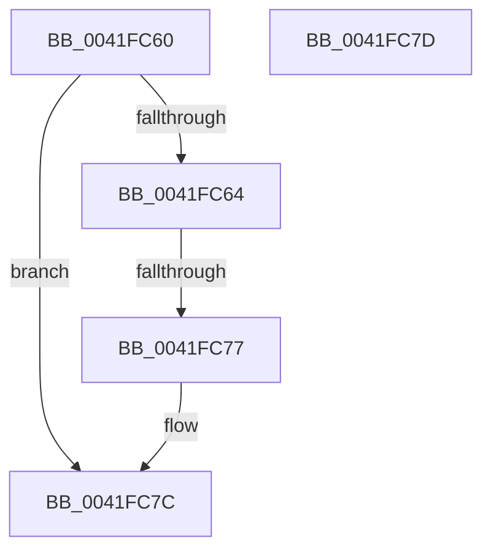

# KeAbProcessEffectiveIoPriorityChange

- RVA: `0x0041FC60`–`0x0041FC7E` (길이 `30` bytes)
- VA: `0x000000014041FC60`
- 실행 섹션: `.text`
- PDB 이름 있음: `예`; PDB Function 태그: `아니요`
- unwind 정보 RVA: `0x0009FF54`
- 디코드: `12`개 명령, `30/30` bytes 표시
- 미해석 바이트: `0` (있으면 어셈블리에 `.byte`로 보존)

> 이 문서는 커널 이미지의 기계어와 PDB 기호를 분석해 생성했습니다. 4번과 5번은 함수 원형과 자료형을 바이너리 사용 방식에서 추정한 C 해석이며 원본 소스 복구 결과는 아닙니다.

## 1. Dependencies

- 직접 호출 지점: **0**; 고유 호출 대상: **0**
- 직접 호출자로 확인된 함수: **1**
- RIP 상대 이미지 참조: **0**

### Outgoing calls
- 직접 디코드된 call 명령이 없습니다.

### Direct callers
- [sub_002142F9](../21/Unknown_function_002142F9.md) at `0x00214DBE`
- [sub_002142F9](../21/Unknown_function_002142F9.md) at `0x00214DCD`

### Static image references
- 디코드된 RIP-relative 메모리 참조가 없습니다.

## 2. Other-region calls and transfers

- 다른 실행 섹션으로 향하는 call: **0**
- call이 아닌 외부 분기/꼬리 이동: **1**
  - `0x0041FC75` → [sub_0041FC7E](Unknown_function_0041FC7E.md) (`tail-transfer`)

## 3. Assembly (complete function range)

```asm
0041FC60  85 D2                           test edx, edx
0041FC62  75 18                           jne 0x14041fc7c
0041FC64  53                              push rbx
0041FC65  48 83 EC 20                     sub rsp, 0x20
0041FC69  0F B6 81 18 03 00 00            movzx eax, byte ptr [rcx + 0x318]
0041FC70  48 8B D9                        mov rbx, rcx
0041FC73  84 C0                           test al, al
0041FC75  75 07                           jne 0x14041fc7e
0041FC77  48 83 C4 20                     add rsp, 0x20
0041FC7B  5B                              pop rbx
0041FC7C  C3                              ret
0041FC7D  CC                              int3
```

## 4. C-style interpretation (structured pseudocode)

```c
__int64 __fastcall KeAbProcessEffectiveIoPriorityChange(__int64 a1, int a2)
{
    __int64 v_rsp;

    if (a2 != 0) goto loc_0041FC7C;
    v_rsp = (v_rsp) - (32);
    v_rsp = (v_rsp) + (32);
loc_0041FC7C:
    return *(unsigned __int8 *)(a1 + 792);
}
```

## 5. (Beta) C Style

```c
int64_t KeAbProcessEffectiveIoPriorityChange(void *Arg1, int32_t Arg2)
{
    uint8_t *arg1 = (uint8_t *)Arg1;

    int64_t local_rsp;

    if (Arg2 != 0) goto loc_0041FC7C;
    local_rsp = (local_rsp) - (32);
    local_rsp = (local_rsp) + (32);
loc_0041FC7C:
    return *(uint8_t *)(arg1 + 0x318);
}
```

### 관측된 메모리 오프셋

구조체 형식이 확인되지 않은 접근은 인자 기준의 오프셋으로만 기록했습니다.

| 기준 인자 | 오프셋 표현 | 폭 (bit) | 접근 |
|---|---:|---:|---|
| `Arg1` | `+ 0x318` | `8` | `R` |

## 6. Execution-region graph

[열기: 2D/3D 그래프와 함수 탐색 컨트롤 패널](../../../control-panel.html?section=text&rva=0x0041FC60&view=graph)

- 2D 그래프는 위에서 아래로 흐르고, 3D 그래프는 빈 공간을 드래그해 회전합니다. Shift+드래그는 이동, 휠은 확대·축소, 함수 노드 선택은 대상 보고서 이동입니다.

### Static fallback


