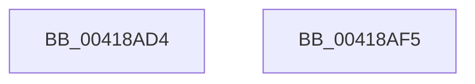

# KeCountSetBitsGroupMask

- RVA: `0x00418AD4`–`0x00418AF6` (길이 `34` bytes)
- VA: `0x0000000140418AD4`
- 실행 섹션: `.text`
- PDB 이름 있음: `예`; PDB Function 태그: `아니요`
- unwind 정보 RVA: `0x0005D2F4`
- 디코드: `8`개 명령, `34/34` bytes 표시
- 미해석 바이트: `0` (있으면 어셈블리에 `.byte`로 보존)

> 이 문서는 커널 이미지의 기계어와 PDB 기호를 분석해 생성했습니다. 4번과 5번은 함수 원형과 자료형을 바이너리 사용 방식에서 추정한 C 해석이며 원본 소스 복구 결과는 아닙니다.

## 1. Dependencies

- 직접 호출 지점: **1**; 고유 호출 대상: **1**
- 직접 호출자로 확인된 함수: **2**
- RIP 상대 이미지 참조: **0**

### Outgoing calls
- `0x00418AEB` → [RtlNumberOfSetBitsEx](RtlNumberOfSetBitsEx_function_00418CA0.md) (function, `0x00418CA0`)

### Direct callers
- [EtwTraceThreadAffinity](../3C/EtwTraceThreadAffinity_function_003C29A0.md) at `0x003C2AD2`
- [KeQueryCpuPartitionAffinity](../5C/KeQueryCpuPartitionAffinity_function_005C0EF8.md) at `0x005C0FAB`

### Static image references
- 디코드된 RIP-relative 메모리 참조가 없습니다.

## 2. Other-region calls and transfers

- 다른 실행 섹션으로 향하는 call: **0**
- 별도 외부 분기/꼬리 이동을 확인하지 못했습니다.

## 3. Assembly (complete function range)

```asm
00418AD4  48 83 EC 38                     sub rsp, 0x38
00418AD8  48 89 4C 24 28                  mov qword ptr [rsp + 0x28], rcx
00418ADD  48 8D 4C 24 20                  lea rcx, [rsp + 0x20]
00418AE2  48 C7 44 24 20 20 00 00 00      mov qword ptr [rsp + 0x20], 0x20
00418AEB  E8 B0 01 00 00                  call 0x140418ca0
00418AF0  48 83 C4 38                     add rsp, 0x38
00418AF4  C3                              ret
00418AF5  CC                              int3
```

## 4. C-style interpretation (structured pseudocode)

```c
__int64 __fastcall KeCountSetBitsGroupMask(__int64 a1)
{
    __int64 result;
    __int64 v_rsp;
    unsigned __int64 v_stack_m10;
    unsigned __int64 v_stack_m18;

    v_rsp = (v_rsp) - (56);
    v_stack_m10 = a1;
    v_stack_m18 = 32;
    result = RtlNumberOfSetBitsEx(v_stack_m18, a2, a3, a4);
    v_rsp = (v_rsp) + (56);
    return result;
}
```

## 5. (Beta) C Style

```c
int64_t KeCountSetBitsGroupMask(int64_t Arg1)
{
    int64_t result;
    int64_t local_rsp;
    uint64_t v_stack_m10;
    uint64_t v_stack_m18;

    local_rsp = (local_rsp) - (56);
    v_stack_m10 = Arg1;
    v_stack_m18 = 32;
    result = RtlNumberOfSetBitsEx(v_stack_m18, a2, a3, a4);
    local_rsp = (local_rsp) + (56);
    return result;
}
```

## 6. Execution-region graph

[열기: 2D/3D 그래프와 함수 탐색 컨트롤 패널](../../../control-panel.html?section=text&rva=0x00418AD4&view=graph)

- 2D 그래프는 위에서 아래로 흐르고, 3D 그래프는 빈 공간을 드래그해 회전합니다. Shift+드래그는 이동, 휠은 확대·축소, 함수 노드 선택은 대상 보고서 이동입니다.

### Static fallback


