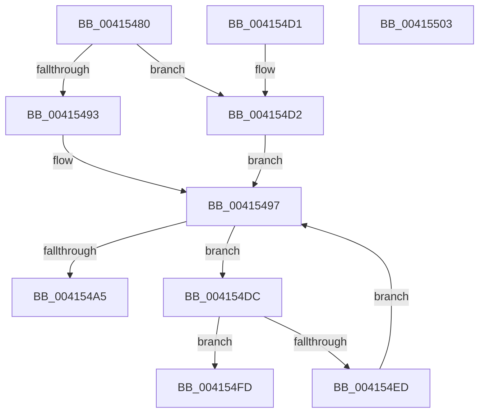

# KeEnumerateNextProcessor

- RVA: `0x00415480`–`0x00415504` (길이 `132` bytes)
- VA: `0x0000000140415480`
- 실행 섹션: `.text`
- PDB 이름 있음: `예`; PDB Function 태그: `아니요`
- unwind 정보 RVA: `0x000DB714`
- 디코드: `40`개 명령, `132/132` bytes 표시
- 미해석 바이트: `0` (있으면 어셈블리에 `.byte`로 보존)

> 이 문서는 커널 이미지의 기계어와 PDB 기호를 분석해 생성했습니다. 4번과 5번은 함수 원형과 자료형을 바이너리 사용 방식에서 추정한 C 해석이며 원본 소스 복구 결과는 아닙니다.

## 1. Dependencies

- 직접 호출 지점: **0**; 고유 호출 대상: **0**
- 직접 호출자로 확인된 함수: **59**
- RIP 상대 이미지 참조: **1**

### Outgoing calls
- 직접 디코드된 call 명령이 없습니다.

### Direct callers
- [HalGetMessageRoutingInfo](../2D/HalGetMessageRoutingInfo_function_002D4E00.md) at `0x002D53F5`
- [PpmPerfRecordMostActiveWorkloadClass](../40/PpmPerfRecordMostActiveWorkloadClass_function_0040B1A4.md) at `0x0040B34C`
- [PpmParkComputeUnparkMask](../46/PpmParkComputeUnparkMask_function_0046F9C4.md) at `0x0046FEFC`
- [KiForceIdleUpdateSchedulerParkState](../48/KiForceIdleUpdateSchedulerParkState_function_0048D874.md) at `0x0048DB94`
- [PpmParkApplyPolicy](../4B/PpmParkApplyPolicy_function_004B613C.md) at `0x004B63FB`
- [PpmParkApplyPolicy](../4B/PpmParkApplyPolicy_function_004B613C.md) at `0x004B6430`
- [PpmParkEvalualteSmtUnparkPolicy](../4C/PpmParkEvalualteSmtUnparkPolicy_function_004C0868.md) at `0x004C0909`
- [PpmEstimateIdleDuration](../4C/PpmEstimateIdleDuration_function_004C79DC.md) at `0x004C7C23`
- [PpmEstimateIdleDuration](../4C/PpmEstimateIdleDuration_function_004C79DC.md) at `0x004C7C53`
- [KeFreezeExecution](../4D/KeFreezeExecution_function_004DFA40.md) at `0x004DFCDF`
- [KiSendThawExecution](../4E/KiSendThawExecution_function_004E2800.md) at `0x004E29A7`
- [PpmHeteroDistributeUtilityEx](../4E/PpmHeteroDistributeUtilityEx_function_004EFC00.md) at `0x004EFFBF`
- [PpmHeteroDistributeUtilityEx](../4E/PpmHeteroDistributeUtilityEx_function_004EFC00.md) at `0x004EFFFB`
- [PpmHeteroDistributeUtilityEx](../4E/PpmHeteroDistributeUtilityEx_function_004EFC00.md) at `0x004F006C`
- [PpmHeteroDistributeUtilityEx](../4E/PpmHeteroDistributeUtilityEx_function_004EFC00.md) at `0x004F00E9`
- [PpmHeteroDistributeUtilityEx](../4E/PpmHeteroDistributeUtilityEx_function_004EFC00.md) at `0x004F0129`
- [PpmHeteroDistributeUtilityEx](../4E/PpmHeteroDistributeUtilityEx_function_004EFC00.md) at `0x004F0194`
- [PpmParkDistributeUtilityEx](../4F/PpmParkDistributeUtilityEx_function_004F020C.md) at `0x004F07C0`
- [PpmParkDistributeUtilityEx](../4F/PpmParkDistributeUtilityEx_function_004F020C.md) at `0x004F0808`
- [HalSendNMI](../54/HalSendNMI_function_00545E80.md) at `0x00546137`
- [HalSendNMI](../54/HalSendNMI_function_00545E80.md) at `0x005461D4`
- [HalpPmuReservedResourcesProcessorCallback](../54/HalpPmuReservedResourcesProcessorCallback_function_00547608.md) at `0x00547686`
- [HalpPmuReservedResourcesProcessorCallback](../54/HalpPmuReservedResourcesProcessorCallback_function_00547608.md) at `0x0054772A`
- [IopLiveDumpAddIptTraceBuffers](../59/IopLiveDumpAddIptTraceBuffers_function_00598EF0.md) at `0x00598F4A`
- [IopLiveDumpCorralProcessors](../59/IopLiveDumpCorralProcessors_function_0059B720.md) at `0x0059B881`
- [IopLiveDumpCorralProcessors](../59/IopLiveDumpCorralProcessors_function_0059B720.md) at `0x0059B8E1`
- [IopLiveDumpMarkRequiredDumpData](../59/IopLiveDumpMarkRequiredDumpData_function_0059D070.md) at `0x0059D14E`
- [IopAddLiveDumpPagesToPartialKernelDump](../5A/IopAddLiveDumpPagesToPartialKernelDump_function_005A13AC.md) at `0x005A14C3`
- [KiAcquirePrcbLocksForGroupAffinity](../5B/KiAcquirePrcbLocksForGroupAffinity_function_005B1C80.md) at `0x005B1CF2`
- [KiReleasePrcbLocksForGroupAffinity](../5B/KiReleasePrcbLocksForGroupAffinity_function_005B2140.md) at `0x005B218B`
- [KeEtwInitializeCpuStarvationProvider](../5B/KeEtwInitializeCpuStarvationProvider_function_005B5704.md) at `0x005B57D9`
- [KiAssignCooperativeIdleSearchContexts](../5B/KiAssignCooperativeIdleSearchContexts_function_005B7088.md) at `0x005B7106`
- [KiAssignCooperativeIdleSearchContexts](../5B/KiAssignCooperativeIdleSearchContexts_function_005B7088.md) at `0x005B713E`
- [KiAssignCooperativeIdleSearchContexts](../5B/KiAssignCooperativeIdleSearchContexts_function_005B7088.md) at `0x005B71EB`
- [KiAssignCooperativeIdleSearchContexts](../5B/KiAssignCooperativeIdleSearchContexts_function_005B7088.md) at `0x005B7285`
- [KiAssignCooperativeIdleSearchContexts](../5B/KiAssignCooperativeIdleSearchContexts_function_005B7088.md) at `0x005B72D6`
- [KiAssignCooperativeIdleSearchContexts](../5B/KiAssignCooperativeIdleSearchContexts_function_005B7088.md) at `0x005B731A`
- [KiAssignSubNodeSharedReadyQueues](../5B/KiAssignSubNodeSharedReadyQueues_function_005B737C.md) at `0x005B7417`
- [KiAssignSubNodeSharedReadyQueues](../5B/KiAssignSubNodeSharedReadyQueues_function_005B737C.md) at `0x005B7445`
- [KiAssignSubNodeSharedReadyQueues](../5B/KiAssignSubNodeSharedReadyQueues_function_005B737C.md) at `0x005B7532`
- [KiAssignSubNodeSharedReadyQueues](../5B/KiAssignSubNodeSharedReadyQueues_function_005B737C.md) at `0x005B75E2`
- [KeAllocateKernelHiberSwapShadowStacks](../5B/KeAllocateKernelHiberSwapShadowStacks_function_005BD658.md) at `0x005BD6C7`
- [KeAllocateKernelHiberSwapShadowStacks](../5B/KeAllocateKernelHiberSwapShadowStacks_function_005BD658.md) at `0x005BD705`
- [KiCpuPartitionUpdatePrcbs](../5C/KiCpuPartitionUpdatePrcbs_function_005C15D4.md) at `0x005C1643`
- [KiSrcuInitializeTopology](../5C/KiSrcuInitializeTopology_function_005C2408.md) at `0x005C25FA`
- [KiSendFreeze](../5C/KiSendFreeze_function_005C3364.md) at `0x005C33C8`
- [KiSendFreeze](../5C/KiSendFreeze_function_005C3364.md) at `0x005C3418`
- [KiBugCheckRecoveryFreezeOtherProcessors](../5C/KiBugCheckRecoveryFreezeOtherProcessors_function_005C7120.md) at `0x005C7228`
- [KiBugCheckRecoveryFreezeOtherProcessors](../5C/KiBugCheckRecoveryFreezeOtherProcessors_function_005C7120.md) at `0x005C725D`
- [KiBugCheckRecoveryFreezeOtherProcessors](../5C/KiBugCheckRecoveryFreezeOtherProcessors_function_005C7120.md) at `0x005C72D3`
- [KiAltContextWorkQueueAddItem](../5C/KiAltContextWorkQueueAddItem_function_005CB028.md) at `0x005CB09F`
- [PopDetermineBucketFrequencies](../5C/PopDetermineBucketFrequencies_function_005CEBF8.md) at `0x005CEC7F`
- [PopDetermineBucketFrequencies](../5C/PopDetermineBucketFrequencies_function_005CEBF8.md) at `0x005CEEFE`
- [PpmIdleCheckCoordinatedDependency](../5C/PpmIdleCheckCoordinatedDependency_function_005CF72C.md) at `0x005CF989`
- [PpmIdleRecheckSecondaryProcessors](../5D/PpmIdleRecheckSecondaryProcessors_function_005D0204.md) at `0x005D023B`
- [PpmIdleWaitForDependentTransitions](../5D/PpmIdleWaitForDependentTransitions_function_005D0594.md) at `0x005D05CF`
- [PpmHeteroHgsDetectContainmentPresence](../5D/PpmHeteroHgsDetectContainmentPresence_function_005D8768.md) at `0x005D88A7`
- [PpmHeteroHgsDetectContainmentPresence](../5D/PpmHeteroHgsDetectContainmentPresence_function_005D8768.md) at `0x005D88E7`
- [PpmHeteroHgsDetectContainmentPresence](../5D/PpmHeteroHgsDetectContainmentPresence_function_005D8768.md) at `0x005D896E`
- [PpmHeteroHgsDetectContainmentPresence](../5D/PpmHeteroHgsDetectContainmentPresence_function_005D8768.md) at `0x005D89D9`
- [PpmHeteroHgsDetectContainmentPresence](../5D/PpmHeteroHgsDetectContainmentPresence_function_005D8768.md) at `0x005D8A16`
- [PpmHeteroHgsDetectContainmentPresence](../5D/PpmHeteroHgsDetectContainmentPresence_function_005D8768.md) at `0x005D8A92`
- [PpmHeteroHgsRegisterContainmentGroups](../5D/PpmHeteroHgsRegisterContainmentGroups_function_005D8D14.md) at `0x005D8DBA`
- [PpmHeteroHgsRegisterContainmentGroups](../5D/PpmHeteroHgsRegisterContainmentGroups_function_005D8D14.md) at `0x005D8E23`
- [PpmHeteroHgsRegisterContainmentGroups](../5D/PpmHeteroHgsRegisterContainmentGroups_function_005D8D14.md) at `0x005D8E4A`
- [PpmHeteroHgsRegisterContainmentGroups](../5D/PpmHeteroHgsRegisterContainmentGroups_function_005D8D14.md) at `0x005D8EAF`
- [PpmParkRegisterParking](../5D/PpmParkRegisterParking_function_005DB508.md) at `0x005DB8A2`
- [PpmParkRegisterParking](../5D/PpmParkRegisterParking_function_005DB508.md) at `0x005DB8D7`
- [PpmCheckComputeHeteroResponseEx](../5D/PpmCheckComputeHeteroResponseEx_function_005DECA0.md) at `0x005DEE5E`
- [PpmCheckComputeHeteroResponseEx](../5D/PpmCheckComputeHeteroResponseEx_function_005DECA0.md) at `0x005DEEC2`
- [PpmParkCalculateCoreParkingMaskEx](../5D/PpmParkCalculateCoreParkingMaskEx_function_005DFBE0.md) at `0x005DFF42`
- [PpmParkCalculateCoreParkingMaskEx](../5D/PpmParkCalculateCoreParkingMaskEx_function_005DFBE0.md) at `0x005E0098`
- [PpmParkCalculateCoreParkingMaskEx](../5D/PpmParkCalculateCoreParkingMaskEx_function_005DFBE0.md) at `0x005E00C7`
- [PpmParkCalculateCoreParkingMaskEx](../5D/PpmParkCalculateCoreParkingMaskEx_function_005DFBE0.md) at `0x005E00FC`
- [PpmParkCalculateCoreParkingMaskEx](../5D/PpmParkCalculateCoreParkingMaskEx_function_005DFBE0.md) at `0x005E0164`
- [PpmParkComputeUnparkMaskEx](../5E/PpmParkComputeUnparkMaskEx_function_005E05E0.md) at `0x005E0DD0`
- [PpmParkComputeUnparkMaskEx](../5E/PpmParkComputeUnparkMaskEx_function_005E05E0.md) at `0x005E0DED`
- [PpmParkComputeUnparkMaskEx](../5E/PpmParkComputeUnparkMaskEx_function_005E05E0.md) at `0x005E0EA7`
- [PpmParkComputeUnparkMaskEx](../5E/PpmParkComputeUnparkMaskEx_function_005E05E0.md) at `0x005E104C`
- [PpmParkComputeUnparkMaskEx](../5E/PpmParkComputeUnparkMaskEx_function_005E05E0.md) at `0x005E108E`
- [PpmParkInitParkNode](../5E/PpmParkInitParkNode_function_005E1444.md) at `0x005E15E8`
- [ExpNodeUpdateProcessorSubQueueIndex](../65/ExpNodeUpdateProcessorSubQueueIndex_function_0065A728.md) at `0x0065A78B`
- [WheaFlushETWEventsAddWorkRtn](../66/WheaFlushETWEventsAddWorkRtn_function_0066031C.md) at `0x0066038C`
- [MiDbgPteWriteInProgress](../68/MiDbgPteWriteInProgress_function_00685528.md) at `0x006855C6`
- [sub_006F178E](../6F/Unknown_function_006F178E.md) at `0x006F17BB`
- [sub_006F322E](../6F/Unknown_function_006F322E.md) at `0x006F3372`
- [sub_006F322E](../6F/Unknown_function_006F322E.md) at `0x006F33D6`
- [sub_006F3648](../6F/Unknown_function_006F3648.md) at `0x006F396A`
- [sub_006F6620](../6F/Unknown_function_006F6620.md) at `0x006F67BB`
- [sub_006F6620](../6F/Unknown_function_006F6620.md) at `0x006F683F`
- [sub_006F6620](../6F/Unknown_function_006F6620.md) at `0x006F688C`
- [sub_006F6620](../6F/Unknown_function_006F6620.md) at `0x006F68E6`
- [sub_006F6620](../6F/Unknown_function_006F6620.md) at `0x006F6906`
- [sub_006F6620](../6F/Unknown_function_006F6620.md) at `0x006F6975`
- [sub_006F6C54](../6F/Unknown_function_006F6C54.md) at `0x006F6CBE`
- [sub_006FA0AE](../6F/Unknown_function_006FA0AE.md) at `0x006FA182`
- [sub_006FAB60](../6F/Unknown_function_006FAB60.md) at `0x006FADB4`
- [sub_006FAB60](../6F/Unknown_function_006FAB60.md) at `0x006FADF0`
- [sub_006FAB60](../6F/Unknown_function_006FAB60.md) at `0x006FAE49`
- [sub_006FAB60](../6F/Unknown_function_006FAB60.md) at `0x006FAEA6`
- [sub_006FAB60](../6F/Unknown_function_006FAB60.md) at `0x006FAEE2`
- [sub_006FAB60](../6F/Unknown_function_006FAB60.md) at `0x006FAF31`
- [KiPrepareUpdateCoresHeteroMask](../../page/74/KiPrepareUpdateCoresHeteroMask_function_0074508C.md) at `0x007452C0`
- [KiPrepareUpdateCoresHeteroMask](../../page/74/KiPrepareUpdateCoresHeteroMask_function_0074508C.md) at `0x00745301`
- [KiPrepareUpdateCoresHeteroMask](../../page/74/KiPrepareUpdateCoresHeteroMask_function_0074508C.md) at `0x00745328`
- [KiPrepareUpdateCoresHeteroMask](../../page/74/KiPrepareUpdateCoresHeteroMask_function_0074508C.md) at `0x00745397`
- [KiPrepareUpdateCoresHeteroMask](../../page/74/KiPrepareUpdateCoresHeteroMask_function_0074508C.md) at `0x007453E4`
- [KiPrepareUpdateCoresHeteroMask](../../page/74/KiPrepareUpdateCoresHeteroMask_function_0074508C.md) at `0x00745425`
- [KiPrepareUpdateCoresHeteroMask](../../page/74/KiPrepareUpdateCoresHeteroMask_function_0074508C.md) at `0x00745452`
- [KiPrepareUpdateCoresHeteroMask](../../page/74/KiPrepareUpdateCoresHeteroMask_function_0074508C.md) at `0x007454D7`
- [PpmPerfResizeHistoryAll](../../page/75/PpmPerfResizeHistoryAll_function_0075ADF8.md) at `0x0075AE55`
- [PpmEventTraceControlCallback](../../page/A5/PpmEventTraceControlCallback_function_00A51F60.md) at `0x00A52314`
- [PpmCheckInitProcessors](../../page/A8/PpmCheckInitProcessors_function_00A84AE8.md) at `0x00A84C17`
- [PpmHvEnableQosEnlightenment](../../page/A8/PpmHvEnableQosEnlightenment_function_00A84D00.md) at `0x00A84DA8`
- [PpmPerfGetBrandedFrequency](../../page/AD/PpmPerfGetBrandedFrequency_function_00AD4900.md) at `0x00AD4990`
- [PnprQuiesceProcessors](../../pagelk/B6/PnprQuiesceProcessors_function_00B64FB4.md) at `0x00B6514D`
- [KiInitializeDpcRuntimeHistoryHashTables](../../init/C3/KiInitializeDpcRuntimeHistoryHashTables_function_00C3A398.md) at `0x00C3A3D3`
- [PspCopyNodeRelativeMaskToAffinityEx](../../init/C4/PspCopyNodeRelativeMaskToAffinityEx_function_00C451AC.md) at `0x00C452B1`
- [VslConnectSwInterrupt](../../init/C7/VslConnectSwInterrupt_function_00C75C70.md) at `0x00C75E3E`

### Static image references
- `0x004154C1` → RVA `0x00F231B8` (`.data`; read)

## 2. Other-region calls and transfers

- 다른 실행 섹션으로 향하는 call: **0**
- 별도 외부 분기/꼬리 이동을 확인하지 못했습니다.

## 3. Assembly (complete function range)

```asm
00415480  48 8B 02                        mov rax, qword ptr [rdx]
00415483  4C 8B D1                        mov r10, rcx
00415486  C7 44 24 10 00 00 00 00         mov dword ptr [rsp + 0x10], 0
0041548E  48 85 C0                        test rax, rax
00415491  74 3F                           je 0x1404154d2
00415493  44 0F B7 00                     movzx r8d, word ptr [rax]
00415497  48 8B 4A 08                     mov rcx, qword ptr [rdx + 8]
0041549B  44 0F B7 4A 10                  movzx r9d, word ptr [rdx + 0x10]
004154A0  48 85 C9                        test rcx, rcx
004154A3  74 37                           je 0x1404154dc
004154A5  4C 0F BC C1                     bsf r8, rcx
004154A9  41 0F B6 C0                     movzx eax, r8b
004154AD  48 0F B3 C1                     btr rcx, rax
004154B1  41 0F B6 C0                     movzx eax, r8b
004154B5  48 89 4A 08                     mov qword ptr [rdx + 8], rcx
004154B9  41 8B C9                        mov ecx, r9d
004154BC  C1 E1 06                        shl ecx, 6
004154BF  03 C8                           add ecx, eax
004154C1  48 8B 05 F0 DC B0 00            mov rax, qword ptr [rip + 0xb0dcf0]
004154C8  8B 0C 88                        mov ecx, dword ptr [rax + rcx*4]
004154CB  33 C0                           xor eax, eax
004154CD  41 89 0A                        mov dword ptr [r10], ecx
004154D0  C3                              ret
004154D1  CC                              int3
004154D2  44 0F B7 42 10                  movzx r8d, word ptr [rdx + 0x10]
004154D7  41 FF C0                        inc r8d
004154DA  EB BB                           jmp 0x140415497
004154DC  66 41 FF C1                     inc r9w
004154E0  41 0F B7 C1                     movzx eax, r9w
004154E4  66 89 42 10                     mov word ptr [rdx + 0x10], ax
004154E8  41 3B C0                        cmp eax, r8d
004154EB  73 10                           jae 0x1404154fd
004154ED  8B C8                           mov ecx, eax
004154EF  48 8B 02                        mov rax, qword ptr [rdx]
004154F2  48 8B 4C C8 08                  mov rcx, qword ptr [rax + rcx*8 + 8]
004154F7  48 89 4A 08                     mov qword ptr [rdx + 8], rcx
004154FB  EB 9A                           jmp 0x140415497
004154FD  B8 25 02 00 C0                  mov eax, 0xc0000225
00415502  C3                              ret
00415503  CC                              int3
```

## 4. C-style interpretation (structured pseudocode)

```c
__int64 __fastcall KeEnumerateNextProcessor(__int64 a1, __int64 a2)
{
    __int64 result;
    unsigned int v_stack_p10;

    v_stack_p10 = 0;
    if (*(unsigned __int64 *)(a2) == 0) goto loc_004154D2;
loc_00415497:
    if (*(unsigned __int64 *)(a2 + 8) == 0) goto loc_004154DC;
    *(unsigned __int64 *)(a2 + 8) = *(unsigned __int64 *)(a2 + 8);
    a1 = (unsigned int)(((unsigned int)((unsigned int)(*(unsigned __int16 *)(a2 + 16)))) << (6));
    a1 = (unsigned int)((a1) + ((unsigned int)((unsigned __int8)(*(unsigned __int16 *)(*(unsigned __int64 *)(a2))))));
    result = 0;
    *(unsigned int *)(a1) = (unsigned int)((unsigned int)(*(unsigned int *)(*(unsigned __int64 *)(v_rip + 11590896) + a1 * 4)));
    return result;
loc_004154D2:
    a3 = (unsigned int)((*(unsigned __int16 *)(a2 + 16)) + 1);
    goto loc_00415497;
loc_004154DC:
    a4 = (unsigned __int16)((*(unsigned __int16 *)(a2 + 16)) + 1);
    *(unsigned __int16 *)(a2 + 16) = (unsigned __int16)((unsigned __int16)(a4));
    if (((unsigned int)((unsigned __int16)(a4))) >= ((unsigned int)(a3))) goto loc_004154FD;
    *(unsigned __int64 *)(a2 + 8) = *(unsigned __int64 *)(*(unsigned __int64 *)(a2) + (unsigned int)((unsigned int)((unsigned __int16)(a4))) * 8 + 8);
    goto loc_00415497;
loc_004154FD:
    return (unsigned int)(0xC0000225ULL);
}
```

## 5. (Beta) C Style

```c
int64_t KeEnumerateNextProcessor(void *Arg1, void *Arg2)
{
    uint8_t *arg1 = (uint8_t *)Arg1;
    uint8_t *arg2 = (uint8_t *)Arg2;

    int64_t result;
    uint32_t v_stack_p10;

    v_stack_p10 = 0;
    if (*(uint64_t *)(arg2) == 0) goto loc_004154D2;
loc_00415497:
    if (*(uint64_t *)(arg2 + 0x8) == 0) goto loc_004154DC;
    *(uint64_t *)(arg2 + 0x8) = *(uint64_t *)(arg2 + 0x8);
    Arg1 = (uint32_t)(((uint32_t)((uint32_t)(*(uint16_t *)(arg2 + 0x10)))) << (6));
    Arg1 = (uint32_t)((Arg1) + ((uint32_t)((uint8_t)(*(uint16_t *)(*(uint64_t *)(arg2))))));
    result = 0;
    *(uint32_t *)(arg1) = (uint32_t)((uint32_t)(*(uint32_t *)(*(uint64_t *)(v_rip + 0xB0DCF0) + arg1 * 4)));
    return result;
loc_004154D2:
    a3 = (uint32_t)((*(uint16_t *)(arg2 + 0x10)) + 1);
    goto loc_00415497;
loc_004154DC:
    a4 = (uint16_t)((*(uint16_t *)(arg2 + 0x10)) + 1);
    *(uint16_t *)(arg2 + 0x10) = (uint16_t)((uint16_t)(a4));
    if (((uint32_t)((uint16_t)(a4))) >= ((uint32_t)(a3))) goto loc_004154FD;
    *(uint64_t *)(arg2 + 0x8) = *(uint64_t *)(*(uint64_t *)(arg2) + (uint32_t)((uint32_t)((uint16_t)(a4))) * 8 + 0x8);
    goto loc_00415497;
loc_004154FD:
    return (uint32_t)(0xC0000225ULL);
}
```

### 관측된 메모리 오프셋

구조체 형식이 확인되지 않은 접근은 인자 기준의 오프셋으로만 기록했습니다.

| 기준 인자 | 오프셋 표현 | 폭 (bit) | 접근 |
|---|---:|---:|---|
| `Arg1` | `+ 0x0` | `32` | `W` |
| `Arg2` | `+ 0x0` | `64` | `R` |
| `Arg2` | `+ 0x8` | `64` | `R` |
| `Arg2` | `+ 0x8` | `64` | `W` |
| `Arg2` | `+ 0x10` | `16` | `R` |
| `Arg2` | `+ 0x10` | `16` | `W` |

## 6. Execution-region graph

[열기: 2D/3D 그래프와 함수 탐색 컨트롤 패널](../../../control-panel.html?section=text&rva=0x00415480&view=graph)

- 2D 그래프는 위에서 아래로 흐르고, 3D 그래프는 빈 공간을 드래그해 회전합니다. Shift+드래그는 이동, 휠은 확대·축소, 함수 노드 선택은 대상 보고서 이동입니다.

### Static fallback


