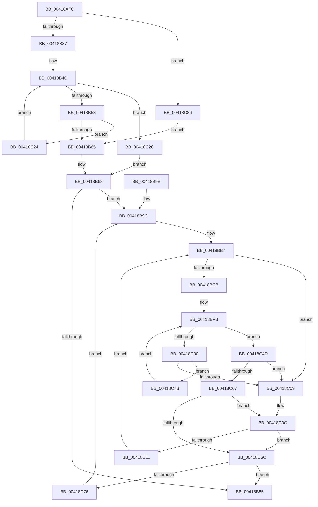

# KeFindBiasedSetBitGroupMask

- RVA: `0x00418AFC`–`0x00418C8F` (길이 `403` bytes)
- VA: `0x0000000140418AFC`
- 실행 섹션: `.text`
- PDB 이름 있음: `예`; PDB Function 태그: `아니요`
- unwind 정보 RVA: `0x0009D068`
- 디코드: `117`개 명령, `403/403` bytes 표시
- 미해석 바이트: `0` (있으면 어셈블리에 `.byte`로 보존)

> 이 문서는 커널 이미지의 기계어와 PDB 기호를 분석해 생성했습니다. 4번과 5번은 함수 원형과 자료형을 바이너리 사용 방식에서 추정한 C 해석이며 원본 소스 복구 결과는 아닙니다.

## 1. Dependencies

- 직접 호출 지점: **1**; 고유 호출 대상: **1**
- 직접 호출자로 확인된 함수: **2**
- RIP 상대 이미지 참조: **0**

### Outgoing calls
- `0x00418B6D` → [RtlNumberOfSetBitsEx](RtlNumberOfSetBitsEx_function_00418CA0.md) (function, `0x00418CA0`)

### Direct callers
- [sub_002546EC](../25/Unknown_function_002546EC.md) at `0x00255304`
- [KeStartThread](../3C/KeStartThread_function_003C21B8.md) at `0x003C249A`

### Static image references
- 디코드된 RIP-relative 메모리 참조가 없습니다.

## 2. Other-region calls and transfers

- 다른 실행 섹션으로 향하는 call: **0**
- 별도 외부 분기/꼬리 이동을 확인하지 못했습니다.

## 3. Assembly (complete function range)

```asm
00418AFC  48 8B C4                        mov rax, rsp
00418AFF  48 89 58 10                     mov qword ptr [rax + 0x10], rbx
00418B03  48 89 68 18                     mov qword ptr [rax + 0x18], rbp
00418B07  56                              push rsi
00418B08  57                              push rdi
00418B09  41 56                           push r14
00418B0B  48 83 EC 30                     sub rsp, 0x30
00418B0F  83 60 08 00                     and dword ptr [rax + 8], 0
00418B13  48 8B F2                        mov rsi, rdx
00418B16  48 C7 40 D8 20 00 00 00         mov qword ptr [rax - 0x28], 0x20
00418B1E  4C 8B 40 D8                     mov r8, qword ptr [rax - 0x28]
00418B22  49 FF C8                        dec r8
00418B25  48 89 48 E0                     mov qword ptr [rax - 0x20], rcx
00418B29  49 8D 40 01                     lea rax, [r8 + 1]
00418B2D  48 83 F8 01                     cmp rax, 1
00418B31  0F 82 4F 01 00 00               jb 0x140418c86
00418B37  49 8B C0                        mov rax, r8
00418B3A  48 8B D9                        mov rbx, rcx
00418B3D  48 C1 E8 06                     shr rax, 6
00418B41  48 83 CF FF                     or rdi, 0xffffffffffffffff
00418B45  48 8D 14 C1                     lea rdx, [rcx + rax*8]
00418B49  48 8B 01                        mov rax, qword ptr [rcx]
00418B4C  48 F7 D0                        not rax
00418B4F  48 3B C7                        cmp rax, rdi
00418B52  0F 85 D4 00 00 00               jne 0x140418c2c
00418B58  48 83 C3 08                     add rbx, 8
00418B5C  48 3B DA                        cmp rbx, rdx
00418B5F  0F 86 BF 00 00 00               jbe 0x140418c24
00418B65  48 8B DF                        mov rbx, rdi
00418B68  48 8D 4C 24 20                  lea rcx, [rsp + 0x20]
00418B6D  E8 2E 01 00 00                  call 0x140418ca0
00418B72  48 8B C8                        mov rcx, rax
00418B75  33 D2                           xor edx, edx
00418B77  48 8B C6                        mov rax, rsi
00418B7A  48 F7 F1                        div rcx
00418B7D  4C 8B DA                        mov r11, rdx
00418B80  48 85 D2                        test rdx, rdx
00418B83  75 17                           jne 0x140418b9c
00418B85  48 8B 6C 24 60                  mov rbp, qword ptr [rsp + 0x60]
00418B8A  0F B7 C3                        movzx eax, bx
00418B8D  48 8B 5C 24 58                  mov rbx, qword ptr [rsp + 0x58]
00418B92  48 83 C4 30                     add rsp, 0x30
00418B96  41 5E                           pop r14
00418B98  5F                              pop rdi
00418B99  5E                              pop rsi
00418B9A  C3                              ret
00418B9B  CC                              int3
00418B9C  4C 8B 54 24 20                  mov r10, qword ptr [rsp + 0x20]
00418BA1  48 8D 73 01                     lea rsi, [rbx + 1]
00418BA5  4C 8B 74 24 28                  mov r14, qword ptr [rsp + 0x28]
00418BAA  49 3B F2                        cmp rsi, r10
00418BAD  4D 1B C9                        sbb r9, r9
00418BB0  4C 23 CE                        and r9, rsi
00418BB3  4D 8D 42 FF                     lea r8, [r10 - 1]
00418BB7  83 64 24 50 00                  and dword ptr [rsp + 0x50], 0
00418BBC  49 8B C0                        mov rax, r8
00418BBF  49 2B C1                        sub rax, r9
00418BC2  48 FF C0                        inc rax
00418BC5  48 83 F8 01                     cmp rax, 1
00418BC9  72 3E                           jb 0x140418c09
00418BCB  49 8B C0                        mov rax, r8
00418BCE  41 8A C9                        mov cl, r9b
00418BD1  48 C1 E8 06                     shr rax, 6
00418BD5  80 E1 3F                        and cl, 0x3f
00418BD8  BA 01 00 00 00                  mov edx, 1
00418BDD  48 D3 E2                        shl rdx, cl
00418BE0  48 FF CA                        dec rdx
00418BE3  49 8D 2C C6                     lea rbp, [r14 + rax*8]
00418BE7  49 8B C1                        mov rax, r9
00418BEA  48 C1 E8 06                     shr rax, 6
00418BEE  49 8D 1C C6                     lea rbx, [r14 + rax*8]
00418BF2  48 8B 03                        mov rax, qword ptr [rbx]
00418BF5  48 F7 D0                        not rax
00418BF8  48 0B D0                        or rdx, rax
00418BFB  48 3B D7                        cmp rdx, rdi
00418BFE  75 4D                           jne 0x140418c4d
00418C00  48 83 C3 08                     add rbx, 8
00418C04  48 3B DD                        cmp rbx, rbp
00418C07  76 72                           jbe 0x140418c7b
00418C09  48 8B DF                        mov rbx, rdi
00418C0C  4D 85 C9                        test r9, r9
00418C0F  74 5B                           je 0x140418c6c
00418C11  4C 8D 46 01                     lea r8, [rsi + 1]
00418C15  4D 3B C2                        cmp r8, r10
00418C18  4D 0F 47 C2                     cmova r8, r10
00418C1C  49 FF C8                        dec r8
00418C1F  45 33 C9                        xor r9d, r9d
00418C22  EB 93                           jmp 0x140418bb7
00418C24  48 8B 03                        mov rax, qword ptr [rbx]
00418C27  E9 20 FF FF FF                  jmp 0x140418b4c
00418C2C  48 2B D9                        sub rbx, rcx
00418C2F  48 F7 D0                        not rax
00418C32  48 C1 FB 03                     sar rbx, 3
00418C36  48 C1 E3 06                     shl rbx, 6
00418C3A  48 0F BC C0                     bsf rax, rax
00418C3E  48 03 D8                        add rbx, rax
00418C41  49 3B D8                        cmp rbx, r8
00418C44  48 0F 47 DF                     cmova rbx, rdi
00418C48  E9 1B FF FF FF                  jmp 0x140418b68
00418C4D  49 2B DE                        sub rbx, r14
00418C50  48 F7 D2                        not rdx
00418C53  48 C1 FB 03                     sar rbx, 3
00418C57  48 0F BC C2                     bsf rax, rdx
00418C5B  48 C1 E3 06                     shl rbx, 6
00418C5F  48 03 D8                        add rbx, rax
00418C62  49 3B D8                        cmp rbx, r8
00418C65  77 A2                           ja 0x140418c09
00418C67  48 3B DF                        cmp rbx, rdi
00418C6A  74 A0                           je 0x140418c0c
00418C6C  49 83 EB 01                     sub r11, 1
00418C70  0F 84 0F FF FF FF               je 0x140418b85
00418C76  E9 21 FF FF FF                  jmp 0x140418b9c
00418C7B  48 8B 13                        mov rdx, qword ptr [rbx]
00418C7E  48 F7 D2                        not rdx
00418C81  E9 75 FF FF FF                  jmp 0x140418bfb
00418C86  48 83 CF FF                     or rdi, 0xffffffffffffffff
00418C8A  E9 D6 FE FF FF                  jmp 0x140418b65
```

## 4. C-style interpretation (structured pseudocode)

```c
__int64 __fastcall KeFindBiasedSetBitGroupMask(__int64 a1, __int64 a2, __int64 a3, __int64 a4)
{
    __int64 result;
    __int64 v_r11;
    __int64 v_rbx;
    __int64 v_rdi;
    __int64 v_rsp;
    unsigned __int64 v_stack_m28;
    unsigned __int64 v_stack_p10;
    unsigned __int64 v_stack_p18;
    unsigned __int64 v_stack_p20;
    unsigned __int64 v_stack_p28;
    unsigned int v_stack_p50;

    *(unsigned __int64 *)(v_rsp + 16) = v_rbx;
    *(unsigned __int64 *)(v_rsp + 24) = v_rbp;
    v_rsp = (v_rsp) - (48);
    *(unsigned __int64 *)(v_rsp - 40) = 32;
    a3 = (*(unsigned __int64 *)(v_rsp - 40)) - 1;
    *(unsigned __int64 *)(v_rsp - 32) = a1;
    if ((a3 + 1) < 1) goto loc_00418C86;
    result = (a3) >> (6);
    v_rdi = (v_rdi) | (-1);
loc_00418B4C:
    result = ~(*(unsigned __int64 *)(a1));
    if (result != v_rdi) goto loc_00418C2C;
    v_rbx = (a1) + (8);
    if (v_rbx <= (a1 + result * 8)) goto loc_00418C24;
loc_00418B65:
loc_00418B68:
    result = RtlNumberOfSetBitsEx(v_stack_m28, a1 + result * 8, a3, a4);
    a2 = 0;
    if (0 != 0) goto loc_00418B9C;
loc_00418B85:
    v_rsp = (v_rsp) + (48);
    return (unsigned __int16)(v_rdi);
loc_00418B9C:
    a4 = (a4) & (v_stack_p10 + 1);
loc_00418BB7:
    result = (v_stack_p20 - 1) - (a4);
    result = (result) + 1;
    if (result < 1) goto loc_00418C09;
    result = (v_stack_p20 - 1) >> (6);
    a1 = (unsigned __int8)(((unsigned __int8)(a4)) & (63));
    a2 = (1) << ((unsigned __int8)(a1));
    a2 = (a2) - 1;
    result = (a4) >> (6);
    result = ~(*(unsigned __int64 *)(v_stack_p28 + result * 8));
    a2 = (a2) | (result);
loc_00418BFB:
    if (a2 != v_rdi) goto loc_00418C4D;
    v_rbx = (v_stack_p28 + result * 8) + (8);
    if (v_rbx <= (v_stack_p28 + result * 8)) goto loc_00418C7B;
loc_00418C09:
loc_00418C0C:
    if (a4 == 0) goto loc_00418C6C;
    a3 = v_stack_p10 + 1 + 1;
    if ((v_stack_p10 + 1 + 1) > v_stack_p20) { a3 = v_stack_p20; }
    a3 = (a3) - 1;
    a4 = 0;
    goto loc_00418BB7;
loc_00418C24:
    goto loc_00418B4C;
loc_00418C2C:
    v_rbx = (v_rdi) - (a1);
    result = ~(*(unsigned __int64 *)(v_rdi));
    v_rbx = (v_rbx) >> (3);
    v_rbx = (v_rbx) << (6);
    v_rbx = (v_rbx) + (result);
    if (v_rbx > a3) { v_rbx = v_rdi; }
    goto loc_00418B68;
loc_00418C4D:
    v_rbx = (v_rbx) - (v_stack_p28);
    a2 = ~(a2);
    v_rbx = (v_rbx) >> (3);
    v_rbx = (v_rbx) << (6);
    v_rbx = (v_rbx) + (result);
    if (v_rbx > a3) goto loc_00418C09;
    if (v_rbx == v_rdi) goto loc_00418C0C;
loc_00418C6C:
    v_r11 = (0) - (1);
    if (condition_is_equal) goto loc_00418B85;
    goto loc_00418B9C;
loc_00418C7B:
    a2 = ~(*(unsigned __int64 *)(v_rbx));
    goto loc_00418BFB;
loc_00418C86:
    v_rdi = (v_rdi) | (-1);
    goto loc_00418B65;
}
```

## 5. (Beta) C Style

```c
int64_t KeFindBiasedSetBitGroupMask(void *Arg1, int64_t Arg2, int64_t Arg3, int64_t Arg4)
{
    uint8_t *arg1 = (uint8_t *)Arg1;

    int64_t result;
    int64_t local_r11;
    int64_t local_rbx;
    int64_t local_rdi;
    int64_t local_rsp;
    uint64_t v_stack_m28;
    uint64_t v_stack_p10;
    uint64_t v_stack_p18;
    uint64_t v_stack_p20;
    uint64_t v_stack_p28;
    uint32_t v_stack_p50;

    *(uint64_t *)(local_rsp + 0x10) = local_rbx;
    *(uint64_t *)(local_rsp + 0x18) = local_rbp;
    local_rsp = (local_rsp) - (48);
    *(uint64_t *)(local_rsp - 0x28) = 32;
    Arg3 = (*(uint64_t *)(local_rsp - 0x28)) - 1;
    *(void **)(local_rsp - 0x20) = Arg1;
    if ((Arg3 + 1) < 1) goto loc_00418C86;
    result = (Arg3) >> (6);
    local_rdi = (local_rdi) | (-1);
loc_00418B4C:
    result = ~(*(uint64_t *)(arg1));
    if (result != local_rdi) goto loc_00418C2C;
    local_rbx = (Arg1) + (8);
    if (local_rbx <= (Arg1 + result * 8)) goto loc_00418C24;
loc_00418B65:
loc_00418B68:
    result = RtlNumberOfSetBitsEx(v_stack_m28, Arg1 + result * 8, Arg3, Arg4);
    Arg2 = 0;
    if (0 != 0) goto loc_00418B9C;
loc_00418B85:
    local_rsp = (local_rsp) + (48);
    return (uint16_t)(local_rdi);
loc_00418B9C:
    Arg4 = (Arg4) & (v_stack_p10 + 1);
loc_00418BB7:
    result = (v_stack_p20 - 1) - (Arg4);
    result = (result) + 1;
    if (result < 1) goto loc_00418C09;
    result = (v_stack_p20 - 1) >> (6);
    Arg1 = (uint8_t)(((uint8_t)(Arg4)) & (63));
    Arg2 = (1) << ((uint8_t)(Arg1));
    Arg2 = (Arg2) - 1;
    result = (Arg4) >> (6);
    result = ~(*(uint64_t *)(v_stack_p28 + result * 8));
    Arg2 = (Arg2) | (result);
loc_00418BFB:
    if (Arg2 != local_rdi) goto loc_00418C4D;
    local_rbx = (v_stack_p28 + result * 8) + (8);
    if (local_rbx <= (v_stack_p28 + result * 8)) goto loc_00418C7B;
loc_00418C09:
loc_00418C0C:
    if (Arg4 == 0) goto loc_00418C6C;
    Arg3 = v_stack_p10 + 1 + 1;
    if ((v_stack_p10 + 1 + 1) > v_stack_p20) { Arg3 = v_stack_p20; }
    Arg3 = (Arg3) - 1;
    Arg4 = 0;
    goto loc_00418BB7;
loc_00418C24:
    goto loc_00418B4C;
loc_00418C2C:
    local_rbx = (local_rdi) - (Arg1);
    result = ~(*(uint64_t *)(local_rdi));
    local_rbx = (local_rbx) >> (3);
    local_rbx = (local_rbx) << (6);
    local_rbx = (local_rbx) + (result);
    if (local_rbx > Arg3) { local_rbx = local_rdi; }
    goto loc_00418B68;
loc_00418C4D:
    local_rbx = (local_rbx) - (v_stack_p28);
    Arg2 = ~(Arg2);
    local_rbx = (local_rbx) >> (3);
    local_rbx = (local_rbx) << (6);
    local_rbx = (local_rbx) + (result);
    if (local_rbx > Arg3) goto loc_00418C09;
    if (local_rbx == local_rdi) goto loc_00418C0C;
loc_00418C6C:
    local_r11 = (0) - (1);
    if (condition_is_equal) goto loc_00418B85;
    goto loc_00418B9C;
loc_00418C7B:
    Arg2 = ~(*(uint64_t *)(local_rbx));
    goto loc_00418BFB;
loc_00418C86:
    local_rdi = (local_rdi) | (-1);
    goto loc_00418B65;
}
```

### 관측된 메모리 오프셋

구조체 형식이 확인되지 않은 접근은 인자 기준의 오프셋으로만 기록했습니다.

| 기준 인자 | 오프셋 표현 | 폭 (bit) | 접근 |
|---|---:|---:|---|
| `Arg1` | `+ 0x0` | `64` | `R` |
| `Arg1` | `+ 0x0 + rax*8` | `64` | `R` |

## 6. Execution-region graph

[열기: 2D/3D 그래프와 함수 탐색 컨트롤 패널](../../../control-panel.html?section=text&rva=0x00418AFC&view=graph)

- 2D 그래프는 위에서 아래로 흐르고, 3D 그래프는 빈 공간을 드래그해 회전합니다. Shift+드래그는 이동, 휠은 확대·축소, 함수 노드 선택은 대상 보고서 이동입니다.

### Static fallback


