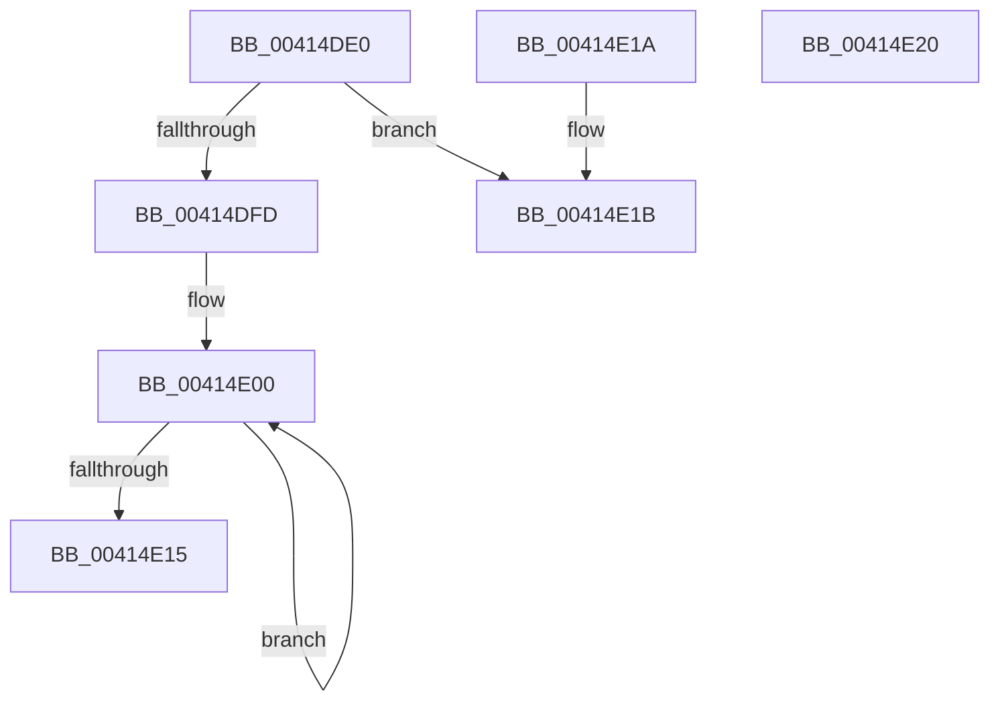

# KeFindBiasedSetMember

- RVA: `0x00414DE0`–`0x00414E21` (길이 `65` bytes)
- VA: `0x0000000140414DE0`
- 실행 섹션: `.text`
- PDB 이름 있음: `예`; PDB Function 태그: `아니요`
- unwind 정보 RVA: `0x000DB714`
- 디코드: `24`개 명령, `65/65` bytes 표시
- 미해석 바이트: `0` (있으면 어셈블리에 `.byte`로 보존)

> 이 문서는 커널 이미지의 기계어와 PDB 기호를 분석해 생성했습니다. 4번과 5번은 함수 원형과 자료형을 바이너리 사용 방식에서 추정한 C 해석이며 원본 소스 복구 결과는 아닙니다.

## 1. Dependencies

- 직접 호출 지점: **0**; 고유 호출 대상: **0**
- 직접 호출자로 확인된 함수: **1**
- RIP 상대 이미지 참조: **0**

### Outgoing calls
- 직접 디코드된 call 명령이 없습니다.

### Direct callers
- [NtGetCurrentProcessorNumber](../../page/A9/NtGetCurrentProcessorNumber_function_00A95550.md) at `0x00A955D8`

### Static image references
- 디코드된 RIP-relative 메모리 참조가 없습니다.

## 2. Other-region calls and transfers

- 다른 실행 섹션으로 향하는 call: **0**
- 별도 외부 분기/꼬리 이동을 확인하지 못했습니다.

## 3. Assembly (complete function range)

```asm
00414DE0  48 8B C2                        mov rax, rdx
00414DE3  4C 8B C1                        mov r8, rcx
00414DE6  F3 48 0F B8 C9                  popcnt rcx, rcx
00414DEB  33 D2                           xor edx, edx
00414DED  8B C9                           mov ecx, ecx
00414DEF  48 F7 F1                        div rcx
00414DF2  45 33 DB                        xor r11d, r11d
00414DF5  45 8B D3                        mov r10d, r11d
00414DF8  83 C2 01                        add edx, 1
00414DFB  74 1E                           je 0x140414e1b
00414DFD  0F 1F 00                        nop dword ptr [rax]
00414E00  49 0F BC C0                     bsf rax, r8
00414E04  41 FF C2                        inc r10d
00414E07  44 03 D0                        add r10d, eax
00414E0A  8D 48 01                        lea ecx, [rax + 1]
00414E0D  49 D3 E8                        shr r8, cl
00414E10  83 C2 FF                        add edx, -1
00414E13  75 EB                           jne 0x140414e00
00414E15  41 8D 42 FF                     lea eax, [r10 - 1]
00414E19  C3                              ret
00414E1A  CC                              int3
00414E1B  41 8D 43 FF                     lea eax, [r11 - 1]
00414E1F  C3                              ret
00414E20  CC                              int3
```

## 4. C-style interpretation (structured pseudocode)

```c
__int64 __fastcall KeFindBiasedSetMember(__int64 a1, __int64 a2)
{
    __int64 v_r10;
    __int64 v_r11;

    a2 = 0;
    v_r11 = 0;
    a2 = (unsigned int)((a2) + (1));
    if (condition_is_equal) goto loc_00414E1B;
loc_00414E00:
    v_r10 = (unsigned int)((0) + 1);
    v_r10 = (unsigned int)((v_r10) + ((unsigned int)(a2)));
    a3 = (a1) >> ((unsigned __int8)(a2 + 1));
    a2 = (unsigned int)((a2) + (-1));
    if (condition_is_not_equal) goto loc_00414E00;
    return v_r10 - 1;
loc_00414E1B:
    return v_r11 - 1;
}
```

## 5. (Beta) C Style

```c
int64_t KeFindBiasedSetMember(int64_t Arg1, void *Arg2)
{
    uint8_t *arg2 = (uint8_t *)Arg2;

    int64_t local_r10;
    int64_t local_r11;

    Arg2 = 0;
    local_r11 = 0;
    Arg2 = (uint32_t)((Arg2) + (1));
    if (condition_is_equal) goto loc_00414E1B;
loc_00414E00:
    local_r10 = (uint32_t)((0) + 1);
    local_r10 = (uint32_t)((local_r10) + ((uint32_t)(Arg2)));
    a3 = (Arg1) >> ((uint8_t)(Arg2 + 1));
    Arg2 = (uint32_t)((Arg2) + (-1));
    if (condition_is_not_equal) goto loc_00414E00;
    return local_r10 - 1;
loc_00414E1B:
    return local_r11 - 1;
}
```

### 관측된 메모리 오프셋

구조체 형식이 확인되지 않은 접근은 인자 기준의 오프셋으로만 기록했습니다.

| 기준 인자 | 오프셋 표현 | 폭 (bit) | 접근 |
|---|---:|---:|---|
| `Arg2` | `+ 0x0` | `32` | `R` |

## 6. Execution-region graph

[열기: 2D/3D 그래프와 함수 탐색 컨트롤 패널](../../../control-panel.html?section=text&rva=0x00414DE0&view=graph)

- 2D 그래프는 위에서 아래로 흐르고, 3D 그래프는 빈 공간을 드래그해 회전합니다. Shift+드래그는 이동, 휠은 확대·축소, 함수 노드 선택은 대상 보고서 이동입니다.

### Static fallback


