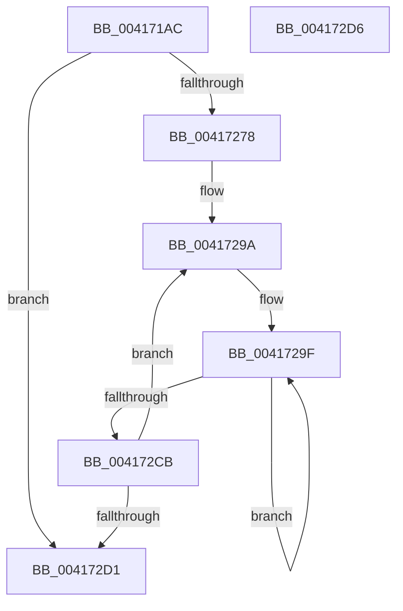

# KeFoldProcessStatisticsThread

- RVA: `0x004171AC`–`0x004172D7` (길이 `299` bytes)
- VA: `0x00000001404171AC`
- 실행 섹션: `.text`
- PDB 이름 있음: `예`; PDB Function 태그: `아니요`
- unwind 정보 RVA: `0x0005C788`
- 디코드: `52`개 명령, `299/299` bytes 표시
- 미해석 바이트: `0` (있으면 어셈블리에 `.byte`로 보존)

> 이 문서는 커널 이미지의 기계어와 PDB 기호를 분석해 생성했습니다. 4번과 5번은 함수 원형과 자료형을 바이너리 사용 방식에서 추정한 C 해석이며 원본 소스 복구 결과는 아닙니다.

## 1. Dependencies

- 직접 호출 지점: **1**; 고유 호출 대상: **1**
- 직접 호출자로 확인된 함수: **1**
- RIP 상대 이미지 참조: **0**

### Outgoing calls
- `0x0041728D` → [RtlTimelineBitmapMerge](RtlTimelineBitmapMerge_function_004172E0.md) (function, `0x004172E0`)

### Direct callers
- [PspThreadDelete](../../page/A7/PspThreadDelete_function_00A79C20.md) at `0x00A79D9B`

### Static image references
- 디코드된 RIP-relative 메모리 참조가 없습니다.

## 2. Other-region calls and transfers

- 다른 실행 섹션으로 향하는 call: **0**
- 별도 외부 분기/꼬리 이동을 확인하지 못했습니다.

## 3. Assembly (complete function range)

```asm
004171AC  48 83 EC 28                     sub rsp, 0x28
004171B0  8B 81 8C 02 00 00               mov eax, dword ptr [rcx + 0x28c]
004171B6  4C 8B 91 20 02 00 00            mov r10, qword ptr [rcx + 0x220]
004171BD  49 01 82 38 01 00 00            add qword ptr [r10 + 0x138], rax
004171C4  8B 81 DC 02 00 00               mov eax, dword ptr [rcx + 0x2dc]
004171CA  49 01 82 40 01 00 00            add qword ptr [r10 + 0x140], rax
004171D1  8B 81 84 00 00 00               mov eax, dword ptr [rcx + 0x84]
004171D7  49 01 82 48 01 00 00            add qword ptr [r10 + 0x148], rax
004171DE  48 8B 41 48                     mov rax, qword ptr [rcx + 0x48]
004171E2  49 01 82 20 01 00 00            add qword ptr [r10 + 0x120], rax
004171E9  48 8B 81 E0 03 00 00            mov rax, qword ptr [rcx + 0x3e0]
004171F0  49 01 82 78 01 00 00            add qword ptr [r10 + 0x178], rax
004171F7  48 8B 81 E8 03 00 00            mov rax, qword ptr [rcx + 0x3e8]
004171FE  49 01 82 80 01 00 00            add qword ptr [r10 + 0x180], rax
00417205  8B 81 54 01 00 00               mov eax, dword ptr [rcx + 0x154]
0041720B  49 01 82 28 01 00 00            add qword ptr [r10 + 0x128], rax
00417212  48 8B 81 80 03 00 00            mov rax, qword ptr [rcx + 0x380]
00417219  F0 49 01 82 A0 03 00 00         lock add qword ptr [r10 + 0x3a0], rax
00417221  48 8B 81 88 03 00 00            mov rax, qword ptr [rcx + 0x388]
00417228  F0 49 01 82 A8 03 00 00         lock add qword ptr [r10 + 0x3a8], rax
00417230  48 8B 81 90 03 00 00            mov rax, qword ptr [rcx + 0x390]
00417237  F0 49 01 82 B0 03 00 00         lock add qword ptr [r10 + 0x3b0], rax
0041723F  48 8B 81 98 03 00 00            mov rax, qword ptr [rcx + 0x398]
00417246  F0 49 01 82 B8 03 00 00         lock add qword ptr [r10 + 0x3b8], rax
0041724E  48 8B 81 A0 03 00 00            mov rax, qword ptr [rcx + 0x3a0]
00417255  F0 49 01 82 C0 03 00 00         lock add qword ptr [r10 + 0x3c0], rax
0041725D  48 8B 81 A8 03 00 00            mov rax, qword ptr [rcx + 0x3a8]
00417264  F0 49 01 82 C8 03 00 00         lock add qword ptr [r10 + 0x3c8], rax
0041726C  4C 8B 99 88 06 00 00            mov r11, qword ptr [rcx + 0x688]
00417273  4D 85 DB                        test r11, r11
00417276  74 59                           je 0x1404172d1
00417278  4D 8B 92 68 06 00 00            mov r10, qword ptr [r10 + 0x668]
0041727F  49 8D 93 C0 00 00 00            lea rdx, [r11 + 0xc0]
00417286  49 8D 8A 10 01 00 00            lea rcx, [r10 + 0x110]
0041728D  E8 4E 00 00 00                  call 0x1404172e0
00417292  4D 2B DA                        sub r11, r10
00417295  B9 04 00 00 00                  mov ecx, 4
0041729A  BA 02 00 00 00                  mov edx, 2
0041729F  4B 8B 04 13                     mov rax, qword ptr [r11 + r10]
004172A3  49 01 02                        add qword ptr [r10], rax
004172A6  4B 8B 44 13 40                  mov rax, qword ptr [r11 + r10 + 0x40]
004172AB  49 01 82 90 00 00 00            add qword ptr [r10 + 0x90], rax
004172B2  4B 8B 84 13 80 00 00 00         mov rax, qword ptr [r11 + r10 + 0x80]
004172BA  49 01 82 D0 00 00 00            add qword ptr [r10 + 0xd0], rax
004172C1  49 83 C2 08                     add r10, 8
004172C5  48 83 EA 01                     sub rdx, 1
004172C9  75 D4                           jne 0x14041729f
004172CB  48 83 E9 01                     sub rcx, 1
004172CF  75 C9                           jne 0x14041729a
004172D1  48 83 C4 28                     add rsp, 0x28
004172D5  C3                              ret
004172D6  CC                              int3
```

## 4. C-style interpretation (structured pseudocode)

```c
__int64 __fastcall KeFoldProcessStatisticsThread(__int64 a1)
{
    __int64 result;
    __int64 v_r10;
    __int64 v_r11;
    __int64 v_rsp;

    v_rsp = (v_rsp) - (40);
    if (*(unsigned __int64 *)(a1 + 1672) == 0) goto loc_004172D1;
    result = RtlTimelineBitmapMerge(*(unsigned __int64 *)(*(unsigned __int64 *)(a1 + 544) + 1640) + 272, *(unsigned __int64 *)(a1 + 1672) + 192, a3, a4);
    v_r11 = (*(unsigned __int64 *)(a1 + 1672)) - (*(unsigned __int64 *)(*(unsigned __int64 *)(a1 + 544) + 1640));
loc_0041729A:
loc_0041729F:
    v_r10 = (*(unsigned __int64 *)(*(unsigned __int64 *)(a1 + 544) + 1640)) + (8);
    a2 = (2) - (1);
    if (condition_is_not_equal) goto loc_0041729F;
    a1 = (4) - (1);
    if (condition_is_not_equal) goto loc_0041729A;
loc_004172D1:
    v_rsp = (v_rsp) + (40);
    return *(unsigned __int64 *)(v_r11 + *(unsigned __int64 *)(*(unsigned __int64 *)(a1 + 544) + 1640) * 1 + 128);
}
```

## 5. (Beta) C Style

```c
int64_t KeFoldProcessStatisticsThread(void *Arg1)
{
    uint8_t *arg1 = (uint8_t *)Arg1;

    int64_t result;
    int64_t local_r10;
    int64_t local_r11;
    int64_t local_rsp;

    local_rsp = (local_rsp) - (40);
    if (*(uint64_t *)(arg1 + 0x688) == 0) goto loc_004172D1;
    result = RtlTimelineBitmapMerge(*(uint64_t *)(*(uint64_t *)(arg1 + 0x220) + 0x668) + 272, *(uint64_t *)(arg1 + 0x688) + 192, a3, a4);
    local_r11 = (*(uint64_t *)(arg1 + 0x688)) - (*(uint64_t *)(*(uint64_t *)(arg1 + 0x220) + 0x668));
loc_0041729A:
loc_0041729F:
    local_r10 = (*(uint64_t *)(*(uint64_t *)(arg1 + 0x220) + 0x668)) + (8);
    a2 = (2) - (1);
    if (condition_is_not_equal) goto loc_0041729F;
    Arg1 = (4) - (1);
    if (condition_is_not_equal) goto loc_0041729A;
loc_004172D1:
    local_rsp = (local_rsp) + (40);
    return *(uint64_t *)(local_r11 + *(uint64_t *)(*(uint64_t *)(arg1 + 0x220) + 0x668) * 1 + 0x80);
}
```

### 관측된 메모리 오프셋

구조체 형식이 확인되지 않은 접근은 인자 기준의 오프셋으로만 기록했습니다.

| 기준 인자 | 오프셋 표현 | 폭 (bit) | 접근 |
|---|---:|---:|---|
| `Arg1` | `+ 0x48` | `64` | `R` |
| `Arg1` | `+ 0x84` | `32` | `R` |
| `Arg1` | `+ 0x154` | `32` | `R` |
| `Arg1` | `+ 0x220` | `64` | `R` |
| `Arg1` | `+ 0x28C` | `32` | `R` |
| `Arg1` | `+ 0x2DC` | `32` | `R` |
| `Arg1` | `+ 0x380` | `64` | `R` |
| `Arg1` | `+ 0x388` | `64` | `R` |
| `Arg1` | `+ 0x390` | `64` | `R` |
| `Arg1` | `+ 0x398` | `64` | `R` |
| `Arg1` | `+ 0x3A0` | `64` | `R` |
| `Arg1` | `+ 0x3A8` | `64` | `R` |
| `Arg1` | `+ 0x3E0` | `64` | `R` |
| `Arg1` | `+ 0x3E8` | `64` | `R` |
| `Arg1` | `+ 0x688` | `64` | `R` |

## 6. Execution-region graph

[열기: 2D/3D 그래프와 함수 탐색 컨트롤 패널](../../../control-panel.html?section=text&rva=0x004171AC&view=graph)

- 2D 그래프는 위에서 아래로 흐르고, 3D 그래프는 빈 공간을 드래그해 회전합니다. Shift+드래그는 이동, 휠은 확대·축소, 함수 노드 선택은 대상 보고서 이동입니다.

### Static fallback


