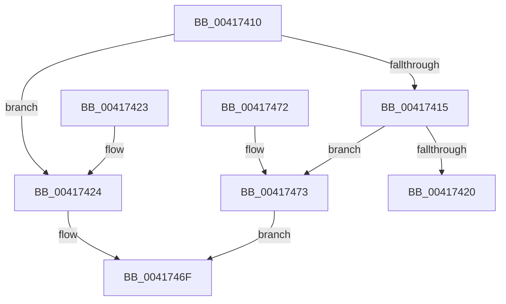

# KeGetNextKernelStackSegment

- RVA: `0x00417410`–`0x00417494` (길이 `132` bytes)
- VA: `0x0000000140417410`
- 실행 섹션: `.text`
- PDB 이름 있음: `예`; PDB Function 태그: `아니요`
- unwind 정보 RVA: `0x000DB714`
- 디코드: `36`개 명령, `132/132` bytes 표시
- 미해석 바이트: `0` (있으면 어셈블리에 `.byte`로 보존)

> 이 문서는 커널 이미지의 기계어와 PDB 기호를 분석해 생성했습니다. 4번과 5번은 함수 원형과 자료형을 바이너리 사용 방식에서 추정한 C 해석이며 원본 소스 복구 결과는 아닙니다.

## 1. Dependencies

- 직접 호출 지점: **0**; 고유 호출 대상: **0**
- 직접 호출자로 확인된 함수: **1**
- RIP 상대 이미지 참조: **0**

### Outgoing calls
- 직접 디코드된 call 명령이 없습니다.

### Direct callers
- [IopMarkPagesForProcessorData](../5A/IopMarkPagesForProcessorData_function_005A21C8.md) at `0x005A2291`
- [IopMarkPagesForProcessorData](../5A/IopMarkPagesForProcessorData_function_005A21C8.md) at `0x005A22DB`

### Static image references
- 디코드된 RIP-relative 메모리 참조가 없습니다.

## 2. Other-region calls and transfers

- 다른 실행 섹션으로 향하는 call: **0**
- 별도 외부 분기/꼬리 이동을 확인하지 못했습니다.

## 3. Assembly (complete function range)

```asm
00417410  45 84 C0                        test r8b, r8b
00417413  75 0F                           jne 0x140417424
00417415  48 8B 42 18                     mov rax, qword ptr [rdx + 0x18]
00417419  48 83 78 10 00                  cmp qword ptr [rax + 0x10], 0
0041741E  75 53                           jne 0x140417473
00417420  32 C0                           xor al, al
00417422  C3                              ret
00417423  CC                              int3
00417424  48 8B 41 38                     mov rax, qword ptr [rcx + 0x38]
00417428  48 89 02                        mov qword ptr [rdx], rax
0041742B  48 8B 41 30                     mov rax, qword ptr [rcx + 0x30]
0041742F  48 89 42 08                     mov qword ptr [rdx + 8], rax
00417433  48 8B 41 58                     mov rax, qword ptr [rcx + 0x58]
00417437  48 89 42 10                     mov qword ptr [rdx + 0x10], rax
0041743B  48 8B 41 28                     mov rax, qword ptr [rcx + 0x28]
0041743F  48 89 42 18                     mov qword ptr [rdx + 0x18], rax
00417443  48 8B 81 18 04 00 00            mov rax, qword ptr [rcx + 0x418]
0041744A  48 89 42 20                     mov qword ptr [rdx + 0x20], rax
0041744E  48 8B 81 20 04 00 00            mov rax, qword ptr [rcx + 0x420]
00417455  48 89 42 28                     mov qword ptr [rdx + 0x28], rax
00417459  48 8B 81 08 04 00 00            mov rax, qword ptr [rcx + 0x408]
00417460  48 89 42 30                     mov qword ptr [rdx + 0x30], rax
00417464  48 8B 81 10 04 00 00            mov rax, qword ptr [rcx + 0x410]
0041746B  48 89 42 38                     mov qword ptr [rdx + 0x38], rax
0041746F  B0 01                           mov al, 1
00417471  C3                              ret
00417472  CC                              int3
00417473  0F 10 40 10                     movups xmm0, xmmword ptr [rax + 0x10]
00417477  0F 11 02                        movups xmmword ptr [rdx], xmm0
0041747A  0F 10 48 20                     movups xmm1, xmmword ptr [rax + 0x20]
0041747E  0F 11 4A 10                     movups xmmword ptr [rdx + 0x10], xmm1
00417482  0F 10 40 30                     movups xmm0, xmmword ptr [rax + 0x30]
00417486  0F 11 42 20                     movups xmmword ptr [rdx + 0x20], xmm0
0041748A  0F 10 48 40                     movups xmm1, xmmword ptr [rax + 0x40]
0041748E  0F 11 4A 30                     movups xmmword ptr [rdx + 0x30], xmm1
00417492  EB DB                           jmp 0x14041746f
```

## 4. C-style interpretation (structured pseudocode)

```c
__int64 __fastcall KeGetNextKernelStackSegment(__int64 a1, __int64 a2, unsigned __int8 a3)
{
    __int64 result;

    if (a3 != 0) goto loc_00417424;
    if ((*(unsigned __int64 *)(*(unsigned __int64 *)(a2 + 24) + 16)) != 0) goto loc_00417473;
    result = 0;
    return result;
loc_00417424:
    *(unsigned __int64 *)(a2) = *(unsigned __int64 *)(a1 + 56);
    *(unsigned __int64 *)(a2 + 8) = *(unsigned __int64 *)(a1 + 48);
    *(unsigned __int64 *)(a2 + 16) = *(unsigned __int64 *)(a1 + 88);
    *(unsigned __int64 *)(a2 + 24) = *(unsigned __int64 *)(a1 + 40);
    *(unsigned __int64 *)(a2 + 32) = *(unsigned __int64 *)(a1 + 1048);
    *(unsigned __int64 *)(a2 + 40) = *(unsigned __int64 *)(a1 + 1056);
    *(unsigned __int64 *)(a2 + 48) = *(unsigned __int64 *)(a1 + 1032);
    *(unsigned __int64 *)(a2 + 56) = *(unsigned __int64 *)(a1 + 1040);
loc_0041746F:
    return 1;
loc_00417473:
    *(unsigned __int64 *)(a2) = v_xmm0;
    *(unsigned __int64 *)(a2 + 16) = v_xmm1;
    *(unsigned __int64 *)(a2 + 32) = v_xmm0;
    *(unsigned __int64 *)(a2 + 48) = v_xmm1;
    goto loc_0041746F;
}
```

## 5. (Beta) C Style

```c
int64_t KeGetNextKernelStackSegment(void *Arg1, void *Arg2, uint8_t Arg3)
{
    uint8_t *arg1 = (uint8_t *)Arg1;
    uint8_t *arg2 = (uint8_t *)Arg2;

    int64_t result;

    if (Arg3 != 0) goto loc_00417424;
    if ((*(uint64_t *)(*(uint64_t *)(arg2 + 0x18) + 0x10)) != 0) goto loc_00417473;
    result = 0;
    return result;
loc_00417424:
    *(uint64_t *)(arg2) = *(uint64_t *)(arg1 + 0x38);
    *(uint64_t *)(arg2 + 0x8) = *(uint64_t *)(arg1 + 0x30);
    *(uint64_t *)(arg2 + 0x10) = *(uint64_t *)(arg1 + 0x58);
    *(uint64_t *)(arg2 + 0x18) = *(uint64_t *)(arg1 + 0x28);
    *(uint64_t *)(arg2 + 0x20) = *(uint64_t *)(arg1 + 0x418);
    *(uint64_t *)(arg2 + 0x28) = *(uint64_t *)(arg1 + 0x420);
    *(uint64_t *)(arg2 + 0x30) = *(uint64_t *)(arg1 + 0x408);
    *(uint64_t *)(arg2 + 0x38) = *(uint64_t *)(arg1 + 0x410);
loc_0041746F:
    return 1;
loc_00417473:
    *(uint64_t *)(arg2) = v_xmm0;
    *(uint64_t *)(arg2 + 0x10) = v_xmm1;
    *(uint64_t *)(arg2 + 0x20) = v_xmm0;
    *(uint64_t *)(arg2 + 0x30) = v_xmm1;
    goto loc_0041746F;
}
```

### 관측된 메모리 오프셋

구조체 형식이 확인되지 않은 접근은 인자 기준의 오프셋으로만 기록했습니다.

| 기준 인자 | 오프셋 표현 | 폭 (bit) | 접근 |
|---|---:|---:|---|
| `Arg1` | `+ 0x28` | `64` | `R` |
| `Arg1` | `+ 0x30` | `64` | `R` |
| `Arg1` | `+ 0x38` | `64` | `R` |
| `Arg1` | `+ 0x58` | `64` | `R` |
| `Arg1` | `+ 0x408` | `64` | `R` |
| `Arg1` | `+ 0x410` | `64` | `R` |
| `Arg1` | `+ 0x418` | `64` | `R` |
| `Arg1` | `+ 0x420` | `64` | `R` |
| `Arg2` | `+ 0x0` | `64` | `W` |
| `Arg2` | `+ 0x0` | `128` | `R` |
| `Arg2` | `+ 0x8` | `64` | `W` |
| `Arg2` | `+ 0x10` | `64` | `W` |
| `Arg2` | `+ 0x10` | `128` | `R` |
| `Arg2` | `+ 0x18` | `64` | `R` |
| `Arg2` | `+ 0x18` | `64` | `W` |
| `Arg2` | `+ 0x20` | `64` | `W` |
| `Arg2` | `+ 0x20` | `128` | `R` |
| `Arg2` | `+ 0x28` | `64` | `W` |
| `Arg2` | `+ 0x30` | `64` | `W` |
| `Arg2` | `+ 0x30` | `128` | `R` |
| `Arg2` | `+ 0x38` | `64` | `W` |

## 6. Execution-region graph

[열기: 2D/3D 그래프와 함수 탐색 컨트롤 패널](../../../control-panel.html?section=text&rva=0x00417410&view=graph)

- 2D 그래프는 위에서 아래로 흐르고, 3D 그래프는 빈 공간을 드래그해 회전합니다. Shift+드래그는 이동, 휠은 확대·축소, 함수 노드 선택은 대상 보고서 이동입니다.

### Static fallback


