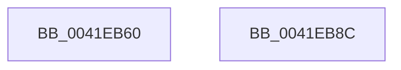

# KeInitializeAffinityEx2

- RVA: `0x0041EB60`–`0x0041EB8D` (길이 `45` bytes)
- VA: `0x000000014041EB60`
- 실행 섹션: `.text`
- PDB 이름 있음: `예`; PDB Function 태그: `아니요`
- unwind 정보 RVA: `0x0005C788`
- 디코드: `12`개 명령, `45/45` bytes 표시
- 미해석 바이트: `0` (있으면 어셈블리에 `.byte`로 보존)

> 이 문서는 커널 이미지의 기계어와 PDB 기호를 분석해 생성했습니다. 4번과 5번은 함수 원형과 자료형을 바이너리 사용 방식에서 추정한 C 해석이며 원본 소스 복구 결과는 아닙니다.

## 1. Dependencies

- 직접 호출 지점: **1**; 고유 호출 대상: **1**
- 직접 호출자로 확인된 함수: **0**
- RIP 상대 이미지 참조: **0**

### Outgoing calls
- `0x0041EB82` → [memset](../6C/memset_function_006C6C40.md) (function, `0x006C6C40`)

### Direct callers
- 이 함수 시작 RVA로 연결되는 직접 call은 확인되지 않았습니다. 간접 호출은 완전히 역산할 수 없습니다.

### Static image references
- 디코드된 RIP-relative 메모리 참조가 없습니다.

## 2. Other-region calls and transfers

- 다른 실행 섹션으로 향하는 call: **0**
- 별도 외부 분기/꼬리 이동을 확인하지 못했습니다.

## 3. Assembly (complete function range)

```asm
0041EB60  48 83 EC 28                     sub rsp, 0x28
0041EB64  44 0F B7 C2                     movzx r8d, dx
0041EB68  66 89 51 02                     mov word ptr [rcx + 2], dx
0041EB6C  33 D2                           xor edx, edx
0041EB6E  66 C7 01 01 00                  mov word ptr [rcx], 1
0041EB73  C7 41 04 00 00 00 00            mov dword ptr [rcx + 4], 0
0041EB7A  48 83 C1 08                     add rcx, 8
0041EB7E  49 C1 E0 03                     shl r8, 3
0041EB82  E8 B9 80 2A 00                  call 0x1406c6c40
0041EB87  48 83 C4 28                     add rsp, 0x28
0041EB8B  C3                              ret
0041EB8C  CC                              int3
```

## 4. C-style interpretation (structured pseudocode)

```c
__int64 __fastcall KeInitializeAffinityEx2(__int64 a1, int a2)
{
    __int64 result;
    __int64 v_rsp;

    v_rsp = (v_rsp) - (40);
    *(unsigned __int16 *)(a1 + 2) = (unsigned __int16)(a2);
    a2 = 0;
    *(unsigned __int16 *)(a1) = 1;
    *(unsigned int *)(a1 + 4) = 0;
    a1 = (a1) + (8);
    a3 = ((unsigned __int16)(a2)) << (3);
    result = memset(a1, a2, a3, a4);
    v_rsp = (v_rsp) + (40);
    return result;
}
```

## 5. (Beta) C Style

```c
int64_t KeInitializeAffinityEx2(void *AffinityEx2, int32_t Arg2)
{
    uint8_t *affinityEx2 = (uint8_t *)AffinityEx2;

    int64_t result;
    int64_t local_rsp;

    local_rsp = (local_rsp) - (40);
    *(uint16_t *)(affinityEx2 + 0x2) = (uint16_t)(Arg2);
    Arg2 = 0;
    *(uint16_t *)(affinityEx2) = 1;
    *(uint32_t *)(affinityEx2 + 0x4) = 0;
    AffinityEx2 = (AffinityEx2) + (8);
    a3 = ((uint16_t)(Arg2)) << (3);
    result = memset(AffinityEx2, Arg2, a3, a4);
    local_rsp = (local_rsp) + (40);
    return result;
}
```

### 관측된 메모리 오프셋

구조체 형식이 확인되지 않은 접근은 인자 기준의 오프셋으로만 기록했습니다.

| 기준 인자 | 오프셋 표현 | 폭 (bit) | 접근 |
|---|---:|---:|---|
| `AffinityEx2` | `+ 0x0` | `16` | `W` |
| `AffinityEx2` | `+ 0x2` | `16` | `W` |
| `AffinityEx2` | `+ 0x4` | `32` | `W` |

## 6. Execution-region graph

[열기: 2D/3D 그래프와 함수 탐색 컨트롤 패널](../../../control-panel.html?section=text&rva=0x0041EB60&view=graph)

- 2D 그래프는 위에서 아래로 흐르고, 3D 그래프는 빈 공간을 드래그해 회전합니다. Shift+드래그는 이동, 휠은 확대·축소, 함수 노드 선택은 대상 보고서 이동입니다.

### Static fallback


