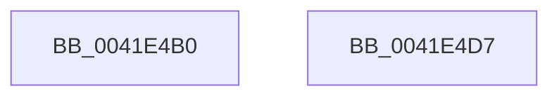

# KeInitializeSchedulerSubNodeEnumerationContext

- RVA: `0x0041E4B0`–`0x0041E4D8` (길이 `40` bytes)
- VA: `0x000000014041E4B0`
- 실행 섹션: `.text`
- PDB 이름 있음: `예`; PDB Function 태그: `아니요`
- unwind 정보 RVA: `0x0005C788`
- 디코드: `12`개 명령, `40/40` bytes 표시
- 미해석 바이트: `0` (있으면 어셈블리에 `.byte`로 보존)

> 이 문서는 커널 이미지의 기계어와 PDB 기호를 분석해 생성했습니다. 4번과 5번은 함수 원형과 자료형을 바이너리 사용 방식에서 추정한 C 해석이며 원본 소스 복구 결과는 아닙니다.

## 1. Dependencies

- 직접 호출 지점: **1**; 고유 호출 대상: **1**
- 직접 호출자로 확인된 함수: **9**
- RIP 상대 이미지 참조: **0**

### Outgoing calls
- `0x0041E4CD` → [RtlCopyVolatileMemory](../6B/RtlCopyVolatileMemory_function_006BC9D0.md) (function, `0x006BC9D0`)

### Direct callers
- [KeUpdateProcessorRestrictionsEx](../5B/KeUpdateProcessorRestrictionsEx_function_005B64E8.md) at `0x005B689E`
- [KeQueryNodeActiveProcessorCount](../5B/KeQueryNodeActiveProcessorCount_function_005BBDF0.md) at `0x005BBE44`
- [PoAllProcessorsDeepIdle](../5C/PoAllProcessorsDeepIdle_function_005CF1C4.md) at `0x005CF22C`
- [PpmParkRegisterParking](../5D/PpmParkRegisterParking_function_005DB508.md) at `0x005DB67D`
- [PpmParkRegisterParking](../5D/PpmParkRegisterParking_function_005DB508.md) at `0x005DB76C`
- [sub_006D831E](../6D/Unknown_function_006D831E.md) at `0x006D85E4`
- [sub_006D831E](../6D/Unknown_function_006D831E.md) at `0x006D8702`
- [ExpQuerySystemInformation](../../page/A5/ExpQuerySystemInformation_function_00A57858.md) at `0x00A5AD44`
- [KiSynchNumaCounterSetCallback](../../page/A7/KiSynchNumaCounterSetCallback_function_00A77BE0.md) at `0x00A77CF9`
- [KeStartAllProcessors](../../init/C3/KeStartAllProcessors_function_00C36F78.md) at `0x00C37603`
- [KiConfigureAllSchedulingInformation](../../init/C3/KiConfigureAllSchedulingInformation_function_00C380D0.md) at `0x00C3817C`

### Static image references
- 디코드된 RIP-relative 메모리 참조가 없습니다.

## 2. Other-region calls and transfers

- 다른 실행 섹션으로 향하는 call: **0**
- 별도 외부 분기/꼬리 이동을 확인하지 못했습니다.

## 3. Assembly (complete function range)

```asm
0041E4B0  48 83 EC 28                     sub rsp, 0x28
0041E4B4  33 C0                           xor eax, eax
0041E4B6  48 89 41 08                     mov qword ptr [rcx + 8], rax
0041E4BA  48 89 41 10                     mov qword ptr [rcx + 0x10], rax
0041E4BE  48 89 11                        mov qword ptr [rcx], rdx
0041E4C1  48 83 C2 10                     add rdx, 0x10
0041E4C5  48 83 C1 08                     add rcx, 8
0041E4C9  44 8D 40 10                     lea r8d, [rax + 0x10]
0041E4CD  E8 FE E4 29 00                  call 0x1406bc9d0
0041E4D2  48 83 C4 28                     add rsp, 0x28
0041E4D6  C3                              ret
0041E4D7  CC                              int3
```

## 4. C-style interpretation (structured pseudocode)

```c
__int64 __fastcall KeInitializeSchedulerSubNodeEnumerationContext(__int64 a1, __int64 a2)
{
    __int64 result;
    __int64 v_rsp;

    v_rsp = (v_rsp) - (40);
    result = 0;
    *(unsigned __int64 *)(a1 + 8) = 0;
    *(unsigned __int64 *)(a1 + 16) = 0;
    *(unsigned __int64 *)(a1) = a2;
    a2 = (a2) + (16);
    a1 = (a1) + (8);
    result = RtlCopyVolatileMemory(a1, a2, result + 16, a4);
    v_rsp = (v_rsp) + (40);
    return result;
}
```

## 5. (Beta) C Style

```c
int64_t KeInitializeSchedulerSubNodeEnumerationContext(void *SchedulerSubNodeEnumerationContext, int64_t Arg2)
{
    uint8_t *schedulerSubNodeEnumerationContext = (uint8_t *)SchedulerSubNodeEnumerationContext;

    int64_t result;
    int64_t local_rsp;

    local_rsp = (local_rsp) - (40);
    result = 0;
    *(uint64_t *)(schedulerSubNodeEnumerationContext + 0x8) = 0;
    *(uint64_t *)(schedulerSubNodeEnumerationContext + 0x10) = 0;
    *(uint64_t *)(schedulerSubNodeEnumerationContext) = Arg2;
    Arg2 = (Arg2) + (16);
    SchedulerSubNodeEnumerationContext = (SchedulerSubNodeEnumerationContext) + (8);
    result = RtlCopyVolatileMemory(SchedulerSubNodeEnumerationContext, Arg2, result + 16, a4);
    local_rsp = (local_rsp) + (40);
    return result;
}
```

### 관측된 메모리 오프셋

구조체 형식이 확인되지 않은 접근은 인자 기준의 오프셋으로만 기록했습니다.

| 기준 인자 | 오프셋 표현 | 폭 (bit) | 접근 |
|---|---:|---:|---|
| `SchedulerSubNodeEnumerationContext` | `+ 0x0` | `64` | `W` |
| `SchedulerSubNodeEnumerationContext` | `+ 0x8` | `64` | `W` |
| `SchedulerSubNodeEnumerationContext` | `+ 0x10` | `64` | `W` |

## 6. Execution-region graph

[열기: 2D/3D 그래프와 함수 탐색 컨트롤 패널](../../../control-panel.html?section=text&rva=0x0041E4B0&view=graph)

- 2D 그래프는 위에서 아래로 흐르고, 3D 그래프는 빈 공간을 드래그해 회전합니다. Shift+드래그는 이동, 휠은 확대·축소, 함수 노드 선택은 대상 보고서 이동입니다.

### Static fallback


