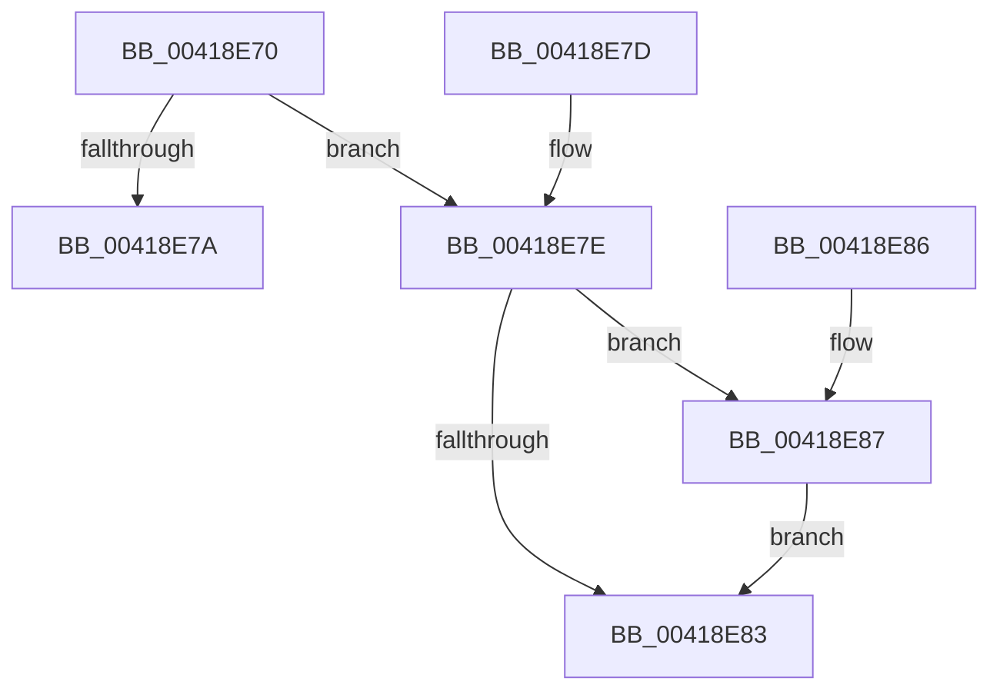

# KeIsBugCheckActive

- RVA: `0x00418E70`–`0x00418E8E` (길이 `30` bytes)
- VA: `0x0000000140418E70`
- 실행 섹션: `.text`
- PDB 이름 있음: `예`; PDB Function 태그: `아니요`
- unwind 정보 RVA: `0x000DB714`
- 디코드: `14`개 명령, `30/30` bytes 표시
- 미해석 바이트: `0` (있으면 어셈블리에 `.byte`로 보존)

> 이 문서는 커널 이미지의 기계어와 PDB 기호를 분석해 생성했습니다. 4번과 5번은 함수 원형과 자료형을 바이너리 사용 방식에서 추정한 C 해석이며 원본 소스 복구 결과는 아닙니다.

## 1. Dependencies

- 직접 호출 지점: **0**; 고유 호출 대상: **0**
- 직접 호출자로 확인된 함수: **1**
- RIP 상대 이미지 참조: **1**

### Outgoing calls
- 직접 디코드된 call 명령이 없습니다.

### Direct callers
- [KiSendThawExecution](../4E/KiSendThawExecution_function_004E2800.md) at `0x004E28BC`

### Static image references
- `0x00418E70` → RVA `0x00F4754C` (`.data`; read)

## 2. Other-region calls and transfers

- 다른 실행 섹션으로 향하는 call: **0**
- 별도 외부 분기/꼬리 이동을 확인하지 못했습니다.

## 3. Assembly (complete function range)

```asm
00418E70  8B 05 D6 E6 B2 00               mov eax, dword ptr [rip + 0xb2e6d6]
00418E76  A8 03                           test al, 3
00418E78  75 04                           jne 0x140418e7e
00418E7A  32 C0                           xor al, al
00418E7C  C3                              ret
00418E7D  CC                              int3
00418E7E  48 85 C9                        test rcx, rcx
00418E81  75 04                           jne 0x140418e87
00418E83  B0 01                           mov al, 1
00418E85  C3                              ret
00418E86  CC                              int3
00418E87  C1 E8 04                        shr eax, 4
00418E8A  89 01                           mov dword ptr [rcx], eax
00418E8C  EB F5                           jmp 0x140418e83
```

## 4. C-style interpretation (structured pseudocode)

```c
__int64 __fastcall KeIsBugCheckActive(__int64 a1)
{
    __int64 result;

    if ((((unsigned __int8)((unsigned int)(*(unsigned int *)(v_rip + 11724502)))) & (3)) != 0) goto loc_00418E7E;
    result = 0;
    return result;
loc_00418E7E:
    if (a1 != 0) goto loc_00418E87;
loc_00418E83:
    return 1;
loc_00418E87:
    result = (unsigned int)((1) >> (4));
    *(unsigned int *)(a1) = (unsigned int)(result);
    goto loc_00418E83;
}
```

## 5. (Beta) C Style

```c
int64_t KeIsBugCheckActive(int64_t Arg1)
{
    int64_t result;

    if ((((uint8_t)((uint32_t)(*(uint32_t *)(v_rip + 0xB2E6D6)))) & (3)) != 0) goto loc_00418E7E;
    result = 0;
    return result;
loc_00418E7E:
    if (Arg1 != 0) goto loc_00418E87;
loc_00418E83:
    return 1;
loc_00418E87:
    result = (uint32_t)((1) >> (4));
    *(uint32_t *)(Arg1) = (uint32_t)(result);
    goto loc_00418E83;
}
```

## 6. Execution-region graph

[열기: 2D/3D 그래프와 함수 탐색 컨트롤 패널](../../../control-panel.html?section=text&rva=0x00418E70&view=graph)

- 2D 그래프는 위에서 아래로 흐르고, 3D 그래프는 빈 공간을 드래그해 회전합니다. Shift+드래그는 이동, 휠은 확대·축소, 함수 노드 선택은 대상 보고서 이동입니다.

### Static fallback


