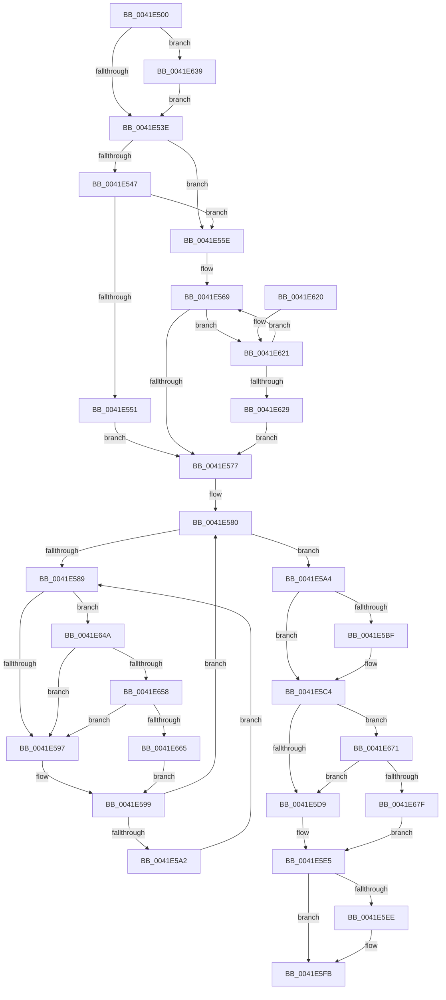

# KeQueryBasePriorityThread

- RVA: `0x0041E500`–`0x0041E692` (길이 `402` bytes)
- VA: `0x000000014041E500`
- 실행 섹션: `.text`
- PDB 이름 있음: `예`; PDB Function 태그: `아니요`
- unwind 정보 RVA: `0x0009FB74`
- 디코드: `95`개 명령, `402/402` bytes 표시
- 미해석 바이트: `0` (있으면 어셈블리에 `.byte`로 보존)

> 이 문서는 커널 이미지의 기계어와 PDB 기호를 분석해 생성했습니다. 4번과 5번은 함수 원형과 자료형을 바이너리 사용 방식에서 추정한 C 해석이며 원본 소스 복구 결과는 아닙니다.

## 1. Dependencies

- 직접 호출 지점: **7**; 고유 호출 대상: **7**
- 직접 호출자로 확인된 함수: **1**
- RIP 상대 이미지 참조: **5**

### Outgoing calls
- `0x0041E557` → [ExpAcquireSpinLockSharedAtDpcLevelInstrumented](../27/ExpAcquireSpinLockSharedAtDpcLevelInstrumented_function_0027CD20.md) (function, `0x0027CD20`)
- `0x0041E5F6` → [KiLowerIrqlProcessIrqlFlags](../4F/KiLowerIrqlProcessIrqlFlags_function_004F5698.md) (function, `0x004F5698`)
- `0x0041E62F` → [ExpWaitForSpinLockSharedAndAcquire](../36/ExpWaitForSpinLockSharedAndAcquire_function_00362380.md) (function, `0x00362380`)
- `0x0041E640` → [KiRaiseIrqlProcessIrqlFlags](../4F/KiRaiseIrqlProcessIrqlFlags_function_004F56FC.md) (function, `0x004F56FC`)
- `0x0041E658` → [KiCheckVpBackingLongSpinWaitHypercall](../30/KiCheckVpBackingLongSpinWaitHypercall_function_0030F490.md) (function, `0x0030F490`)
- `0x0041E667` → [HvlNotifyLongSpinWait](../30/HvlNotifyLongSpinWait_function_0030F460.md) (function, `0x0030F460`)
- `0x0041E688` → [ExpReleaseSpinLockSharedFromDpcLevelInstrumented](../2F/ExpReleaseSpinLockSharedFromDpcLevelInstrumented_function_002F0F48.md) (function, `0x002F0F48`)

### Direct callers
- [NtQueryInformationThread](../../page/AE/NtQueryInformationThread_function_00AE3760.md) at `0x00AE3A68`

### Static image references
- `0x0041E531` → RVA `0x00FC6D20` (`ALMOSTRO`; read)
- `0x0041E53E` → RVA `0x00FC6B06` (`ALMOSTRO`; read)
- `0x0041E547` → RVA `0x00F0DE58` (`.data`; read)
- `0x0041E58B` → RVA `0x00FC52AC` (`ALMOSTRO`; reference)
- `0x0041E64A` → RVA `0x00FC6AB8` (`ALMOSTRO`; read)

## 2. Other-region calls and transfers

- 다른 실행 섹션으로 향하는 call: **0**
- 별도 외부 분기/꼬리 이동을 확인하지 못했습니다.

## 3. Assembly (complete function range)

```asm
0041E500  48 89 5C 24 08                  mov qword ptr [rsp + 8], rbx
0041E505  48 89 6C 24 10                  mov qword ptr [rsp + 0x10], rbp
0041E50A  48 89 74 24 18                  mov qword ptr [rsp + 0x18], rsi
0041E50F  48 89 7C 24 20                  mov qword ptr [rsp + 0x20], rdi
0041E514  41 56                           push r14
0041E516  48 83 EC 20                     sub rsp, 0x20
0041E51A  48 8B A9 20 02 00 00            mov rbp, qword ptr [rcx + 0x220]
0041E521  48 8B D9                        mov rbx, rcx
0041E524  45 0F 20 C6                     mov r14, cr8
0041E528  B8 02 00 00 00                  mov eax, 2
0041E52D  44 0F 22 C0                     mov cr8, rax
0041E531  83 3D E8 87 BA 00 00            cmp dword ptr [rip + 0xba87e8], 0
0041E538  0F 85 FB 00 00 00               jne 0x14041e639
0041E53E  F6 05 C1 85 BA 00 21            test byte ptr [rip + 0xba85c1], 0x21
0041E545  74 17                           je 0x14041e55e
0041E547  8B 05 0B F9 AE 00               mov eax, dword ptr [rip + 0xaef90b]
0041E54D  85 C0                           test eax, eax
0041E54F  75 0D                           jne 0x14041e55e
0041E551  B2 FF                           mov dl, 0xff
0041E553  48 8D 4D 40                     lea rcx, [rbp + 0x40]
0041E557  E8 C4 E7 E5 FF                  call 0x14027cd20
0041E55C  EB 19                           jmp 0x14041e577
0041E55E  0F 0D 4D 40                     prefetchw byte ptr [rbp + 0x40]
0041E562  8B 45 40                        mov eax, dword ptr [rbp + 0x40]
0041E565  0F BA F0 1F                     btr eax, 0x1f
0041E569  8D 48 01                        lea ecx, [rax + 1]
0041E56C  F0 0F B1 4D 40                  lock cmpxchg dword ptr [rbp + 0x40], ecx
0041E571  0F 85 AA 00 00 00               jne 0x14041e621
0041E577  33 FF                           xor edi, edi
0041E579  0F 1F 80 00 00 00 00            nop dword ptr [rax]
0041E580  F0 48 0F BA 6B 40 00            lock bts qword ptr [rbx + 0x40], 0
0041E587  73 1B                           jae 0x14041e5a4
0041E589  FF C7                           inc edi
0041E58B  85 3D 1B 6D BA 00               test dword ptr [rip + 0xba6d1b], edi
0041E591  0F 84 B3 00 00 00               je 0x14041e64a
0041E597  F3 90                           pause
0041E599  48 8B 43 40                     mov rax, qword ptr [rbx + 0x40]
0041E59D  48 85 C0                        test rax, rax
0041E5A0  74 DE                           je 0x14041e580
0041E5A2  EB E5                           jmp 0x14041e589
0041E5A4  0F BE 85 90 00 00 00            movsx eax, byte ptr [rbp + 0x90]
0041E5AB  0F BE BB 33 02 00 00            movsx edi, byte ptr [rbx + 0x233]
0041E5B2  2B F8                           sub edi, eax
0041E5B4  0F BE 83 85 02 00 00            movsx eax, byte ptr [rbx + 0x285]
0041E5BB  84 C0                           test al, al
0041E5BD  74 05                           je 0x14041e5c4
0041E5BF  8B F8                           mov edi, eax
0041E5C1  C1 E7 04                        shl edi, 4
0041E5C4  48 C7 43 40 00 00 00 00         mov qword ptr [rbx + 0x40], 0
0041E5CC  F6 05 33 85 BA 00 01            test byte ptr [rip + 0xba8533], 1
0041E5D3  0F 85 98 00 00 00               jne 0x14041e671
0041E5D9  F0 81 65 40 FF FF FF BF         lock and dword ptr [rbp + 0x40], 0xbfffffff
0041E5E1  F0 FF 4D 40                     lock dec dword ptr [rbp + 0x40]
0041E5E5  83 3D 34 87 BA 00 00            cmp dword ptr [rip + 0xba8734], 0
0041E5EC  74 0D                           je 0x14041e5fb
0041E5EE  44 0F 20 C1                     mov rcx, cr8
0041E5F2  41 0F B6 D6                     movzx edx, r14b
0041E5F6  E8 9D 70 0D 00                  call 0x1404f5698
0041E5FB  41 0F B6 CE                     movzx ecx, r14b
0041E5FF  44 0F 22 C1                     mov cr8, rcx
0041E603  48 8B 5C 24 30                  mov rbx, qword ptr [rsp + 0x30]
0041E608  8B C7                           mov eax, edi
0041E60A  48 8B 7C 24 48                  mov rdi, qword ptr [rsp + 0x48]
0041E60F  48 8B 6C 24 38                  mov rbp, qword ptr [rsp + 0x38]
0041E614  48 8B 74 24 40                  mov rsi, qword ptr [rsp + 0x40]
0041E619  48 83 C4 20                     add rsp, 0x20
0041E61D  41 5E                           pop r14
0041E61F  C3                              ret
0041E620  CC                              int3
0041E621  85 C0                           test eax, eax
0041E623  0F 89 40 FF FF FF               jns 0x14041e569
0041E629  B2 FF                           mov dl, 0xff
0041E62B  48 8D 4D 40                     lea rcx, [rbp + 0x40]
0041E62F  E8 4C 3D F4 FF                  call 0x140362380
0041E634  E9 3E FF FF FF                  jmp 0x14041e577
0041E639  0F B6 D0                        movzx edx, al
0041E63C  41 0F B6 CE                     movzx ecx, r14b
0041E640  E8 B7 70 0D 00                  call 0x1404f56fc
0041E645  E9 F4 FE FF FF                  jmp 0x14041e53e
0041E64A  8B 05 68 84 BA 00               mov eax, dword ptr [rip + 0xba8468]
0041E650  A8 40                           test al, 0x40
0041E652  0F 84 3F FF FF FF               je 0x14041e597
0041E658  E8 33 0E EF FF                  call 0x14030f490
0041E65D  84 C0                           test al, al
0041E65F  0F 84 32 FF FF FF               je 0x14041e597
0041E665  8B CF                           mov ecx, edi
0041E667  E8 F4 0D EF FF                  call 0x14030f460
0041E66C  E9 28 FF FF FF                  jmp 0x14041e599
0041E671  8B 05 E1 F7 AE 00               mov eax, dword ptr [rip + 0xaef7e1]
0041E677  85 C0                           test eax, eax
0041E679  0F 85 5A FF FF FF               jne 0x14041e5d9
0041E67F  48 8B 54 24 28                  mov rdx, qword ptr [rsp + 0x28]
0041E684  48 8D 4D 40                     lea rcx, [rbp + 0x40]
0041E688  E8 BB 28 ED FF                  call 0x1402f0f48
0041E68D  E9 53 FF FF FF                  jmp 0x14041e5e5
```

## 4. C-style interpretation (structured pseudocode)

```c
__int64 __fastcall KeQueryBasePriorityThread(__int64 a1)
{
    __int64 result;
    __int64 v_rdi;
    __int64 v_rsp;
    unsigned __int64 v_stack_p10;
    unsigned __int64 v_stack_p18;
    unsigned __int64 v_stack_p20;
    unsigned __int64 v_stack_p28;
    unsigned __int64 v_stack_p8;

    v_stack_p8 = v_rbx;
    v_stack_p10 = v_rbp;
    v_stack_p18 = v_rsi;
    v_stack_p20 = v_rdi;
    v_rsp = (v_rsp) - (32);
    if ((*(unsigned int *)(v_rip + 12224488)) != 0) goto loc_0041E639;
loc_0041E53E:
    if (((*(unsigned __int8 *)(v_rip + 12223937)) & (33)) == 0) goto loc_0041E55E;
    if ((unsigned int)((unsigned int)(*(unsigned int *)(v_rip + 11467019))) != 0) goto loc_0041E55E;
    result = ExpAcquireSpinLockSharedAtDpcLevelInstrumented(*(unsigned __int64 *)(a1 + 544) + 64, 255, a3, a4);
    goto loc_0041E577;
loc_0041E55E:
loc_0041E569:
    if ((unsigned int)((unsigned int)(*(unsigned int *)(v_rip + 11467019))) != 0) goto loc_0041E621;
loc_0041E577:
    v_rdi = 0;
loc_0041E580:
    if (condition_is_above_or_equal) goto loc_0041E5A4;
loc_0041E589:
    v_rdi = (unsigned int)((v_rdi) + 1);
    if (((*(unsigned int *)(v_rip + 12217627)) & ((unsigned int)(v_rdi))) == 0) goto loc_0041E64A;
loc_0041E597:
loc_0041E599:
    if (*(unsigned __int64 *)(a1 + 64) == 0) goto loc_0041E580;
    goto loc_0041E589;
loc_0041E5A4:
    v_rdi = (unsigned int)(((__int8)(*(unsigned __int8 *)(a1 + 563))) - ((unsigned int)((__int8)(*(unsigned __int8 *)(*(unsigned __int64 *)(a1 + 544) + 144)))));
    if ((unsigned __int8)((__int8)(*(unsigned __int8 *)(a1 + 645))) != 0) {
        v_rdi = (unsigned int)((__int8)(*(unsigned __int8 *)(a1 + 645)));
        v_rdi = (unsigned int)((v_rdi) << (4));
    }
    *(unsigned __int64 *)(a1 + 64) = 0;
    if (((*(unsigned __int8 *)(v_rip + 12223795)) & (1)) != 0) goto loc_0041E671;
loc_0041E5D9:
loc_0041E5E5:
    result = (__int8)(*(unsigned __int8 *)(a1 + 645));
    if ((*(unsigned int *)(v_rip + 12224308)) != 0) {
        a1 = 2;
        a2 = (unsigned __int8)(v_cr8);
        result = KiLowerIrqlProcessIrqlFlags(a1, a2, a3, a4);
    }
    v_rsp = (v_rsp) + (32);
    return (unsigned int)((unsigned int)(v_rdi));
loc_0041E621:
    if (!sign_flag) goto loc_0041E569;
    result = ExpWaitForSpinLockSharedAndAcquire(v_stack_p10 + 64, 255, a3, a4);
    goto loc_0041E577;
loc_0041E639:
    result = KiRaiseIrqlProcessIrqlFlags((unsigned __int8)(v_cr8), (unsigned __int8)(result), a3, a4);
    goto loc_0041E53E;
loc_0041E64A:
    if ((((unsigned __int8)((unsigned int)(*(unsigned int *)(v_rip + 12223592)))) & (64)) == 0) goto loc_0041E597;
    result = KiCheckVpBackingLongSpinWaitHypercall((unsigned __int8)(v_cr8), (unsigned __int8)(result), a3, a4);
    if ((unsigned __int8)(result) == 0) goto loc_0041E597;
    result = HvlNotifyLongSpinWait((unsigned int)((unsigned int)(v_stack_p20)), (unsigned __int8)(result), a3, a4);
    goto loc_0041E599;
loc_0041E671:
    if ((unsigned int)((unsigned int)(*(unsigned int *)(v_rip + 11466721))) != 0) goto loc_0041E5D9;
    result = ExpReleaseSpinLockSharedFromDpcLevelInstrumented(v_stack_p10 + 64, v_stack_p28, a3, a4);
    goto loc_0041E5E5;
}
```

## 5. (Beta) C Style

```c
int64_t KeQueryBasePriorityThread(void *Arg1)
{
    uint8_t *arg1 = (uint8_t *)Arg1;

    int64_t result;
    int64_t local_rdi;
    int64_t local_rsp;
    uint64_t v_stack_p10;
    uint64_t v_stack_p18;
    uint64_t v_stack_p20;
    uint64_t v_stack_p28;
    uint64_t v_stack_p8;

    v_stack_p8 = local_rbx;
    v_stack_p10 = local_rbp;
    v_stack_p18 = local_rsi;
    v_stack_p20 = local_rdi;
    local_rsp = (local_rsp) - (32);
    if ((*(uint32_t *)(v_rip + 0xBA87E8)) != 0) goto loc_0041E639;
loc_0041E53E:
    if (((*(uint8_t *)(v_rip + 0xBA85C1)) & (33)) == 0) goto loc_0041E55E;
    if ((uint32_t)((uint32_t)(*(uint32_t *)(v_rip + 0xAEF90B))) != 0) goto loc_0041E55E;
    result = ExpAcquireSpinLockSharedAtDpcLevelInstrumented(*(uint64_t *)(arg1 + 0x220) + 64, 255, a3, a4);
    goto loc_0041E577;
loc_0041E55E:
loc_0041E569:
    if ((uint32_t)((uint32_t)(*(uint32_t *)(v_rip + 0xAEF90B))) != 0) goto loc_0041E621;
loc_0041E577:
    local_rdi = 0;
loc_0041E580:
    if (condition_is_above_or_equal) goto loc_0041E5A4;
loc_0041E589:
    local_rdi = (uint32_t)((local_rdi) + 1);
    if (((*(uint32_t *)(v_rip + 0xBA6D1B)) & ((uint32_t)(local_rdi))) == 0) goto loc_0041E64A;
loc_0041E597:
loc_0041E599:
    if (*(uint64_t *)(arg1 + 0x40) == 0) goto loc_0041E580;
    goto loc_0041E589;
loc_0041E5A4:
    local_rdi = (uint32_t)(((int8_t)(*(uint8_t *)(arg1 + 0x233))) - ((uint32_t)((int8_t)(*(uint8_t *)(*(uint64_t *)(arg1 + 0x220) + 0x90)))));
    if ((uint8_t)((int8_t)(*(uint8_t *)(arg1 + 0x285))) != 0) {
        local_rdi = (uint32_t)((int8_t)(*(uint8_t *)(arg1 + 0x285)));
        local_rdi = (uint32_t)((local_rdi) << (4));
    }
    *(uint64_t *)(arg1 + 0x40) = 0;
    if (((*(uint8_t *)(v_rip + 0xBA8533)) & (1)) != 0) goto loc_0041E671;
loc_0041E5D9:
loc_0041E5E5:
    result = (int8_t)(*(uint8_t *)(arg1 + 0x285));
    if ((*(uint32_t *)(v_rip + 0xBA8734)) != 0) {
        Arg1 = 2;
        a2 = (uint8_t)(v_cr8);
        result = KiLowerIrqlProcessIrqlFlags(Arg1, a2, a3, a4);
    }
    local_rsp = (local_rsp) + (32);
    return (uint32_t)((uint32_t)(local_rdi));
loc_0041E621:
    if (!sign_flag) goto loc_0041E569;
    result = ExpWaitForSpinLockSharedAndAcquire(v_stack_p10 + 64, 255, a3, a4);
    goto loc_0041E577;
loc_0041E639:
    result = KiRaiseIrqlProcessIrqlFlags((uint8_t)(v_cr8), (uint8_t)(result), a3, a4);
    goto loc_0041E53E;
loc_0041E64A:
    if ((((uint8_t)((uint32_t)(*(uint32_t *)(v_rip + 0xBA8468)))) & (64)) == 0) goto loc_0041E597;
    result = KiCheckVpBackingLongSpinWaitHypercall((uint8_t)(v_cr8), (uint8_t)(result), a3, a4);
    if ((uint8_t)(result) == 0) goto loc_0041E597;
    result = HvlNotifyLongSpinWait((uint32_t)((uint32_t)(v_stack_p20)), (uint8_t)(result), a3, a4);
    goto loc_0041E599;
loc_0041E671:
    if ((uint32_t)((uint32_t)(*(uint32_t *)(v_rip + 0xAEF7E1))) != 0) goto loc_0041E5D9;
    result = ExpReleaseSpinLockSharedFromDpcLevelInstrumented(v_stack_p10 + 64, v_stack_p28, a3, a4);
    goto loc_0041E5E5;
}
```

### 관측된 메모리 오프셋

구조체 형식이 확인되지 않은 접근은 인자 기준의 오프셋으로만 기록했습니다.

| 기준 인자 | 오프셋 표현 | 폭 (bit) | 접근 |
|---|---:|---:|---|
| `Arg1` | `+ 0x40` | `64` | `R` |
| `Arg1` | `+ 0x40` | `64` | `R/W` |
| `Arg1` | `+ 0x40` | `64` | `W` |
| `Arg1` | `+ 0x220` | `64` | `R` |
| `Arg1` | `+ 0x233` | `8` | `R` |
| `Arg1` | `+ 0x285` | `8` | `R` |

## 6. Execution-region graph

[열기: 2D/3D 그래프와 함수 탐색 컨트롤 패널](../../../control-panel.html?section=text&rva=0x0041E500&view=graph)

- 2D 그래프는 위에서 아래로 흐르고, 3D 그래프는 빈 공간을 드래그해 회전합니다. Shift+드래그는 이동, 휠은 확대·축소, 함수 노드 선택은 대상 보고서 이동입니다.

### Static fallback


