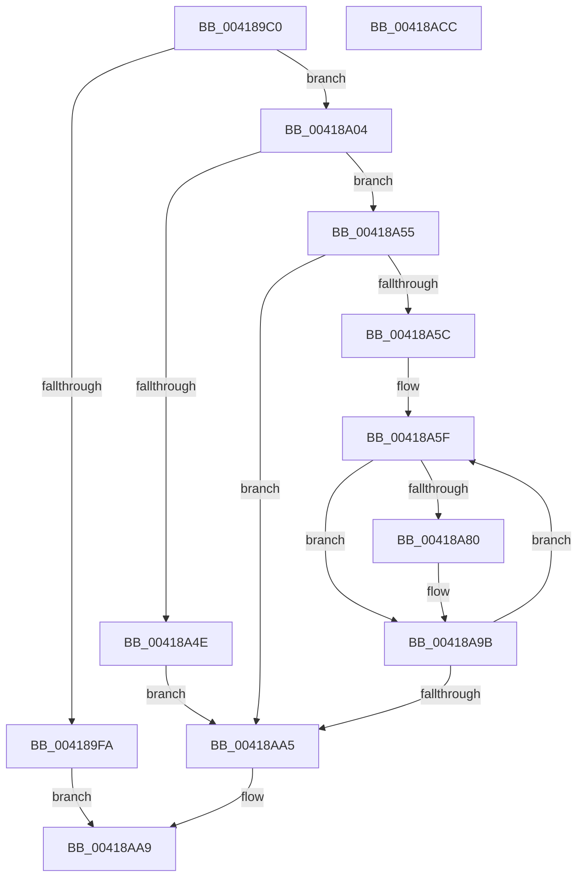

# KeQueryNodeActiveAffinity2

- RVA: `0x004189C0`–`0x00418ACD` (길이 `269` bytes)
- VA: `0x00000001404189C0`
- 실행 섹션: `.text`
- PDB 이름 있음: `예`; PDB Function 태그: `아니요`
- unwind 정보 RVA: `0x0009D048`
- 디코드: `72`개 명령, `269/269` bytes 표시
- 미해석 바이트: `0` (있으면 어셈블리에 `.byte`로 보존)

> 이 문서는 커널 이미지의 기계어와 PDB 기호를 분석해 생성했습니다. 4번과 5번은 함수 원형과 자료형을 바이너리 사용 방식에서 추정한 C 해석이며 원본 소스 복구 결과는 아닙니다.

## 1. Dependencies

- 직접 호출 지점: **4**; 고유 호출 대상: **4**
- 직접 호출자로 확인된 함수: **3**
- RIP 상대 이미지 참조: **3**

### Outgoing calls
- `0x00418A24` → [RtlCopyVolatileMemory](../6B/RtlCopyVolatileMemory_function_006BC9D0.md) (function, `0x006BC9D0`)
- `0x00418A41` → [RtlNumberOfSetBitsEx](RtlNumberOfSetBitsEx_function_00418CA0.md) (function, `0x00418CA0`)
- `0x00418A64` → [KeFindFirstSetRightGroupMask](../25/KeFindFirstSetRightGroupMask_function_00256BE4.md) (function, `0x00256BE4`)
- `0x00418AB3` → [_security_check_cookie](../6A/_security_check_cookie_function_006AC640.md) (function, `0x006AC640`)

### Direct callers
- [MiComputeIdealDpcGang](../43/MiComputeIdealDpcGang_function_0043EAAC.md) at `0x0043EBE6`
- [MiComputeIdealDpcGang](../43/MiComputeIdealDpcGang_function_0043EAAC.md) at `0x0043EC51`
- [MiCombineAllPhysicalMemory](../../page/9F/MiCombineAllPhysicalMemory_function_009F6B6C.md) at `0x009F6C88`
- [MiCombineAllPhysicalMemory](../../page/9F/MiCombineAllPhysicalMemory_function_009F6B6C.md) at `0x009F6CCF`
- [MiComputeMemoryNodeProcessorAssignments](../../init/C6/MiComputeMemoryNodeProcessorAssignments_function_00C68F8C.md) at `0x00C68FFD`
- [MiComputeMemoryNodeProcessorAssignments](../../init/C6/MiComputeMemoryNodeProcessorAssignments_function_00C68F8C.md) at `0x00C6906E`

### Static image references
- `0x004189D0` → RVA `0x00E0A740` (`.data`; read)
- `0x004189DF` → RVA `0x00FC5000` (`ALMOSTRO`; read)
- `0x00418A0A` → RVA `0x00FCF6C0` (`CACHEALI`; read)

## 2. Other-region calls and transfers

- 다른 실행 섹션으로 향하는 call: **0**
- 별도 외부 분기/꼬리 이동을 확인하지 못했습니다.

## 3. Assembly (complete function range)

```asm
004189C0  48 89 5C 24 18                  mov qword ptr [rsp + 0x18], rbx
004189C5  55                              push rbp
004189C6  56                              push rsi
004189C7  57                              push rdi
004189C8  41 56                           push r14
004189CA  41 57                           push r15
004189CC  48 83 EC 50                     sub rsp, 0x50
004189D0  48 8B 05 69 1D 9F 00            mov rax, qword ptr [rip + 0x9f1d69]
004189D7  48 33 C4                        xor rax, rsp
004189DA  48 89 44 24 40                  mov qword ptr [rsp + 0x40], rax
004189DF  66 3B 0D 1A C6 BA 00            cmp cx, word ptr [rip + 0xbac61a]
004189E6  0F 57 C0                        xorps xmm0, xmm0
004189E9  0F 11 44 24 30                  movups xmmword ptr [rsp + 0x30], xmm0
004189EE  4D 8B F1                        mov r14, r9
004189F1  41 0F B7 D8                     movzx ebx, r8w
004189F5  48 8B F2                        mov rsi, rdx
004189F8  72 0A                           jb 0x140418a04
004189FA  BB 0D 00 00 C0                  mov ebx, 0xc000000d
004189FF  E9 A5 00 00 00                  jmp 0x140418aa9
00418A04  0F AE E8                        lfence
00418A07  0F B7 C1                        movzx eax, cx
00418A0A  4C 8D 3D AF 6C BB 00            lea r15, [rip + 0xbb6caf]
00418A11  41 B8 10 00 00 00               mov r8d, 0x10
00418A17  48 8D 4C 24 30                  lea rcx, [rsp + 0x30]
00418A1C  4D 8B 3C C7                     mov r15, qword ptr [r15 + rax*8]
00418A20  49 8D 57 10                     lea rdx, [r15 + 0x10]
00418A24  E8 A7 3F 2A 00                  call 0x1406bc9d0
00418A29  48 8D 44 24 30                  lea rax, [rsp + 0x30]
00418A2E  48 C7 44 24 20 20 00 00 00      mov qword ptr [rsp + 0x20], 0x20
00418A37  48 8D 4C 24 20                  lea rcx, [rsp + 0x20]
00418A3C  48 89 44 24 28                  mov qword ptr [rsp + 0x28], rax
00418A41  E8 5A 02 00 00                  call 0x140418ca0
00418A46  48 8B F8                        mov rdi, rax
00418A49  66 3B D8                        cmp bx, ax
00418A4C  73 07                           jae 0x140418a55
00418A4E  BB 23 00 00 C0                  mov ebx, 0xc0000023
00418A53  EB 50                           jmp 0x140418aa5
00418A55  33 DB                           xor ebx, ebx
00418A57  66 3B DF                        cmp bx, di
00418A5A  73 49                           jae 0x140418aa5
00418A5C  0F B7 EF                        movzx ebp, di
00418A5F  48 8D 4C 24 30                  lea rcx, [rsp + 0x30]
00418A64  E8 7B E1 E3 FF                  call 0x140256be4
00418A69  44 0F B7 D8                     movzx r11d, ax
00418A6D  48 8D 44 24 30                  lea rax, [rsp + 0x30]
00418A72  4C 0F B3 18                     btr qword ptr [rax], r11
00418A76  4B 8B 4C DF 20                  mov rcx, qword ptr [r15 + r11*8 + 0x20]
00418A7B  48 85 F6                        test rsi, rsi
00418A7E  74 1B                           je 0x140418a9b
00418A80  0F 57 C0                        xorps xmm0, xmm0
00418A83  0F 11 06                        movups xmmword ptr [rsi], xmm0
00418A86  48 8B 81 80 00 00 00            mov rax, qword ptr [rcx + 0x80]
00418A8D  48 89 06                        mov qword ptr [rsi], rax
00418A90  0F B7 89 88 00 00 00            movzx ecx, word ptr [rcx + 0x88]
00418A97  66 89 4E 08                     mov word ptr [rsi + 8], cx
00418A9B  48 83 C6 10                     add rsi, 0x10
00418A9F  48 83 ED 01                     sub rbp, 1
00418AA3  75 BA                           jne 0x140418a5f
00418AA5  66 41 89 3E                     mov word ptr [r14], di
00418AA9  8B C3                           mov eax, ebx
00418AAB  48 8B 4C 24 40                  mov rcx, qword ptr [rsp + 0x40]
00418AB0  48 33 CC                        xor rcx, rsp
00418AB3  E8 88 3B 29 00                  call 0x1406ac640
00418AB8  48 8B 9C 24 90 00 00 00         mov rbx, qword ptr [rsp + 0x90]
00418AC0  48 83 C4 50                     add rsp, 0x50
00418AC4  41 5F                           pop r15
00418AC6  41 5E                           pop r14
00418AC8  5F                              pop rdi
00418AC9  5E                              pop rsi
00418ACA  5D                              pop rbp
00418ACB  C3                              ret
00418ACC  CC                              int3
```

## 4. C-style interpretation (structured pseudocode)

```c
__int64 __fastcall KeQueryNodeActiveAffinity2(unsigned __int16 a1, __int64 a2, unsigned __int16 a3, __int64 a4)
{
    __int64 result;
    __int64 v_rbp;
    __int64 v_rbx;
    __int64 v_rsi;
    __int64 v_rsp;
    unsigned __int64 v_stack_m38;
    unsigned __int64 v_stack_m48;
    unsigned __int64 v_stack_m50;
    unsigned __int64 v_stack_m58;
    unsigned __int64 v_stack_p18;

    v_stack_p18 = v_rbx;
    v_rsp = (v_rsp) - (80);
    result = (*(unsigned __int64 *)(v_rip + 10427753)) ^ (v_rsp);
    v_stack_m38 = result;
    v_stack_m48 = v_xmm0;
    if (a1 < (*(unsigned __int16 *)(v_rip + 12240410))) goto loc_00418A04;
    goto loc_00418AA9;
loc_00418A04:
    result = RtlCopyVolatileMemory(v_stack_m48, *(unsigned __int64 *)(v_rip + 12283055 + a1 * 8) + 16, 16, a4);
    v_stack_m58 = 32;
    v_stack_m50 = v_stack_m48;
    result = RtlNumberOfSetBitsEx(v_stack_m58, *(unsigned __int64 *)(v_rip + 12283055 + a1 * 8) + 16, 16, a4);
    if (((unsigned __int16)((unsigned int)(0xC000000DULL))) >= ((unsigned __int16)(result))) goto loc_00418A55;
    goto loc_00418AA5;
loc_00418A55:
    v_rbx = 0;
    if (0 >= ((unsigned __int16)(result))) goto loc_00418AA5;
loc_00418A5F:
    result = KeFindFirstSetRightGroupMask(v_stack_m48, *(unsigned __int64 *)(v_rip + 12283055 + a1 * 8) + 16, 16, a4);
    result = v_stack_m48;
    if (a2 != 0) {
        *(unsigned __int64 *)(a2) = v_xmm0;
        result = *(unsigned __int64 *)(*(unsigned __int64 *)(*(unsigned __int64 *)(v_rip + 12283055 + a1 * 8) + (unsigned __int16)(result) * 8 + 32) + 128);
        *(unsigned __int64 *)(a2) = result;
        a1 = *(unsigned __int16 *)(*(unsigned __int64 *)(*(unsigned __int64 *)(v_rip + 12283055 + a1 * 8) + (unsigned __int16)(result) * 8 + 32) + 136);
        *(unsigned __int16 *)(a2 + 8) = a1;
    }
    v_rsi = (a2) + (16);
    v_rbp = ((unsigned __int16)(result)) - (1);
    if (condition_is_not_equal) goto loc_00418A5F;
loc_00418AA5:
    *(unsigned __int16 *)(a4) = (unsigned __int16)(result);
loc_00418AA9:
    a1 = (v_stack_m38) ^ (v_rsp);
    result = _security_check_cookie(a1, *(unsigned __int64 *)(v_rip + 12283055 + a1 * 8) + 16, 16, a4);
    v_rsp = (v_rsp) + (80);
    return result;
}
```

## 5. (Beta) C Style

```c
int64_t KeQueryNodeActiveAffinity2(uint16_t Arg1, int64_t Arg2, uint16_t Arg3, void *Arg4)
{
    uint8_t *arg4 = (uint8_t *)Arg4;

    int64_t result;
    int64_t local_rbp;
    int64_t local_rbx;
    int64_t local_rsi;
    int64_t local_rsp;
    uint64_t v_stack_m38;
    uint64_t v_stack_m48;
    uint64_t v_stack_m50;
    uint64_t v_stack_m58;
    uint64_t v_stack_p18;

    v_stack_p18 = local_rbx;
    local_rsp = (local_rsp) - (80);
    result = (*(uint64_t *)(v_rip + 0x9F1D69)) ^ (local_rsp);
    v_stack_m38 = result;
    v_stack_m48 = v_xmm0;
    if (Arg1 < (*(uint16_t *)(v_rip + 0xBAC61A))) goto loc_00418A04;
    goto loc_00418AA9;
loc_00418A04:
    result = RtlCopyVolatileMemory(v_stack_m48, *(uint64_t *)(v_rip + 0xBB6CAF + Arg1 * 8) + 16, 16, Arg4);
    v_stack_m58 = 32;
    v_stack_m50 = v_stack_m48;
    result = RtlNumberOfSetBitsEx(v_stack_m58, *(uint64_t *)(v_rip + 0xBB6CAF + Arg1 * 8) + 16, 16, Arg4);
    if (((uint16_t)((uint32_t)(0xC000000DULL))) >= ((uint16_t)(result))) goto loc_00418A55;
    goto loc_00418AA5;
loc_00418A55:
    local_rbx = 0;
    if (0 >= ((uint16_t)(result))) goto loc_00418AA5;
loc_00418A5F:
    result = KeFindFirstSetRightGroupMask(v_stack_m48, *(uint64_t *)(v_rip + 0xBB6CAF + Arg1 * 8) + 16, 16, Arg4);
    result = v_stack_m48;
    if (Arg2 != 0) {
        *(uint64_t *)(Arg2) = v_xmm0;
        result = *(uint64_t *)(*(uint64_t *)(*(uint64_t *)(v_rip + 0xBB6CAF + Arg1 * 8) + (uint16_t)(result) * 8 + 0x20) + 0x80);
        *(uint64_t *)(Arg2) = result;
        Arg1 = *(uint16_t *)(*(uint64_t *)(*(uint64_t *)(v_rip + 0xBB6CAF + Arg1 * 8) + (uint16_t)(result) * 8 + 0x20) + 0x88);
        *(uint16_t *)(Arg2 + 0x8) = Arg1;
    }
    local_rsi = (Arg2) + (16);
    local_rbp = ((uint16_t)(result)) - (1);
    if (condition_is_not_equal) goto loc_00418A5F;
loc_00418AA5:
    *(uint16_t *)(arg4) = (uint16_t)(result);
loc_00418AA9:
    Arg1 = (v_stack_m38) ^ (local_rsp);
    result = _security_check_cookie(Arg1, *(uint64_t *)(v_rip + 0xBB6CAF + Arg1 * 8) + 16, 16, Arg4);
    local_rsp = (local_rsp) + (80);
    return result;
}
```

### 관측된 메모리 오프셋

구조체 형식이 확인되지 않은 접근은 인자 기준의 오프셋으로만 기록했습니다.

| 기준 인자 | 오프셋 표현 | 폭 (bit) | 접근 |
|---|---:|---:|---|
| `Arg4` | `+ 0x0` | `16` | `W` |

## 6. Execution-region graph

[열기: 2D/3D 그래프와 함수 탐색 컨트롤 패널](../../../control-panel.html?section=text&rva=0x004189C0&view=graph)

- 2D 그래프는 위에서 아래로 흐르고, 3D 그래프는 빈 공간을 드래그해 회전합니다. Shift+드래그는 이동, 휠은 확대·축소, 함수 노드 선택은 대상 보고서 이동입니다.

### Static fallback


