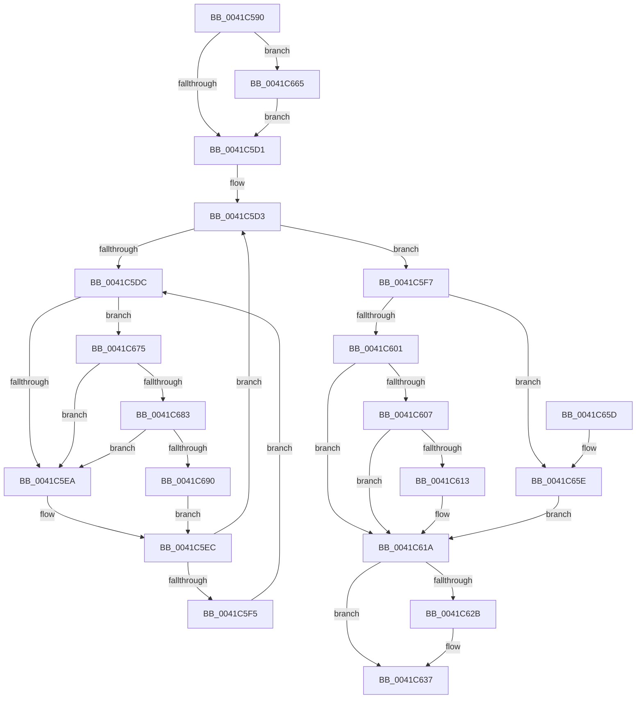

# KeTestAlertThread

- RVA: `0x0041C590`–`0x0041C69C` (길이 `268` bytes)
- VA: `0x000000014041C590`
- 실행 섹션: `.text`
- PDB 이름 있음: `예`; PDB Function 태그: `아니요`
- unwind 정보 RVA: `0x0009D804`
- 디코드: `66`개 명령, `268/268` bytes 표시
- 미해석 바이트: `0` (있으면 어셈블리에 `.byte`로 보존)

> 이 문서는 커널 이미지의 기계어와 PDB 기호를 분석해 생성했습니다. 4번과 5번은 함수 원형과 자료형을 바이너리 사용 방식에서 추정한 C 해석이며 원본 소스 복구 결과는 아닙니다.

## 1. Dependencies

- 직접 호출 지점: **4**; 고유 호출 대상: **4**
- 직접 호출자로 확인된 함수: **4**
- RIP 상대 이미지 참조: **3**

### Outgoing calls
- `0x0041C632` → [KiLowerIrqlProcessIrqlFlags](../4F/KiLowerIrqlProcessIrqlFlags_function_004F5698.md) (function, `0x004F5698`)
- `0x0041C66B` → [KiRaiseIrqlProcessIrqlFlags](../4F/KiRaiseIrqlProcessIrqlFlags_function_004F56FC.md) (function, `0x004F56FC`)
- `0x0041C683` → [KiCheckVpBackingLongSpinWaitHypercall](../30/KiCheckVpBackingLongSpinWaitHypercall_function_0030F490.md) (function, `0x0030F490`)
- `0x0041C692` → [HvlNotifyLongSpinWait](../30/HvlNotifyLongSpinWait_function_0030F460.md) (function, `0x0030F460`)

### Direct callers
- [sub_002514A5](../25/Unknown_function_002514A5.md) at `0x0025162D`
- [KiContinueEx](KiContinueEx_function_0041C370.md) at `0x0041C439`
- [KiContinueEx](KiContinueEx_function_0041C370.md) at `0x0041C55C`
- [DbgkpSendErrorMessage](../../page/92/DbgkpSendErrorMessage_function_009210A8.md) at `0x00921421`
- [NtTestAlert](../../page/A3/NtTestAlert_function_00A355D0.md) at `0x00A355E3`

### Static image references
- `0x0041C5C4` → RVA `0x00FC6D20` (`ALMOSTRO`; read)
- `0x0041C5DE` → RVA `0x00FC52AC` (`ALMOSTRO`; reference)
- `0x0041C675` → RVA `0x00FC6AB8` (`ALMOSTRO`; read)

## 2. Other-region calls and transfers

- 다른 실행 섹션으로 향하는 call: **0**
- 별도 외부 분기/꼬리 이동을 확인하지 못했습니다.

## 3. Assembly (complete function range)

```asm
0041C590  48 8B C4                        mov rax, rsp
0041C593  48 89 58 08                     mov qword ptr [rax + 8], rbx
0041C597  48 89 68 10                     mov qword ptr [rax + 0x10], rbp
0041C59B  48 89 70 18                     mov qword ptr [rax + 0x18], rsi
0041C59F  48 89 78 20                     mov qword ptr [rax + 0x20], rdi
0041C5A3  41 57                           push r15
0041C5A5  48 83 EC 20                     sub rsp, 0x20
0041C5A9  65 48 8B 1C 25 88 01 00 00      mov rbx, qword ptr gs:[0x188]
0041C5B2  48 0F BE E9                     movsx rbp, cl
0041C5B6  44 0F 20 C6                     mov rsi, cr8
0041C5BA  41 BF 02 00 00 00               mov r15d, 2
0041C5C0  45 0F 22 C7                     mov cr8, r15
0041C5C4  83 3D 55 A7 BA 00 00            cmp dword ptr [rip + 0xbaa755], 0
0041C5CB  0F 85 94 00 00 00               jne 0x14041c665
0041C5D1  33 FF                           xor edi, edi
0041C5D3  F0 48 0F BA 6B 40 00            lock bts qword ptr [rbx + 0x40], 0
0041C5DA  73 1B                           jae 0x14041c5f7
0041C5DC  FF C7                           inc edi
0041C5DE  85 3D C8 8C BA 00               test dword ptr [rip + 0xba8cc8], edi
0041C5E4  0F 84 8B 00 00 00               je 0x14041c675
0041C5EA  F3 90                           pause
0041C5EC  48 8B 43 40                     mov rax, qword ptr [rbx + 0x40]
0041C5F0  48 85 C0                        test rax, rax
0041C5F3  74 DE                           je 0x14041c5d3
0041C5F5  EB E5                           jmp 0x14041c5dc
0041C5F7  40 8A 7C 1D 72                  mov dil, byte ptr [rbp + rbx + 0x72]
0041C5FC  40 84 FF                        test dil, dil
0041C5FF  75 5D                           jne 0x14041c65e
0041C601  40 80 FD 01                     cmp bpl, 1
0041C605  75 13                           jne 0x14041c61a
0041C607  48 8D 83 A8 00 00 00            lea rax, [rbx + 0xa8]
0041C60E  48 39 00                        cmp qword ptr [rax], rax
0041C611  74 07                           je 0x14041c61a
0041C613  44 08 BB C2 00 00 00            or byte ptr [rbx + 0xc2], r15b
0041C61A  48 C7 43 40 00 00 00 00         mov qword ptr [rbx + 0x40], 0
0041C622  83 3D F7 A6 BA 00 00            cmp dword ptr [rip + 0xbaa6f7], 0
0041C629  74 0C                           je 0x14041c637
0041C62B  44 0F 20 C1                     mov rcx, cr8
0041C62F  40 8A D6                        mov dl, sil
0041C632  E8 61 90 0D 00                  call 0x1404f5698
0041C637  40 0F B6 CE                     movzx ecx, sil
0041C63B  44 0F 22 C1                     mov cr8, rcx
0041C63F  48 8B 5C 24 30                  mov rbx, qword ptr [rsp + 0x30]
0041C644  40 8A C7                        mov al, dil
0041C647  48 8B 7C 24 48                  mov rdi, qword ptr [rsp + 0x48]
0041C64C  48 8B 6C 24 38                  mov rbp, qword ptr [rsp + 0x38]
0041C651  48 8B 74 24 40                  mov rsi, qword ptr [rsp + 0x40]
0041C656  48 83 C4 20                     add rsp, 0x20
0041C65A  41 5F                           pop r15
0041C65C  C3                              ret
0041C65D  CC                              int3
0041C65E  C6 44 1D 72 00                  mov byte ptr [rbp + rbx + 0x72], 0
0041C663  EB B5                           jmp 0x14041c61a
0041C665  41 8A D7                        mov dl, r15b
0041C668  40 8A CE                        mov cl, sil
0041C66B  E8 8C 90 0D 00                  call 0x1404f56fc
0041C670  E9 5C FF FF FF                  jmp 0x14041c5d1
0041C675  8B 05 3D A4 BA 00               mov eax, dword ptr [rip + 0xbaa43d]
0041C67B  A8 40                           test al, 0x40
0041C67D  0F 84 67 FF FF FF               je 0x14041c5ea
0041C683  E8 08 2E EF FF                  call 0x14030f490
0041C688  84 C0                           test al, al
0041C68A  0F 84 5A FF FF FF               je 0x14041c5ea
0041C690  8B CF                           mov ecx, edi
0041C692  E8 C9 2D EF FF                  call 0x14030f460
0041C697  E9 50 FF FF FF                  jmp 0x14041c5ec
```

## 4. C-style interpretation (structured pseudocode)

```c
__int64 __fastcall KeTestAlertThread(unsigned __int8 a1)
{
    __int64 result;
    __int64 v_rdi;
    __int64 v_rsp;
    unsigned __int64 v_stack_p10;
    unsigned __int64 v_stack_p18;
    unsigned __int64 v_stack_p20;
    unsigned __int64 v_stack_p8;

    *(unsigned __int64 *)(v_rsp + 8) = v_rbx;
    *(unsigned __int64 *)(v_rsp + 16) = v_rbp;
    *(unsigned __int64 *)(v_rsp + 24) = v_rsi;
    *(unsigned __int64 *)(v_rsp + 32) = v_rdi;
    v_rsp = (v_rsp) - (32);
    if ((*(unsigned int *)(v_rip + 12232533)) != 0) goto loc_0041C665;
loc_0041C5D1:
    v_rdi = 0;
loc_0041C5D3:
    if (condition_is_above_or_equal) goto loc_0041C5F7;
loc_0041C5DC:
    v_rdi = (unsigned int)((v_rdi) + 1);
    if (((*(unsigned int *)(v_rip + 12225736)) & ((unsigned int)(v_rdi))) == 0) goto loc_0041C675;
loc_0041C5EA:
loc_0041C5EC:
    if (*(unsigned __int64 *)(*(unsigned __int64 *)(gs_base + (0 + 392)) + 64) == 0) goto loc_0041C5D3;
    goto loc_0041C5DC;
loc_0041C5F7:
    if ((unsigned __int8)(*(unsigned __int8 *)((__int8)(a1) + *(unsigned __int64 *)(gs_base + (0 + 392)) * 1 + 114)) != 0) goto loc_0041C65E;
    if (((unsigned __int8)((__int8)(a1))) != 1) goto loc_0041C61A;
    if ((*(unsigned __int64 *)(*(unsigned __int64 *)(gs_base + (0 + 392)) + 168)) != (*(unsigned __int64 *)(gs_base + (0 + 392)) + 168)) {
    }
    *(unsigned __int64 *)(*(unsigned __int64 *)(gs_base + (0 + 392)) + 64) = 0;
    result = *(unsigned __int64 *)(gs_base + (0 + 392)) + 168;
    if ((*(unsigned int *)(v_rip + 12232439)) != 0) {
        a1 = 2;
        a2 = (unsigned __int8)(v_cr8);
        result = KiLowerIrqlProcessIrqlFlags(a1, a2, a3, a4);
    }
    v_rsp = (v_rsp) + (32);
    return (unsigned __int8)(*(unsigned __int8 *)((__int8)(a1) + *(unsigned __int64 *)(gs_base + (0 + 392)) * 1 + 114));
loc_0041C65E:
    *(unsigned __int8 *)(v_stack_p10 + v_stack_p8 * 1 + 114) = 0;
    goto loc_0041C61A;
loc_0041C665:
    result = KiRaiseIrqlProcessIrqlFlags((unsigned __int8)(v_stack_p18), 2, a3, a4);
    goto loc_0041C5D1;
loc_0041C675:
    if ((((unsigned __int8)((unsigned int)(*(unsigned int *)(v_rip + 12231741)))) & (64)) == 0) goto loc_0041C5EA;
    result = KiCheckVpBackingLongSpinWaitHypercall((unsigned __int8)(v_stack_p18), 2, a3, a4);
    if ((unsigned __int8)(result) == 0) goto loc_0041C5EA;
    result = HvlNotifyLongSpinWait((unsigned int)((unsigned int)(v_stack_p20)), 2, a3, a4);
    goto loc_0041C5EC;
}
```

## 5. (Beta) C Style

```c
int64_t KeTestAlertThread(void *Arg1)
{
    uint8_t *arg1 = (uint8_t *)Arg1;

    int64_t result;
    int64_t local_rdi;
    int64_t local_rsp;
    uint64_t v_stack_p10;
    uint64_t v_stack_p18;
    uint64_t v_stack_p20;
    uint64_t v_stack_p8;

    *(uint64_t *)(local_rsp + 0x8) = local_rbx;
    *(uint64_t *)(local_rsp + 0x10) = local_rbp;
    *(uint64_t *)(local_rsp + 0x18) = local_rsi;
    *(uint64_t *)(local_rsp + 0x20) = local_rdi;
    local_rsp = (local_rsp) - (32);
    if ((*(uint32_t *)(v_rip + 0xBAA755)) != 0) goto loc_0041C665;
loc_0041C5D1:
    local_rdi = 0;
loc_0041C5D3:
    if (condition_is_above_or_equal) goto loc_0041C5F7;
loc_0041C5DC:
    local_rdi = (uint32_t)((local_rdi) + 1);
    if (((*(uint32_t *)(v_rip + 0xBA8CC8)) & ((uint32_t)(local_rdi))) == 0) goto loc_0041C675;
loc_0041C5EA:
loc_0041C5EC:
    if (*(uint64_t *)(*(uint64_t *)(gs_base + (0 + 0x188)) + 0x40) == 0) goto loc_0041C5D3;
    goto loc_0041C5DC;
loc_0041C5F7:
    if ((uint8_t)(*(uint8_t *)((int8_t)(arg1) + *(uint64_t *)(gs_base + (0 + 0x188)) * 1 + 0x72)) != 0) goto loc_0041C65E;
    if (((uint8_t)((int8_t)(Arg1))) != 1) goto loc_0041C61A;
    if ((*(uint64_t *)(*(uint64_t *)(gs_base + (0 + 0x188)) + 0xA8)) != (*(uint64_t *)(gs_base + (0 + 0x188)) + 168)) {
    }
    *(uint64_t *)(*(uint64_t *)(gs_base + (0 + 0x188)) + 0x40) = 0;
    result = *(uint64_t *)(gs_base + (0 + 0x188)) + 168;
    if ((*(uint32_t *)(v_rip + 0xBAA6F7)) != 0) {
        Arg1 = 2;
        a2 = (uint8_t)(v_cr8);
        result = KiLowerIrqlProcessIrqlFlags(Arg1, a2, a3, a4);
    }
    local_rsp = (local_rsp) + (32);
    return (uint8_t)(*(uint8_t *)((int8_t)(arg1) + *(uint64_t *)(gs_base + (0 + 0x188)) * 1 + 0x72));
loc_0041C65E:
    *(uint8_t *)(v_stack_p10 + v_stack_p8 * 1 + 0x72) = 0;
    goto loc_0041C61A;
loc_0041C665:
    result = KiRaiseIrqlProcessIrqlFlags((uint8_t)(v_stack_p18), 2, a3, a4);
    goto loc_0041C5D1;
loc_0041C675:
    if ((((uint8_t)((uint32_t)(*(uint32_t *)(v_rip + 0xBAA43D)))) & (64)) == 0) goto loc_0041C5EA;
    result = KiCheckVpBackingLongSpinWaitHypercall((uint8_t)(v_stack_p18), 2, a3, a4);
    if ((uint8_t)(result) == 0) goto loc_0041C5EA;
    result = HvlNotifyLongSpinWait((uint32_t)((uint32_t)(v_stack_p20)), 2, a3, a4);
    goto loc_0041C5EC;
}
```

### 관측된 메모리 오프셋

구조체 형식이 확인되지 않은 접근은 인자 기준의 오프셋으로만 기록했습니다.

| 기준 인자 | 오프셋 표현 | 폭 (bit) | 접근 |
|---|---:|---:|---|
| `Arg1` | `+ 0x72 + rbx*1` | `8` | `R` |
| `Arg1` | `+ 0x72 + rbx*1` | `8` | `W` |

## 6. Execution-region graph

[열기: 2D/3D 그래프와 함수 탐색 컨트롤 패널](../../../control-panel.html?section=text&rva=0x0041C590&view=graph)

- 2D 그래프는 위에서 아래로 흐르고, 3D 그래프는 빈 공간을 드래그해 회전합니다. Shift+드래그는 이동, 휠은 확대·축소, 함수 노드 선택은 대상 보고서 이동입니다.

### Static fallback


