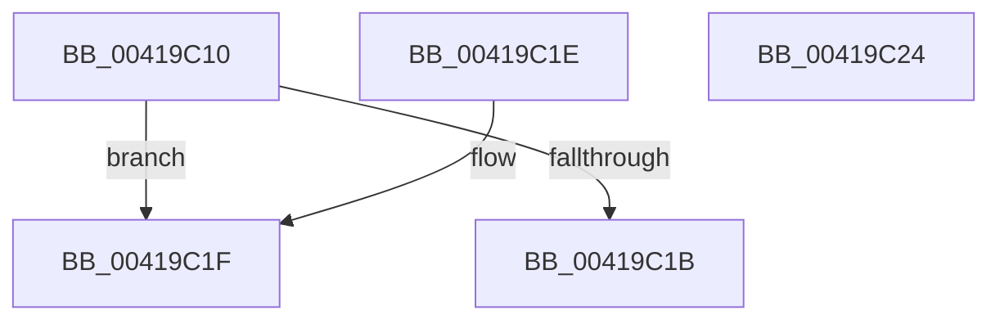

# KeTestSpinLock

- RVA: `0x00419C10`–`0x00419C25` (길이 `21` bytes)
- VA: `0x0000000140419C10`
- 실행 섹션: `.text`
- PDB 이름 있음: `예`; PDB Function 태그: `아니요`
- unwind 정보 RVA: `0x000DB714`
- 디코드: `12`개 명령, `21/21` bytes 표시
- 미해석 바이트: `0` (있으면 어셈블리에 `.byte`로 보존)

> 이 문서는 커널 이미지의 기계어와 PDB 기호를 분석해 생성했습니다. 4번과 5번은 함수 원형과 자료형을 바이너리 사용 방식에서 추정한 C 해석이며 원본 소스 복구 결과는 아닙니다.

## 1. Dependencies

- 직접 호출 지점: **0**; 고유 호출 대상: **0**
- 직접 호출자로 확인된 함수: **5**
- RIP 상대 이미지 참조: **0**

### Outgoing calls
- 직접 디코드된 call 명령이 없습니다.

### Direct callers
- [EtwpLockUnlockBufferList](EtwpLockUnlockBufferList_function_00419B88.md) at `0x00419BA5`
- [HalpDmaMarkHiberAdapter](../4D/HalpDmaMarkHiberAdapter_function_004DA56C.md) at `0x004DA806`
- [HalpDmaMarkHiberAdapter](../4D/HalpDmaMarkHiberAdapter_function_004DA56C.md) at `0x004DA907`
- [KiDecodeMcaFault](../50/KiDecodeMcaFault_function_00509DC0.md) at `0x00509DE1`
- [BvgaAcquireLock](../59/BvgaAcquireLock_function_005913A0.md) at `0x005913BF`
- [EtwpBugCheckMultiPartCallback](../65/EtwpBugCheckMultiPartCallback_function_00652390.md) at `0x0065249A`

### Static image references
- 디코드된 RIP-relative 메모리 참조가 없습니다.

## 2. Other-region calls and transfers

- 다른 실행 섹션으로 향하는 call: **0**
- 별도 외부 분기/꼬리 이동을 확인하지 못했습니다.

## 3. Assembly (complete function range)

```asm
00419C10  66 90                           nop
00419C12  90                              nop
00419C13  48 8B 01                        mov rax, qword ptr [rcx]
00419C16  48 85 C0                        test rax, rax
00419C19  75 04                           jne 0x140419c1f
00419C1B  B0 01                           mov al, 1
00419C1D  C3                              ret
00419C1E  CC                              int3
00419C1F  F3 90                           pause
00419C21  32 C0                           xor al, al
00419C23  C3                              ret
00419C24  CC                              int3
```

## 4. C-style interpretation (structured pseudocode)

```c
__int64 __fastcall KeTestSpinLock(__int64 a1)
{
    __int64 result;

    if (*(unsigned __int64 *)(a1) != 0) goto loc_00419C1F;
    return 1;
loc_00419C1F:
    result = 0;
    return result;
}
```

## 5. (Beta) C Style

```c
int64_t KeTestSpinLock(void *Arg1)
{
    uint8_t *arg1 = (uint8_t *)Arg1;

    int64_t result;

    if (*(uint64_t *)(arg1) != 0) goto loc_00419C1F;
    return 1;
loc_00419C1F:
    result = 0;
    return result;
}
```

### 관측된 메모리 오프셋

구조체 형식이 확인되지 않은 접근은 인자 기준의 오프셋으로만 기록했습니다.

| 기준 인자 | 오프셋 표현 | 폭 (bit) | 접근 |
|---|---:|---:|---|
| `Arg1` | `+ 0x0` | `64` | `R` |

## 6. Execution-region graph

[열기: 2D/3D 그래프와 함수 탐색 컨트롤 패널](../../../control-panel.html?section=text&rva=0x00419C10&view=graph)

- 2D 그래프는 위에서 아래로 흐르고, 3D 그래프는 빈 공간을 드래그해 회전합니다. Shift+드래그는 이동, 휠은 확대·축소, 함수 노드 선택은 대상 보고서 이동입니다.

### Static fallback


