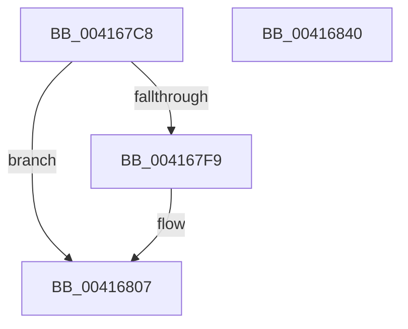

# KiAbCrossThreadRelease

- RVA: `0x004167C8`–`0x00416841` (길이 `121` bytes)
- VA: `0x00000001404167C8`
- 실행 섹션: `.text`
- PDB 이름 있음: `예`; PDB Function 태그: `아니요`
- unwind 정보 RVA: `0x00060BC4`
- 디코드: `35`개 명령, `121/121` bytes 표시
- 미해석 바이트: `0` (있으면 어셈블리에 `.byte`로 보존)

> 이 문서는 커널 이미지의 기계어와 PDB 기호를 분석해 생성했습니다. 4번과 5번은 함수 원형과 자료형을 바이너리 사용 방식에서 추정한 C 해석이며 원본 소스 복구 결과는 아닙니다.

## 1. Dependencies

- 직접 호출 지점: **2**; 고유 호출 대상: **2**
- 직접 호출자로 확인된 함수: **2**
- RIP 상대 이미지 참조: **0**

### Outgoing calls
- `0x004167E3` → [KiAbEntryRemoveFromTree](../26/KiAbEntryRemoveFromTree_function_00262410.md) (function, `0x00262410`)
- `0x00416802` → [KiAbThreadRemoveBoostsSlow](../21/KiAbThreadRemoveBoostsSlow_function_00210BB0.md) (function, `0x00210BB0`)

### Direct callers
- [KeAbCrossThreadRelease](KeAbCrossThreadRelease_function_00416794.md) at `0x004167B5`
- [KeAbCrossThreadDelete](../5C/KeAbCrossThreadDelete_function_005C517C.md) at `0x005C55A4`

### Static image references
- 디코드된 RIP-relative 메모리 참조가 없습니다.

## 2. Other-region calls and transfers

- 다른 실행 섹션으로 향하는 call: **0**
- 별도 외부 분기/꼬리 이동을 확인하지 못했습니다.

## 3. Assembly (complete function range)

```asm
004167C8  48 89 5C 24 08                  mov qword ptr [rsp + 8], rbx
004167CD  48 89 74 24 10                  mov qword ptr [rsp + 0x10], rsi
004167D2  57                              push rdi
004167D3  48 83 EC 20                     sub rsp, 0x20
004167D7  48 8B F1                        mov rsi, rcx
004167DA  49 8B F8                        mov rdi, r8
004167DD  48 8B CA                        mov rcx, rdx
004167E0  48 8B DA                        mov rbx, rdx
004167E3  E8 28 BC E4 FF                  call 0x140262410
004167E8  44 8B 43 50                     mov r8d, dword ptr [rbx + 0x50]
004167EC  83 63 50 00                     and dword ptr [rbx + 0x50], 0
004167F0  C6 43 0A 00                     mov byte ptr [rbx + 0xa], 0
004167F4  45 85 C0                        test r8d, r8d
004167F7  74 0E                           je 0x140416807
004167F9  45 33 C9                        xor r9d, r9d
004167FC  48 8B D6                        mov rdx, rsi
004167FF  48 8B CF                        mov rcx, rdi
00416802  E8 A9 A3 DF FF                  call 0x140210bb0
00416807  48 C7 03 00 00 00 00            mov qword ptr [rbx], 0
0041680E  B8 01 00 00 00                  mov eax, 1
00416813  0F B6 53 08                     movzx edx, byte ptr [rbx + 8]
00416817  8B CA                           mov ecx, edx
00416819  83 E2 3F                        and edx, 0x3f
0041681C  83 E1 3F                        and ecx, 0x3f
0041681F  D2 E0                           shl al, cl
00416821  0F B6 C8                        movzx ecx, al
00416824  48 6B C2 58                     imul rax, rdx, 0x58
00416828  48 2B D8                        sub rbx, rax
0041682B  66 F0 09 4B FA                  lock or word ptr [rbx - 6], cx
00416830  48 8B 5C 24 30                  mov rbx, qword ptr [rsp + 0x30]
00416835  48 8B 74 24 38                  mov rsi, qword ptr [rsp + 0x38]
0041683A  48 83 C4 20                     add rsp, 0x20
0041683E  5F                              pop rdi
0041683F  C3                              ret
00416840  CC                              int3
```

## 4. C-style interpretation (structured pseudocode)

```c
__int64 __fastcall KiAbCrossThreadRelease(__int64 a1, __int64 a2, __int64 a3, int a4)
{
    __int64 result;
    __int64 v_rbx;
    __int64 v_rsp;
    unsigned __int64 v_stack_p10;
    unsigned __int64 v_stack_p8;

    v_stack_p8 = v_rbx;
    v_stack_p10 = v_rsi;
    v_rsp = (v_rsp) - (32);
    result = KiAbEntryRemoveFromTree(a2, a2, a3, a4);
    *(unsigned __int8 *)(a2 + 10) = 0;
    if ((unsigned int)((unsigned int)(*(unsigned int *)(a2 + 80))) != 0) {
        a4 = 0;
        a2 = a1;
        a1 = a3;
        result = KiAbThreadRemoveBoostsSlow(a1, a2, (unsigned int)(*(unsigned int *)(a2 + 80)), a4);
    }
    *(unsigned __int64 *)(a2) = 0;
    a2 = (unsigned int)((*(unsigned __int8 *)(a2 + 8)) & (63));
    a1 = (unsigned int)(((unsigned int)((unsigned int)(*(unsigned __int8 *)(a2 + 8)))) & (63));
    result = (unsigned __int8)((1) << ((unsigned __int8)(a1)));
    result = (result) * (a2);
    v_rbx = (a2) - (result);
    v_rsp = (v_rsp) + (32);
    return result;
}
```

## 5. (Beta) C Style

```c
int64_t KiAbCrossThreadRelease(int64_t Arg1, void *Arg2, int64_t Arg3, int32_t Arg4)
{
    uint8_t *arg2 = (uint8_t *)Arg2;

    int64_t result;
    int64_t local_rbx;
    int64_t local_rsp;
    uint64_t v_stack_p10;
    uint64_t v_stack_p8;

    v_stack_p8 = local_rbx;
    v_stack_p10 = local_rsi;
    local_rsp = (local_rsp) - (32);
    result = KiAbEntryRemoveFromTree(Arg2, Arg2, Arg3, Arg4);
    *(uint8_t *)(arg2 + 0xA) = 0;
    if ((uint32_t)((uint32_t)(*(uint32_t *)(arg2 + 0x50))) != 0) {
        Arg4 = 0;
        Arg2 = Arg1;
        Arg1 = Arg3;
        result = KiAbThreadRemoveBoostsSlow(Arg1, Arg2, (uint32_t)(*(uint32_t *)(arg2 + 0x50)), Arg4);
    }
    *(uint64_t *)(arg2) = 0;
    Arg2 = (uint32_t)((*(uint8_t *)(arg2 + 0x8)) & (63));
    Arg1 = (uint32_t)(((uint32_t)((uint32_t)(*(uint8_t *)(arg2 + 0x8)))) & (63));
    result = (uint8_t)((1) << ((uint8_t)(Arg1)));
    result = (result) * (Arg2);
    local_rbx = (Arg2) - (result);
    local_rsp = (local_rsp) + (32);
    return result;
}
```

### 관측된 메모리 오프셋

구조체 형식이 확인되지 않은 접근은 인자 기준의 오프셋으로만 기록했습니다.

| 기준 인자 | 오프셋 표현 | 폭 (bit) | 접근 |
|---|---:|---:|---|
| `Arg2` | `- 0x6` | `16` | `R/W` |
| `Arg2` | `+ 0x0` | `64` | `W` |
| `Arg2` | `+ 0x8` | `8` | `R` |
| `Arg2` | `+ 0xA` | `8` | `W` |
| `Arg2` | `+ 0x50` | `32` | `R` |
| `Arg2` | `+ 0x50` | `32` | `R/W` |

## 6. Execution-region graph

[열기: 2D/3D 그래프와 함수 탐색 컨트롤 패널](../../../control-panel.html?section=text&rva=0x004167C8&view=graph)

- 2D 그래프는 위에서 아래로 흐르고, 3D 그래프는 빈 공간을 드래그해 회전합니다. Shift+드래그는 이동, 휠은 확대·축소, 함수 노드 선택은 대상 보고서 이동입니다.

### Static fallback


