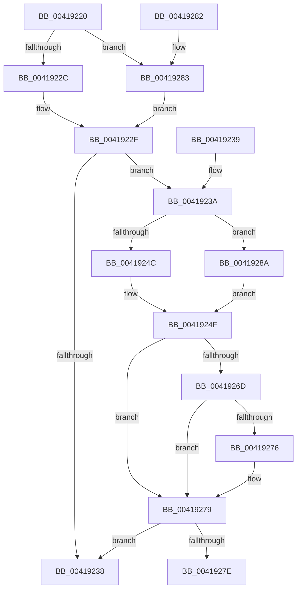

# KiAbDetermineMinOwnerCpuPriority

- RVA: `0x00419220`–`0x00419297` (길이 `119` bytes)
- VA: `0x0000000140419220`
- 실행 섹션: `.text`
- PDB 이름 있음: `예`; PDB Function 태그: `아니요`
- unwind 정보 RVA: `0x000DB714`
- 디코드: `38`개 명령, `119/119` bytes 표시
- 미해석 바이트: `0` (있으면 어셈블리에 `.byte`로 보존)

> 이 문서는 커널 이미지의 기계어와 PDB 기호를 분석해 생성했습니다. 4번과 5번은 함수 원형과 자료형을 바이너리 사용 방식에서 추정한 C 해석이며 원본 소스 복구 결과는 아닙니다.

## 1. Dependencies

- 직접 호출 지점: **0**; 고유 호출 대상: **0**
- 직접 호출자로 확인된 함수: **2**
- RIP 상대 이미지 참조: **0**

### Outgoing calls
- 직접 디코드된 call 명령이 없습니다.

### Direct callers
- [KiAbConvertWaiterToOwnerEntry](../21/KiAbConvertWaiterToOwnerEntry_function_00219430.md) at `0x0021976C`
- [KiAbForceProcessLockEntry](KiAbForceProcessLockEntry_function_00419078.md) at `0x00419146`

### Static image references
- 디코드된 RIP-relative 메모리 참조가 없습니다.

## 2. Other-region calls and transfers

- 다른 실행 섹션으로 향하는 call: **0**
- 별도 외부 분기/꼬리 이동을 확인하지 못했습니다.

## 3. Assembly (complete function range)

```asm
00419220  48 8B 41 30                     mov rax, qword ptr [rcx + 0x30]
00419224  4C 8B C2                        mov r8, rdx
00419227  48 85 C0                        test rax, rax
0041922A  75 57                           jne 0x140419283
0041922C  41 B1 1E                        mov r9b, 0x1e
0041922F  44 88 0A                        mov byte ptr [rdx], r9b
00419232  80 79 09 00                     cmp byte ptr [rcx + 9], 0
00419236  74 02                           je 0x14041923a
00419238  C3                              ret
00419239  CC                              int3
0041923A  8B 41 50                        mov eax, dword ptr [rcx + 0x50]
0041923D  C7 44 24 08 00 00 00 00         mov dword ptr [rsp + 8], 0
00419245  25 FF FF FF 3F                  and eax, 0x3fffffff
0041924A  77 3E                           ja 0x14041928a
0041924C  45 32 D2                        xor r10b, r10b
0041924F  0F B6 41 08                     movzx eax, byte ptr [rcx + 8]
00419253  83 E0 3F                        and eax, 0x3f
00419256  48 6B D0 58                     imul rdx, rax, 0x58
0041925A  48 2B CA                        sub rcx, rdx
0041925D  48 8B 41 F0                     mov rax, qword ptr [rcx - 0x10]
00419261  0F B6 88 33 02 00 00            movzx ecx, byte ptr [rax + 0x233]
00419268  41 3A CA                        cmp cl, r10b
0041926B  7E 0C                           jle 0x140419279
0041926D  44 0F B6 D1                     movzx r10d, cl
00419271  80 F9 1E                        cmp cl, 0x1e
00419274  7E 03                           jle 0x140419279
00419276  41 B2 1E                        mov r10b, 0x1e
00419279  45 3A D1                        cmp r10b, r9b
0041927C  7D BA                           jge 0x140419238
0041927E  45 88 10                        mov byte ptr [r8], r10b
00419281  C3                              ret
00419282  CC                              int3
00419283  44 0F B6 48 18                  movzx r9d, byte ptr [rax + 0x18]
00419288  EB A5                           jmp 0x14041922f
0041928A  44 0F B6 0A                     movzx r9d, byte ptr [rdx]
0041928E  44 0F BD D0                     bsr r10d, eax
00419292  41 FE C2                        inc r10b
00419295  EB B8                           jmp 0x14041924f
```

## 4. C-style interpretation (structured pseudocode)

```c
__int64 __fastcall KiAbDetermineMinOwnerCpuPriority(__int64 a1, __int64 a2)
{
    __int64 result;
    __int64 v_r10;
    unsigned int v_stack_p8;

    if (*(unsigned __int64 *)(a1 + 48) != 0) goto loc_00419283;
loc_0041922F:
    *(unsigned __int8 *)(a2) = 30;
    if ((*(unsigned __int8 *)(a1 + 9)) == 0) goto loc_0041923A;
loc_00419238:
    return *(unsigned __int64 *)(a1 + 48);
loc_0041923A:
    v_stack_p8 = 0;
    result = (unsigned int)(((unsigned int)(*(unsigned int *)(a1 + 80))) & (0x3FFFFFFFULL));
    if (condition_is_above) goto loc_0041928A;
    v_r10 = 0;
loc_0041924F:
    result = (unsigned int)((*(unsigned __int8 *)(a1 + 8)) & (63));
    a2 = (a2) * (result);
    a1 = (a1) - (a2);
    if (((unsigned __int8)(*(unsigned __int8 *)(*(unsigned __int64 *)(a1 - 16) + 563))) <= 0) goto loc_00419279;
    v_r10 = (unsigned __int8)(*(unsigned __int8 *)(*(unsigned __int64 *)(a1 - 16) + 563));
    if (((unsigned __int8)(*(unsigned __int8 *)(*(unsigned __int64 *)(a1 - 16) + 563))) >= = 30) {
        v_r10 = 30;
    }
    if (((unsigned __int8)(v_r10)) >= 30) goto loc_00419238;
    *(unsigned __int8 *)(a2) = (unsigned __int8)(v_r10);
    return *(unsigned __int64 *)(a1 - 16);
loc_00419283:
    goto loc_0041922F;
loc_0041928A:
    v_r10 = (unsigned __int8)((v_r10) + 1);
    goto loc_0041924F;
}
```

## 5. (Beta) C Style

```c
int64_t KiAbDetermineMinOwnerCpuPriority(void *Arg1, void *Arg2)
{
    uint8_t *arg1 = (uint8_t *)Arg1;
    uint8_t *arg2 = (uint8_t *)Arg2;

    int64_t result;
    int64_t local_r10;
    uint32_t v_stack_p8;

    if (*(uint64_t *)(arg1 + 0x30) != 0) goto loc_00419283;
loc_0041922F:
    *(uint8_t *)(arg2) = 30;
    if ((*(uint8_t *)(arg1 + 0x9)) == 0) goto loc_0041923A;
loc_00419238:
    return *(uint64_t *)(arg1 + 0x30);
loc_0041923A:
    v_stack_p8 = 0;
    result = (uint32_t)(((uint32_t)(*(uint32_t *)(arg1 + 0x50))) & (0x3FFFFFFFULL));
    if (condition_is_above) goto loc_0041928A;
    local_r10 = 0;
loc_0041924F:
    result = (uint32_t)((*(uint8_t *)(arg1 + 0x8)) & (63));
    Arg2 = (Arg2) * (result);
    Arg1 = (Arg1) - (Arg2);
    if (((uint8_t)(*(uint8_t *)(*(uint64_t *)(arg1 - 0x10) + 0x233))) <= 0) goto loc_00419279;
    local_r10 = (uint8_t)(*(uint8_t *)(*(uint64_t *)(arg1 - 0x10) + 0x233));
    if (((uint8_t)(*(uint8_t *)(*(uint64_t *)(arg1 - 0x10) + 0x233))) >= = 30) {
        local_r10 = 30;
    }
    if (((uint8_t)(local_r10)) >= 30) goto loc_00419238;
    *(uint8_t *)(arg2) = (uint8_t)(local_r10);
    return *(uint64_t *)(arg1 - 0x10);
loc_00419283:
    goto loc_0041922F;
loc_0041928A:
    local_r10 = (uint8_t)((local_r10) + 1);
    goto loc_0041924F;
}
```

### 관측된 메모리 오프셋

구조체 형식이 확인되지 않은 접근은 인자 기준의 오프셋으로만 기록했습니다.

| 기준 인자 | 오프셋 표현 | 폭 (bit) | 접근 |
|---|---:|---:|---|
| `Arg1` | `- 0x10` | `64` | `R` |
| `Arg1` | `+ 0x8` | `8` | `R` |
| `Arg1` | `+ 0x9` | `8` | `R` |
| `Arg1` | `+ 0x30` | `64` | `R` |
| `Arg1` | `+ 0x50` | `32` | `R` |
| `Arg2` | `+ 0x0` | `8` | `R` |
| `Arg2` | `+ 0x0` | `8` | `W` |

## 6. Execution-region graph

[열기: 2D/3D 그래프와 함수 탐색 컨트롤 패널](../../../control-panel.html?section=text&rva=0x00419220&view=graph)

- 2D 그래프는 위에서 아래로 흐르고, 3D 그래프는 빈 공간을 드래그해 회전합니다. Shift+드래그는 이동, 휠은 확대·축소, 함수 노드 선택은 대상 보고서 이동입니다.

### Static fallback


