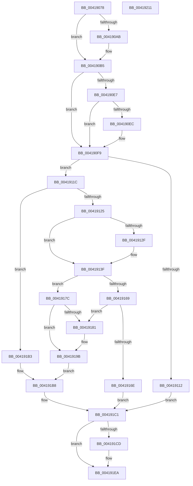

# KiAbForceProcessLockEntry

- RVA: `0x00419078`–`0x00419212` (길이 `410` bytes)
- VA: `0x0000000140419078`
- 실행 섹션: `.text`
- PDB 이름 있음: `예`; PDB Function 태그: `아니요`
- unwind 정보 RVA: `0x0009D0F0`
- 디코드: `116`개 명령, `410/410` bytes 표시
- 미해석 바이트: `0` (있으면 어셈블리에 `.byte`로 보존)

> 이 문서는 커널 이미지의 기계어와 PDB 기호를 분석해 생성했습니다. 4번과 5번은 함수 원형과 자료형을 바이너리 사용 방식에서 추정한 C 해석이며 원본 소스 복구 결과는 아닙니다.

## 1. Dependencies

- 직접 호출 지점: **12**; 고유 호출 대상: **11**
- 직접 호출자로 확인된 함수: **1**
- RIP 상대 이미지 참조: **2**

### Outgoing calls
- `0x004190B0` → [KiRaiseIrqlProcessIrqlFlags](../4F/KiRaiseIrqlProcessIrqlFlags_function_004F56FC.md) (function, `0x004F56FC`)
- `0x00419105` → [KiAbEntryGetLockedHeadEntry](../22/KiAbEntryGetLockedHeadEntry_function_002213C0.md) (function, `0x002213C0`)
- `0x00419135` → [KiAbEntryUpdateWaiterTreePosition](../2E/KiAbEntryUpdateWaiterTreePosition_function_002E5AE0.md) (function, `0x002E5AE0`)
- `0x00419146` → [KiAbDetermineMinOwnerCpuPriority](KiAbDetermineMinOwnerCpuPriority_function_00419220.md) (function, `0x00419220`)
- `0x00419151` → [KiAbTryIncrementIoWaiterCounts](KiAbTryIncrementIoWaiterCounts_function_004192A0.md) (function, `0x004192A0`)
- `0x0041915C` → [KiAbEntryGetCpuPriorityKey](../22/KiAbEntryGetCpuPriorityKey_function_00222DD0.md) (function, `0x00222DD0`)
- `0x00419172` → [KeReleaseInStackQueuedSpinLockFromDpcLevel](../21/KeReleaseInStackQueuedSpinLockFromDpcLevel_function_002171B0.md) (function, `0x002171B0`)
- `0x00419193` → [KiAbIoBoostOwners](../21/KiAbIoBoostOwners_function_0021FCB0.md) (function, `0x0021FCB0`)
- `0x004191AC` → [KiAbCpuBoostOwners](../22/KiAbCpuBoostOwners_function_00220680.md) (function, `0x00220680`)
- `0x004191BC` → [KeReleaseInStackQueuedSpinLockFromDpcLevel](../21/KeReleaseInStackQueuedSpinLockFromDpcLevel_function_002171B0.md) (function, `0x002171B0`)
- `0x004191E5` → [EtwTraceAutoBoostProcessLockEntry](../22/EtwTraceAutoBoostProcessLockEntry_function_00221C7C.md) (function, `0x00221C7C`)
- `0x004191F4` → [KiProcessDeferredReadyList](../25/KiProcessDeferredReadyList_function_00250800.md) (function, `0x00250800`)

### Direct callers
- [KeAbMarkCrossThreadReleasable](../3B/KeAbMarkCrossThreadReleasable_function_003BE8AC.md) at `0x003BE8F8`

### Static image references
- `0x004190A3` → RVA `0x00FC6D20` (`ALMOSTRO`; read)
- `0x004191C1` → RVA `0x00FC6B14` (`ALMOSTRO`; read)

## 2. Other-region calls and transfers

- 다른 실행 섹션으로 향하는 call: **0**
- 별도 외부 분기/꼬리 이동을 확인하지 못했습니다.

## 3. Assembly (complete function range)

```asm
00419078  48 89 5C 24 20                  mov qword ptr [rsp + 0x20], rbx
0041907D  55                              push rbp
0041907E  56                              push rsi
0041907F  57                              push rdi
00419080  41 54                           push r12
00419082  41 55                           push r13
00419084  41 56                           push r14
00419086  41 57                           push r15
00419088  48 8B EC                        mov rbp, rsp
0041908B  48 83 EC 50                     sub rsp, 0x50
0041908F  33 DB                           xor ebx, ebx
00419091  48 8B F9                        mov rdi, rcx
00419094  48 89 5D 50                     mov qword ptr [rbp + 0x50], rbx
00419098  45 0F 20 C7                     mov r15, cr8
0041909C  8D 43 02                        lea eax, [rbx + 2]
0041909F  44 0F 22 C0                     mov cr8, rax
004190A3  39 1D 77 DC BA 00               cmp dword ptr [rip + 0xbadc77], ebx
004190A9  74 0A                           je 0x1404190b5
004190AB  8A D0                           mov dl, al
004190AD  41 8A CF                        mov cl, r15b
004190B0  E8 47 C6 0D 00                  call 0x1404f56fc
004190B5  65 4C 8B 2C 25 20 00 00 00      mov r13, qword ptr gs:[0x20]
004190BE  33 C0                           xor eax, eax
004190C0  4C 8B 37                        mov r14, qword ptr [rdi]
004190C3  0F 57 C0                        xorps xmm0, xmm0
004190C6  48 89 45 F0                     mov qword ptr [rbp - 0x10], rax
004190CA  48 B8 FC FF FF FF FF FF FF 7F   movabs rax, 0x7ffffffffffffffc
004190D4  89 5D 48                        mov dword ptr [rbp + 0x48], ebx
004190D7  4D 8D A5 70 91 00 00            lea r12, [r13 + 0x9170]
004190DE  0F 11 45 E0                     movups xmmword ptr [rbp - 0x20], xmm0
004190E2  4C 23 F0                        and r14, rax
004190E5  74 12                           je 0x1404190f9
004190E7  38 5F 08                        cmp byte ptr [rdi + 8], bl
004190EA  7C 0D                           jl 0x1404190f9
004190EC  48 B8 00 00 00 00 00 00 00 80   movabs rax, 0x8000000000000000
004190F6  4C 0B F0                        or r14, rax
004190F9  4C 8D 45 E0                     lea r8, [rbp - 0x20]
004190FD  BA 01 00 00 00                  mov edx, 1
00419102  48 8B CF                        mov rcx, rdi
00419105  E8 B6 82 E0 FF                  call 0x1402213c0
0041910A  48 8B F0                        mov rsi, rax
0041910D  48 85 C0                        test rax, rax
00419110  75 0A                           jne 0x14041911c
00419112  BB 40 01 00 00                  mov ebx, 0x140
00419117  E9 A5 00 00 00                  jmp 0x1404191c1
0041911C  38 5F 09                        cmp byte ptr [rdi + 9], bl
0041911F  0F 84 8E 00 00 00               je 0x1404191b3
00419125  BB 48 01 00 00                  mov ebx, 0x148
0041912A  48 3B FE                        cmp rdi, rsi
0041912D  74 10                           je 0x14041913f
0041912F  48 8B D6                        mov rdx, rsi
00419132  48 8B CF                        mov rcx, rdi
00419135  E8 A6 C9 EC FF                  call 0x1402e5ae0
0041913A  BB 68 01 00 00                  mov ebx, 0x168
0041913F  48 8D 55 48                     lea rdx, [rbp + 0x48]
00419143  48 8B CE                        mov rcx, rsi
00419146  E8 D5 00 00 00                  call 0x140419220
0041914B  48 8B D6                        mov rdx, rsi
0041914E  48 8B CF                        mov rcx, rdi
00419151  E8 4A 01 00 00                  call 0x1404192a0
00419156  48 8B CF                        mov rcx, rdi
00419159  44 8B D0                        mov r10d, eax
0041915C  E8 6F 9C E0 FF                  call 0x140222dd0
00419161  88 45 40                        mov byte ptr [rbp + 0x40], al
00419164  38 45 48                        cmp byte ptr [rbp + 0x48], al
00419167  7C 13                           jl 0x14041917c
00419169  45 85 D2                        test r10d, r10d
0041916C  75 13                           jne 0x140419181
0041916E  48 8D 4D E0                     lea rcx, [rbp - 0x20]
00419172  E8 39 E0 DF FF                  call 0x1402171b0
00419177  83 CB 02                        or ebx, 2
0041917A  EB 45                           jmp 0x1404191c1
0041917C  45 85 D2                        test r10d, r10d
0041917F  74 1A                           je 0x14041919b
00419181  45 33 C9                        xor r9d, r9d
00419184  4C 89 64 24 20                  mov qword ptr [rsp + 0x20], r12
00419189  4C 8D 45 50                     lea r8, [rbp + 0x50]
0041918D  41 8B D2                        mov edx, r10d
00419190  48 8B CE                        mov rcx, rsi
00419193  E8 18 6B E0 FF                  call 0x14021fcb0
00419198  8A 45 40                        mov al, byte ptr [rbp + 0x40]
0041919B  45 33 C9                        xor r9d, r9d
0041919E  4C 89 64 24 20                  mov qword ptr [rsp + 0x20], r12
004191A3  4C 8D 45 50                     lea r8, [rbp + 0x50]
004191A7  8A D0                           mov dl, al
004191A9  48 8B CE                        mov rcx, rsi
004191AC  E8 CF 74 E0 FF                  call 0x140220680
004191B1  EB 05                           jmp 0x1404191b8
004191B3  BB 40 01 00 00                  mov ebx, 0x140
004191B8  48 8D 4D E0                     lea rcx, [rbp - 0x20]
004191BC  E8 EF DF DF FF                  call 0x1402171b0
004191C1  F7 05 49 D9 BA 00 00 10 00 00   test dword ptr [rip + 0xbad949], 0x1000
004191CB  74 1D                           je 0x1404191ea
004191CD  0F B6 47 08                     movzx eax, byte ptr [rdi + 8]
004191D1  44 8B C3                        mov r8d, ebx
004191D4  83 E0 3F                        and eax, 0x3f
004191D7  49 8B D6                        mov rdx, r14
004191DA  4C 6B C8 58                     imul r9, rax, 0x58
004191DE  49 2B F9                        sub rdi, r9
004191E1  48 8B 4F F0                     mov rcx, qword ptr [rdi - 0x10]
004191E5  E8 92 8A E0 FF                  call 0x140221c7c
004191EA  45 8A C7                        mov r8b, r15b
004191ED  48 8D 55 50                     lea rdx, [rbp + 0x50]
004191F1  49 8B CD                        mov rcx, r13
004191F4  E8 07 76 E3 FF                  call 0x140250800
004191F9  48 8B 9C 24 A8 00 00 00         mov rbx, qword ptr [rsp + 0xa8]
00419201  48 83 C4 50                     add rsp, 0x50
00419205  41 5F                           pop r15
00419207  41 5E                           pop r14
00419209  41 5D                           pop r13
0041920B  41 5C                           pop r12
0041920D  5F                              pop rdi
0041920E  5E                              pop rsi
0041920F  5D                              pop rbp
00419210  C3                              ret
00419211  CC                              int3
```

## 4. C-style interpretation (structured pseudocode)

```c
__int64 __fastcall KiAbForceProcessLockEntry(__int64 a1, __int64 a2, __int64 a3, int a4)
{
    __int64 result;
    __int64 v_r14;
    __int64 v_rbx;
    __int64 v_rdi;
    __int64 v_rsp;
    unsigned __int64 v_stack_m48;
    unsigned __int64 v_stack_m58;
    unsigned __int64 v_stack_m68;
    unsigned int v_stack_p10;
    unsigned __int64 v_stack_p18;
    unsigned __int64 v_stack_p20;
    unsigned __int8 v_stack_p8;

    v_stack_p20 = v_rbx;
    v_rsp = (v_rsp) - (80);
    v_rbx = 0;
    v_stack_p18 = 0;
    result = v_rbx + 2;
    if ((*(unsigned int *)(v_rip + 12246135)) != 0) {
        a2 = (unsigned __int8)(v_rbx + 2);
        a1 = (unsigned __int8)(v_cr8);
        result = KiRaiseIrqlProcessIrqlFlags(a1, a2, a3, a4);
    }
    result = 0;
    v_stack_m48 = 0;
    v_stack_p10 = 0;
    v_stack_m58 = v_xmm0;
    v_r14 = (*(unsigned __int64 *)(a1)) & (0);
    if (condition_is_equal) goto loc_004190F9;
    if ((*(unsigned __int8 *)(a1 + 8)) >= 0) {
        v_r14 = (v_r14) | (0);
    }
    result = KiAbEntryGetLockedHeadEntry(a1, 1, v_stack_m58, a4);
    if (result != 0) goto loc_0041911C;
    goto loc_004191C1;
loc_0041911C:
    if ((*(unsigned __int8 *)(a1 + 9)) == 320) goto loc_004191B3;
    v_rbx = 328;
    if (a1 != result) {
        a2 = result;
        a1 = a1;
        result = KiAbEntryUpdateWaiterTreePosition(a1, a2, v_stack_m58, a4);
        v_rbx = 360;
    }
    result = KiAbDetermineMinOwnerCpuPriority(result, v_stack_p10, v_stack_m58, a4);
    result = KiAbTryIncrementIoWaiterCounts(a1, result, v_stack_m58, a4);
    result = KiAbEntryGetCpuPriorityKey(a1, result, v_stack_m58, a4);
    v_stack_p8 = (unsigned __int8)(result);
    if (v_stack_p10 < ((unsigned __int8)(result))) goto loc_0041917C;
    if ((unsigned int)((unsigned int)((unsigned int)(result))) != 0) goto loc_00419181;
    result = KeReleaseInStackQueuedSpinLockFromDpcLevel(v_stack_m58, result, v_stack_m58, a4);
    v_rbx = (unsigned int)((v_rbx) | (2));
    goto loc_004191C1;
loc_0041917C:
    if ((unsigned int)((unsigned int)((unsigned int)(result))) != 0) {
        a4 = 0;
        v_stack_m68 = *(unsigned __int64 *)(gs_base + (0 + 32)) + 37232;
        a3 = v_stack_p18;
        a2 = (unsigned int)((unsigned int)((unsigned int)(result)));
        a1 = result;
        result = KiAbIoBoostOwners(a1, a2, a3, a4);
        result = v_stack_p8;
    }
    a4 = 0;
    v_stack_m68 = *(unsigned __int64 *)(gs_base + (0 + 32)) + 37232;
    result = KiAbCpuBoostOwners(result, (unsigned __int8)(result), v_stack_p18, a4);
    goto loc_004191B8;
loc_004191B3:
loc_004191B8:
    result = KeReleaseInStackQueuedSpinLockFromDpcLevel(v_stack_m58, (unsigned __int8)(result), v_stack_p18, a4);
loc_004191C1:
    v_rdi = a1;
    if (((*(unsigned int *)(v_rip + 12245321)) & (0x1000ULL)) != 0) {
        result = *(unsigned __int8 *)(a1 + 8);
        a3 = 320;
        result = (unsigned int)((result) & (63));
        a2 = v_r14;
        a4 = (a4) * (result);
        v_rdi = (a1) - (a4);
        a1 = *(unsigned __int64 *)(v_rdi - 16);
        result = EtwTraceAutoBoostProcessLockEntry(a1, a2, a3, a4);
    }
    result = KiProcessDeferredReadyList(*(unsigned __int64 *)(gs_base + (0 + 32)), v_stack_p18, (unsigned __int8)(v_cr8), a4);
    v_rsp = (v_rsp) + (80);
    return result;
}
```

## 5. (Beta) C Style

```c
int64_t KiAbForceProcessLockEntry(void *Arg1, int64_t Arg2, int64_t Arg3, int32_t Arg4)
{
    uint8_t *arg1 = (uint8_t *)Arg1;

    int64_t result;
    int64_t local_r14;
    int64_t local_rbx;
    int64_t local_rdi;
    int64_t local_rsp;
    uint64_t v_stack_m48;
    uint64_t v_stack_m58;
    uint64_t v_stack_m68;
    uint32_t v_stack_p10;
    uint64_t v_stack_p18;
    uint64_t v_stack_p20;
    uint8_t v_stack_p8;

    v_stack_p20 = local_rbx;
    local_rsp = (local_rsp) - (80);
    local_rbx = 0;
    v_stack_p18 = 0;
    result = local_rbx + 2;
    if ((*(uint32_t *)(v_rip + 0xBADC77)) != 0) {
        Arg2 = (uint8_t)(local_rbx + 2);
        Arg1 = (uint8_t)(v_cr8);
        result = KiRaiseIrqlProcessIrqlFlags(Arg1, Arg2, Arg3, Arg4);
    }
    result = 0;
    v_stack_m48 = 0;
    v_stack_p10 = 0;
    v_stack_m58 = v_xmm0;
    local_r14 = (*(uint64_t *)(arg1)) & (0);
    if (condition_is_equal) goto loc_004190F9;
    if ((*(uint8_t *)(arg1 + 0x8)) >= 0) {
        local_r14 = (local_r14) | (0);
    }
    result = KiAbEntryGetLockedHeadEntry(Arg1, 1, v_stack_m58, Arg4);
    if (result != 0) goto loc_0041911C;
    goto loc_004191C1;
loc_0041911C:
    if ((*(uint8_t *)(arg1 + 0x9)) == 320) goto loc_004191B3;
    local_rbx = 328;
    if (Arg1 != result) {
        Arg2 = result;
        Arg1 = Arg1;
        result = KiAbEntryUpdateWaiterTreePosition(Arg1, Arg2, v_stack_m58, Arg4);
        local_rbx = 360;
    }
    result = KiAbDetermineMinOwnerCpuPriority(result, v_stack_p10, v_stack_m58, Arg4);
    result = KiAbTryIncrementIoWaiterCounts(Arg1, result, v_stack_m58, Arg4);
    result = KiAbEntryGetCpuPriorityKey(Arg1, result, v_stack_m58, Arg4);
    v_stack_p8 = (uint8_t)(result);
    if (v_stack_p10 < ((uint8_t)(result))) goto loc_0041917C;
    if ((uint32_t)((uint32_t)((uint32_t)(result))) != 0) goto loc_00419181;
    result = KeReleaseInStackQueuedSpinLockFromDpcLevel(v_stack_m58, result, v_stack_m58, Arg4);
    local_rbx = (uint32_t)((local_rbx) | (2));
    goto loc_004191C1;
loc_0041917C:
    if ((uint32_t)((uint32_t)((uint32_t)(result))) != 0) {
        Arg4 = 0;
        v_stack_m68 = *(uint64_t *)(gs_base + (0 + 0x20)) + 37232;
        Arg3 = v_stack_p18;
        Arg2 = (uint32_t)((uint32_t)((uint32_t)(result)));
        Arg1 = result;
        result = KiAbIoBoostOwners(Arg1, Arg2, Arg3, Arg4);
        result = v_stack_p8;
    }
    Arg4 = 0;
    v_stack_m68 = *(uint64_t *)(gs_base + (0 + 0x20)) + 37232;
    result = KiAbCpuBoostOwners(result, (uint8_t)(result), v_stack_p18, Arg4);
    goto loc_004191B8;
loc_004191B3:
loc_004191B8:
    result = KeReleaseInStackQueuedSpinLockFromDpcLevel(v_stack_m58, (uint8_t)(result), v_stack_p18, Arg4);
loc_004191C1:
    local_rdi = Arg1;
    if (((*(uint32_t *)(v_rip + 0xBAD949)) & (0x1000ULL)) != 0) {
        result = *(uint8_t *)(arg1 + 0x8);
        Arg3 = 320;
        result = (uint32_t)((result) & (63));
        Arg2 = local_r14;
        Arg4 = (Arg4) * (result);
        local_rdi = (Arg1) - (Arg4);
        Arg1 = *(uint64_t *)(local_rdi - 0x10);
        result = EtwTraceAutoBoostProcessLockEntry(Arg1, Arg2, Arg3, Arg4);
    }
    result = KiProcessDeferredReadyList(*(uint64_t *)(gs_base + (0 + 0x20)), v_stack_p18, (uint8_t)(v_cr8), Arg4);
    local_rsp = (local_rsp) + (80);
    return result;
}
```

### 관측된 메모리 오프셋

구조체 형식이 확인되지 않은 접근은 인자 기준의 오프셋으로만 기록했습니다.

| 기준 인자 | 오프셋 표현 | 폭 (bit) | 접근 |
|---|---:|---:|---|
| `Arg1` | `+ 0x0` | `64` | `R` |
| `Arg1` | `+ 0x8` | `8` | `R` |
| `Arg1` | `+ 0x9` | `8` | `R` |

## 6. Execution-region graph

[열기: 2D/3D 그래프와 함수 탐색 컨트롤 패널](../../../control-panel.html?section=text&rva=0x00419078&view=graph)

- 2D 그래프는 위에서 아래로 흐르고, 3D 그래프는 빈 공간을 드래그해 회전합니다. Shift+드래그는 이동, 휠은 확대·축소, 함수 노드 선택은 대상 보고서 이동입니다.

### Static fallback


