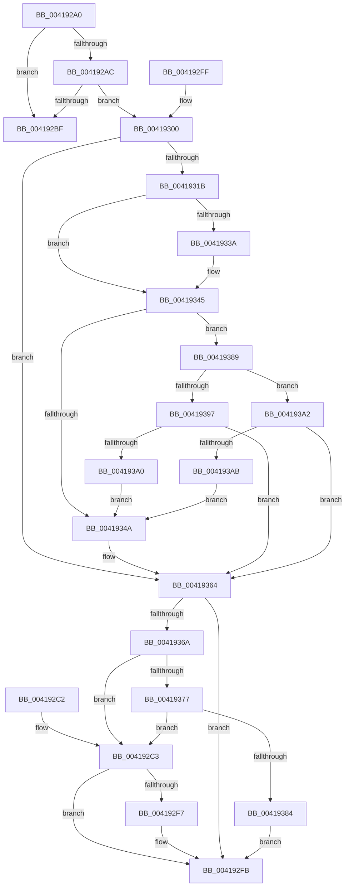

# KiAbTryIncrementIoWaiterCounts

- RVA: `0x004192A0`–`0x004193AD` (길이 `269` bytes)
- VA: `0x00000001404192A0`
- 실행 섹션: `.text`
- PDB 이름 있음: `예`; PDB Function 태그: `아니요`
- unwind 정보 RVA: `0x000DB714`
- 디코드: `73`개 명령, `269/269` bytes 표시
- 미해석 바이트: `0` (있으면 어셈블리에 `.byte`로 보존)

> 이 문서는 커널 이미지의 기계어와 PDB 기호를 분석해 생성했습니다. 4번과 5번은 함수 원형과 자료형을 바이너리 사용 방식에서 추정한 C 해석이며 원본 소스 복구 결과는 아닙니다.

## 1. Dependencies

- 직접 호출 지점: **0**; 고유 호출 대상: **0**
- 직접 호출자로 확인된 함수: **2**
- RIP 상대 이미지 참조: **0**

### Outgoing calls
- 직접 디코드된 call 명령이 없습니다.

### Direct callers
- [KiAbConvertWaiterToOwnerEntry](../21/KiAbConvertWaiterToOwnerEntry_function_00219430.md) at `0x00219777`
- [KiAbForceProcessLockEntry](KiAbForceProcessLockEntry_function_00419078.md) at `0x00419151`

### Static image references
- 디코드된 RIP-relative 메모리 참조가 없습니다.

## 2. Other-region calls and transfers

- 다른 실행 섹션으로 향하는 call: **0**
- 별도 외부 분기/꼬리 이동을 확인하지 못했습니다.

## 3. Assembly (complete function range)

```asm
004192A0  80 79 09 00                     cmp byte ptr [rcx + 9], 0
004192A4  4C 8B D2                        mov r10, rdx
004192A7  4C 8B C1                        mov r8, rcx
004192AA  74 13                           je 0x1404192bf
004192AC  44 0F B6 59 0B                  movzx r11d, byte ptr [rcx + 0xb]
004192B1  4C 8D 49 0B                     lea r9, [rcx + 0xb]
004192B5  41 0F B6 C3                     movzx eax, r11b
004192B9  24 06                           and al, 6
004192BB  3C 06                           cmp al, 6
004192BD  75 41                           jne 0x140419300
004192BF  33 C0                           xor eax, eax
004192C1  C3                              ret
004192C2  CC                              int3
004192C3  41 8B 4A 54                     mov ecx, dword ptr [r10 + 0x54]
004192C7  8D 91 00 01 00 00               lea edx, [rcx + 0x100]
004192CD  33 D1                           xor edx, ecx
004192CF  81 E2 00 7F 00 00               and edx, 0x7f00
004192D5  33 D1                           xor edx, ecx
004192D7  41 89 52 54                     mov dword ptr [r10 + 0x54], edx
004192DB  41 0F B6 09                     movzx ecx, byte ptr [r9]
004192DF  80 C9 04                        or cl, 4
004192E2  41 88 09                        mov byte ptr [r9], cl
004192E5  41 8B 4A 54                     mov ecx, dword ptr [r10 + 0x54]
004192E9  81 E1 00 7F 00 00               and ecx, 0x7f00
004192EF  81 F9 00 01 00 00               cmp ecx, 0x100
004192F5  75 04                           jne 0x1404192fb
004192F7  41 83 C8 02                     or r8d, 2
004192FB  41 8B C0                        mov eax, r8d
004192FE  C3                              ret
004192FF  CC                              int3
00419300  0F B6 41 08                     movzx eax, byte ptr [rcx + 8]
00419304  83 E0 3F                        and eax, 0x3f
00419307  48 6B C8 58                     imul rcx, rax, 0x58
0041930B  4C 2B C1                        sub r8, rcx
0041930E  49 8B 50 F0                     mov rdx, qword ptr [r8 - 0x10]
00419312  45 33 C0                        xor r8d, r8d
00419315  41 F6 C3 02                     test r11b, 2
00419319  75 49                           jne 0x140419364
0041931B  48 8B 8A 20 02 00 00            mov rcx, qword ptr [rdx + 0x220]
00419322  8B 82 A0 05 00 00               mov eax, dword ptr [rdx + 0x5a0]
00419328  C1 E8 09                        shr eax, 9
0041932B  83 E0 07                        and eax, 7
0041932E  48 8B 89 A0 02 00 00            mov rcx, qword ptr [rcx + 0x2a0]
00419335  48 85 C9                        test rcx, rcx
00419338  74 0B                           je 0x140419345
0041933A  8B 89 3C 04 00 00               mov ecx, dword ptr [rcx + 0x43c]
00419340  3B C1                           cmp eax, ecx
00419342  0F 4D C1                        cmovge eax, ecx
00419345  83 F8 02                        cmp eax, 2
00419348  7C 3F                           jl 0x140419389
0041934A  41 FE 42 54                     inc byte ptr [r10 + 0x54]
0041934E  41 0F B6 01                     movzx eax, byte ptr [r9]
00419352  0C 02                           or al, 2
00419354  41 88 01                        mov byte ptr [r9], al
00419357  B8 01 00 00 00                  mov eax, 1
0041935C  41 38 42 54                     cmp byte ptr [r10 + 0x54], al
00419360  44 0F 44 C0                     cmove r8d, eax
00419364  41 F6 01 04                     test byte ptr [r9], 4
00419368  75 91                           jne 0x1404192fb
0041936A  83 BA E8 05 00 00 00            cmp dword ptr [rdx + 0x5e8], 0
00419371  0F 84 4C FF FF FF               je 0x1404192c3
00419377  83 BA E4 05 00 00 00            cmp dword ptr [rdx + 0x5e4], 0
0041937E  0F 85 3F FF FF FF               jne 0x1404192c3
00419384  E9 72 FF FF FF                  jmp 0x1404192fb
00419389  65 48 8B 04 25 88 01 00 00      mov rax, qword ptr gs:[0x188]
00419392  48 3B D0                        cmp rdx, rax
00419395  75 0B                           jne 0x1404193a2
00419397  44 39 82 E0 05 00 00            cmp dword ptr [rdx + 0x5e0], r8d
0041939E  74 C4                           je 0x140419364
004193A0  EB A8                           jmp 0x14041934a
004193A2  44 39 82 E0 05 00 00            cmp dword ptr [rdx + 0x5e0], r8d
004193A9  74 B9                           je 0x140419364
004193AB  EB 9D                           jmp 0x14041934a
```

## 4. C-style interpretation (structured pseudocode)

```c
__int64 __fastcall KiAbTryIncrementIoWaiterCounts(__int64 a1, __int64 a2)
{
    __int64 result;

    if ((*(unsigned __int8 *)(a1 + 9)) == 0) goto loc_004192BF;
    result = (unsigned __int8)(((unsigned __int8)(*(unsigned __int8 *)(a1 + 11))) & (6));
    if (((unsigned __int8)(result)) != 6) goto loc_00419300;
loc_004192BF:
    result = 0;
    return result;
loc_004192C3:
    a2 = (unsigned int)(((unsigned int)(*(unsigned int *)(a2 + 84)) + 256) ^ ((unsigned int)((unsigned int)(*(unsigned int *)(a2 + 84)))));
    a2 = (unsigned int)((a2) & (0x7F00ULL));
    a2 = (unsigned int)((a2) ^ ((unsigned int)((unsigned int)(*(unsigned int *)(a2 + 84)))));
    *(unsigned int *)(a2 + 84) = (unsigned int)(a2);
    a1 = (unsigned __int8)((*(unsigned __int8 *)(a1 + 11)) | (4));
    *(unsigned __int8 *)(a1 + 11) = (unsigned __int8)(a1);
    a1 = (unsigned int)(((unsigned int)(*(unsigned int *)(a2 + 84))) & (0x7F00ULL));
    if (((unsigned int)(a1)) == 256) {
        a3 = (unsigned int)((a1) | (2));
    }
    return (unsigned int)((unsigned int)(a3));
loc_00419300:
    result = (unsigned int)((*(unsigned __int8 *)(a1 + 8)) & (63));
    a1 = (a1) * (result);
    a3 = (a3) - (a1);
    a3 = 0;
    if ((((unsigned __int8)(*(unsigned __int8 *)(a1 + 11))) & (2)) != 0) goto loc_00419364;
    result = (unsigned int)(((unsigned int)(*(unsigned int *)(*(unsigned __int64 *)(a3 - 16) + 1440))) >> (9));
    result = (unsigned int)((result) & (7));
    if (*(unsigned __int64 *)(*(unsigned __int64 *)(*(unsigned __int64 *)(a3 - 16) + 544) + 672) != 0) {
        a1 = *(unsigned int *)(*(unsigned __int64 *)(*(unsigned __int64 *)(*(unsigned __int64 *)(a3 - 16) + 544) + 672) + 1084);
        if (((unsigned int)(result)) >= ((unsigned int)(a1))) { result = (unsigned int)(a1); }
    }
    if (((unsigned int)(result)) < 2) goto loc_00419389;
loc_0041934A:
    result = (unsigned __int8)((*(unsigned __int8 *)(a1 + 11)) | (2));
    *(unsigned __int8 *)(a1 + 11) = (unsigned __int8)(result);
    if ((*(unsigned __int8 *)(a2 + 84)) == 1) { a3 = 1; }
loc_00419364:
    if (((*(unsigned __int8 *)(a1 + 11)) & (4)) != 0) goto loc_004192FB;
    if ((*(unsigned int *)(*(unsigned __int64 *)(a3 - 16) + 1512)) == 0) goto loc_004192C3;
    if ((*(unsigned int *)(*(unsigned __int64 *)(a3 - 16) + 1508)) != 0) goto loc_004192C3;
    goto loc_004192FB;
loc_00419389:
    if ((*(unsigned __int64 *)(a3 - 16)) != (*(unsigned __int64 *)(gs_base + (0 + 392)))) goto loc_004193A2;
    if ((*(unsigned int *)(*(unsigned __int64 *)(a3 - 16) + 1504)) == ((unsigned int)(a3))) goto loc_00419364;
    goto loc_0041934A;
loc_004193A2:
    if ((*(unsigned int *)(*(unsigned __int64 *)(a3 - 16) + 1504)) == ((unsigned int)(a3))) goto loc_00419364;
    goto loc_0041934A;
}
```

## 5. (Beta) C Style

```c
int64_t KiAbTryIncrementIoWaiterCounts(void *Arg1, void *Arg2)
{
    uint8_t *arg1 = (uint8_t *)Arg1;
    uint8_t *arg2 = (uint8_t *)Arg2;

    int64_t result;

    if ((*(uint8_t *)(arg1 + 0x9)) == 0) goto loc_004192BF;
    result = (uint8_t)(((uint8_t)(*(uint8_t *)(arg1 + 0xB))) & (6));
    if (((uint8_t)(result)) != 6) goto loc_00419300;
loc_004192BF:
    result = 0;
    return result;
loc_004192C3:
    Arg2 = (uint32_t)(((uint32_t)(*(uint32_t *)(arg2 + 0x54)) + 256) ^ ((uint32_t)((uint32_t)(*(uint32_t *)(arg2 + 0x54)))));
    Arg2 = (uint32_t)((Arg2) & (0x7F00ULL));
    Arg2 = (uint32_t)((Arg2) ^ ((uint32_t)((uint32_t)(*(uint32_t *)(arg2 + 0x54)))));
    *(uint32_t *)(arg2 + 0x54) = (uint32_t)(Arg2);
    Arg1 = (uint8_t)((*(uint8_t *)(arg1 + 0xB)) | (4));
    *(uint8_t *)(arg1 + 0xB) = (uint8_t)(Arg1);
    Arg1 = (uint32_t)(((uint32_t)(*(uint32_t *)(arg2 + 0x54))) & (0x7F00ULL));
    if (((uint32_t)(Arg1)) == 256) {
        a3 = (uint32_t)((Arg1) | (2));
    }
    return (uint32_t)((uint32_t)(a3));
loc_00419300:
    result = (uint32_t)((*(uint8_t *)(arg1 + 0x8)) & (63));
    Arg1 = (Arg1) * (result);
    a3 = (a3) - (Arg1);
    a3 = 0;
    if ((((uint8_t)(*(uint8_t *)(arg1 + 0xB))) & (2)) != 0) goto loc_00419364;
    result = (uint32_t)(((uint32_t)(*(uint32_t *)(*(uint64_t *)(a3 - 0x10) + 0x5A0))) >> (9));
    result = (uint32_t)((result) & (7));
    if (*(uint64_t *)(*(uint64_t *)(*(uint64_t *)(a3 - 0x10) + 0x220) + 0x2A0) != 0) {
        Arg1 = *(uint32_t *)(*(uint64_t *)(*(uint64_t *)(*(uint64_t *)(a3 - 0x10) + 0x220) + 0x2A0) + 0x43C);
        if (((uint32_t)(result)) >= ((uint32_t)(Arg1))) { result = (uint32_t)(Arg1); }
    }
    if (((uint32_t)(result)) < 2) goto loc_00419389;
loc_0041934A:
    result = (uint8_t)((*(uint8_t *)(arg1 + 0xB)) | (2));
    *(uint8_t *)(arg1 + 0xB) = (uint8_t)(result);
    if ((*(uint8_t *)(arg2 + 0x54)) == 1) { a3 = 1; }
loc_00419364:
    if (((*(uint8_t *)(arg1 + 0xB)) & (4)) != 0) goto loc_004192FB;
    if ((*(uint32_t *)(*(uint64_t *)(a3 - 0x10) + 0x5E8)) == 0) goto loc_004192C3;
    if ((*(uint32_t *)(*(uint64_t *)(a3 - 0x10) + 0x5E4)) != 0) goto loc_004192C3;
    goto loc_004192FB;
loc_00419389:
    if ((*(uint64_t *)(a3 - 0x10)) != (*(uint64_t *)(gs_base + (0 + 0x188)))) goto loc_004193A2;
    if ((*(uint32_t *)(*(uint64_t *)(a3 - 0x10) + 0x5E0)) == ((uint32_t)(a3))) goto loc_00419364;
    goto loc_0041934A;
loc_004193A2:
    if ((*(uint32_t *)(*(uint64_t *)(a3 - 0x10) + 0x5E0)) == ((uint32_t)(a3))) goto loc_00419364;
    goto loc_0041934A;
}
```

### 관측된 메모리 오프셋

구조체 형식이 확인되지 않은 접근은 인자 기준의 오프셋으로만 기록했습니다.

| 기준 인자 | 오프셋 표현 | 폭 (bit) | 접근 |
|---|---:|---:|---|
| `Arg1` | `- 0x10` | `64` | `R` |
| `Arg1` | `+ 0x0` | `8` | `R` |
| `Arg1` | `+ 0x0` | `8` | `W` |
| `Arg1` | `+ 0x8` | `8` | `R` |
| `Arg1` | `+ 0x9` | `8` | `R` |
| `Arg1` | `+ 0xB` | `8` | `R` |
| `Arg1` | `+ 0xB` | `64` | `R` |
| `Arg2` | `+ 0x54` | `8` | `R` |
| `Arg2` | `+ 0x54` | `8` | `R/W` |
| `Arg2` | `+ 0x54` | `32` | `R` |
| `Arg2` | `+ 0x54` | `32` | `W` |

## 6. Execution-region graph

[열기: 2D/3D 그래프와 함수 탐색 컨트롤 패널](../../../control-panel.html?section=text&rva=0x004192A0&view=graph)

- 2D 그래프는 위에서 아래로 흐르고, 3D 그래프는 빈 공간을 드래그해 회전합니다. Shift+드래그는 이동, 휠은 확대·축소, 함수 노드 선택은 대상 보고서 이동입니다.

### Static fallback


