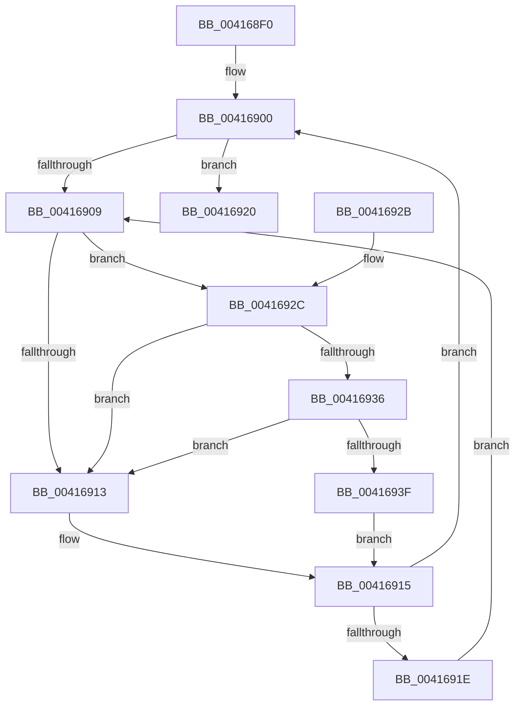

# KiAcquirePrcbLock

- RVA: `0x004168F0`–`0x00416948` (길이 `88` bytes)
- VA: `0x00000001404168F0`
- 실행 섹션: `.text`
- PDB 이름 있음: `예`; PDB Function 태그: `아니요`
- unwind 정보 RVA: `0x0005D394`
- 디코드: `30`개 명령, `88/88` bytes 표시
- 미해석 바이트: `0` (있으면 어셈블리에 `.byte`로 보존)

> 이 문서는 커널 이미지의 기계어와 PDB 기호를 분석해 생성했습니다. 4번과 5번은 함수 원형과 자료형을 바이너리 사용 방식에서 추정한 C 해석이며 원본 소스 복구 결과는 아닙니다.

## 1. Dependencies

- 직접 호출 지점: **2**; 고유 호출 대상: **2**
- 직접 호출자로 확인된 함수: **1**
- RIP 상대 이미지 참조: **2**

### Outgoing calls
- `0x00416936` → [KiCheckVpBackingLongSpinWaitHypercall](../30/KiCheckVpBackingLongSpinWaitHypercall_function_0030F490.md) (function, `0x0030F490`)
- `0x00416941` → [HvlNotifyLongSpinWait](../30/HvlNotifyLongSpinWait_function_0030F460.md) (function, `0x0030F460`)

### Direct callers
- [KiIdleLoop](../6B/KiIdleLoop_function_006B2910.md) at `0x006B29E1`

### Static image references
- `0x0041690B` → RVA `0x00FC52AC` (`ALMOSTRO`; reference)
- `0x0041692C` → RVA `0x00FC6AB8` (`ALMOSTRO`; read)

## 2. Other-region calls and transfers

- 다른 실행 섹션으로 향하는 call: **0**
- 별도 외부 분기/꼬리 이동을 확인하지 못했습니다.

## 3. Assembly (complete function range)

```asm
004168F0  48 89 5C 24 08                  mov qword ptr [rsp + 8], rbx
004168F5  57                              push rdi
004168F6  48 83 EC 20                     sub rsp, 0x20
004168FA  48 8B D9                        mov rbx, rcx
004168FD  33 FF                           xor edi, edi
004168FF  90                              nop
00416900  F0 48 0F BA 6B 30 00            lock bts qword ptr [rbx + 0x30], 0
00416907  73 17                           jae 0x140416920
00416909  FF C7                           inc edi
0041690B  85 3D 9B E9 BA 00               test dword ptr [rip + 0xbae99b], edi
00416911  74 19                           je 0x14041692c
00416913  F3 90                           pause
00416915  48 8B 43 30                     mov rax, qword ptr [rbx + 0x30]
00416919  48 85 C0                        test rax, rax
0041691C  74 E2                           je 0x140416900
0041691E  EB E9                           jmp 0x140416909
00416920  48 8B 5C 24 30                  mov rbx, qword ptr [rsp + 0x30]
00416925  48 83 C4 20                     add rsp, 0x20
00416929  5F                              pop rdi
0041692A  C3                              ret
0041692B  CC                              int3
0041692C  8B 05 86 01 BB 00               mov eax, dword ptr [rip + 0xbb0186]
00416932  A8 40                           test al, 0x40
00416934  74 DD                           je 0x140416913
00416936  E8 55 8B EF FF                  call 0x14030f490
0041693B  84 C0                           test al, al
0041693D  74 D4                           je 0x140416913
0041693F  8B CF                           mov ecx, edi
00416941  E8 1A 8B EF FF                  call 0x14030f460
00416946  EB CD                           jmp 0x140416915
```

## 4. C-style interpretation (structured pseudocode)

```c
__int64 __fastcall KiAcquirePrcbLock(__int64 a1)
{
    __int64 result;
    __int64 v_rdi;
    __int64 v_rsp;
    unsigned __int64 v_stack_p8;

    v_stack_p8 = v_rbx;
    v_rsp = (v_rsp) - (32);
    v_rdi = 0;
loc_00416900:
    if (condition_is_above_or_equal) goto loc_00416920;
loc_00416909:
    v_rdi = (unsigned int)((v_rdi) + 1);
    if (((*(unsigned int *)(v_rip + 12249499)) & ((unsigned int)(v_rdi))) == 0) goto loc_0041692C;
loc_00416913:
loc_00416915:
    if (*(unsigned __int64 *)(a1 + 48) == 0) goto loc_00416900;
    goto loc_00416909;
loc_00416920:
    v_rsp = (v_rsp) + (32);
    return *(unsigned __int64 *)(a1 + 48);
loc_0041692C:
    if ((((unsigned __int8)((unsigned int)(*(unsigned int *)(v_rip + 12255622)))) & (64)) == 0) goto loc_00416913;
    result = KiCheckVpBackingLongSpinWaitHypercall(a1, a2, a3, a4);
    if ((unsigned __int8)(result) == 0) goto loc_00416913;
    result = HvlNotifyLongSpinWait((unsigned int)((unsigned int)(v_rdi)), a2, a3, a4);
    goto loc_00416915;
}
```

## 5. (Beta) C Style

```c
int64_t KiAcquirePrcbLock(void *Arg1)
{
    uint8_t *arg1 = (uint8_t *)Arg1;

    int64_t result;
    int64_t local_rdi;
    int64_t local_rsp;
    uint64_t v_stack_p8;

    v_stack_p8 = local_rbx;
    local_rsp = (local_rsp) - (32);
    local_rdi = 0;
loc_00416900:
    if (condition_is_above_or_equal) goto loc_00416920;
loc_00416909:
    local_rdi = (uint32_t)((local_rdi) + 1);
    if (((*(uint32_t *)(v_rip + 0xBAE99B)) & ((uint32_t)(local_rdi))) == 0) goto loc_0041692C;
loc_00416913:
loc_00416915:
    if (*(uint64_t *)(arg1 + 0x30) == 0) goto loc_00416900;
    goto loc_00416909;
loc_00416920:
    local_rsp = (local_rsp) + (32);
    return *(uint64_t *)(arg1 + 0x30);
loc_0041692C:
    if ((((uint8_t)((uint32_t)(*(uint32_t *)(v_rip + 0xBB0186)))) & (64)) == 0) goto loc_00416913;
    result = KiCheckVpBackingLongSpinWaitHypercall(Arg1, a2, a3, a4);
    if ((uint8_t)(result) == 0) goto loc_00416913;
    result = HvlNotifyLongSpinWait((uint32_t)((uint32_t)(local_rdi)), a2, a3, a4);
    goto loc_00416915;
}
```

### 관측된 메모리 오프셋

구조체 형식이 확인되지 않은 접근은 인자 기준의 오프셋으로만 기록했습니다.

| 기준 인자 | 오프셋 표현 | 폭 (bit) | 접근 |
|---|---:|---:|---|
| `Arg1` | `+ 0x30` | `64` | `R` |
| `Arg1` | `+ 0x30` | `64` | `R/W` |

## 6. Execution-region graph

[열기: 2D/3D 그래프와 함수 탐색 컨트롤 패널](../../../control-panel.html?section=text&rva=0x004168F0&view=graph)

- 2D 그래프는 위에서 아래로 흐르고, 3D 그래프는 빈 공간을 드래그해 회전합니다. Shift+드래그는 이동, 휠은 확대·축소, 함수 노드 선택은 대상 보고서 이동입니다.

### Static fallback


