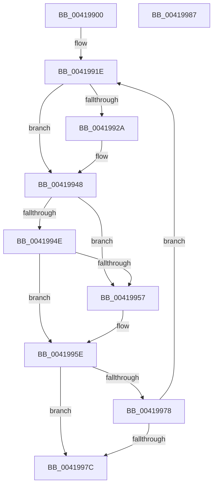

# KiAttemptFastRemoveQueue

- RVA: `0x00419900`–`0x00419988` (길이 `136` bytes)
- VA: `0x0000000140419900`
- 실행 섹션: `.text`
- PDB 이름 있음: `예`; PDB Function 태그: `아니요`
- unwind 정보 RVA: `0x0006E5F8`
- 디코드: `44`개 명령, `136/136` bytes 표시
- 미해석 바이트: `0` (있으면 어셈블리에 `.byte`로 보존)

> 이 문서는 커널 이미지의 기계어와 PDB 기호를 분석해 생성했습니다. 4번과 5번은 함수 원형과 자료형을 바이너리 사용 방식에서 추정한 C 해석이며 원본 소스 복구 결과는 아닙니다.

## 1. Dependencies

- 직접 호출 지점: **1**; 고유 호출 대상: **1**
- 직접 호출자로 확인된 함수: **1**
- RIP 상대 이미지 참조: **1**

### Outgoing calls
- `0x00419942` → [KeBugCheckEx](../4F/KeBugCheckEx_function_004FD660.md) (function, `0x004FD660`)

### Direct callers
- [sub_0020C2D4](../20/Unknown_function_0020C2D4.md) at `0x0020C651`

### Static image references
- `0x00419931` → RVA `0x00EFAAB8` (`.data`; read)

## 2. Other-region calls and transfers

- 다른 실행 섹션으로 향하는 call: **0**
- 별도 외부 분기/꼬리 이동을 확인하지 못했습니다.

## 3. Assembly (complete function range)

```asm
00419900  48 89 5C 24 08                  mov qword ptr [rsp + 8], rbx
00419905  57                              push rdi
00419906  48 83 EC 30                     sub rsp, 0x30
0041990A  33 FF                           xor edi, edi
0041990C  4C 8D 49 18                     lea r9, [rcx + 0x18]
00419910  4C 8B DA                        mov r11, rdx
00419913  8B C7                           mov eax, edi
00419915  49 8B 11                        mov rdx, qword ptr [r9]
00419918  41 8B D8                        mov ebx, r8d
0041991B  4C 8B D1                        mov r10, rcx
0041991E  41 FF 4A 04                     dec dword ptr [r10 + 4]
00419922  4C 8B 02                        mov r8, qword ptr [rdx]
00419925  4D 85 C0                        test r8, r8
00419928  75 1E                           jne 0x140419948
0041992A  48 8B 42 10                     mov rax, qword ptr [rdx + 0x10]
0041992E  4D 8B C2                        mov r8, r10
00419931  4C 8B 0D 80 11 AE 00            mov r9, qword ptr [rip + 0xae1180]
00419938  B9 96 00 00 00                  mov ecx, 0x96
0041993D  48 89 44 24 20                  mov qword ptr [rsp + 0x20], rax
00419942  E8 19 3D 0E 00                  call 0x1404fd660
00419947  CC                              int3
00419948  49 39 50 08                     cmp qword ptr [r8 + 8], rdx
0041994C  75 09                           jne 0x140419957
0041994E  48 8B 4A 08                     mov rcx, qword ptr [rdx + 8]
00419952  48 39 11                        cmp qword ptr [rcx], rdx
00419955  74 07                           je 0x14041995e
00419957  B9 03 00 00 00                  mov ecx, 3
0041995C  CD 29                           int 0x29
0041995E  4C 89 01                        mov qword ptr [rcx], r8
00419961  49 89 48 08                     mov qword ptr [r8 + 8], rcx
00419965  8B C8                           mov ecx, eax
00419967  FF C0                           inc eax
00419969  48 89 3A                        mov qword ptr [rdx], rdi
0041996C  49 89 14 CB                     mov qword ptr [r11 + rcx*8], rdx
00419970  49 8B 11                        mov rdx, qword ptr [r9]
00419973  49 3B D1                        cmp rdx, r9
00419976  74 04                           je 0x14041997c
00419978  3B C3                           cmp eax, ebx
0041997A  72 A2                           jb 0x14041991e
0041997C  48 8B 5C 24 40                  mov rbx, qword ptr [rsp + 0x40]
00419981  48 83 C4 30                     add rsp, 0x30
00419985  5F                              pop rdi
00419986  C3                              ret
00419987  CC                              int3
```

## 4. C-style interpretation (structured pseudocode)

```c
__int64 __fastcall KiAttemptFastRemoveQueue(__int64 a1, __int64 a2, int a3)
{
    __int64 result;
    __int64 v_rdi;
    __int64 v_rsp;
    unsigned __int64 v_stack_m18;
    unsigned __int64 v_stack_p8;

    v_stack_p8 = v_rbx;
    v_rsp = (v_rsp) - (48);
    v_rdi = 0;
loc_0041991E:
    result = 0;
    if (*(unsigned __int64 *)(*(unsigned __int64 *)(a1 + 24)) == 0) {
        result = *(unsigned __int64 *)(*(unsigned __int64 *)(a1 + 24) + 16);
        a3 = a1;
        a4 = *(unsigned __int64 *)(v_rip + 11407744);
        a1 = 150;
        v_stack_m18 = result;
        result = KeBugCheckEx(a1, *(unsigned __int64 *)(a1 + 24), a3, a4);
    }
    if ((*(unsigned __int64 *)(a3 + 8)) != (*(unsigned __int64 *)(a1 + 24))) goto loc_00419957;
    if ((*(unsigned __int64 *)(*(unsigned __int64 *)(*(unsigned __int64 *)(a1 + 24) + 8))) != (*(unsigned __int64 *)(a1 + 24))) {
        a1 = 3;
    }
    *(unsigned __int64 *)(a1) = a3;
    *(unsigned __int64 *)(a3 + 8) = a1;
    result = (unsigned int)((result) + 1);
    *(unsigned __int64 *)(*(unsigned __int64 *)(a1 + 24)) = 0;
    *(unsigned __int64 *)(a2 + (unsigned int)((unsigned int)(result)) * 8) = *(unsigned __int64 *)(a1 + 24);
    if ((*(unsigned __int64 *)(a4)) == a4) goto loc_0041997C;
    if (((unsigned int)(result)) < ((unsigned int)((unsigned int)(a3)))) goto loc_0041991E;
loc_0041997C:
    v_rsp = (v_rsp) + (48);
    return result;
}
```

## 5. (Beta) C Style

```c
int64_t KiAttemptFastRemoveQueue(void *Arg1, int64_t Arg2, int32_t Arg3)
{
    uint8_t *arg1 = (uint8_t *)Arg1;

    int64_t result;
    int64_t local_rdi;
    int64_t local_rsp;
    uint64_t v_stack_m18;
    uint64_t v_stack_p8;

    v_stack_p8 = local_rbx;
    local_rsp = (local_rsp) - (48);
    local_rdi = 0;
loc_0041991E:
    result = 0;
    if (*(uint64_t *)(*(uint64_t *)(arg1 + 0x18)) == 0) {
        result = *(uint64_t *)(*(uint64_t *)(arg1 + 0x18) + 0x10);
        Arg3 = Arg1;
        a4 = *(uint64_t *)(v_rip + 0xAE1180);
        Arg1 = 150;
        v_stack_m18 = result;
        result = KeBugCheckEx(Arg1, *(uint64_t *)(arg1 + 0x18), Arg3, a4);
    }
    if ((*(uint64_t *)(Arg3 + 0x8)) != (*(uint64_t *)(arg1 + 0x18))) goto loc_00419957;
    if ((*(uint64_t *)(*(uint64_t *)(*(uint64_t *)(arg1 + 0x18) + 0x8))) != (*(uint64_t *)(arg1 + 0x18))) {
        Arg1 = 3;
    }
    *(uint64_t *)(arg1) = Arg3;
    *(void **)(Arg3 + 0x8) = Arg1;
    result = (uint32_t)((result) + 1);
    *(uint64_t *)(*(uint64_t *)(arg1 + 0x18)) = 0;
    *(uint64_t *)(Arg2 + (uint32_t)((uint32_t)(result)) * 8) = *(uint64_t *)(arg1 + 0x18);
    if ((*(uint64_t *)(a4)) == a4) goto loc_0041997C;
    if (((uint32_t)(result)) < ((uint32_t)((uint32_t)(Arg3)))) goto loc_0041991E;
loc_0041997C:
    local_rsp = (local_rsp) + (48);
    return result;
}
```

### 관측된 메모리 오프셋

구조체 형식이 확인되지 않은 접근은 인자 기준의 오프셋으로만 기록했습니다.

| 기준 인자 | 오프셋 표현 | 폭 (bit) | 접근 |
|---|---:|---:|---|
| `Arg1` | `+ 0x0` | `64` | `R` |
| `Arg1` | `+ 0x18` | `64` | `R` |

## 6. Execution-region graph

[열기: 2D/3D 그래프와 함수 탐색 컨트롤 패널](../../../control-panel.html?section=text&rva=0x00419900&view=graph)

- 2D 그래프는 위에서 아래로 흐르고, 3D 그래프는 빈 공간을 드래그해 회전합니다. Shift+드래그는 이동, 휠은 확대·축소, 함수 노드 선택은 대상 보고서 이동입니다.

### Static fallback


