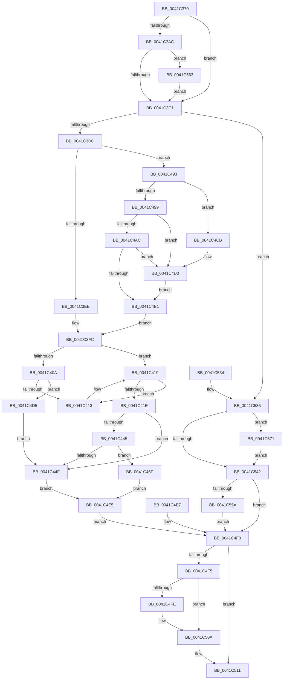

# KiContinueEx

- RVA: `0x0041C370`–`0x0041C57B` (길이 `523` bytes)
- VA: `0x000000014041C370`
- 실행 섹션: `.text`
- PDB 이름 있음: `예`; PDB Function 태그: `아니요`
- unwind 정보 RVA: `0x0009D7CC`
- 디코드: `137`개 명령, `523/523` bytes 표시
- 미해석 바이트: `0` (있으면 어셈블리에 `.byte`로 보존)

> 이 문서는 커널 이미지의 기계어와 PDB 기호를 분석해 생성했습니다. 4번과 5번은 함수 원형과 자료형을 바이너리 사용 방식에서 추정한 C 해석이며 원본 소스 복구 결과는 아닙니다.

## 1. Dependencies

- 직접 호출 지점: **9**; 고유 호출 대상: **7**
- 직접 호출자로 확인된 함수: **1**
- RIP 상대 이미지 참조: **1**

### Outgoing calls
- `0x0041C413` → [ExRaiseDatatypeMisalignment](../../page/89/ExRaiseDatatypeMisalignment_function_00899FD0.md) (function, `0x00899FD0`)
- `0x0041C439` → [KeTestAlertThread](KeTestAlertThread_function_0041C590.md) (function, `0x0041C590`)
- `0x0041C45B` → [KiContinuePreviousModeUser](../2F/KiContinuePreviousModeUser_function_002F9B10.md) (function, `0x002F9B10`)
- `0x0041C484` → [KiDeliverApc](../25/KiDeliverApc_function_00250F20.md) (function, `0x00250F20`)
- `0x0041C4CB` → [ExRaiseDatatypeMisalignment](../../page/89/ExRaiseDatatypeMisalignment_function_00899FD0.md) (function, `0x00899FD0`)
- `0x0041C505` → [KiLowerIrqlProcessIrqlFlags](../4F/KiLowerIrqlProcessIrqlFlags_function_004F5698.md) (function, `0x004F5698`)
- `0x0041C550` → [KeContextToKframes](../4F/KeContextToKframes_function_004FD790.md) (function, `0x004FD790`)
- `0x0041C55C` → [KeTestAlertThread](KeTestAlertThread_function_0041C590.md) (function, `0x0041C590`)
- `0x0041C567` → [KiRaiseIrqlProcessIrqlFlags](../4F/KiRaiseIrqlProcessIrqlFlags_function_004F56FC.md) (function, `0x004F56FC`)

### Direct callers
- [NtContinueEx](../6B/NtContinueEx_function_006B10D0.md) at `0x006B1151`

### Static image references
- `0x0041C3B4` → RVA `0x00FC6D20` (`ALMOSTRO`; read)

## 2. Other-region calls and transfers

- 다른 실행 섹션으로 향하는 call: **2**
  - `0x0041C413` → [ExRaiseDatatypeMisalignment](../../page/89/ExRaiseDatatypeMisalignment_function_00899FD0.md) (`.text` → `PAGE`)
  - `0x0041C4CB` → [ExRaiseDatatypeMisalignment](../../page/89/ExRaiseDatatypeMisalignment_function_00899FD0.md) (`.text` → `PAGE`)
- 별도 외부 분기/꼬리 이동을 확인하지 못했습니다.

## 3. Assembly (complete function range)

```asm
0041C370  48 89 5C 24 08                  mov qword ptr [rsp + 8], rbx
0041C375  48 89 74 24 10                  mov qword ptr [rsp + 0x10], rsi
0041C37A  48 89 7C 24 18                  mov qword ptr [rsp + 0x18], rdi
0041C37F  4C 89 64 24 20                  mov qword ptr [rsp + 0x20], r12
0041C384  41 55                           push r13
0041C386  41 56                           push r14
0041C388  41 57                           push r15
0041C38A  48 83 EC 40                     sub rsp, 0x40
0041C38E  4D 8B E9                        mov r13, r9
0041C391  4D 8B E0                        mov r12, r8
0041C394  48 8B FA                        mov rdi, rdx
0041C397  4C 8B F9                        mov r15, rcx
0041C39A  44 0F 20 C3                     mov rbx, cr8
0041C39E  88 5C 24 32                     mov byte ptr [rsp + 0x32], bl
0041C3A2  BE 01 00 00 00                  mov esi, 1
0041C3A7  40 3A DE                        cmp bl, sil
0041C3AA  73 15                           jae 0x14041c3c1
0041C3AC  44 0F 20 C1                     mov rcx, cr8
0041C3B0  44 0F 22 C6                     mov cr8, rsi
0041C3B4  83 3D 65 A9 BA 00 00            cmp dword ptr [rip + 0xbaa965], 0
0041C3BB  0F 85 A2 01 00 00               jne 0x14041c563
0041C3C1  89 74 24 34                     mov dword ptr [rsp + 0x34], esi
0041C3C5  65 4C 8B 34 25 88 01 00 00      mov r14, qword ptr gs:[0x188]
0041C3CE  41 80 BE 32 02 00 00 00         cmp byte ptr [r14 + 0x232], 0
0041C3D6  0F 84 59 01 00 00               je 0x14041c535
0041C3DC  C6 44 24 30 00                  mov byte ptr [rsp + 0x30], 0
0041C3E1  48 81 FF FF 00 00 00            cmp rdi, 0xff
0041C3E8  0F 87 A5 00 00 00               ja 0x14041c493
0041C3EE  40 0F B6 CF                     movzx ecx, dil
0041C3F2  48 BA 00 00 FF FF FF 7F 00 00   movabs rdx, 0x7fffffff0000
0041C3FC  88 4C 24 31                     mov byte ptr [rsp + 0x31], cl
0041C400  49 8B C7                        mov rax, r15
0041C403  83 E0 0F                        and eax, 0xf
0041C406  84 C9                           test cl, cl
0041C408  75 0F                           jne 0x14041c419
0041C40A  48 85 C0                        test rax, rax
0041C40D  0F 84 C2 00 00 00               je 0x14041c4d5
0041C413  E8 B8 DB 47 00                  call 0x140899fd0
0041C418  CC                              int3
0041C419  48 85 C0                        test rax, rax
0041C41C  75 F5                           jne 0x14041c413
0041C41E  4C 3B FA                        cmp r15, rdx
0041C421  49 0F 42 D7                     cmovb rdx, r15
0041C425  0F B6 02                        movzx eax, byte ptr [rdx]
0041C428  88 02                           mov byte ptr [rdx], al
0041C42A  0F B6 82 CF 04 00 00            movzx eax, byte ptr [rdx + 0x4cf]
0041C431  88 82 CF 04 00 00               mov byte ptr [rdx + 0x4cf], al
0041C437  B1 01                           mov cl, 1
0041C439  E8 52 01 00 00                  call 0x14041c590
0041C43E  80 7C 24 30 00                  cmp byte ptr [rsp + 0x30], 0
0041C443  74 0A                           je 0x14041c44f
0041C445  41 F6 86 C2 00 00 00 02         test byte ptr [r14 + 0xc2], 2
0041C44D  75 20                           jne 0x14041c46f
0041C44F  4C 8B CF                        mov r9, rdi
0041C452  4D 8B C5                        mov r8, r13
0041C455  49 8B D4                        mov rdx, r12
0041C458  49 8B CF                        mov rcx, r15
0041C45B  E8 B0 D6 ED FF                  call 0x1402f9b10
0041C460  89 44 24 34                     mov dword ptr [rsp + 0x34], eax
0041C464  85 C0                           test eax, eax
0041C466  0F 49 C6                        cmovns eax, esi
0041C469  89 44 24 34                     mov dword ptr [rsp + 0x34], eax
0041C46D  EB 76                           jmp 0x14041c4e5
0041C46F  4D 89 BD D0 00 00 00            mov qword ptr [r13 + 0xd0], r15
0041C476  4D 89 A5 60 01 00 00            mov qword ptr [r13 + 0x160], r12
0041C47D  4D 8B C5                        mov r8, r13
0041C480  33 D2                           xor edx, edx
0041C482  B1 01                           mov cl, 1
0041C484  E8 97 4A E3 FF                  call 0x140250f20
0041C489  C7 44 24 34 00 00 00 00         mov dword ptr [rsp + 0x34], 0
0041C491  EB 52                           jmp 0x14041c4e5
0041C493  40 F6 C7 07                     test dil, 7
0041C497  75 32                           jne 0x14041c4cb
0041C499  48 8D 47 18                     lea rax, [rdi + 0x18]
0041C49D  48 BA 00 00 FF FF FF 7F 00 00   movabs rdx, 0x7fffffff0000
0041C4A7  48 3B C2                        cmp rax, rdx
0041C4AA  77 24                           ja 0x14041c4d0
0041C4AC  48 3B C7                        cmp rax, rdi
0041C4AF  72 1F                           jb 0x14041c4d0
0041C4B1  8B 47 04                        mov eax, dword ptr [rdi + 4]
0041C4B4  89 44 24 38                     mov dword ptr [rsp + 0x38], eax
0041C4B8  0F B6 C8                        movzx ecx, al
0041C4BB  80 E1 01                        and cl, 1
0041C4BE  D1 E8                           shr eax, 1
0041C4C0  24 01                           and al, 1
0041C4C2  88 44 24 30                     mov byte ptr [rsp + 0x30], al
0041C4C6  E9 31 FF FF FF                  jmp 0x14041c3fc
0041C4CB  E8 00 DB 47 00                  call 0x140899fd0
0041C4D0  0F B6 02                        movzx eax, byte ptr [rdx]
0041C4D3  EB DC                           jmp 0x14041c4b1
0041C4D5  4C 3B FA                        cmp r15, rdx
0041C4D8  49 0F 42 D7                     cmovb rdx, r15
0041C4DC  90                              nop
0041C4DD  0F B6 02                        movzx eax, byte ptr [rdx]
0041C4E0  E9 6A FF FF FF                  jmp 0x14041c44f
0041C4E5  EB 09                           jmp 0x14041c4f0
0041C4E7  89 44 24 34                     mov dword ptr [rsp + 0x34], eax
0041C4EB  0F B6 5C 24 32                  movzx ebx, byte ptr [rsp + 0x32]
0041C4F0  80 FB 01                        cmp bl, 1
0041C4F3  73 1C                           jae 0x14041c511
0041C4F5  83 3D 24 A8 BA 00 00            cmp dword ptr [rip + 0xbaa824], 0
0041C4FC  74 0C                           je 0x14041c50a
0041C4FE  44 0F 20 C1                     mov rcx, cr8
0041C502  0F B6 D3                        movzx edx, bl
0041C505  E8 8E 91 0D 00                  call 0x1404f5698
0041C50A  0F B6 C3                        movzx eax, bl
0041C50D  44 0F 22 C0                     mov cr8, rax
0041C511  8B 44 24 34                     mov eax, dword ptr [rsp + 0x34]
0041C515  48 8B 5C 24 60                  mov rbx, qword ptr [rsp + 0x60]
0041C51A  48 8B 74 24 68                  mov rsi, qword ptr [rsp + 0x68]
0041C51F  48 8B 7C 24 70                  mov rdi, qword ptr [rsp + 0x70]
0041C524  4C 8B 64 24 78                  mov r12, qword ptr [rsp + 0x78]
0041C529  48 83 C4 40                     add rsp, 0x40
0041C52D  41 5F                           pop r15
0041C52F  41 5E                           pop r14
0041C531  41 5D                           pop r13
0041C533  C3                              ret
0041C534  CC                              int3
0041C535  45 8B 4F 30                     mov r9d, dword ptr [r15 + 0x30]
0041C539  48 81 FF FF 00 00 00            cmp rdi, 0xff
0041C540  77 2F                           ja 0x14041c571
0041C542  C6 44 24 20 00                  mov byte ptr [rsp + 0x20], 0
0041C547  4D 8B C7                        mov r8, r15
0041C54A  49 8B D4                        mov rdx, r12
0041C54D  49 8B CD                        mov rcx, r13
0041C550  E8 3B 12 0E 00                  call 0x1404fd790
0041C555  40 84 FF                        test dil, dil
0041C558  74 96                           je 0x14041c4f0
0041C55A  33 C9                           xor ecx, ecx
0041C55C  E8 2F 00 00 00                  call 0x14041c590
0041C561  EB 8D                           jmp 0x14041c4f0
0041C563  40 0F B6 D6                     movzx edx, sil
0041C567  E8 90 91 0D 00                  call 0x1404f56fc
0041C56C  E9 50 FE FF FF                  jmp 0x14041c3c1
0041C571  0F B6 7F 04                     movzx edi, byte ptr [rdi + 4]
0041C575  40 80 E7 01                     and dil, 1
0041C579  EB C7                           jmp 0x14041c542
```

## 4. C-style interpretation (structured pseudocode)

```c
__int64 __fastcall KiContinueEx(__int64 a1, __int64 a2, __int64 a3, __int64 a4)
{
    __int64 result;
    __int64 v_rdi;
    __int64 v_rsp;
    unsigned int v_stack_m20;
    unsigned int v_stack_m24;
    unsigned __int8 v_stack_m26;
    unsigned __int8 v_stack_m27;
    unsigned __int8 v_stack_m28;
    unsigned __int64 v_stack_p10;
    unsigned __int64 v_stack_p18;
    unsigned __int64 v_stack_p20;
    unsigned __int64 v_stack_p8;

    v_stack_p8 = v_rbx;
    v_stack_p10 = v_rsi;
    v_stack_p18 = v_rdi;
    v_stack_p20 = v_r12;
    v_rsp = (v_rsp) - (64);
    v_stack_m26 = (unsigned __int8)(v_cr8);
    if (((unsigned __int8)(v_cr8)) >= 1) goto loc_0041C3C1;
    if ((*(unsigned int *)(v_rip + 12233061)) != 0) goto loc_0041C563;
loc_0041C3C1:
    v_stack_m24 = 1;
    if ((*(unsigned __int8 *)(*(unsigned __int64 *)(gs_base + (0 + 392)) + 562)) == 0) goto loc_0041C535;
    v_stack_m28 = 0;
    if (a2 > 255) goto loc_0041C493;
loc_0041C3FC:
    v_stack_m27 = (unsigned __int8)((unsigned __int8)(a2));
    result = (unsigned int)((a1) & (15));
    if ((unsigned __int8)((unsigned __int8)(a2)) != 0) goto loc_0041C419;
    if (result == 0) goto loc_0041C4D5;
loc_0041C413:
    result = ExRaiseDatatypeMisalignment((unsigned __int8)(a2), a2, a3, a4);
loc_0041C419:
    if (result != 0) goto loc_0041C413;
    if (a1 < a2) { a2 = a1; }
    *(unsigned __int8 *)(a2) = (unsigned __int8)(*(unsigned __int8 *)(a2));
    *(unsigned __int8 *)(a2 + 1231) = (unsigned __int8)(*(unsigned __int8 *)(a2 + 1231));
    result = KeTestAlertThread(1, a2, a3, a4);
    if (v_stack_m28 == 0) goto loc_0041C44F;
    if (((*(unsigned __int8 *)(*(unsigned __int64 *)(gs_base + (0 + 392)) + 194)) & (2)) != 0) goto loc_0041C46F;
loc_0041C44F:
    result = KiContinuePreviousModeUser(a1, a3, a4, a2);
    v_stack_m24 = (unsigned int)(result);
    if (!sign_flag) { result = 1; }
    v_stack_m24 = (unsigned int)(result);
    goto loc_0041C4E5;
loc_0041C46F:
    *(unsigned __int64 *)(a4 + 208) = a1;
    *(unsigned __int64 *)(a4 + 352) = a3;
    a2 = 0;
    result = KiDeliverApc(1, a2, a4, a2);
    v_stack_m24 = 0;
    goto loc_0041C4E5;
loc_0041C493:
    if (((0) & (7)) != 0) goto loc_0041C4CB;
    if ((a2 + 24) > 0) goto loc_0041C4D0;
    if ((a2 + 24) < 0) goto loc_0041C4D0;
loc_0041C4B1:
    v_stack_m20 = (unsigned int)((unsigned int)(*(unsigned int *)(a2 + 4)));
    a1 = (unsigned __int8)(((unsigned __int8)((unsigned int)(*(unsigned int *)(a2 + 4)))) & (1));
    result = (unsigned int)(((unsigned int)(*(unsigned int *)(a2 + 4))) >> (1));
    result = (unsigned __int8)((result) & (1));
    v_stack_m28 = (unsigned __int8)(result);
    goto loc_0041C3FC;
loc_0041C4CB:
    result = ExRaiseDatatypeMisalignment(a1, a2, a4, a2);
loc_0041C4D0:
    goto loc_0041C4B1;
loc_0041C4D5:
    if (a1 < 0) { a2 = a1; }
    goto loc_0041C44F;
loc_0041C4E5:
    goto loc_0041C4F0;
loc_0041C4F0:
    if (((unsigned __int8)(v_cr8)) >= 1) goto loc_0041C511;
    result = *(unsigned __int8 *)(a2);
    if ((*(unsigned int *)(v_rip + 12232740)) != 0) {
        a1 = 1;
        a2 = (unsigned __int8)(v_cr8);
        result = KiLowerIrqlProcessIrqlFlags(a1, a2, a4, a2);
    }
loc_0041C511:
    v_rsp = (v_rsp) + (64);
    return (unsigned int)(v_stack_m24);
loc_0041C535:
    if (v_stack_p18 > 255) goto loc_0041C571;
loc_0041C542:
    v_stack_p20 = 0;
    result = KeContextToKframes(a4, v_stack_p20, a1, (unsigned int)(*(unsigned int *)(a1 + 48)));
    if ((unsigned __int8)(v_stack_p18) == 0) goto loc_0041C4F0;
    a1 = 0;
    result = KeTestAlertThread(a1, v_stack_p20, a1, (unsigned int)(*(unsigned int *)(a1 + 48)));
    goto loc_0041C4F0;
loc_0041C563:
    result = KiRaiseIrqlProcessIrqlFlags(a1, (unsigned __int8)(v_stack_p10), a1, (unsigned int)(*(unsigned int *)(a1 + 48)));
    goto loc_0041C3C1;
loc_0041C571:
    v_rdi = (unsigned __int8)((*(unsigned __int8 *)(v_stack_p18 + 4)) & (1));
    goto loc_0041C542;
}
```

## 5. (Beta) C Style

```c
int64_t KiContinueEx(void *Arg1, int64_t Arg2, int64_t Arg3, void *Arg4)
{
    uint8_t *arg1 = (uint8_t *)Arg1;
    uint8_t *arg4 = (uint8_t *)Arg4;

    int64_t result;
    int64_t local_rdi;
    int64_t local_rsp;
    uint32_t v_stack_m20;
    uint32_t v_stack_m24;
    uint8_t v_stack_m26;
    uint8_t v_stack_m27;
    uint8_t v_stack_m28;
    uint64_t v_stack_p10;
    uint64_t v_stack_p18;
    uint64_t v_stack_p20;
    uint64_t v_stack_p8;

    v_stack_p8 = local_rbx;
    v_stack_p10 = local_rsi;
    v_stack_p18 = local_rdi;
    v_stack_p20 = local_r12;
    local_rsp = (local_rsp) - (64);
    v_stack_m26 = (uint8_t)(v_cr8);
    if (((uint8_t)(v_cr8)) >= 1) goto loc_0041C3C1;
    if ((*(uint32_t *)(v_rip + 0xBAA965)) != 0) goto loc_0041C563;
loc_0041C3C1:
    v_stack_m24 = 1;
    if ((*(uint8_t *)(*(uint64_t *)(gs_base + (0 + 0x188)) + 0x232)) == 0) goto loc_0041C535;
    v_stack_m28 = 0;
    if (Arg2 > 255) goto loc_0041C493;
loc_0041C3FC:
    v_stack_m27 = (uint8_t)((uint8_t)(Arg2));
    result = (uint32_t)((Arg1) & (15));
    if ((uint8_t)((uint8_t)(Arg2)) != 0) goto loc_0041C419;
    if (result == 0) goto loc_0041C4D5;
loc_0041C413:
    result = ExRaiseDatatypeMisalignment((uint8_t)(Arg2), Arg2, Arg3, Arg4);
loc_0041C419:
    if (result != 0) goto loc_0041C413;
    if (Arg1 < Arg2) { Arg2 = Arg1; }
    *(uint8_t *)(Arg2) = (uint8_t)(*(uint8_t *)(Arg2));
    *(uint8_t *)(Arg2 + 0x4CF) = (uint8_t)(*(uint8_t *)(Arg2 + 0x4CF));
    result = KeTestAlertThread(1, Arg2, Arg3, Arg4);
    if (v_stack_m28 == 0) goto loc_0041C44F;
    if (((*(uint8_t *)(*(uint64_t *)(gs_base + (0 + 0x188)) + 0xC2)) & (2)) != 0) goto loc_0041C46F;
loc_0041C44F:
    result = KiContinuePreviousModeUser(Arg1, Arg3, Arg4, Arg2);
    v_stack_m24 = (uint32_t)(result);
    if (!sign_flag) { result = 1; }
    v_stack_m24 = (uint32_t)(result);
    goto loc_0041C4E5;
loc_0041C46F:
    *(void **)(arg4 + 0xD0) = Arg1;
    *(uint64_t *)(arg4 + 0x160) = Arg3;
    Arg2 = 0;
    result = KiDeliverApc(1, Arg2, Arg4, Arg2);
    v_stack_m24 = 0;
    goto loc_0041C4E5;
loc_0041C493:
    if (((0) & (7)) != 0) goto loc_0041C4CB;
    if ((Arg2 + 24) > 0) goto loc_0041C4D0;
    if ((Arg2 + 24) < 0) goto loc_0041C4D0;
loc_0041C4B1:
    v_stack_m20 = (uint32_t)((uint32_t)(*(uint32_t *)(Arg2 + 0x4)));
    Arg1 = (uint8_t)(((uint8_t)((uint32_t)(*(uint32_t *)(Arg2 + 0x4)))) & (1));
    result = (uint32_t)(((uint32_t)(*(uint32_t *)(Arg2 + 0x4))) >> (1));
    result = (uint8_t)((result) & (1));
    v_stack_m28 = (uint8_t)(result);
    goto loc_0041C3FC;
loc_0041C4CB:
    result = ExRaiseDatatypeMisalignment(Arg1, Arg2, Arg4, Arg2);
loc_0041C4D0:
    goto loc_0041C4B1;
loc_0041C4D5:
    if (Arg1 < 0) { Arg2 = Arg1; }
    goto loc_0041C44F;
loc_0041C4E5:
    goto loc_0041C4F0;
loc_0041C4F0:
    if (((uint8_t)(v_cr8)) >= 1) goto loc_0041C511;
    result = *(uint8_t *)(Arg2);
    if ((*(uint32_t *)(v_rip + 0xBAA824)) != 0) {
        Arg1 = 1;
        Arg2 = (uint8_t)(v_cr8);
        result = KiLowerIrqlProcessIrqlFlags(Arg1, Arg2, Arg4, Arg2);
    }
loc_0041C511:
    local_rsp = (local_rsp) + (64);
    return (uint32_t)(v_stack_m24);
loc_0041C535:
    if (v_stack_p18 > 255) goto loc_0041C571;
loc_0041C542:
    v_stack_p20 = 0;
    result = KeContextToKframes(Arg4, v_stack_p20, Arg1, (uint32_t)(*(uint32_t *)(arg1 + 0x30)));
    if ((uint8_t)(v_stack_p18) == 0) goto loc_0041C4F0;
    Arg1 = 0;
    result = KeTestAlertThread(Arg1, v_stack_p20, Arg1, (uint32_t)(*(uint32_t *)(arg1 + 0x30)));
    goto loc_0041C4F0;
loc_0041C563:
    result = KiRaiseIrqlProcessIrqlFlags(Arg1, (uint8_t)(v_stack_p10), Arg1, (uint32_t)(*(uint32_t *)(arg1 + 0x30)));
    goto loc_0041C3C1;
loc_0041C571:
    local_rdi = (uint8_t)((*(uint8_t *)(v_stack_p18 + 0x4)) & (1));
    goto loc_0041C542;
}
```

### 관측된 메모리 오프셋

구조체 형식이 확인되지 않은 접근은 인자 기준의 오프셋으로만 기록했습니다.

| 기준 인자 | 오프셋 표현 | 폭 (bit) | 접근 |
|---|---:|---:|---|
| `Arg1` | `+ 0x30` | `32` | `R` |
| `Arg4` | `+ 0xD0` | `64` | `W` |
| `Arg4` | `+ 0x160` | `64` | `W` |

## 6. Execution-region graph

[열기: 2D/3D 그래프와 함수 탐색 컨트롤 패널](../../../control-panel.html?section=text&rva=0x0041C370&view=graph)

- 2D 그래프는 위에서 아래로 흐르고, 3D 그래프는 빈 공간을 드래그해 회전합니다. Shift+드래그는 이동, 휠은 확대·축소, 함수 노드 선택은 대상 보고서 이동입니다.

### Static fallback


