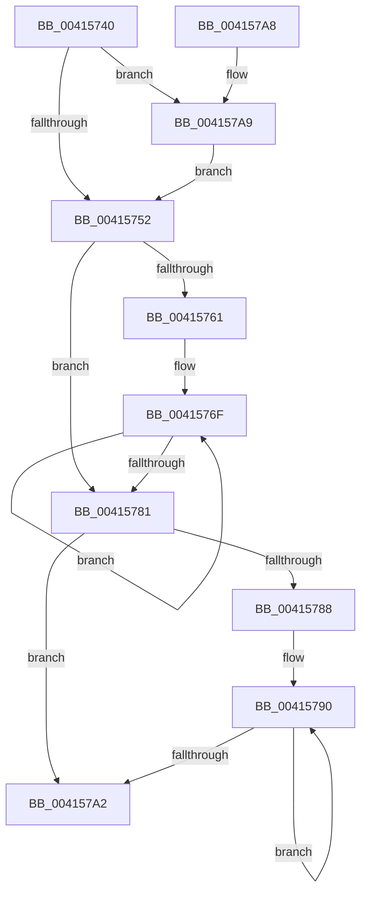

# KiCopyGroupMasksToAffinityEx

- RVA: `0x00415740`–`0x004157AF` (길이 `111` bytes)
- VA: `0x0000000140415740`
- 실행 섹션: `.text`
- PDB 이름 있음: `예`; PDB Function 태그: `아니요`
- unwind 정보 RVA: `0x0009C2B4`
- 디코드: `32`개 명령, `111/111` bytes 표시
- 미해석 바이트: `0` (있으면 어셈블리에 `.byte`로 보존)

> 이 문서는 커널 이미지의 기계어와 PDB 기호를 분석해 생성했습니다. 4번과 5번은 함수 원형과 자료형을 바이너리 사용 방식에서 추정한 C 해석이며 원본 소스 복구 결과는 아닙니다.

## 1. Dependencies

- 직접 호출 지점: **0**; 고유 호출 대상: **0**
- 직접 호출자로 확인된 함수: **1**
- RIP 상대 이미지 참조: **0**

### Outgoing calls
- 직접 디코드된 call 명령이 없습니다.

### Direct callers
- [KiComputeCpuSetAffinity](../39/KiComputeCpuSetAffinity_function_0039A1C0.md) at `0x0039A66F`

### Static image references
- 디코드된 RIP-relative 메모리 참조가 없습니다.

## 2. Other-region calls and transfers

- 다른 실행 섹션으로 향하는 call: **0**
- 별도 외부 분기/꼬리 이동을 확인하지 못했습니다.

## 3. Assembly (complete function range)

```asm
00415740  48 89 5C 24 08                  mov qword ptr [rsp + 8], rbx
00415745  0F B7 41 02                     movzx eax, word ptr [rcx + 2]
00415749  4C 8B C9                        mov r9, rcx
0041574C  66 44 3B C0                     cmp r8w, ax
00415750  77 57                           ja 0x1404157a9
00415752  33 DB                           xor ebx, ebx
00415754  66 44 89 01                     mov word ptr [rcx], r8w
00415758  0F B7 C3                        movzx eax, bx
0041575B  66 41 3B D8                     cmp bx, r8w
0041575F  73 20                           jae 0x140415781
00415761  4D 8B D9                        mov r11, r9
00415764  45 0F B7 D0                     movzx r10d, r8w
00415768  4C 2B DA                        sub r11, rdx
0041576B  41 0F B7 C0                     movzx eax, r8w
0041576F  48 8B 0A                        mov rcx, qword ptr [rdx]
00415772  49 89 4C 13 08                  mov qword ptr [r11 + rdx + 8], rcx
00415777  48 8D 52 08                     lea rdx, [rdx + 8]
0041577B  49 83 EA 01                     sub r10, 1
0041577F  75 EE                           jne 0x14041576f
00415781  66 41 3B 41 02                  cmp ax, word ptr [r9 + 2]
00415786  73 1A                           jae 0x1404157a2
00415788  0F 1F 84 00 00 00 00 00         nop dword ptr [rax + rax]
00415790  0F B7 C8                        movzx ecx, ax
00415793  66 FF C0                        inc ax
00415796  49 89 5C C9 08                  mov qword ptr [r9 + rcx*8 + 8], rbx
0041579B  66 41 3B 41 02                  cmp ax, word ptr [r9 + 2]
004157A0  72 EE                           jb 0x140415790
004157A2  48 8B 5C 24 08                  mov rbx, qword ptr [rsp + 8]
004157A7  C3                              ret
004157A8  CC                              int3
004157A9  44 0F B7 C0                     movzx r8d, ax
004157AD  EB A3                           jmp 0x140415752
```

## 4. C-style interpretation (structured pseudocode)

```c
__int64 __fastcall KiCopyGroupMasksToAffinityEx(__int64 a1, __int64 a2, unsigned __int16 a3)
{
    __int64 result;
    __int64 v_r10;
    __int64 v_r11;
    __int64 v_rbx;
    unsigned __int64 v_stack_p8;

    v_stack_p8 = v_rbx;
    if (a3 > ((unsigned __int16)(*(unsigned __int16 *)(a1 + 2)))) goto loc_004157A9;
loc_00415752:
    v_rbx = 0;
    *(unsigned __int16 *)(a1) = a3;
    if (0 >= a3) goto loc_00415781;
    v_r11 = (a1) - (a2);
loc_0041576F:
    *(unsigned __int64 *)(v_r11 + a2 * 1 + 8) = *(unsigned __int64 *)(a2);
    v_r10 = (a3) - (1);
    if (condition_is_not_equal) goto loc_0041576F;
loc_00415781:
    if (a3 >= (*(unsigned __int16 *)(a1 + 2))) goto loc_004157A2;
loc_00415790:
    result = (unsigned __int16)((a3) + 1);
    *(unsigned __int64 *)(a1 + a3 * 8 + 8) = 0;
    if (((unsigned __int16)(result)) < (*(unsigned __int16 *)(a1 + 2))) goto loc_00415790;
loc_004157A2:
    return result;
loc_004157A9:
    goto loc_00415752;
}
```

## 5. (Beta) C Style

```c
int64_t KiCopyGroupMasksToAffinityEx(void *Arg1, void *Arg2, uint16_t Arg3)
{
    uint8_t *arg1 = (uint8_t *)Arg1;
    uint8_t *arg2 = (uint8_t *)Arg2;

    int64_t result;
    int64_t local_r10;
    int64_t local_r11;
    int64_t local_rbx;
    uint64_t v_stack_p8;

    v_stack_p8 = local_rbx;
    if (Arg3 > ((uint16_t)(*(uint16_t *)(arg1 + 0x2)))) goto loc_004157A9;
loc_00415752:
    local_rbx = 0;
    *(uint16_t *)(arg1) = Arg3;
    if (0 >= Arg3) goto loc_00415781;
    local_r11 = (Arg1) - (Arg2);
loc_0041576F:
    *(uint64_t *)(local_r11 + arg2 * 1 + 0x8) = *(uint64_t *)(arg2);
    local_r10 = (Arg3) - (1);
    if (condition_is_not_equal) goto loc_0041576F;
loc_00415781:
    if (Arg3 >= (*(uint16_t *)(arg1 + 0x2))) goto loc_004157A2;
loc_00415790:
    result = (uint16_t)((Arg3) + 1);
    *(uint64_t *)(arg1 + Arg3 * 8 + 0x8) = 0;
    if (((uint16_t)(result)) < (*(uint16_t *)(arg1 + 0x2))) goto loc_00415790;
loc_004157A2:
    return result;
loc_004157A9:
    goto loc_00415752;
}
```

### 관측된 메모리 오프셋

구조체 형식이 확인되지 않은 접근은 인자 기준의 오프셋으로만 기록했습니다.

| 기준 인자 | 오프셋 표현 | 폭 (bit) | 접근 |
|---|---:|---:|---|
| `Arg1` | `+ 0x0` | `16` | `W` |
| `Arg1` | `+ 0x2` | `16` | `R` |
| `Arg1` | `+ 0x8 + rcx*8` | `64` | `W` |
| `Arg1` | `+ 0x8 + rdx*1` | `64` | `W` |
| `Arg2` | `+ 0x0` | `64` | `R` |
| `Arg2` | `+ 0x8` | `64` | `R` |

## 6. Execution-region graph

[열기: 2D/3D 그래프와 함수 탐색 컨트롤 패널](../../../control-panel.html?section=text&rva=0x00415740&view=graph)

- 2D 그래프는 위에서 아래로 흐르고, 3D 그래프는 빈 공간을 드래그해 회전합니다. Shift+드래그는 이동, 휠은 확대·축소, 함수 노드 선택은 대상 보고서 이동입니다.

### Static fallback


