# KiHeteroIdleSetReduction

- RVA: `0x00414A90`–`0x00414D5D` (길이 `717` bytes)
- VA: `0x0000000140414A90`
- 실행 섹션: `.text`
- PDB 이름 있음: `예`; PDB Function 태그: `아니요`
- unwind 정보 RVA: `0x0009C16C`
- 디코드: `180`개 명령, `717/717` bytes 표시
- 미해석 바이트: `0` (있으면 어셈블리에 `.byte`로 보존)

> 이 문서는 커널 이미지의 기계어와 PDB 기호를 분석해 생성했습니다. 4번과 5번은 함수 원형과 자료형을 바이너리 사용 방식에서 추정한 C 해석이며 원본 소스 복구 결과는 아닙니다.

## 1. Dependencies

- 직접 호출 지점: **5**; 고유 호출 대상: **3**
- 직접 호출자로 확인된 함수: **1**
- RIP 상대 이미지 참조: **4**

### Outgoing calls
- `0x00414B22` → [RtlCopyVolatileMemory](../6B/RtlCopyVolatileMemory_function_006BC9D0.md) (function, `0x006BC9D0`)
- `0x00414B5E` → [RtlCopyVolatileMemory](../6B/RtlCopyVolatileMemory_function_006BC9D0.md) (function, `0x006BC9D0`)
- `0x00414BE1` → [RtlCopyVolatileMemory](../6B/RtlCopyVolatileMemory_function_006BC9D0.md) (function, `0x006BC9D0`)
- `0x00414C5A` → [KiReduceAffinityToRankListMaximums](KiReduceAffinityToRankListMaximums_function_00414D70.md) (function, `0x00414D70`)
- `0x00414C76` → [_security_check_cookie](../6A/_security_check_cookie_function_006AC640.md) (function, `0x006AC640`)

### Direct callers
- [KiHeteroSelectIdleProcessorFromSubNode](../25/KiHeteroSelectIdleProcessorFromSubNode_function_00255504.md) at `0x002555DF`

### Static image references
- `0x00414AA8` → RVA `0x00E0A740` (`.data`; read)
- `0x00414AB7` → RVA `0x00FC6D14` (`ALMOSTRO`; read)
- `0x00414B04` → RVA `0x00FC6C6C` (`ALMOSTRO`; read)
- `0x00414BB6` → RVA `0x00FC6D10` (`ALMOSTRO`; read)

## 2. Other-region calls and transfers

- 다른 실행 섹션으로 향하는 call: **0**
- 별도 외부 분기/꼬리 이동을 확인하지 못했습니다.

## 3. Assembly (complete function range)

```asm
00414A90  48 89 5C 24 10                  mov qword ptr [rsp + 0x10], rbx
00414A95  48 89 6C 24 18                  mov qword ptr [rsp + 0x18], rbp
00414A9A  48 89 74 24 20                  mov qword ptr [rsp + 0x20], rsi
00414A9F  57                              push rdi
00414AA0  41 56                           push r14
00414AA2  41 57                           push r15
00414AA4  48 83 EC 70                     sub rsp, 0x70
00414AA8  48 8B 05 91 5C 9F 00            mov rax, qword ptr [rip + 0x9f5c91]
00414AAF  48 33 C4                        xor rax, rsp
00414AB2  48 89 44 24 60                  mov qword ptr [rsp + 0x60], rax
00414AB7  8B 05 57 22 BB 00               mov eax, dword ptr [rip + 0xbb2257]
00414ABD  0F 57 C0                        xorps xmm0, xmm0
00414AC0  33 FF                           xor edi, edi
00414AC2  4D 8B F9                        mov r15, r9
00414AC5  49 8B F0                        mov rsi, r8
00414AC8  4C 8B F2                        mov r14, rdx
00414ACB  48 8B E9                        mov rbp, rcx
00414ACE  0F 11 44 24 20                  movups xmmword ptr [rsp + 0x20], xmm0
00414AD3  0F 11 44 24 30                  movups xmmword ptr [rsp + 0x30], xmm0
00414AD8  0F 11 44 24 40                  movups xmmword ptr [rsp + 0x40], xmm0
00414ADD  0F 11 44 24 50                  movups xmmword ptr [rsp + 0x50], xmm0
00414AE2  A8 02                           test al, 2
00414AE4  0F 85 CC 00 00 00               jne 0x140414bb6
00414AEA  41 8B 41 04                     mov eax, dword ptr [r9 + 4]
00414AEE  FF C8                           dec eax
00414AF0  A9 FA FF FF FF                  test eax, 0xfffffffa
00414AF5  0F 85 C9 00 00 00               jne 0x140414bc4
00414AFB  F6 81 B8 00 00 00 01            test byte ptr [rcx + 0xb8], 1
00414B02  74 48                           je 0x140414b4c
00414B04  39 3D 62 21 BB 00               cmp dword ptr [rip + 0xbb2162], edi
00414B0A  0F 85 26 02 00 00               jne 0x140414d36
00414B10  48 8D 91 80 02 00 00            lea rdx, [rcx + 0x280]
00414B17  41 B8 40 00 00 00               mov r8d, 0x40
00414B1D  48 8D 4C 24 20                  lea rcx, [rsp + 0x20]
00414B22  E8 A9 7E 2A 00                  call 0x1406bc9d0
00414B27  45 32 D2                        xor r10b, r10b
00414B2A  4C 8B CF                        mov r9, rdi
00414B2D  32 C9                           xor cl, cl
00414B2F  48 8B D7                        mov rdx, rdi
00414B32  B8 01 00 00 00                  mov eax, 1
00414B37  48 D3 E0                        shl rax, cl
00414B3A  48 85 C6                        test rsi, rax
00414B3D  75 62                           jne 0x140414ba1
00414B3F  FE C1                           inc cl
00414B41  48 FF C2                        inc rdx
00414B44  80 F9 40                        cmp cl, 0x40
00414B47  72 E9                           jb 0x140414b32
00414B49  49 8B F1                        mov rsi, r9
00414B4C  48 8D 95 C0 02 00 00            lea rdx, [rbp + 0x2c0]
00414B53  41 B8 40 00 00 00               mov r8d, 0x40
00414B59  48 8D 4C 24 20                  lea rcx, [rsp + 0x20]
00414B5E  E8 6D 7E 2A 00                  call 0x1406bc9d0
00414B63  45 32 D2                        xor r10b, r10b
00414B66  4C 8B CF                        mov r9, rdi
00414B69  32 C9                           xor cl, cl
00414B6B  48 8B D7                        mov rdx, rdi
00414B6E  66 90                           nop
00414B70  B8 01 00 00 00                  mov eax, 1
00414B75  48 D3 E0                        shl rax, cl
00414B78  48 85 C6                        test rsi, rax
00414B7B  75 0F                           jne 0x140414b8c
00414B7D  FE C1                           inc cl
00414B7F  48 FF C2                        inc rdx
00414B82  80 F9 40                        cmp cl, 0x40
00414B85  72 E9                           jb 0x140414b70
00414B87  49 8B F1                        mov rsi, r9
00414B8A  EB 38                           jmp 0x140414bc4
00414B8C  44 0F B6 44 14 20               movzx r8d, byte ptr [rsp + rdx + 0x20]
00414B92  45 3A C2                        cmp r8b, r10b
00414B95  0F 85 21 01 00 00               jne 0x140414cbc
00414B9B  49 0F AB D1                     bts r9, rdx
00414B9F  EB DC                           jmp 0x140414b7d
00414BA1  44 0F B6 44 14 20               movzx r8d, byte ptr [rsp + rdx + 0x20]
00414BA7  45 3A C2                        cmp r8b, r10b
00414BAA  0F 85 1E 01 00 00               jne 0x140414cce
00414BB0  49 0F AB D1                     bts r9, rdx
00414BB4  EB 89                           jmp 0x140414b3f
00414BB6  8B 05 54 21 BB 00               mov eax, dword ptr [rip + 0xbb2154]
00414BBC  A8 02                           test al, 2
00414BBE  0F 85 26 FF FF FF               jne 0x140414aea
00414BC4  48 8B 5D 18                     mov rbx, qword ptr [rbp + 0x18]
00414BC8  48 8D 95 40 02 00 00            lea rdx, [rbp + 0x240]
00414BCF  48 23 DE                        and rbx, rsi
00414BD2  48 8D 4C 24 20                  lea rcx, [rsp + 0x20]
00414BD7  41 B8 40 00 00 00               mov r8d, 0x40
00414BDD  48 0F 44 DE                     cmove rbx, rsi
00414BE1  E8 EA 7D 2A 00                  call 0x1406bc9d0
00414BE6  41 B1 FF                        mov r9b, 0xff
00414BE9  32 C9                           xor cl, cl
00414BEB  48 8B D7                        mov rdx, rdi
00414BEE  66 90                           nop
00414BF0  B8 01 00 00 00                  mov eax, 1
00414BF5  48 D3 E0                        shl rax, cl
00414BF8  48 85 D8                        test rax, rbx
00414BFB  0F 85 95 00 00 00               jne 0x140414c96
00414C01  FE C1                           inc cl
00414C03  48 FF C2                        inc rdx
00414C06  80 F9 40                        cmp cl, 0x40
00414C09  72 E5                           jb 0x140414bf0
00414C0B  48 8B 8C 24 B0 00 00 00         mov rcx, qword ptr [rsp + 0xb0]
00414C13  32 D2                           xor dl, dl
00414C15  48 8B C7                        mov rax, rdi
00414C18  48 23 01                        and rax, qword ptr [rcx]
00414C1B  0F 84 28 01 00 00               je 0x140414d49
00414C21  48 8B F8                        mov rdi, rax
00414C24  83 3D 41 20 BB 00 00            cmp dword ptr [rip + 0xbb2041], 0
00414C2B  0F 85 E1 00 00 00               jne 0x140414d12
00414C31  84 D2                           test dl, dl
00414C33  74 2D                           je 0x140414c62
00414C35  41 0F B6 4F 10                  movzx ecx, byte ptr [r15 + 0x10]
00414C3A  41 8B 47 0C                     mov eax, dword ptr [r15 + 0xc]
00414C3E  8B D1                           mov edx, ecx
00414C40  48 C1 E2 06                     shl rdx, 6
00414C44  83 C0 FD                        add eax, -3
00414C47  83 F8 01                        cmp eax, 1
00414C4A  0F 86 DA 00 00 00               jbe 0x140414d2a
00414C50  48 03 95 C8 00 00 00            add rdx, qword ptr [rbp + 0xc8]
00414C57  48 8B CF                        mov rcx, rdi
00414C5A  E8 11 01 00 00                  call 0x140414d70
00414C5F  48 8B F8                        mov rdi, rax
00414C62  48 8B C7                        mov rax, rdi
00414C65  49 23 86 C8 00 00 00            and rax, qword ptr [r14 + 0xc8]
00414C6C  74 72                           je 0x140414ce0
00414C6E  48 8B 4C 24 60                  mov rcx, qword ptr [rsp + 0x60]
00414C73  48 33 CC                        xor rcx, rsp
00414C76  E8 C5 79 29 00                  call 0x1406ac640
00414C7B  4C 8D 5C 24 70                  lea r11, [rsp + 0x70]
00414C80  49 8B 5B 28                     mov rbx, qword ptr [r11 + 0x28]
00414C84  49 8B 6B 30                     mov rbp, qword ptr [r11 + 0x30]
00414C88  49 8B 73 38                     mov rsi, qword ptr [r11 + 0x38]
00414C8C  49 8B E3                        mov rsp, r11
00414C8F  41 5F                           pop r15
00414C91  41 5E                           pop r14
00414C93  5F                              pop rdi
00414C94  C3                              ret
00414C95  CC                              int3
00414C96  44 0F B6 44 14 20               movzx r8d, byte ptr [rsp + rdx + 0x20]
00414C9C  45 3A C1                        cmp r8b, r9b
00414C9F  75 09                           jne 0x140414caa
00414CA1  48 0F AB D7                     bts rdi, rdx
00414CA5  E9 57 FF FF FF                  jmp 0x140414c01
00414CAA  0F 83 51 FF FF FF               jae 0x140414c01
00414CB0  45 0F B6 C8                     movzx r9d, r8b
00414CB4  48 8B F8                        mov rdi, rax
00414CB7  E9 45 FF FF FF                  jmp 0x140414c01
00414CBC  0F 86 BB FE FF FF               jbe 0x140414b7d
00414CC2  45 0F B6 D0                     movzx r10d, r8b
00414CC6  4C 8B C8                        mov r9, rax
00414CC9  E9 AF FE FF FF                  jmp 0x140414b7d
00414CCE  0F 86 6B FE FF FF               jbe 0x140414b3f
00414CD4  45 0F B6 D0                     movzx r10d, r8b
00414CD8  4C 8B C8                        mov r9, rax
00414CDB  E9 5F FE FF FF                  jmp 0x140414b3f
00414CE0  48 8B C7                        mov rax, rdi
00414CE3  49 23 86 60 8E 00 00            and rax, qword ptr [r14 + 0x8e60]
00414CEA  75 82                           jne 0x140414c6e
00414CEC  48 8B C7                        mov rax, rdi
00414CEF  49 23 86 78 8E 00 00            and rax, qword ptr [r14 + 0x8e78]
00414CF6  0F 85 72 FF FF FF               jne 0x140414c6e
00414CFC  48 8B CF                        mov rcx, rdi
00414CFF  49 23 8E 70 8E 00 00            and rcx, qword ptr [r14 + 0x8e70]
00414D06  48 0F 45 F9                     cmovne rdi, rcx
00414D0A  48 8B C7                        mov rax, rdi
00414D0D  E9 5C FF FF FF                  jmp 0x140414c6e
00414D12  49 63 47 04                     movsxd rax, dword ptr [r15 + 4]
00414D16  48 8B CF                        mov rcx, rdi
00414D19  48 23 8C C5 00 01 00 00         and rcx, qword ptr [rbp + rax*8 + 0x100]
00414D21  48 0F 45 F9                     cmovne rdi, rcx
00414D25  E9 07 FF FF FF                  jmp 0x140414c31
00414D2A  48 03 95 D0 00 00 00            add rdx, qword ptr [rbp + 0xd0]
00414D31  E9 21 FF FF FF                  jmp 0x140414c57
00414D36  48 8B 81 48 01 00 00            mov rax, qword ptr [rcx + 0x148]
00414D3D  48 23 C6                        and rax, rsi
00414D40  48 0F 45 F0                     cmovne rsi, rax
00414D44  E9 C7 FD FF FF                  jmp 0x140414b10
00414D49  48 8B C7                        mov rax, rdi
00414D4C  48 23 41 08                     and rax, qword ptr [rcx + 8]
00414D50  0F 84 CE FE FF FF               je 0x140414c24
00414D56  B2 01                           mov dl, 1
00414D58  E9 C4 FE FF FF                  jmp 0x140414c21
```

## 4. C-style interpretation (structured pseudocode)

```c
__int64 __fastcall KiHeteroIdleSetReduction(__int64 a1, __int64 a2, __int64 a3, __int64 a4, __int64 a5)
{
    __int64 result;
    __int64 v_r10;
    __int64 v_rbx;
    __int64 v_rdi;
    __int64 v_rsi;
    __int64 v_rsp;
    unsigned __int64 v_stack_m18;
    unsigned __int64 v_stack_m28;
    unsigned __int64 v_stack_m38;
    unsigned __int64 v_stack_m48;
    unsigned __int64 v_stack_m58;
    unsigned __int64 v_stack_m68;
    unsigned __int64 v_stack_p10;
    unsigned __int64 v_stack_p18;
    unsigned __int64 v_stack_p20;

    v_stack_p10 = v_rbx;
    v_stack_p18 = v_rbp;
    v_stack_p20 = v_rsi;
    v_rsp = (v_rsp) - (112);
    result = (*(unsigned __int64 *)(v_rip + 10443921)) ^ (v_rsp);
    v_stack_m28 = result;
    v_rdi = 0;
    v_stack_m68 = v_xmm0;
    v_stack_m58 = v_xmm0;
    v_stack_m48 = v_xmm0;
    v_stack_m38 = v_xmm0;
    if ((((unsigned __int8)((unsigned int)(*(unsigned int *)(v_rip + 12264023)))) & (2)) != 0) goto loc_00414BB6;
loc_00414AEA:
    result = (unsigned int)(((unsigned int)(*(unsigned int *)(a4 + 4))) - 1);
    if ((((unsigned int)(result)) & (0xFFFFFFFAULL)) != 0) goto loc_00414BC4;
    if (((*(unsigned __int8 *)(a1 + 184)) & (1)) == 0) goto loc_00414B4C;
    if ((*(unsigned int *)(v_rip + 12263778)) != 0) goto loc_00414D36;
loc_00414B10:
    result = RtlCopyVolatileMemory(v_stack_m68, a1 + 640, 64, a4);
    v_r10 = 0;
    a1 = 0;
loc_00414B32:
    result = (1) << (0);
    if (((a3) & (result)) != 0) goto loc_00414BA1;
loc_00414B3F:
    a1 = (unsigned __int8)((a1) + 1);
    a2 = (0) + 1;
    if (((unsigned __int8)(a1)) < 64) goto loc_00414B32;
loc_00414B4C:
    result = RtlCopyVolatileMemory(v_stack_m68, a1 + 704, 64, 0);
    v_r10 = 0;
    a1 = 0;
loc_00414B70:
    result = (1) << (0);
    if (((0) & (result)) != 0) goto loc_00414B8C;
loc_00414B7D:
    a1 = (unsigned __int8)((a1) + 1);
    a2 = (0) + 1;
    if (((unsigned __int8)(a1)) < 64) goto loc_00414B70;
    goto loc_00414BC4;
loc_00414B8C:
    if (((unsigned __int8)(*(unsigned __int8 *)(v_rsp + a2 * 1 + 32))) != 0) goto loc_00414CBC;
    goto loc_00414B7D;
loc_00414BA1:
    if (((unsigned __int8)(*(unsigned __int8 *)(v_rsp + a2 * 1 + 32))) != 0) goto loc_00414CCE;
    goto loc_00414B3F;
loc_00414BB6:
    if ((((unsigned __int8)((unsigned int)(*(unsigned int *)(v_rip + 12263764)))) & (2)) != 0) goto loc_00414AEA;
loc_00414BC4:
    v_rbx = (*(unsigned __int64 *)(a1 + 24)) & (0);
    if (condition_is_equal) { v_rbx = 0; }
    result = RtlCopyVolatileMemory(v_stack_m68, a1 + 576, 64, 0);
    a1 = 0;
loc_00414BF0:
    result = (1) << (0);
    if (((result) & (v_rbx)) != 0) goto loc_00414C96;
loc_00414C01:
    a1 = (unsigned __int8)((a1) + 1);
    a2 = (0) + 1;
    if (((unsigned __int8)(a1)) < 64) goto loc_00414BF0;
    a2 = 0;
    result = (0) & (*(unsigned __int64 *)(a5));
    if (condition_is_equal) goto loc_00414D49;
loc_00414C21:
loc_00414C24:
    if ((*(unsigned int *)(v_rip + 12263489)) != 0) goto loc_00414D12;
loc_00414C31:
    if (0 == 0) goto loc_00414C62;
    a2 = ((unsigned int)((unsigned int)(*(unsigned __int8 *)(a4 + 16)))) << (6);
    result = (unsigned int)(((unsigned int)(*(unsigned int *)(a4 + 12))) + (-3));
    if (((unsigned int)(result)) <= 1) goto loc_00414D2A;
    a2 = (a2) + (*(unsigned __int64 *)(a1 + 200));
loc_00414C57:
    result = KiReduceAffinityToRankListMaximums(result, a2, 64, 255);
loc_00414C62:
    result = (result) & (*(unsigned __int64 *)(a2 + 200));
    if (condition_is_equal) goto loc_00414CE0;
loc_00414C6E:
    a1 = (v_stack_m28) ^ (v_rsp);
    result = _security_check_cookie(a1, a2, 64, 255);
    return result;
loc_00414C96:
    if (((unsigned __int8)(*(unsigned __int8 *)(v_stack_m18 + a2 * 1 + 32))) != 255) goto loc_00414CAA;
    goto loc_00414C01;
loc_00414CAA:
    if (((unsigned __int8)(*(unsigned __int8 *)(v_stack_m18 + a2 * 1 + 32))) >= 255) goto loc_00414C01;
    goto loc_00414C01;
loc_00414CBC:
    if (((unsigned __int8)(*(unsigned __int8 *)(v_stack_m18 + a2 * 1 + 32))) <= 255) goto loc_00414B7D;
    goto loc_00414B7D;
loc_00414CCE:
    if (((unsigned __int8)(*(unsigned __int8 *)(v_stack_m18 + a2 * 1 + 32))) <= 255) goto loc_00414B3F;
    goto loc_00414B3F;
loc_00414CE0:
    result = (result) & (*(unsigned __int64 *)(a2 + 36448));
    if (condition_is_not_equal) goto loc_00414C6E;
    result = (result) & (*(unsigned __int64 *)(a2 + 36472));
    if (condition_is_not_equal) goto loc_00414C6E;
    a1 = (result) & (*(unsigned __int64 *)(a2 + 36464));
    v_rdi = result;
    if (condition_is_not_equal) { v_rdi = a1; }
    goto loc_00414C6E;
loc_00414D12:
    a1 = (v_rdi) & (*(unsigned __int64 *)(*(unsigned __int64 *)(v_stack_m18 + 48) + (int)(*(unsigned int *)(a4 + 4)) * 8 + 256));
    if (condition_is_not_equal) { v_rdi = a1; }
    goto loc_00414C31;
loc_00414D2A:
    a2 = (a2) + (*(unsigned __int64 *)(*(unsigned __int64 *)(v_stack_m18 + 48) + 208));
    goto loc_00414C57;
loc_00414D36:
    result = (*(unsigned __int64 *)(a1 + 328)) & (*(unsigned __int64 *)(v_stack_m18 + 56));
    v_rsi = *(unsigned __int64 *)(v_stack_m18 + 56);
    if (condition_is_not_equal) { v_rsi = result; }
    goto loc_00414B10;
loc_00414D49:
    result = (v_rdi) & (*(unsigned __int64 *)(a1 + 8));
    if (condition_is_equal) goto loc_00414C24;
    goto loc_00414C21;
}
```

## 5. (Beta) C Style

```c
int64_t KiHeteroIdleSetReduction(void *Arg1, void *Arg2, int64_t Arg3, void *Arg4, void *Arg5)
{
    uint8_t *arg1 = (uint8_t *)Arg1;
    uint8_t *arg2 = (uint8_t *)Arg2;
    uint8_t *arg4 = (uint8_t *)Arg4;
    uint8_t *arg5 = (uint8_t *)Arg5;

    int64_t result;
    int64_t local_r10;
    int64_t local_rbx;
    int64_t local_rdi;
    int64_t local_rsi;
    int64_t local_rsp;
    uint64_t v_stack_m18;
    uint64_t v_stack_m28;
    uint64_t v_stack_m38;
    uint64_t v_stack_m48;
    uint64_t v_stack_m58;
    uint64_t v_stack_m68;
    uint64_t v_stack_p10;
    uint64_t v_stack_p18;
    uint64_t v_stack_p20;

    v_stack_p10 = local_rbx;
    v_stack_p18 = local_rbp;
    v_stack_p20 = local_rsi;
    local_rsp = (local_rsp) - (112);
    result = (*(uint64_t *)(v_rip + 0x9F5C91)) ^ (local_rsp);
    v_stack_m28 = result;
    local_rdi = 0;
    v_stack_m68 = v_xmm0;
    v_stack_m58 = v_xmm0;
    v_stack_m48 = v_xmm0;
    v_stack_m38 = v_xmm0;
    if ((((uint8_t)((uint32_t)(*(uint32_t *)(v_rip + 0xBB2257)))) & (2)) != 0) goto loc_00414BB6;
loc_00414AEA:
    result = (uint32_t)(((uint32_t)(*(uint32_t *)(arg4 + 0x4))) - 1);
    if ((((uint32_t)(result)) & (0xFFFFFFFAULL)) != 0) goto loc_00414BC4;
    if (((*(uint8_t *)(arg1 + 0xB8)) & (1)) == 0) goto loc_00414B4C;
    if ((*(uint32_t *)(v_rip + 0xBB2162)) != 0) goto loc_00414D36;
loc_00414B10:
    result = RtlCopyVolatileMemory(v_stack_m68, Arg1 + 640, 64, Arg4);
    local_r10 = 0;
    Arg1 = 0;
loc_00414B32:
    result = (1) << (0);
    if (((Arg3) & (result)) != 0) goto loc_00414BA1;
loc_00414B3F:
    Arg1 = (uint8_t)((Arg1) + 1);
    Arg2 = (0) + 1;
    if (((uint8_t)(Arg1)) < 64) goto loc_00414B32;
loc_00414B4C:
    result = RtlCopyVolatileMemory(v_stack_m68, Arg1 + 704, 64, 0);
    local_r10 = 0;
    Arg1 = 0;
loc_00414B70:
    result = (1) << (0);
    if (((0) & (result)) != 0) goto loc_00414B8C;
loc_00414B7D:
    Arg1 = (uint8_t)((Arg1) + 1);
    Arg2 = (0) + 1;
    if (((uint8_t)(Arg1)) < 64) goto loc_00414B70;
    goto loc_00414BC4;
loc_00414B8C:
    if (((uint8_t)(*(uint8_t *)(local_rsp + arg2 * 1 + 0x20))) != 0) goto loc_00414CBC;
    goto loc_00414B7D;
loc_00414BA1:
    if (((uint8_t)(*(uint8_t *)(local_rsp + arg2 * 1 + 0x20))) != 0) goto loc_00414CCE;
    goto loc_00414B3F;
loc_00414BB6:
    if ((((uint8_t)((uint32_t)(*(uint32_t *)(v_rip + 0xBB2154)))) & (2)) != 0) goto loc_00414AEA;
loc_00414BC4:
    local_rbx = (*(uint64_t *)(arg1 + 0x18)) & (0);
    if (condition_is_equal) { local_rbx = 0; }
    result = RtlCopyVolatileMemory(v_stack_m68, Arg1 + 576, 64, 0);
    Arg1 = 0;
loc_00414BF0:
    result = (1) << (0);
    if (((result) & (local_rbx)) != 0) goto loc_00414C96;
loc_00414C01:
    Arg1 = (uint8_t)((Arg1) + 1);
    Arg2 = (0) + 1;
    if (((uint8_t)(Arg1)) < 64) goto loc_00414BF0;
    Arg2 = 0;
    result = (0) & (*(uint64_t *)(arg5));
    if (condition_is_equal) goto loc_00414D49;
loc_00414C21:
loc_00414C24:
    if ((*(uint32_t *)(v_rip + 0xBB2041)) != 0) goto loc_00414D12;
loc_00414C31:
    if (0 == 0) goto loc_00414C62;
    Arg2 = ((uint32_t)((uint32_t)(*(uint8_t *)(arg4 + 0x10)))) << (6);
    result = (uint32_t)(((uint32_t)(*(uint32_t *)(arg4 + 0xC))) + (-3));
    if (((uint32_t)(result)) <= 1) goto loc_00414D2A;
    Arg2 = (Arg2) + (*(uint64_t *)(arg1 + 0xC8));
loc_00414C57:
    result = KiReduceAffinityToRankListMaximums(result, Arg2, 64, 255);
loc_00414C62:
    result = (result) & (*(uint64_t *)(arg2 + 0xC8));
    if (condition_is_equal) goto loc_00414CE0;
loc_00414C6E:
    Arg1 = (v_stack_m28) ^ (local_rsp);
    result = _security_check_cookie(Arg1, Arg2, 64, 255);
    return result;
loc_00414C96:
    if (((uint8_t)(*(uint8_t *)(v_stack_m18 + arg2 * 1 + 0x20))) != 255) goto loc_00414CAA;
    goto loc_00414C01;
loc_00414CAA:
    if (((uint8_t)(*(uint8_t *)(v_stack_m18 + arg2 * 1 + 0x20))) >= 255) goto loc_00414C01;
    goto loc_00414C01;
loc_00414CBC:
    if (((uint8_t)(*(uint8_t *)(v_stack_m18 + arg2 * 1 + 0x20))) <= 255) goto loc_00414B7D;
    goto loc_00414B7D;
loc_00414CCE:
    if (((uint8_t)(*(uint8_t *)(v_stack_m18 + arg2 * 1 + 0x20))) <= 255) goto loc_00414B3F;
    goto loc_00414B3F;
loc_00414CE0:
    result = (result) & (*(uint64_t *)(arg2 + 0x8E60));
    if (condition_is_not_equal) goto loc_00414C6E;
    result = (result) & (*(uint64_t *)(arg2 + 0x8E78));
    if (condition_is_not_equal) goto loc_00414C6E;
    Arg1 = (result) & (*(uint64_t *)(arg2 + 0x8E70));
    local_rdi = result;
    if (condition_is_not_equal) { local_rdi = Arg1; }
    goto loc_00414C6E;
loc_00414D12:
    Arg1 = (local_rdi) & (*(uint64_t *)(*(uint64_t *)(v_stack_m18 + 0x30) + (int32_t)(*(uint32_t *)(arg4 + 0x4)) * 8 + 0x100));
    if (condition_is_not_equal) { local_rdi = Arg1; }
    goto loc_00414C31;
loc_00414D2A:
    Arg2 = (Arg2) + (*(uint64_t *)(*(uint64_t *)(v_stack_m18 + 0x30) + 0xD0));
    goto loc_00414C57;
loc_00414D36:
    result = (*(uint64_t *)(arg1 + 0x148)) & (*(uint64_t *)(v_stack_m18 + 0x38));
    local_rsi = *(uint64_t *)(v_stack_m18 + 0x38);
    if (condition_is_not_equal) { local_rsi = result; }
    goto loc_00414B10;
loc_00414D49:
    result = (local_rdi) & (*(uint64_t *)(arg1 + 0x8));
    if (condition_is_equal) goto loc_00414C24;
    goto loc_00414C21;
}
```

### 관측된 메모리 오프셋

구조체 형식이 확인되지 않은 접근은 인자 기준의 오프셋으로만 기록했습니다.

| 기준 인자 | 오프셋 표현 | 폭 (bit) | 접근 |
|---|---:|---:|---|
| `Arg1` | `+ 0x18` | `64` | `R` |
| `Arg1` | `+ 0xB8` | `8` | `R` |
| `Arg1` | `+ 0xC8` | `64` | `R` |
| `Arg1` | `+ 0xD0` | `64` | `R` |
| `Arg1` | `+ 0x100 + rax*8` | `64` | `R` |
| `Arg1` | `+ 0x148` | `64` | `R` |
| `Arg1` | `+ 0x240` | `64` | `R` |
| `Arg1` | `+ 0x280` | `64` | `R` |
| `Arg1` | `+ 0x2C0` | `64` | `R` |
| `Arg2` | `+ 0xC8` | `64` | `R` |
| `Arg2` | `+ 0x8E60` | `64` | `R` |
| `Arg2` | `+ 0x8E70` | `64` | `R` |
| `Arg2` | `+ 0x8E78` | `64` | `R` |
| `Arg4` | `+ 0x4` | `32` | `R` |
| `Arg4` | `+ 0xC` | `32` | `R` |
| `Arg4` | `+ 0x10` | `8` | `R` |
| `Arg5` | `+ 0x0` | `64` | `R` |
| `Arg5` | `+ 0x8` | `64` | `R` |

## 6. Execution-region graph

[열기: 2D/3D 그래프와 함수 탐색 컨트롤 패널](../../../control-panel.html?section=text&rva=0x00414A90&view=graph)

- 2D 그래프는 위에서 아래로 흐르고, 3D 그래프는 빈 공간을 드래그해 회전합니다. Shift+드래그는 이동, 휠은 확대·축소, 함수 노드 선택은 대상 보고서 이동입니다.

### Static fallback

```mermaid
flowchart TD
  bb_00414A90[BB_00414A90]
  bb_00414AEA[BB_00414AEA]
  bb_00414AFB[BB_00414AFB]
  bb_00414B04[BB_00414B04]
  bb_00414B10[BB_00414B10]
  bb_00414B32[BB_00414B32]
  bb_00414B3F[BB_00414B3F]
  bb_00414B49[BB_00414B49]
  bb_00414B4C[BB_00414B4C]
  bb_00414B70[BB_00414B70]
  bb_00414B7D[BB_00414B7D]
  bb_00414B87[BB_00414B87]
  bb_00414B8C[BB_00414B8C]
  bb_00414B9B[BB_00414B9B]
  bb_00414BA1[BB_00414BA1]
  bb_00414BB0[BB_00414BB0]
  bb_00414BB6[BB_00414BB6]
  bb_00414BC4[BB_00414BC4]
  bb_00414BF0[BB_00414BF0]
  bb_00414C01[BB_00414C01]
  bb_00414C0B[BB_00414C0B]
  bb_00414C21[BB_00414C21]
  bb_00414C24[BB_00414C24]
  bb_00414C31[BB_00414C31]
  bb_00414C35[BB_00414C35]
  bb_00414C50[BB_00414C50]
  bb_00414C57[BB_00414C57]
  bb_00414C62[BB_00414C62]
  bb_00414C6E[BB_00414C6E]
  bb_00414C95[BB_00414C95]
  bb_00414C96[BB_00414C96]
  bb_00414CA1[BB_00414CA1]
  bb_00414CAA[BB_00414CAA]
  bb_00414CB0[BB_00414CB0]
  bb_00414CBC[BB_00414CBC]
  bb_00414CC2[BB_00414CC2]
  bb_00414CCE[BB_00414CCE]
  bb_00414CD4[BB_00414CD4]
  bb_00414CE0[BB_00414CE0]
  bb_00414CEC[BB_00414CEC]
  bb_00414CFC[BB_00414CFC]
  bb_00414D12[BB_00414D12]
  bb_00414D2A[BB_00414D2A]
  bb_00414D36[BB_00414D36]
  bb_00414D49[BB_00414D49]
  bb_00414D56[BB_00414D56]
  bb_00414A90 -->|branch| bb_00414BB6
  bb_00414A90 -->|fallthrough| bb_00414AEA
  bb_00414AEA -->|branch| bb_00414BC4
  bb_00414AEA -->|fallthrough| bb_00414AFB
  bb_00414AFB -->|branch| bb_00414B4C
  bb_00414AFB -->|fallthrough| bb_00414B04
  bb_00414B04 -->|branch| bb_00414D36
  bb_00414B04 -->|fallthrough| bb_00414B10
  bb_00414B10 -->|flow| bb_00414B32
  bb_00414B32 -->|branch| bb_00414BA1
  bb_00414B32 -->|fallthrough| bb_00414B3F
  bb_00414B3F -->|branch| bb_00414B32
  bb_00414B3F -->|fallthrough| bb_00414B49
  bb_00414B49 -->|flow| bb_00414B4C
  bb_00414B4C -->|flow| bb_00414B70
  bb_00414B70 -->|branch| bb_00414B8C
  bb_00414B70 -->|fallthrough| bb_00414B7D
  bb_00414B7D -->|branch| bb_00414B70
  bb_00414B7D -->|fallthrough| bb_00414B87
  bb_00414B87 -->|branch| bb_00414BC4
  bb_00414B8C -->|branch| bb_00414CBC
  bb_00414B8C -->|fallthrough| bb_00414B9B
  bb_00414B9B -->|branch| bb_00414B7D
  bb_00414BA1 -->|branch| bb_00414CCE
  bb_00414BA1 -->|fallthrough| bb_00414BB0
  bb_00414BB0 -->|branch| bb_00414B3F
  bb_00414BB6 -->|branch| bb_00414AEA
  bb_00414BB6 -->|fallthrough| bb_00414BC4
  bb_00414BC4 -->|flow| bb_00414BF0
  bb_00414BF0 -->|branch| bb_00414C96
  bb_00414BF0 -->|fallthrough| bb_00414C01
  bb_00414C01 -->|branch| bb_00414BF0
  bb_00414C01 -->|fallthrough| bb_00414C0B
  bb_00414C0B -->|branch| bb_00414D49
  bb_00414C0B -->|fallthrough| bb_00414C21
  bb_00414C21 -->|flow| bb_00414C24
  bb_00414C24 -->|branch| bb_00414D12
  bb_00414C24 -->|fallthrough| bb_00414C31
  bb_00414C31 -->|branch| bb_00414C62
  bb_00414C31 -->|fallthrough| bb_00414C35
  bb_00414C35 -->|branch| bb_00414D2A
  bb_00414C35 -->|fallthrough| bb_00414C50
  bb_00414C50 -->|flow| bb_00414C57
  bb_00414C57 -->|flow| bb_00414C62
  bb_00414C62 -->|branch| bb_00414CE0
  bb_00414C62 -->|fallthrough| bb_00414C6E
  bb_00414C95 -->|flow| bb_00414C96
  bb_00414C96 -->|branch| bb_00414CAA
  bb_00414C96 -->|fallthrough| bb_00414CA1
  bb_00414CA1 -->|branch| bb_00414C01
  bb_00414CAA -->|branch| bb_00414C01
  bb_00414CAA -->|fallthrough| bb_00414CB0
  bb_00414CB0 -->|branch| bb_00414C01
  bb_00414CBC -->|branch| bb_00414B7D
  bb_00414CBC -->|fallthrough| bb_00414CC2
  bb_00414CC2 -->|branch| bb_00414B7D
  bb_00414CCE -->|branch| bb_00414B3F
  bb_00414CCE -->|fallthrough| bb_00414CD4
  bb_00414CD4 -->|branch| bb_00414B3F
  bb_00414CE0 -->|branch| bb_00414C6E
  bb_00414CE0 -->|fallthrough| bb_00414CEC
  bb_00414CEC -->|branch| bb_00414C6E
  bb_00414CEC -->|fallthrough| bb_00414CFC
  bb_00414CFC -->|branch| bb_00414C6E
  bb_00414D12 -->|branch| bb_00414C31
  bb_00414D2A -->|branch| bb_00414C57
  bb_00414D36 -->|branch| bb_00414B10
  bb_00414D49 -->|branch| bb_00414C24
  bb_00414D49 -->|fallthrough| bb_00414D56
  bb_00414D56 -->|branch| bb_00414C21
```


