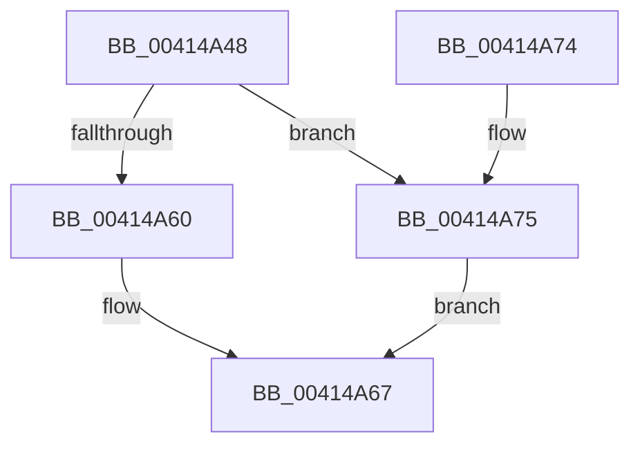

# KiHeteroReduceToMaximallyPreferredByClass

- RVA: `0x00414A48`–`0x00414A7E` (길이 `54` bytes)
- VA: `0x0000000140414A48`
- 실행 섹션: `.text`
- PDB 이름 있음: `예`; PDB Function 태그: `아니요`
- unwind 정보 RVA: `0x0006EDE0`
- 디코드: `15`개 명령, `54/54` bytes 표시
- 미해석 바이트: `0` (있으면 어셈블리에 `.byte`로 보존)

> 이 문서는 커널 이미지의 기계어와 PDB 기호를 분석해 생성했습니다. 4번과 5번은 함수 원형과 자료형을 바이너리 사용 방식에서 추정한 C 해석이며 원본 소스 복구 결과는 아닙니다.

## 1. Dependencies

- 직접 호출 지점: **1**; 고유 호출 대상: **1**
- 직접 호출자로 확인된 함수: **2**
- RIP 상대 이미지 참조: **0**

### Outgoing calls
- `0x00414A6A` → [KiReduceAffinityToRankListMaximums](KiReduceAffinityToRankListMaximums_function_00414D70.md) (function, `0x00414D70`)

### Direct callers
- [KiTallyHeteroSoftParkElectionVotes](../39/KiTallyHeteroSoftParkElectionVotes_function_0039E5B8.md) at `0x0039E6B8`
- [KiGetNextClockOwner](../5B/KiGetNextClockOwner_function_005BB5D4.md) at `0x005BB69F`
- [KiGetNextClockOwner](../5B/KiGetNextClockOwner_function_005BB5D4.md) at `0x005BB733`

### Static image references
- 디코드된 RIP-relative 메모리 참조가 없습니다.

## 2. Other-region calls and transfers

- 다른 실행 섹션으로 향하는 call: **0**
- 별도 외부 분기/꼬리 이동을 확인하지 못했습니다.

## 3. Assembly (complete function range)

```asm
00414A48  48 83 EC 28                     sub rsp, 0x28
00414A4C  4C 8B D2                        mov r10, rdx
00414A4F  41 8D 40 FD                     lea eax, [r8 - 3]
00414A53  41 0F B6 D1                     movzx edx, r9b
00414A57  48 C1 E2 06                     shl rdx, 6
00414A5B  83 F8 01                        cmp eax, 1
00414A5E  76 15                           jbe 0x140414a75
00414A60  48 03 91 C8 00 00 00            add rdx, qword ptr [rcx + 0xc8]
00414A67  49 8B CA                        mov rcx, r10
00414A6A  E8 01 03 00 00                  call 0x140414d70
00414A6F  48 83 C4 28                     add rsp, 0x28
00414A73  C3                              ret
00414A74  CC                              int3
00414A75  48 03 91 D0 00 00 00            add rdx, qword ptr [rcx + 0xd0]
00414A7C  EB E9                           jmp 0x140414a67
```

## 4. C-style interpretation (structured pseudocode)

```c
__int64 __fastcall KiHeteroReduceToMaximallyPreferredByClass(__int64 a1, __int64 a2, __int64 a3, unsigned __int8 a4)
{
    __int64 result;
    __int64 v_rsp;

    v_rsp = (v_rsp) - (40);
    a2 = (a4) << (6);
    if (((unsigned int)(a3 - 3)) <= 1) goto loc_00414A75;
    a2 = (a2) + (*(unsigned __int64 *)(a1 + 200));
loc_00414A67:
    result = KiReduceAffinityToRankListMaximums(a2, a2, a3, a4);
    v_rsp = (v_rsp) + (40);
    return result;
loc_00414A75:
    a2 = (a2) + (*(unsigned __int64 *)(a2 + 208));
    goto loc_00414A67;
}
```

## 5. (Beta) C Style

```c
int64_t KiHeteroReduceToMaximallyPreferredByClass(void *Arg1, int64_t Arg2, void *Arg3, uint8_t Arg4)
{
    uint8_t *arg1 = (uint8_t *)Arg1;
    uint8_t *arg3 = (uint8_t *)Arg3;

    int64_t result;
    int64_t local_rsp;

    local_rsp = (local_rsp) - (40);
    Arg2 = (Arg4) << (6);
    if (((uint32_t)(Arg3 - 3)) <= 1) goto loc_00414A75;
    Arg2 = (Arg2) + (*(uint64_t *)(arg1 + 0xC8));
loc_00414A67:
    result = KiReduceAffinityToRankListMaximums(Arg2, Arg2, Arg3, Arg4);
    local_rsp = (local_rsp) + (40);
    return result;
loc_00414A75:
    Arg2 = (Arg2) + (*(uint64_t *)(Arg2 + 0xD0));
    goto loc_00414A67;
}
```

### 관측된 메모리 오프셋

구조체 형식이 확인되지 않은 접근은 인자 기준의 오프셋으로만 기록했습니다.

| 기준 인자 | 오프셋 표현 | 폭 (bit) | 접근 |
|---|---:|---:|---|
| `Arg1` | `+ 0xC8` | `64` | `R` |
| `Arg1` | `+ 0xD0` | `64` | `R` |
| `Arg3` | `- 0x3` | `32` | `R` |

## 6. Execution-region graph

[열기: 2D/3D 그래프와 함수 탐색 컨트롤 패널](../../../control-panel.html?section=text&rva=0x00414A48&view=graph)

- 2D 그래프는 위에서 아래로 흐르고, 3D 그래프는 빈 공간을 드래그해 회전합니다. Shift+드래그는 이동, 휠은 확대·축소, 함수 노드 선택은 대상 보고서 이동입니다.

### Static fallback


