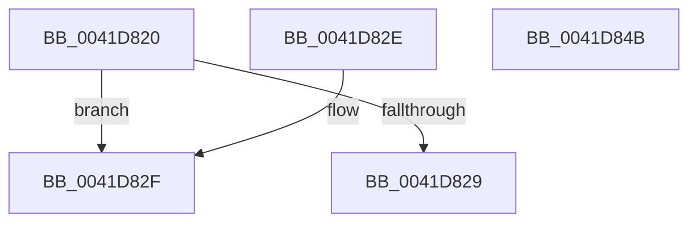

# KiIncrementConcurrencyCount

- RVA: `0x0041D820`–`0x0041D84C` (길이 `44` bytes)
- VA: `0x000000014041D820`
- 실행 섹션: `.text`
- PDB 이름 있음: `예`; PDB Function 태그: `아니요`
- unwind 정보 RVA: `0x000DB714`
- 디코드: `13`개 명령, `44/44` bytes 표시
- 미해석 바이트: `0` (있으면 어셈블리에 `.byte`로 보존)

> 이 문서는 커널 이미지의 기계어와 PDB 기호를 분석해 생성했습니다. 4번과 5번은 함수 원형과 자료형을 바이너리 사용 방식에서 추정한 C 해석이며 원본 소스 복구 결과는 아닙니다.

## 1. Dependencies

- 직접 호출 지점: **0**; 고유 호출 대상: **0**
- 직접 호출자로 확인된 함수: **1**
- RIP 상대 이미지 참조: **0**

### Outgoing calls
- 직접 디코드된 call 명령이 없습니다.

### Direct callers
- [KiCommitThreadWait](../20/KiCommitThreadWait_function_0020DFE0.md) at `0x0020E47A`

### Static image references
- 디코드된 RIP-relative 메모리 참조가 없습니다.

## 2. Other-region calls and transfers

- 다른 실행 섹션으로 향하는 call: **0**
- 별도 외부 분기/꼬리 이동을 확인하지 못했습니다.

## 3. Assembly (complete function range)

```asm
0041D820  0F B6 01                        movzx eax, byte ptr [rcx]
0041D823  24 7F                           and al, 0x7f
0041D825  3C 15                           cmp al, 0x15
0041D827  74 06                           je 0x14041d82f
0041D829  F0 FF 41 28                     lock inc dword ptr [rcx + 0x28]
0041D82D  C3                              ret
0041D82E  CC                              int3
0041D82F  81 A2 1C 02 00 00 FF 00 00 00   and dword ptr [rdx + 0x21c], 0xff
0041D839  8B 82 1C 02 00 00               mov eax, dword ptr [rdx + 0x21c]
0041D83F  48 8D 04 81                     lea rax, [rcx + rax*4]
0041D843  F0 FF 80 18 02 00 00            lock inc dword ptr [rax + 0x218]
0041D84A  C3                              ret
0041D84B  CC                              int3
```

## 4. C-style interpretation (structured pseudocode)

```c
__int64 __fastcall KiIncrementConcurrencyCount(__int64 a1, __int64 a2)
{
    __int64 result;

    result = (unsigned __int8)((*(unsigned __int8 *)(a1)) & (127));
    if (((unsigned __int8)(result)) == 21) goto loc_0041D82F;
    return result;
loc_0041D82F:
    return a1 + (unsigned int)(*(unsigned int *)(a2 + 540)) * 4;
}
```

## 5. (Beta) C Style

```c
int64_t KiIncrementConcurrencyCount(void *Arg1, void *Arg2)
{
    uint8_t *arg1 = (uint8_t *)Arg1;
    uint8_t *arg2 = (uint8_t *)Arg2;

    int64_t result;

    result = (uint8_t)((*(uint8_t *)(arg1)) & (127));
    if (((uint8_t)(result)) == 21) goto loc_0041D82F;
    return result;
loc_0041D82F:
    return Arg1 + (uint32_t)(*(uint32_t *)(arg2 + 0x21C)) * 4;
}
```

### 관측된 메모리 오프셋

구조체 형식이 확인되지 않은 접근은 인자 기준의 오프셋으로만 기록했습니다.

| 기준 인자 | 오프셋 표현 | 폭 (bit) | 접근 |
|---|---:|---:|---|
| `Arg1` | `+ 0x0` | `8` | `R` |
| `Arg1` | `+ 0x0 + rax*4` | `64` | `R` |
| `Arg1` | `+ 0x28` | `32` | `R/W` |
| `Arg1` | `+ 0x218` | `32` | `R/W` |
| `Arg2` | `+ 0x21C` | `32` | `R` |
| `Arg2` | `+ 0x21C` | `32` | `R/W` |

## 6. Execution-region graph

[열기: 2D/3D 그래프와 함수 탐색 컨트롤 패널](../../../control-panel.html?section=text&rva=0x0041D820&view=graph)

- 2D 그래프는 위에서 아래로 흐르고, 3D 그래프는 빈 공간을 드래그해 회전합니다. Shift+드래그는 이동, 휠은 확대·축소, 함수 노드 선택은 대상 보고서 이동입니다.

### Static fallback


