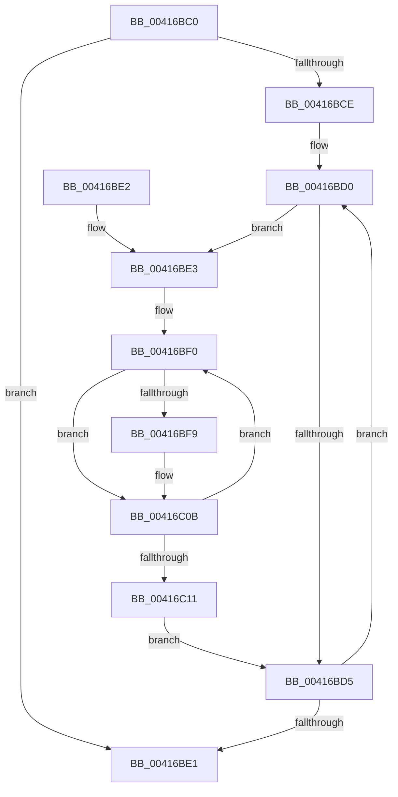

# KiInterlockedIncrementRankListMembersNoFence

- RVA: `0x00416BC0`–`0x00416C1C` (길이 `92` bytes)
- VA: `0x0000000140416BC0`
- 실행 섹션: `.text`
- PDB 이름 있음: `예`; PDB Function 태그: `아니요`
- unwind 정보 RVA: `0x000DB714`
- 디코드: `30`개 명령, `92/92` bytes 표시
- 미해석 바이트: `0` (있으면 어셈블리에 `.byte`로 보존)

> 이 문서는 커널 이미지의 기계어와 PDB 기호를 분석해 생성했습니다. 4번과 5번은 함수 원형과 자료형을 바이너리 사용 방식에서 추정한 C 해석이며 원본 소스 복구 결과는 아닙니다.

## 1. Dependencies

- 직접 호출 지점: **0**; 고유 호출 대상: **0**
- 직접 호출자로 확인된 함수: **2**
- RIP 상대 이미지 참조: **0**

### Outgoing calls
- 직접 디코드된 call 명령이 없습니다.

### Direct callers
- [KiUpdateThreadQosGroupingSummaries](../25/KiUpdateThreadQosGroupingSummaries_function_00257AEC.md) at `0x00257B80`
- [KiUpdateThreadQosGroupingSummaries](../25/KiUpdateThreadQosGroupingSummaries_function_00257AEC.md) at `0x00257B8F`
- [KiSetProcessorIdle](KiSetProcessorIdle_function_00416950.md) at `0x00416A63`
- [KiSetProcessorIdle](KiSetProcessorIdle_function_00416950.md) at `0x00416A7F`

### Static image references
- 디코드된 RIP-relative 메모리 참조가 없습니다.

## 2. Other-region calls and transfers

- 다른 실행 섹션으로 향하는 call: **0**
- 별도 외부 분기/꼬리 이동을 확인하지 못했습니다.

## 3. Assembly (complete function range)

```asm
00416BC0  45 32 D2                        xor r10b, r10b
00416BC3  4C 8B C2                        mov r8, rdx
00416BC6  4C 8B D9                        mov r11, rcx
00416BC9  48 85 D2                        test rdx, rdx
00416BCC  74 13                           je 0x140416be1
00416BCE  66 90                           nop
00416BD0  45 84 C0                        test r8b, r8b
00416BD3  75 0E                           jne 0x140416be3
00416BD5  41 FE C2                        inc r10b
00416BD8  49 C1 E8 08                     shr r8, 8
00416BDC  4D 85 C0                        test r8, r8
00416BDF  75 EF                           jne 0x140416bd0
00416BE1  C3                              ret
00416BE2  CC                              int3
00416BE3  45 33 C9                        xor r9d, r9d
00416BE6  32 C0                           xor al, al
00416BE8  0F 1F 84 00 00 00 00 00         nop dword ptr [rax + rax]
00416BF0  0F B6 D0                        movzx edx, al
00416BF3  49 0F A3 D0                     bt r8, rdx
00416BF7  73 12                           jae 0x140416c0b
00416BF9  8D 0C D5 00 00 00 00            lea ecx, [rdx*8]
00416C00  BA 01 00 00 00                  mov edx, 1
00416C05  48 D3 E2                        shl rdx, cl
00416C08  4C 03 CA                        add r9, rdx
00416C0B  FE C0                           inc al
00416C0D  3C 08                           cmp al, 8
00416C0F  72 DF                           jb 0x140416bf0
00416C11  41 0F B6 C2                     movzx eax, r10b
00416C15  F0 4D 01 0C C3                  lock add qword ptr [r11 + rax*8], r9
00416C1A  EB B9                           jmp 0x140416bd5
```

## 4. C-style interpretation (structured pseudocode)

```c
__int64 __fastcall KiInterlockedIncrementRankListMembersNoFence(__int64 a1, __int64 a2, __int64 a3, int a4)
{
    __int64 result;
    __int64 v_r10;

    v_r10 = 0;
    if (a2 == 0) goto loc_00416BE1;
loc_00416BD0:
    if ((unsigned __int8)(a2) != 0) goto loc_00416BE3;
loc_00416BD5:
    v_r10 = (unsigned __int8)((v_r10) + 1);
    a3 = (a2) >> (8);
    if (a3 != 0) goto loc_00416BD0;
loc_00416BE1:
    return result;
loc_00416BE3:
    a4 = 0;
    result = 0;
loc_00416BF0:
    if (!(condition_is_above_or_equal)) {
        a1 = 0 * 8;
        a2 = 1;
        a2 = (a2) << ((unsigned __int8)(a1));
        a4 = (a4) + (a2);
    }
    result = (unsigned __int8)((result) + 1);
    if (((unsigned __int8)(result)) < 8) goto loc_00416BF0;
    goto loc_00416BD5;
}
```

## 5. (Beta) C Style

```c
int64_t KiInterlockedIncrementRankListMembersNoFence(void *Arg1, int64_t Arg2, int64_t Arg3, int32_t Arg4)
{
    uint8_t *arg1 = (uint8_t *)Arg1;

    int64_t result;
    int64_t local_r10;

    local_r10 = 0;
    if (Arg2 == 0) goto loc_00416BE1;
loc_00416BD0:
    if ((uint8_t)(Arg2) != 0) goto loc_00416BE3;
loc_00416BD5:
    local_r10 = (uint8_t)((local_r10) + 1);
    Arg3 = (Arg2) >> (8);
    if (Arg3 != 0) goto loc_00416BD0;
loc_00416BE1:
    return result;
loc_00416BE3:
    Arg4 = 0;
    result = 0;
loc_00416BF0:
    if (!(condition_is_above_or_equal)) {
        Arg1 = 0 * 8;
        Arg2 = 1;
        Arg2 = (Arg2) << ((uint8_t)(Arg1));
        Arg4 = (Arg4) + (Arg2);
    }
    result = (uint8_t)((result) + 1);
    if (((uint8_t)(result)) < 8) goto loc_00416BF0;
    goto loc_00416BD5;
}
```

### 관측된 메모리 오프셋

구조체 형식이 확인되지 않은 접근은 인자 기준의 오프셋으로만 기록했습니다.

| 기준 인자 | 오프셋 표현 | 폭 (bit) | 접근 |
|---|---:|---:|---|
| `Arg1` | `+ 0x0 + rax*8` | `64` | `R/W` |

## 6. Execution-region graph

[열기: 2D/3D 그래프와 함수 탐색 컨트롤 패널](../../../control-panel.html?section=text&rva=0x00416BC0&view=graph)

- 2D 그래프는 위에서 아래로 흐르고, 3D 그래프는 빈 공간을 드래그해 회전합니다. Shift+드래그는 이동, 휠은 확대·축소, 함수 노드 선택은 대상 보고서 이동입니다.

### Static fallback


